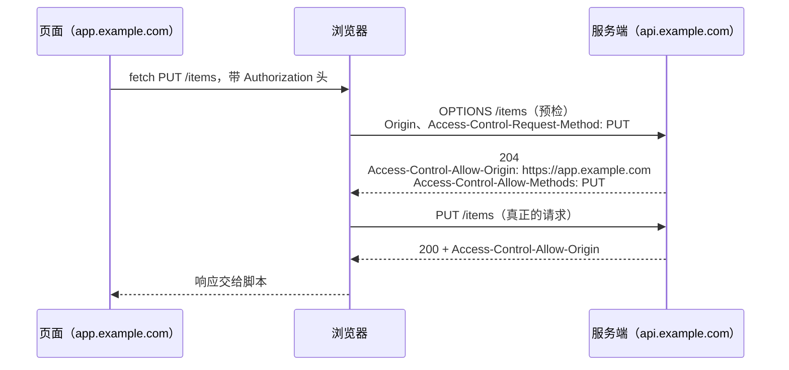

# CORS / CSP 与前端安全

前端开发者和浏览器安全机制打交道，最常见的场景是控制台里一行红字：「has been blocked by CORS policy」。于是去搜，加一行 `Access-Control-Allow-Origin: *`，问题消失，然后忘掉。这一章要扭转这个印象：CORS、CSP、cookie 的 SameSite 属性都是**浏览器替你挡攻击的机制**，理解它们在防什么，才知道怎么正确地配置，而不是一路关掉。贯穿的案例仍是 hatch-counter：它在生产环境不开 CORS、给页面挂了 CSP、把刷新令牌放进一个路径受限的 httpOnly cookie，每一个决定都在减少「出了 XSS 时能被偷走的东西」。

## 同源策略：一切的起点

**源**（origin）= 协议 + 主机 + 端口。`https://app.example.com` 和 `https://api.example.com` 是不同源，`http://localhost:5178` 和 `http://localhost:3000` 也是不同源。

**同源策略**规定：一个源的页面脚本，**不能读取**另一个源的响应。注意是「不能读」，而不是「不能发」：

| 动作 | 跨源时 |
|---|---|
| ``、`<script src>`、`<link href>` 加载资源 | 允许（这是 Web 的本性） |
| `<form>` 提交到另一个源 | 允许发送 |
| `fetch` / `XMLHttpRequest` 发请求 | 可以发出（简单请求），但**响应读不到** |
| 读另一个源 iframe 里的 DOM | 禁止 |

为什么要有这个限制？设想你登录了网银，然后打开一个恶意网站。如果没有同源策略，恶意网站的脚本可以 `fetch("https://bank.com/api/balance")`，浏览器会自动带上你的网银 cookie，脚本读到你的余额。同源策略保证了它读不到。

## CORS：有控制地放开读取

CORS（跨源资源共享）是服务端告诉浏览器「我允许哪些源读我的响应」的机制。**它是放宽限制，不是增加保护**。服务端什么都不配时最安全。

### 简单请求与预检



**简单请求**（GET / HEAD / POST，且只用少数几个标准头，Content-Type 只能是表单类型或 `text/plain`）直接发出，浏览器看响应头决定是否交给脚本。其他请求（PUT、DELETE、带 `Authorization` 头、`Content-Type: application/json`）要先发一个 `OPTIONS` **预检**，服务端同意了才发真正的请求。现代 API 几乎都用 JSON，所以几乎每个跨源请求都有预检，多一个往返。

### 响应头

| 头 | 含义 |
|---|---|
| `Access-Control-Allow-Origin` | 允许的源。`*` 或一个具体的源，不能写多个 |
| `Access-Control-Allow-Credentials: true` | 允许带 cookie。此时 Allow-Origin **不能是 `*`** |
| `Access-Control-Allow-Methods` / `-Headers` | 预检里允许的方法和请求头 |
| `Access-Control-Expose-Headers` | 允许脚本读取的**响应头**；默认只能读少数几个安全头 |
| `Access-Control-Max-Age` | 预检结果缓存多久 |

最后一个容易被忽视的是 `Expose-Headers`。hatch-counter 服务端在开发环境开 CORS 时专门列了几个版本号相关的头，注释说「不然浏览器里的移动端调试读不到它们」：请求成功了，但 `response.headers.get("x-xxx")` 返回 `null`，这种问题非常难查。

### 最好的 CORS 配置是不需要 CORS

hatch-counter 的做法是让**页面和接口同源**：

- 开发时：Vite 开发服务器把 `/v1` 代理到本机 3000 端口的 NestJS（第 4 章）
- 生产时：nginx 在网页端的域名下托管静态文件，同时把 `/v1/` 反代到服务端

浏览器眼里只有一个源，CORS 根本不发生。收益是实在的：没有预检往返、cookie 是第一方的、不用担心配错 Allow-Origin。服务端代码里的 CORS 只在非生产环境打开（给 Expo Web 调试用），注释写着「生产不放开……别图省事留一个 `origin: true` 在线上」：

```ts
if (cfg.NODE_ENV !== "production") {
  app.enableCors({
    origin: true,        // 反射请求的 Origin，等于对所有源开放
    credentials: true,
    exposedHeaders: [/* 版本号相关的几个头 */],
  });
}
```

`origin: true` 加 `credentials: true` 在生产环境是严重漏洞：任何网站都能以登录用户的身份读你的接口。真需要跨源时，用明确的白名单。

## Cookie 与 CSRF

同源策略防的是「读」，没防「发」。**CSRF**（跨站请求伪造）利用的正是这一点：恶意网站放一个自动提交的表单，目标是 `https://bank.com/transfer`，浏览器会带上你的 cookie 发出去。攻击者读不到响应，但转账已经发生了。

### SameSite

cookie 的 `SameSite` 属性控制跨站请求是否携带它：

| 值 | 跨站请求带不带 |
|---|---|
| `Strict` | 一律不带，连从别的网站点链接过来都不带 |
| `Lax` | 只在顶层导航的 GET（点链接）时带；跨站表单 POST、fetch、iframe 不带。现代浏览器的默认值 |
| `None` | 都带，必须同时设 `Secure` |

注意「站」（site）和「源」不同：站大致是「可注册域名」，`app.example.com` 和 `api.example.com` 同站不同源。

### hatch-counter 的令牌布局

hatch-counter 网页端的两种令牌放在两个不同的地方，这是一个值得借鉴的设计：

| 令牌 | 寿命 | 放在哪 | 页面脚本能读吗 |
|---|---|---|---|
| 访问令牌 | 默认 15 分钟 | 页面内存，请求时放 `Authorization: Bearer` 头 | 能（但刷新就没了） |
| 刷新令牌 | 默认 30 天，每次续期轮换 | cookie：`HttpOnly; SameSite=Strict; Path=/v1/auth`，生产加 `Secure` | 不能 |

每个属性都有用意：

- `HttpOnly`：页面脚本读不到。即使出了 XSS，攻击者也偷不走这张 30 天的票
- `Path=/v1/auth`：只在续期、退出那几条接口上带，业务接口一条都看不见它
- `SameSite=Strict`：跨站请求带不上，CSRF 无从发起
- 访问令牌只在内存里，不进 `localStorage`：XSS 能偷走的最多是一张十几分钟后就过期的票

服务端文档里写明了为什么不另加 CSRF 令牌：cookie 只开放给 `/v1/auth` 那几条、跨站带不上，续期的回包对方也读不到。**用 cookie 属性组合消除攻击面，比事后加防护更可靠**。

## XSS：前端安全的头号问题

**XSS**（跨站脚本）是攻击者设法让自己的脚本在你的页面里运行。一旦得手，同源策略、CORS、SameSite 统统失效：攻击者的脚本就在你的源里，能读 DOM、能以用户身份发请求。

### React 替你挡了大部分

React 渲染文本时会自动转义，`<div>{userInput}</div>` 里的 `<script>` 只会显示成文字。React 里出 XSS 基本只有这几个口子：

| 口子 | 例子 |
|---|---|
| `dangerouslySetInnerHTML` | 渲染用户提供的富文本、Markdown 转出的 HTML |
| `javascript:` URL | `<a href={userUrl}>`，userUrl 是 `javascript:alert(1)` |
| 直接操作 DOM | `el.innerHTML = ...` |
| 第三方脚本 | 被篡改的 npm 包、CDN 上的统计脚本 |

对应的做法：必须渲染 HTML 时先用 DOMPurify 这类库净化；用户给的 URL 校验协议只允许 `http:` / `https:`；能不用第三方脚本就不用。hatch-counter 的 `index.html` 里拼 HTML 字符串时，对 `location.host` 做了 `replace(/[<>&"]/g, "")`，就是在一个手写 HTML 的地方顺手堵上注入。

## CSP：XSS 的最后一道防线

**CSP**（内容安全策略）告诉浏览器：这个页面只允许从哪些地方加载脚本、样式、图片，连接哪些服务器。即使攻击者成功注入了一段 `<script>`，只要它不在白名单里，浏览器就拒绝执行。

### hatch-counter 的 CSP

hatch-counter 在构建时由一个 Vite 插件生成 CSP（第 4 章），产物 `index.html` 里是这样一条：

```html
<meta http-equiv="Content-Security-Policy" content="default-src 'self'; script-src 'self' 'sha256-…' 'sha256-…'; style-src 'self' 'unsafe-inline'; img-src 'self' data: blob:; font-src 'self' data:; connect-src 'self'; frame-src 'self'; manifest-src 'self'; object-src 'none'; base-uri 'self'" />
```

逐条看：

| 指令 | 值 | 含义 |
|---|---|---|
| `default-src` | `'self'` | 没单独列出的资源类型，只允许同源 |
| `script-src` | `'self'` + 两个哈希 | 只执行同源的脚本文件，以及内容哈希匹配的两段内联脚本 |
| `style-src` | `'self' 'unsafe-inline'` | 允许内联样式（Radix 定位、动画会写 `style` 属性） |
| `img-src` | `'self' data: blob:` | 允许同源图片、data URL、本地生成的 blob（拍照预览） |
| `connect-src` | `'self'` | `fetch` / WebSocket / EventSource 只能连同源。即使被注入脚本，数据也发不出去 |
| `object-src` | `'none'` | 禁止 `<object>` / `<embed>` 等插件 |
| `base-uri` | `'self'` | 防止注入 `<base>` 标签改写所有相对 URL |

`connect-src 'self'` 是同源架构的又一个红利：页面只需要和自己的源通信，于是可以把出口封得很死。

### 内联脚本的哈希

`index.html` 里那两段阻塞内联脚本（浏览器版本检测、主题首帧）是 CSP 的难点：放开 `'unsafe-inline'` 等于让所有注入的内联脚本都能跑，CSP 就形同虚设。插件的做法是在构建的最后一步，算出每段内联脚本内容的 SHA-256，写进 `script-src`：

```ts
const hashes = [...html.matchAll(/<script>([\s\S]*?)<\/script>/g)].map(
  (m) => `'sha256-${createHash("sha256").update(m[1]).digest("base64")}'`,
);
```

只有内容一字不差的脚本才能执行，攻击者注入的脚本哈希对不上。因为在构建时自动算，改了内联脚本也不用手动更新 CSP。

### meta 标签的局限

用 `<meta>` 挂 CSP 不需要动服务器配置，但有几个限制：

- 只对 meta 标签**之后**的内容生效，所以插件把它插在 `charset` 紧后、内联脚本之前，并且找不到插入点时直接让构建失败
- 不支持 `frame-ancestors`（防止被别人用 iframe 嵌套，即点击劫持）、`report-uri` / `report-to`、`sandbox`

hatch-counter 用 nginx 补上了防嵌套：每个 location 都加了 `X-Frame-Options: SAMEORIGIN`（nginx 的 `add_header` 写在 location 里就不继承 server 层的，所以每处都要写一遍）。如果能控制服务器，通过 HTTP 响应头下发 CSP 更完整，可以用 `frame-ancestors 'self'` 代替 `X-Frame-Options`。

### 上线 CSP 的步骤

1. 先用 `Content-Security-Policy-Report-Only` 头（只能通过 HTTP 头，不能用 meta）只报告不拦截，观察一段时间
2. 控制台里看违规报告，补全白名单（字体、图片 CDN、第三方 SDK）
3. 切换为正式的 `Content-Security-Policy`
4. **开发环境不挂**：Vite 的 HMR 要注入自己的内联脚本，hatch-counter 的插件 `apply: "build"` 正是这个原因

## 其他安全头

| 头 | 作用 | 建议值 |
|---|---|---|
| `Strict-Transport-Security` | 强制以后只用 HTTPS 访问 | 确认全站 HTTPS 后再加 |
| `X-Content-Type-Options` | 禁止浏览器猜测 MIME 类型 | `nosniff` |
| `Referrer-Policy` | 跳转时带多少来源信息 | `strict-origin-when-cross-origin` |
| `Permissions-Policy` | 禁用不需要的浏览器能力 | 如关掉 `geolocation`、`microphone` |
| `X-Frame-Options` | 防止被 iframe 嵌套 | `SAMEORIGIN` 或 `DENY` |

这些头在 nginx 层统一加最方便，具体写法见[《Nginx 与反向代理》](../nginx-gateway/)。

## 前端安全清单

- [ ] 页面和接口同源，生产不开 CORS；必须跨源时用明确白名单，不用 `origin: true` 加 credentials
- [ ] 长期凭据放 `HttpOnly; Secure; SameSite` 的 cookie，路径尽量收窄；短期令牌放内存
- [ ] `localStorage` 里不放任何令牌
- [ ] 不用 `dangerouslySetInnerHTML`，必须用时先净化；用户提供的 URL 校验协议
- [ ] 生产环境有 CSP，`script-src` 不含 `'unsafe-inline'`，内联脚本用哈希
- [ ] `connect-src` 收紧到实际需要的源
- [ ] 防 iframe 嵌套（`frame-ancestors` 或 `X-Frame-Options`）
- [ ] 前端包里没有密钥（`VITE_` 变量都是公开的）
- [ ] 依赖锁定版本，定期审计，少用第三方脚本

## 本章要点

- 同源策略限制的是跨源**读取**，不是发送；CORS 是服务端主动放宽读取，不是保护
- 带 credentials 时 Allow-Origin 不能是 `*`；自定义响应头要 `Expose-Headers` 才读得到
- 最好的 CORS 配置是同源架构：开发用代理，生产用反向代理
- CSRF 利用「能发不能读」，`SameSite`、窄 `Path` 的 cookie 从根上消除它
- XSS 一旦得手其他防线全部失效；React 自动转义，危险口子集中在 `dangerouslySetInnerHTML` 和 URL
- CSP 是 XSS 的最后防线；内联脚本用构建时计算的哈希放行，开发环境不挂
- meta 方式的 CSP 不支持 `frame-ancestors`，用响应头补上

前端工程这一侧到这里讲完了。往下读有两个方向：想弄清 React 本身怎么渲染、为什么重渲染、并发特性和 Compiler 怎么帮你优化，读[《React 19 原理与模式》](../react-internals/)；想把本章的安全话题扩展到认证方案、OWASP Top 10 和供应链安全，读[《应用安全》](../app-security/)。
