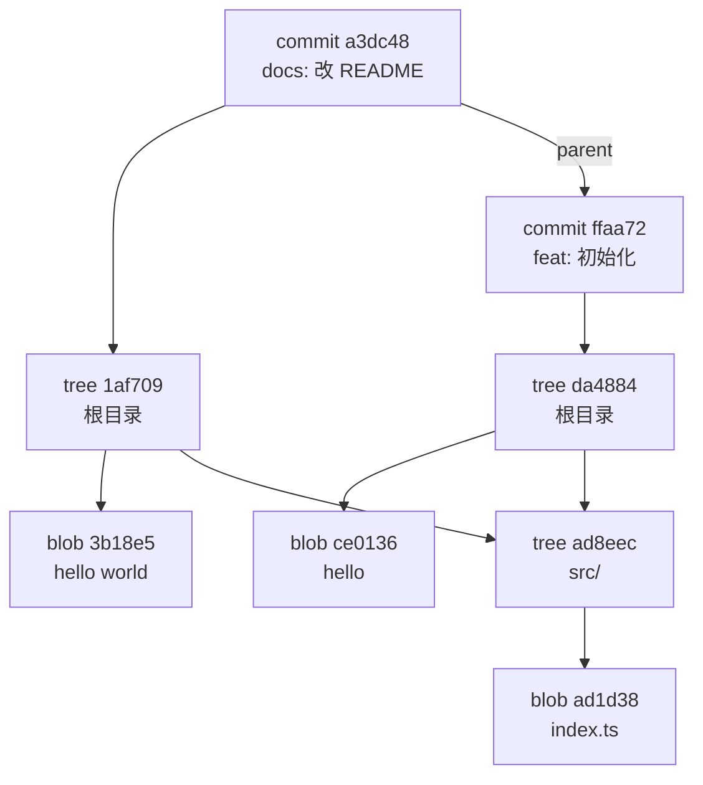

# 对象模型：blob、tree、commit、tag

大多数人用 Git 的方式是记命令：`add`、`commit`、`push`、`rebase -i`，出了问题再搜一条新命令。这样能用很多年，但每次遇到没见过的情况都会心慌，因为不知道命令底下发生了什么，也就判断不了「这一步能不能撤回」。

这一章把 Git 拆到最底层。Git 的核心只是一个**按内容寻址的对象数据库**，加上一组指向对象的**名字**（引用）。对象只有四种：blob、tree、commit、tag。理解了这四种对象，后面几章讲的变基、救援、过滤历史、部分克隆，全都可以还原成「新建了哪些对象、哪个名字改指向了哪里」。

## 一个空目录里的实验

最好的学法是亲手看。在一个临时目录里建仓库，固定作者和时间，这样你算出来的哈希和书里一致：

```bash
mkdir /tmp/git-lab && cd /tmp/git-lab
git init -q -b main
export GIT_AUTHOR_NAME=jarvis GIT_AUTHOR_EMAIL=jarvis@example.com
export GIT_COMMITTER_NAME=jarvis GIT_COMMITTER_EMAIL=jarvis@example.com
export GIT_AUTHOR_DATE='2026-11-04T10:00:00+08:00'
export GIT_COMMITTER_DATE='2026-11-04T10:00:00+08:00'

mkdir src
echo 'hello' > README.md
echo 'export const x = 1;' > src/index.ts
git add .
git commit -qm 'feat: 初始化'
```

现在看 `.git/objects` 下多了什么：

```bash
find .git/objects -type f | sort
```

```text
.git/objects/ad/1d380d6cc4dfe69119852d461b7ccd89a19228
.git/objects/ad/8eeca4eb250ab34f65d18a672787a97b063e93
.git/objects/ce/013625030ba8dba906f756967f9e9ca394464a
.git/objects/da/4884211e682a885dff63def4e7997e52fa0dde
.git/objects/ff/aa72e8d3fa4fbd810ee78e88ffa42881fa9fa8
```

两个文件、一个子目录、一次提交，产生了五个对象。下面逐个认识它们。

## blob：只有内容，没有名字

`ce0136...` 是 `README.md` 的内容。验证一下：

```bash
echo 'hello' | git hash-object --stdin
# ce013625030ba8dba906f756967f9e9ca394464a

printf 'blob 6\0hello\n' | shasum
# ce013625030ba8dba906f756967f9e9ca394464a  -
```

对象的 ID 就是「类型 + 空格 + 字节数 + `\0` + 内容」的 SHA-1。磁盘上的文件是这段字节经过 zlib 压缩的结果，用 Python 解压可以看到原样：

```bash
python3 -c "import zlib;print(zlib.decompress(open('.git/objects/ce/013625030ba8dba906f756967f9e9ca394464a','rb').read()))"
# b'blob 6\x00hello\n'
```

几个推论，后面会反复用到：

- **blob 里没有文件名、没有权限、没有时间**。两个不同路径、内容相同的文件，在仓库里只存一份。hatch-shelf 里每本书的 `cover.png` 和 `design/covers/<id>.png` 是同一张图，所以历史里只有一份 blob
- **内容变了就是一个新对象**。改一个字节，整个文件存一份新的。Git 不存「差异」，存的是快照；差异是对比两个快照临时算出来的
- **ID 由内容决定**，所以对象天然不可变。你无法「修改」一个提交，只能造一个新提交，再让名字指过去。这一点是理解历史改写的钥匙

> [!NOTE]
> 「每次存完整快照」听起来浪费，实际上 `git gc` 会把松散对象打进 pack 文件，相似的对象之间用增量压缩存储。快照是逻辑模型，增量是存储优化，两者不矛盾。第 8 章讲大仓库时会看到它的边界：PNG 这类已经压缩过的二进制，增量几乎省不下空间。

## tree：目录快照

`da4884...` 是根目录：

```bash
git cat-file -p 'HEAD^{tree}'
```

```text
100644 blob ce013625030ba8dba906f756967f9e9ca394464a	README.md
040000 tree ad8eeca4eb250ab34f65d18a672787a97b063e93	src
```

tree 的每一行是「模式、类型、对象 ID、名字」。文件名和权限存在这里，而不在 blob 里。子目录是另一个 tree，`src` 指向的 `ad8eec...` 里只有一行 `index.ts`。

模式只有寥寥几种：`100644` 普通文件、`100755` 可执行文件、`120000` 符号链接、`040000` 目录、`160000` 子模块（指向另一个仓库的提交）。Git 不记录其他权限位，所以 `chmod 600` 不会出现在 diff 里，而 `chmod +x` 会。

> [!TIP]
> 在 macOS 上给脚本加了可执行权限却忘了提交，到 Linux 的 CI 上就会 `Permission denied`。`git ls-files -s scripts/` 能直接看到仓库里记录的模式，比看本地文件权限可靠。

## commit：快照加上来历

```bash
git cat-file -p HEAD
```

```text
tree da4884211e682a885dff63def4e7997e52fa0dde
author jarvis <jarvis@example.com> 1793757600 +0800
committer jarvis <jarvis@example.com> 1793757600 +0800

feat: 初始化
```

一个提交对象只有这些东西：

| 字段 | 含义 |
|---|---|
| `tree` | 这次提交时整个项目的根目录快照 |
| `parent` | 上一个提交，第一个提交没有；合并提交有两个或更多 |
| `author` | 谁写的这份改动，什么时候写的 |
| `committer` | 谁把它变成提交的，什么时候；变基、cherry-pick 后会和 author 不同 |
| 消息 | 空行之后的全部文本 |
| `gpgsig` | 可选，签名（第 9 章） |

再改一次 README，提交，看第二个提交：

```bash
export GIT_AUTHOR_DATE='2026-11-04T10:05:00+08:00' GIT_COMMITTER_DATE='2026-11-04T10:05:00+08:00'
echo 'hello world' > README.md
git commit -qam 'docs: 改 README'
git cat-file -p HEAD
git cat-file -p 'HEAD^{tree}'
```

```text
tree 1af70982e5b5290bf954f70a3d313528040f4941
parent ffaa72e8d3fa4fbd810ee78e88ffa42881fa9fa8
author jarvis <jarvis@example.com> 1793757900 +0800
committer jarvis <jarvis@example.com> 1793757900 +0800

docs: 改 README
100644 blob 3b18e512dba79e4c8300dd08aeb37f8e728b8dad	README.md
040000 tree ad8eeca4eb250ab34f65d18a672787a97b063e93	src
```

注意 `src` 还是 `ad8eec...`：没变的子目录直接复用旧 tree。改一个文件只会新建这个文件的 blob，以及从它到根目录这一路上的 tree，其余全部共享。一个几万文件的仓库，每次提交新增的对象也只有十几个。

四种对象的关系画出来是这样：



### 提交 ID 为什么「一动全动」

commit 的 ID 是它全部内容的哈希，内容里包括 `parent`。所以：

- 改了某个提交的消息，它的 ID 变了
- 它的子提交里的 `parent` 字段要指向新 ID，于是子提交的 ID 也变了
- 一路传到分支末端，后面所有提交全部换新

这就是「变基会改写历史」的确切含义：不是改了旧提交，而是**造了一串内容相似、ID 全新的提交**，旧的那串还在对象库里，只是没有名字指着它。第 4 章的救援全部建立在这个事实上。

反过来，这条链也是 Git 的完整性保证：只要你信任最新那个提交的 ID，就能确认它之前的所有历史、所有文件一个字节都没被动过。签名（第 9 章）只需要签最末端的那个提交或 tag，就覆盖了全部历史。

### author 和 committer 的区别

两者平时一样，在这些场景下会分开：

- `git rebase`、`git cherry-pick`、`git commit --amend`：author 保留原来的，committer 变成现在的你和现在的时间
- 用 `git am` 应用别人邮件里的补丁：author 是对方，committer 是你

`git log` 默认显示 author 时间，所以变基后的提交「日期」看起来还是很早，实际是今天才生成的。想看真实生成时间用 `git log --format='%h %cd %s'`。

## tag：给对象起一个带说明的名字

标签分两种。轻量标签只是一个引用（下一章讲），不产生对象；附注标签（`-a`）会生成一个 tag 对象：

```bash
git tag -a v0.1.0 -m 'v0.1.0' HEAD~1
git cat-file -p v0.1.0
```

```text
object ffaa72e8d3fa4fbd810ee78e88ffa42881fa9fa8
type commit
tag v0.1.0
tagger jarvis <jarvis@example.com> 1793757900 +0800

v0.1.0
```

tag 对象记录了打标签的人、时间和说明，还可以带签名。发版用附注标签：`git describe` 默认只认附注标签，许多发版工具也以它为准。hatch-shelf 的 `v1.0.0` 到 `v1.0.3` 都是由 TestFlight 脚本打的；版本号以 tag 为唯一真相的理由，见[《部署与 CI/CD》的版本号一章](../deploy-release/06-versioning-changelog.md#tag-是唯一的真相)。

## 暂存区：第五个角色

对象库之外还有一个经常被忽略的文件：`.git/index`，也就是暂存区。它是一张平铺的表，记录「下一次提交时每个路径对应哪个 blob」：

```bash
git ls-files -s
```

```text
100644 3b18e512dba79e4c8300dd08aeb37f8e728b8dad 0	README.md
100644 ad1d380d6cc4dfe69119852d461b7ccd89a19228 0	src/index.ts
```

于是三个区域的关系很清楚：

| 区域 | 存在哪 | 是什么 |
|---|---|---|
| 工作区 | 你的目录 | 普通文件，随便改 |
| 暂存区 | `.git/index` | 路径 → blob 的表，下一次提交的草稿 |
| 仓库 | `.git/objects` | 不可变的对象 |

`git add` 做两件事：把文件内容写成 blob 存进对象库，然后在 index 里更新这一行。所以**一旦 `add` 过，内容就已经进了对象库**，哪怕之后没有提交、哪怕你又 `git reset` 了。第 4 章会用到这一点找回「add 了但没提交就被覆盖」的文件。

`git commit` 则是把 index 转成一棵棵 tree，加上 parent 和消息生成 commit，再把当前分支挪到新提交上。index 中第三列的 `0` 是「阶段号」，合并冲突时同一路径会有 1、2、3 三行，分别是共同祖先、我方、对方的版本，第 3 章会看到。

## 底层命令：直接操作对象

Git 的命令分两层：日常用的「瓷器」命令（porcelain），和直接操作对象的「管道」命令（plumbing）。管道命令的输出格式稳定，适合写脚本：

| 命令 | 作用 |
|---|---|
| `git cat-file -t / -s / -p <obj>` | 看对象类型、大小、内容 |
| `git hash-object -w <file>` | 把文件写成 blob |
| `git ls-tree -r -l <tree>` | 递归列出 tree，带大小 |
| `git rev-parse <名字>` | 把任何名字解析成对象 ID |
| `git rev-list` | 按条件列出提交，`--objects` 时连同所有对象 |
| `git for-each-ref` | 遍历引用，格式可定制 |

一个实际用途：找出仓库历史里最大的文件。这条命令在第 8 章分析 hatch-shelf 的仓库体积时会用到：

```bash
git rev-list --objects --all \
  | git cat-file --batch-check='%(objecttype) %(objectname) %(objectsize) %(rest)' \
  | awk '$1 == "blob"' \
  | sort -k3 -n -r \
  | head -10
```

## SHA-1 与 SHA-256

> [!WARNING]
> 本节关于 Git 默认哈希算法和 Git 3.0 计划的描述，按写作时（2026 年 11 月）的情况整理，以 git-scm.com 的发布说明和 `Documentation/BreakingChanges` 为准。

SHA-1 在 2017 年已经被构造出碰撞。Git 从 2.13 起使用带碰撞检测的 SHA-1 实现（SHA-1DC），能识别已知的碰撞构造手法，所以日常使用仍然安全。同时 Git 早就支持 SHA-256 格式的仓库：

```bash
git init --object-format=sha256 repo256
git -C repo256 rev-parse --show-object-format   # sha256
```

社区计划在 Git 3.0 把新仓库的默认算法切到 SHA-256。对你的影响主要在托管平台：两种格式的仓库之间不能直接推拉，平台是否支持 SHA-256 仓库要先确认。现有仓库没有必要迁移。

## 用对象模型回答几个常见问题

**为什么 `git mv` 后历史「断了」？** Git 不记录重命名。tree 里只是旧路径消失、新路径出现，指向同一个或相似的 blob。`git log --follow`、`git diff -M` 是在显示时按内容相似度**推断**重命名。改名和大改内容放在同一个提交里，相似度跌破阈值（默认 50%），推断就失败。所以：改名单独提交。

**为什么 `.gitignore` 对已经跟踪的文件无效？** 忽略规则只决定「未跟踪的文件要不要出现在 `git status` 里」。文件已经在 index 里了，就会一直被跟踪，要先 `git rm --cached` 把它从 index 去掉。

**为什么删了文件仓库还是那么大？** 删除只是让新的 tree 不再引用那个 blob，旧提交的 tree 仍然引用它。要真正去掉，只能重写所有引用它的提交（第 4 章、第 9 章）。

**为什么空目录提交不了？** tree 记录的是「名字 → 对象」，一个没有任何文件的目录不会产生条目。惯例是放一个 `.gitkeep`。

## 本章要点

- Git 是按内容寻址的对象库，对象只有 blob、tree、commit、tag 四种，ID 是内容的哈希，所以对象不可变
- blob 只有内容；文件名和模式在 tree 里；commit 指向一个根 tree 和若干 parent
- 「改写历史」是造新提交、挪名字，旧提交仍在对象库里，这是一切救援的基础
- 暂存区是路径到 blob 的表；`git add` 过的内容已经进了对象库
- 改名和大改分开提交；删文件不会让仓库变小
- `cat-file`、`ls-tree`、`rev-list` 这几个管道命令足够你看清任何仓库的内部

## 动手练习

1. **手算 blob ID**：不借助 `git hash-object`，只用 `printf` 和 `shasum` 算出内容为 `hello world` 加换行的 blob ID，再和本章第二个提交里 `README.md` 的 blob 对照。

   验证：输出是 `3b18e512dba79e4c8300dd08aeb37f8e728b8dad`，与 `git cat-file -p 'HEAD^{tree}'` 里 README.md 那一行一致。

   参考答案：头部字节数要算上末尾换行，`hello world\n` 是 12 字节：

   ```bash
   printf 'blob 12\0hello world\n' | shasum
   ```

2. **add 过就进了对象库**：在新仓库里 `echo 'draft v1' > notes.md && git add notes.md`，再把文件改成 `draft v2`、重新 add 并提交。不翻工作区，把 `draft v1` 找回来。

   验证：`git fsck --dangling` 列出一个 `dangling blob`，`git cat-file -p <该 ID>` 输出 `draft v1`。

   参考答案：第一次 add 已经把 v1 写成 blob；第二次 add 只是让 index 改指 v2 的 blob，v1 成了没人引用的悬空对象，在被 gc 清理前都能取回。也可以用 `echo 'draft v1' | git hash-object --stdin` 先算出 ID 再 `cat-file`。

3. **哪些权限位会进仓库**：提交一个普通文件后，先 `chmod 600` 再看 `git status --short`，然后 `chmod +x` 再看一次。

   验证：`chmod 600` 后没有任何输出；`chmod +x` 后出现 ` M`，`git diff` 显示 `old mode 100644` / `new mode 100755`。

   参考答案：tree 里的文件模式只有 100644 和 100755 两种，Git 只关心可执行位，其余权限位不记录（前提是 `core.fileMode` 为默认的 true）。
