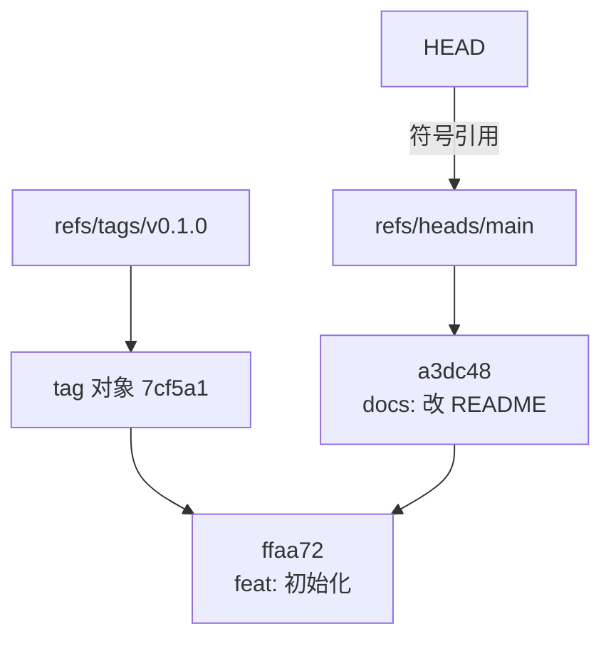

# 引用、分支与 HEAD

上一章的对象库里，每个对象都只有一串四十位的十六进制 ID。人记不住这些，于是 Git 给提交起名字，名字就是**引用**（ref）。分支、标签、远程跟踪分支、`HEAD`、`stash`，全都是引用。

对象不可变、引用随时在变，Git 的几乎所有日常操作，归根结底都是「新建一些对象，然后挪动某个引用」。这一章讲清楚有哪些引用、它们存在哪、怎么写一个提交的名字，以及 `reset`、`switch`、`push --force` 分别动了哪个引用。

## 分支只是一个文件

接着上一章的实验仓库：

```bash
cat .git/HEAD
# ref: refs/heads/main

cat .git/refs/heads/main
# a3dc48fa97fafa1d0f8525011ffe65eee22f0c3f
```

`main` 分支就是 `.git/refs/heads/main` 这个文件，内容是一个提交 ID，四十个字符加换行。创建分支就是新建一个这样的文件，所以 Git 的分支几乎零成本，几千个分支也不会让仓库变慢多少。

`HEAD` 则是一个**符号引用**：它通常不直接存提交 ID，而是存「我指向 `refs/heads/main`」。提交时 Git 顺着 `HEAD` 找到当前分支，把分支文件的内容换成新提交的 ID。`HEAD` 本身没动，它仍然指向 `main`，是 `main` 往前走了一步。



### 引用的命名空间

| 路径 | 是什么 | 谁会改它 |
|---|---|---|
| `refs/heads/*` | 本地分支 | 你：commit、reset、merge、rebase |
| `refs/tags/*` | 标签 | 你：`git tag`；约定上打了就不再动 |
| `refs/remotes/<远程>/*` | 远程跟踪分支，上次 fetch 时远程分支的位置 | 只有 fetch / push |
| `refs/stash` | stash 栈顶 | `git stash` |
| `HEAD` | 当前所在位置 | checkout / switch |
| `ORIG_HEAD` | 危险操作之前 HEAD 在哪 | reset、merge、rebase 自动写入 |
| `FETCH_HEAD` | 上次 fetch 拿到了什么 | fetch |
| `MERGE_HEAD`、`REBASE_HEAD` | 正在进行中的合并 / 变基的对方 | 合并、变基过程中存在，结束后删除 |

`ORIG_HEAD` 值得单独记住：`git reset --hard` 或者一次变基之后发现不对，`git reset --hard ORIG_HEAD` 往往一步就能回去。它只保存最近一次，更久远的要靠第 4 章的 reflog。

### packed-refs 与 reftable

> [!WARNING]
> reftable 的引入版本和 Git 3.0 的默认值计划按 2026 年 11 月 git-scm.com 的 `BreakingChanges` 文档整理：写作时最新版是 Git 2.56，Git 3.0 **还没有确定的发布日期**。以 git-scm.com 的发布说明为准。

引用多了以后，一个文件一个引用会很慢，`git gc` 会把它们收进 `.git/packed-refs` 这一个文本文件。所以**不要直接读 `.git/refs/` 下的文件来判断分支在哪**，读不到不代表不存在。脚本里一律用管道命令：

```bash
git rev-parse refs/heads/main
git for-each-ref --format='%(refname:short) %(objectname:short) %(committerdate:relative)' refs/heads
```

Git 2.45 起还支持一种新的引用存储后端 reftable（`git init --ref-format=reftable`），把引用存成二进制的块文件，解决了大量引用下的性能问题和大小写不敏感文件系统上的冲突。Git 3.0 计划把它设为新仓库的默认格式，前提是 JGit、libgit2 这些其他实现也支持它；想提前用的话，可以设置 `init.defaultRefFormat`。只要你用的是 `rev-parse`、`for-each-ref` 这些命令，存储格式换了也不受影响。

## 分离的 HEAD

`HEAD` 也可以直接存一个提交 ID，这叫**分离 HEAD**（detached HEAD）：

```bash
git switch --detach v0.1.0
cat .git/HEAD
# ffaa72e
```

在这个状态下照常可以提交，新提交的 parent 是当前位置，`HEAD` 跟着往前走。问题在于**没有任何分支指着这些新提交**。一旦你 `git switch main` 离开，它们就成了无名提交，只能靠 reflog 找回，并在过期后被垃圾回收。

分离 HEAD 不是错误状态，`git bisect`、`git rebase` 的过程中、CI 检出某个提交时都处于分离 HEAD。只要记住一条：**想保留在分离 HEAD 下做的提交，离开前先 `git switch -c <新分支名>`**。

## 怎么写一个提交的名字

几乎所有 Git 命令接受「修订」（revision）参数，语法比大多数人用到的丰富得多。完整定义在 `git help revisions`，常用的是这些：

| 写法 | 含义 |
|---|---|
| `HEAD~3` | 沿第一个 parent 往回 3 步 |
| `HEAD^2` | 合并提交的第二个 parent（被合进来的那条线） |
| `main@{u}` | `main` 的上游，通常是 `origin/main` |
| `@` | `HEAD` 的简写 |
| `@{-1}` | 上一个检出的分支，`git switch -` 就用它 |
| `main@{2.days.ago}` | 两天前 `main` 指向的提交，来自本地 reflog |
| `HEAD@{5}` | HEAD 往前第 5 次移动的位置 |
| `v1.0.3^{tree}` | 这个标签指向的提交的根 tree |
| `:/Tab 栏` | 最近一个消息匹配这个正则的提交；`(` 等是正则元字符，`:/fix(app)` 会找不到 |
| `HEAD:app/package.json` | 当前提交里这个文件的 blob |

最后一个很实用，不切分支就能看任意版本的文件：

```bash
git show v1.0.2:app/package.json | grep '"version"'
git diff v1.0.2 v1.0.3 -- app/app.json
```

### 两个点和三个点

区间语法是用错最多的地方，而且在 `log` 和 `diff` 里含义不同：

| 写法 | 在 `git log` 里 | 在 `git diff` 里 |
|---|---|---|
| `A..B` | B 能到达、A 到达不了的提交，即「B 比 A 多出的提交」 | 等同于 `A B`，两个快照直接比 |
| `A...B` | A、B 各自独有的提交（对称差） | 从共同祖先到 B 的改动，即「B 这边做了什么」 |

日常最常用的三条：

```bash
git log --oneline origin/main..HEAD   # 我有、远程还没有：即将推送的提交
git log --oneline HEAD..origin/main   # 远程有、我还没有：fetch 之后要合进来的
git diff main...feat/listen           # 这个分支自分出来以后改了什么，不受 main 后来变化的干扰
```

GitHub PR 的「Files changed」就是三个点的 diff。

## 远程跟踪分支与 fetch

`origin/main` 不是远程仓库里的分支本身，而是**你本地的一份记录**：上次和远程通信时，对方的 `main` 在哪。它只在 `fetch`、`pull`、`push` 时更新。所以 `git status` 里的「Your branch is up to date with 'origin/main'」意思是「和我上次看到的一致」，不保证远程现在没有新提交。

fetch 的行为由 refspec 决定，在 `.git/config` 里：

```ini
[remote "origin"]
	url = git@github.com:jarvis/hatch-shelf.git
	fetch = +refs/heads/*:refs/remotes/origin/*
```

意思是「把远程的 `refs/heads/*` 拉下来，存到本地的 `refs/remotes/origin/*`」，前面的 `+` 允许非快进更新，所以别人强推之后你的 `origin/main` 也能跟着变。

几个值得打开的配置：

```bash
git config --global fetch.prune true            # 远程删掉的分支，本地的 origin/xxx 也删掉
git config --global push.autoSetupRemote true   # 新分支第一次 push 自动设上游，不用 -u
git config --global init.defaultBranch main
git config --global branch.sort -committerdate  # git branch 按最近提交排序
```

> [!NOTE]
> `fetch.prune` 只清理远程跟踪分支，不会删本地 tag。远程删掉的 tag 会在本地一直残留，`git push --tags` 会把它们推回去。这个坑在[《部署与 CI/CD》](../deploy-release/06-versioning-changelog.md#一个不吭声的坑删掉的远端-tag)里有完整的案例。

### 上游与 ahead / behind

每个本地分支可以有一个上游（`branch.<名>.merge` 和 `branch.<名>.remote`）。有了上游，`git status` 才能告诉你领先、落后几个提交，`git pull`、`git push` 才知道默认和谁打交道。脚本里需要判断「有没有没推的提交」时：

```bash
git fetch -q origin
read behind ahead < <(git rev-list --left-right --count '@{u}...HEAD')
echo "落后 $behind，领先 $ahead"
```

hatch-shelf 的 TestFlight 脚本（`app/scripts/testflight.mjs`）上传成功后会提交 `app.json`、打 `v<版本>` 标签再推送。它目前没有在构建前做这类检查，如果当时 main 落后于 origin，或者有没推的提交，包里的代码就和别人看到的 tag 对不上。在构建前加上「在 main 上、`behind` 为 0」这两条判断，成本只有几行。

## 标签：轻量与附注

上一章讲了附注标签会生成 tag 对象。轻量标签则只是 `refs/tags/` 下一个直接指向提交的引用：

```bash
git tag tmp-before-refactor           # 轻量：临时书签
git tag -a v1.0.4 -m 'v1.0.4'         # 附注：发版用
git tag -n --sort=-creatordate | head # 带说明、按时间倒序
```

两条约定：

- **标签发出去就不再移动**。别人 fetch 过的标签，你在本地删了重打，对方不会自动更新，从此两边的 `v1.0.4` 指向不同的提交。发错了就打 `v1.0.5`
- **推送标签要点名**：`git push origin v1.0.4`，或者 `git push --follow-tags`（只推送这次推上去的提交所能到达的附注标签，hatch-shelf 的发版脚本就是这样推的），而不是把本地所有标签一股脑推出去的 `git push --tags`

## reset、switch、restore 各动了什么

用引用的眼光看，这几个容易混的命令非常清楚：

| 命令 | 移动 HEAD | 移动当前分支 | 改暂存区 | 改工作区 |
|---|---|---|---|---|
| `git switch <分支>` | 是，指向另一个分支 | 否 | 是 | 是（保留不冲突的未提交改动） |
| `git reset --soft <提交>` | 跟着分支 | 是 | 否 | 否 |
| `git reset --mixed <提交>`（默认） | 跟着分支 | 是 | 是 | 否 |
| `git reset --hard <提交>` | 跟着分支 | 是 | 是 | 是，未提交的改动丢失 |
| `git restore <文件>` | 否 | 否 | 否 | 是，用暂存区覆盖文件 |
| `git restore --staged <文件>` | 否 | 否 | 是，用 HEAD 覆盖 | 否 |

`reset` 的本质是「把当前分支挪到另一个提交」，`--soft / --mixed / --hard` 只决定顺带要不要把暂存区和工作区也改成那个提交的样子。所以：

- 把最近 3 个提交压成一个：`git reset --soft HEAD~3 && git commit`。分支退回去了，但三次的改动全留在暂存区
- 撤销上一次提交、改动退回工作区重新整理：`git reset HEAD~1`
- 本地实验全不要了，和远程一致：`git reset --hard @{u}`

> [!CAUTION]
> `reset --hard` 和 `restore <文件>` 会丢掉**从未 add 过**的改动，这部分不在对象库里，任何 Git 命令都找不回来。拿不准时先 `git stash -u`，确认没问题再 `git stash drop`。

`switch` 和 `restore` 是 Git 2.23 从 `checkout` 里拆出来的两半：`checkout` 既能切分支又能覆盖文件，一个打错的参数就会把文件改动覆盖掉。新写的脚本和自己的习惯都建议用拆开后的两个命令。

## 强推：force 与 force-with-lease

变基之后推送需要强推，因为远程分支要从旧提交挪到一串新提交上，这不是快进。`git push --force` 的意思是「不管远程现在在哪，改成我的」，如果这期间别人（或者你在另一台机器上）推了新提交，它们会被静默覆盖。

更安全的写法：

```bash
git push --force-with-lease --force-if-includes
```

- `--force-with-lease`：只有远程分支还在「我上次看到的位置」（即本地的 `origin/xxx`）时才覆盖，否则拒绝
- `--force-if-includes`：额外检查你本地分支的历史确实包含过那个位置，防止一个常见漏洞：后台的 IDE 或工具自动 fetch 过，`origin/xxx` 已经更新，lease 检查形同虚设

可以设成别名：

```bash
git config --global alias.pushf 'push --force-with-lease --force-if-includes'
```

一个人开发时，强推的受害者通常是另一台机器上的自己，或者一个在独立 worktree 里干活的 agent。对 `main` 这种分支，更稳妥的做法是在托管平台上直接禁止强推，第 6 章会讲。

## 本章要点

- 引用是指向对象的名字；分支是一个存提交 ID 的文件，`HEAD` 通常是指向分支的符号引用
- 脚本里用 `rev-parse`、`for-each-ref` 读引用，不要直接读 `.git/refs`
- 分离 HEAD 下的提交没有名字保护，离开前先建分支
- `A..B` 在 log 里是「B 多出的提交」，`A...B` 在 diff 里是「B 这边做了什么」
- `origin/main` 是上次 fetch 的记录；`fetch.prune`、`push.autoSetupRemote` 值得全局打开
- `reset` 挪的是分支，三种模式决定暂存区和工作区要不要跟着变；从未 add 的改动丢了就找不回来
- 强推用 `--force-with-lease --force-if-includes`

## 动手练习

1. **分支文件去哪了**：在练习仓库里提交一次，确认 `.git/refs/heads/main` 存在，然后运行 `git gc`，再 `ls .git/refs/heads` 和 `git rev-parse main`。

   验证：`ls` 可能已经看不到 `main`，但 `rev-parse` 照常输出提交 ID；`cat .git/packed-refs` 里能找到 `refs/heads/main` 那一行。

   参考答案：gc 把松散引用收进了 `packed-refs`，这正是脚本不该直接读 `.git/refs` 的原因。如果仓库是 reftable 格式，两个地方都看不到，`rev-parse` 依旧可用。

2. **两个点和三个点**：从 main 的提交 A、B 分出 `feat`，在 `feat` 上提交 F1、F2，再回到 main 提交 M1。预测 `git log --oneline main..feat` 和 `git log --oneline main...feat` 各输出几行，再运行确认。

   验证：前者 2 行（F2、F1），后者 3 行（F2、F1、M1）。

   参考答案：`..` 是 feat 能到、main 到不了的提交；`...` 是两边各自独有的提交，加 `--left-right` 能看到 M1 带 `<`、F1/F2 带 `>`。

3. **lease 拦住了什么**：建一个裸仓库 `origin.git`，克隆出 `a`、`b` 两份。`a` 推一个提交；`b` 拉下来再追加一个提交推上去；`a` 不 fetch，直接 `commit --amend` 后执行 `git push --force-with-lease`。

   验证：推送被拒，输出里有 `! [rejected]` 和 `(stale info)`；远程上 `b` 的提交还在。换成 `--force` 则会成功并覆盖掉它。

   参考答案：`a` 的 `origin/main` 还停在 fetch 前的位置，与远程实际位置不一致，lease 检查失败。先 `git fetch` 再推会通过检查，这时再加 `--force-if-includes` 才能拦住「fetch 了却没合进来」的情况。
