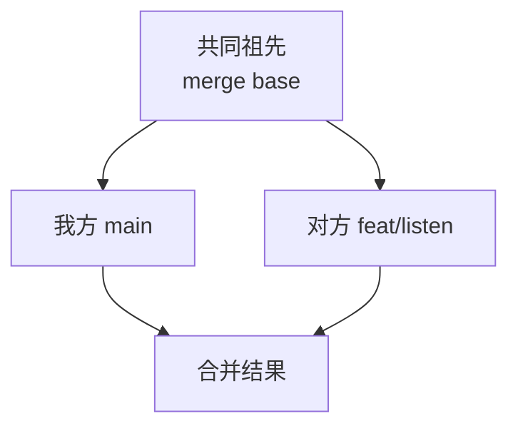
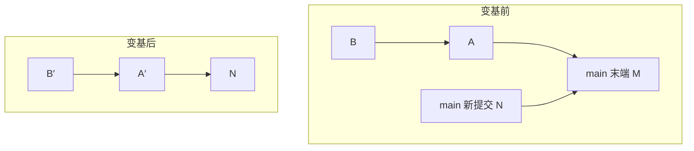

# 合并与变基

两条分开发展的历史要汇到一起，有两种做法：**合并**（merge）造一个有两个 parent 的新提交，把两条线接起来；**变基**（rebase）把一条线上的提交在另一条线的末端重新做一遍，历史变成一条直线。

关于「该用哪个」的争论很多，但用前两章的对象模型看，两者的差别是确定的：合并只新增一个提交、不动已有的提交；变基新造一串提交、丢弃旧的。这一章先讲两者的机制和冲突的本质，再讲一个人开发时怎么选。

## 三方合并

无论合并还是变基，底层都是**三方合并**（three-way merge）：拿三个快照比较，「共同祖先」、「我方」、「对方」。



对每一处内容：

- 两边都没改：保持原样
- 只有一边改了：采用改了的那边
- 两边改成一样：采用它
- 两边改得不一样：**冲突**，交给人决定

只拿两个版本比（两方合并）是做不到这一点的：看到一行不一样，你无法知道是我改了它、还是对方改了它。共同祖先提供的正是「原来是什么样」。找共同祖先的命令：

```bash
git merge-base main feat/listen
```

Git 2.34 起默认的合并策略是 `ort`，取代了用了十多年的 `recursive`，更快，对重命名的处理也更准确。日常不需要手动指定策略。

## 快进与合并提交

如果 `main` 自 `feat/listen` 分出去以后一个提交都没有，共同祖先就是 `main` 本身，这时不需要合并，把 `main` 直接挪到 `feat/listen` 的位置就行，这叫**快进**（fast-forward）。

```bash
git switch main
git merge feat/listen           # 能快进就快进
git merge --no-ff feat/listen   # 即使能快进，也造一个合并提交
git merge --ff-only feat/listen # 只接受快进，不能快进就失败
```

`--no-ff` 的用途是保留「这几个提交是一起作为一个功能进来的」这个信息，用 `git log --first-parent` 看 main 时，每个功能只占一行。`--ff-only` 适合拉取远程：`git config --global pull.ff only` 之后，`git pull` 遇到分叉会停下来让你决定，而不是悄悄生成一个「Merge branch 'main' of github.com:...」。

## 冲突的本质

冲突发生时，Git 把三个版本都放进了暂存区。第 1 章说过 index 的第三列是阶段号，现在派上用场了：

```bash
git ls-files -s app/src/reader/bridge.ts
```

```text
100644 cf461ec 1	app/src/reader/bridge.ts
100644 928e71d 2	app/src/reader/bridge.ts
100644 ce01552 3	app/src/reader/bridge.ts
```

阶段 1 是共同祖先，2 是我方（ours），3 是对方（theirs）。可以分别取出来看：

```bash
git show :1:app/src/reader/bridge.ts   # 原来的样子
git show :2:app/src/reader/bridge.ts   # 我方
git show :3:app/src/reader/bridge.ts   # 对方
```

工作区里的文件则是带冲突标记的版本。默认的标记只显示两边，看不出原来是什么。强烈建议改成 `zdiff3`（Git 2.35 起支持），多显示一段共同祖先：

```bash
git config --global merge.conflictStyle zdiff3
```

```text
<<<<<<< HEAD
export type ReaderMessage = { type: 'progress'; percent: number; anchor: string };
||||||| b2bb570
export type ReaderMessage = { type: 'progress'; percent: number };
=======
export type ReaderMessage = { type: 'progress'; ratio: number };
>>>>>>> feat/listen
```

`|||||||` 后面是共同祖先的提交 ID。有了中间那段，一眼就能看出：我方加了 `anchor` 字段，对方把 `percent` 改名成了 `ratio`。正确的结果是两者都要：`{ type: 'progress'; ratio: number; anchor: string }`。没有中间那段，你很容易只挑一边，悄悄丢掉另一边的意图。

解决之后 `git add` 这个文件，阶段 1、2、3 被一个阶段 0 的条目替换，冲突就算解决了。

> [!TIP]
> 冲突整个文件只要一边时：`git checkout --ours <文件>` 或 `--theirs`。**注意变基时 ours 和 theirs 是反的**：变基是在对方的末端重放你的提交，此时 ours 是「被变基到的那条线」，theirs 才是你正在重放的提交。

### 冲突解决也会出错

合并提交里的冲突解决是最难审查的代码：`git show <合并提交>` 默认只显示两边都改了的「组合 diff」，很多人为的改动看不出来。Git 2.36 起有一个专门的选项：

```bash
git show --remerge-diff <合并提交>
```

它会重新自动合并一次，然后显示「实际提交的结果」和「自动合并的结果」之间的差别，也就是解决冲突时人手做了什么。合并后测试挂了，先看这里。

### rerere：记住你怎么解决的

如果同一个冲突要反复解决（比如一个长期分支不断变基到 main 上），打开 rerere（reuse recorded resolution）：

```bash
git config --global rerere.enabled true
```

Git 会记录「这个冲突形状 → 你的解决结果」，下次遇到一样的冲突自动套用，你只需检查并 `git add`。记录存在 `.git/rr-cache/`，不会推到远程。

## 变基：重放提交

```bash
git switch feat/listen
git rebase main
```

变基做的事情，用前两章的语言描述：

1. 找出 `main..feat/listen` 这些提交，即 feat/listen 有而 main 没有的
2. 把 HEAD 分离到 `main` 末端
3. 对每个提交依次做一次 cherry-pick：取出它相对 parent 的改动，以三方合并的方式应用到当前位置，生成一个**新提交**
4. 把 `feat/listen` 挪到最后一个新提交上



A′、B′ 和 A、B 改动相同，但 parent 不同，所以 ID 不同。旧的 A、B 仍在对象库里，reflog 记着它们（第 4 章）。

### 变基的金规则

**不要变基别人已经基于它工作的提交。** 你的 A、B 如果已经被别人拉下来，并在上面做了提交，你变基后强推，对方手里就有两套内容相同、ID 不同的提交，再合并时会出现重复提交和莫名其妙的冲突。

一个人开发时，「别人」通常是：另一台电脑上的你、CI 正在跑的流水线、在另一个 worktree 里基于这个分支干活的 agent。判断标准很简单：**推到了别人会拉取的分支上的提交，就当它不能再动了**。只推到自己的功能分支上、只有你在用的，随便变基。

### --onto：只搬一段

`git rebase main` 默认搬运 `main..HEAD` 的全部提交。有时你只想搬一段，比如 `feat/b` 是从 `feat/a` 上分出来的，`feat/a` 被压缩合并（squash merge）进了 main，现在要把 `feat/b` 自己的提交移到 main 上：

```bash
# 把 feat/a..feat/b 这段提交，搬到 main 上
git rebase --onto main feat/a feat/b
```

三个参数读作「新基底、旧基底（不含）、要搬的分支」。

### --update-refs：分支叠着分支

把一个大功能拆成几个依次叠加的分支（stacked branches）时，变基最底下的一个，上面的几个分支都还指着旧提交。Git 2.38 起：

```bash
git rebase --update-refs main
git config --global rebase.updateRefs true   # 设为默认
```

变基时，凡是指向被重放提交的本地分支，都会一起挪到对应的新提交上。

### --rebase-merges：保留合并结构

默认的变基会把历史拉平，合并提交被丢掉，只重放非合并提交。如果分支内部有你想保留的合并结构，用 `--rebase-merges`。一个人的功能分支里很少需要它。

### 对比变基前后：range-diff

变基后怎么确认没有在解决冲突时搞丢东西？`git range-diff` 逐个对比新旧两串提交：

```bash
git range-diff ORIG_HEAD...HEAD
# 或者用 reflog 指定变基前的位置
git range-diff feat/listen@{1}...feat/listen
```

输出里，`=` 表示这个提交内容没变，`!` 表示变了并附上「diff 的 diff」。改动只应该出现在你解决过冲突的提交上。

## 拉取：pull 的三种行为

`git pull` 等于 `git fetch` 加上一次整合，整合方式由配置决定：

| 配置 | 本地和远程分叉时 |
|---|---|
| `pull.ff only` | 停下报错，让你自己决定 |
| `pull.rebase true` | 把本地提交变基到远程之上 |
| `pull.rebase false` | 生成一个合并提交 |

一个人开发，推荐 `pull.rebase true` 加 `rebase.autoStash true`：本地没推的提交通常就是你自己的，变基到远程之上最自然，历史是一条线；有未提交的改动时自动 stash、变基后再弹回来。

```bash
git config --global pull.rebase true
git config --global rebase.autoStash true
```

## 案例：agent 分支上的两个合并提交

翻 hatch-shelf 的历史，写作时 200 多个提交里只有两个合并提交，消息都是：

```text
Merge branch 'main' into claude/focused-snyder-557e2d
```

这是一个在独立 worktree 里工作的 coding agent 留下的：它在自己的分支上做「听书」功能期间，main 上又进了别的提交，agent 为了跟上 main，执行了 `git merge main`，前后两次。最后 main 直接快进到这个分支，两个「把 main 合进功能分支」的提交就留在了主线历史上。

```bash
git log --merges --format='%h %p %s'
```

```text
31c374f 83670d7 76717af Merge branch 'main' into claude/focused-snyder-557e2d
83670d7 b8fd9c9 59ad051 Merge branch 'main' into claude/focused-snyder-557e2d
```

功能上没有任何问题，但有两个小代价：`git log --oneline` 里多了两行和功能无关的记录；`git bisect`（第 5 章）遇到合并提交时，需要测试的路径变多。

这种「功能分支同步主线」的场景正是变基的主场：分支只有 agent 自己在用，变基到 main 上不会伤到任何人。可以把规则写进 agent 的说明里：

```markdown
## Git

- 同步 main 时用 `git rebase main`，不要 `git merge main`
- 合进 main 只用快进：`git merge --ff-only <分支>`；不能快进就先在分支上变基
```

agent 怎么在 worktree 里并行干活，见[《编码 Agent 实战》的并行一节](../coding-agents/05-subagents-parallel.md#并行改代码git-worktree)。

## 一个人怎么选

把讨论收窄到一个人的仓库，结论其实很简单：

| 场景 | 用什么 | 理由 |
|---|---|---|
| 拉取远程 main | `pull.rebase true` | 本地没推的提交是自己的，变基无害，历史成一条线 |
| 功能分支跟上 main | `git rebase main` | 分支只有自己在用 |
| 功能分支合进 main | 先变基，再 `merge --ff-only` | 主线保持线性，每个提交都能单独构建，bisect 友好 |
| 想保留「这是一个功能」的分组 | `merge --no-ff` | `--first-parent` 视图清晰 |
| 已经推到 main 的提交 | 不再变基 | 金规则 |

线性历史的最大收益在第 5 章：`git bisect` 在一条直线上二分最省事。代价是你要习惯偶尔强推功能分支，所以第 2 章的 `--force-with-lease` 要用熟。

## 本章要点

- 合并和变基底层都是三方合并，共同祖先让 Git 能判断「谁改了什么」
- 冲突时暂存区里有三个版本：`:1:` 祖先、`:2:` 我方、`:3:` 对方；变基时 ours / theirs 反过来
- 打开 `merge.conflictStyle zdiff3` 和 `rerere.enabled`；审查合并提交用 `--remerge-diff`
- 变基是逐个 cherry-pick 造新提交；不要变基别人已经基于它工作的提交
- `--onto` 搬一段、`--update-refs` 带上叠着的分支、`range-diff` 核对变基前后
- 一个人的默认组合：`pull.rebase true`，功能分支变基后快进合并

## 动手练习

1. **看见三个阶段**：新仓库里文件 `f` 内容为 `percent`；分支 `feat` 把它改成 `ratio`，main 把它改成 `percent anchor`。在 `feat` 上执行 `git -c merge.conflictStyle=zdiff3 rebase main`。

   验证：`git ls-files -s f` 有阶段号 1、2、3 三行；`cat f` 里出现 `|||||||` 段，中间是原来的 `percent`。

   参考答案：三行分别是共同祖先、ours、theirs，zdiff3 多显示的那段就是阶段 1。看完 `git rebase --abort`。

2. **变基时 ours 是谁**：在上一题的冲突里执行 `git checkout --ours f && cat f`，先预测结果。

   验证：输出是 `percent anchor`，也就是 main 的版本，而不是你在 feat 上写的 `ratio`。

   参考答案：变基是在 main 末端重放 feat 的提交，HEAD 此时在 main 那条线上，所以 ours 是 main。合并时则相反。

3. **压缩合并之后搬一段**：main 上分出 `feat/a`（提交 a1、a2），再从 `feat/a` 分出 `feat/b`（提交 b1）；在 main 上 `git merge --squash feat/a && git commit -m 'squash a'`。先看 `git log --oneline main..feat/b` 有几行，再把 `feat/b` 正确搬到 main 上。

   验证：搬之前是 3 行（a1、a2、b1 都算「main 没有」）；执行 `git rebase --onto main feat/a feat/b` 后只剩 `b1` 一行。

   参考答案：squash 生成的是新提交，a1、a2 对 main 来说仍是陌生提交，直接 `git rebase main` 会重放它们。`--onto` 用 `feat/a` 作旧基底，只搬 `feat/a..feat/b` 这一段。
