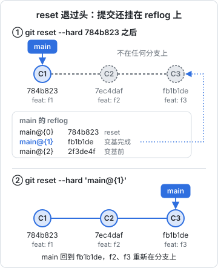

# 历史改写与救援

这一章分两半。前一半讲怎么有意地改写历史：修补几个提交之前的错误、整理一串零碎的提交、从整个历史里删掉一个文件。后一半讲救援：变基搞砸了、`reset --hard` 退过头、stash 被误删，怎么把东西找回来。

两半其实是同一件事的两面。第 1 章说过，Git 从不修改对象，「改写」只是造新对象、挪引用。旧对象还在，只是没有名字了。所以只要知道去哪找没有名字的对象，几乎所有误操作都能撤回。先讲救援，有了安全感，改写起来才敢下手。

## reflog：引用的移动日志

每当一个引用移动（提交、reset、变基、切分支、合并、pull），Git 都会在 `.git/logs/` 下记一笔：从哪到哪、什么时间、因为什么。这就是 reflog。

```bash
git reflog              # HEAD 的移动历史
git reflog show main    # main 分支的移动历史
```

下面是一个小仓库在一次 autosquash 变基（本章后面会讲）之后的 reflog：

```text
fb1b1de HEAD@{0}: rebase (finish): returning to refs/heads/main
fb1b1de HEAD@{1}: rebase (pick): feat: f3
7ec4daf HEAD@{2}: rebase (pick): feat: f2
784b823 HEAD@{3}: rebase (fixup): feat: f1
d40ef3b HEAD@{4}: rebase: fast-forward
fc5cc67 HEAD@{5}: rebase (start): checkout fc5cc67c5aaf59202cc341b5e8fc73b6f407910c
2f3de4f HEAD@{6}: commit: fixup! feat: f1
d2faa92 HEAD@{7}: commit: feat: f3
```

变基前分支在 `2f3de4f`（`HEAD@{6}`）。要撤销整个变基：

```bash
git reset --hard 'HEAD@{6}'
```

更方便的写法是看分支自己的 reflog：`main@{1}` 就是「main 上一次移动之前的位置」，不受中间切分支、分离 HEAD 的干扰：

```bash
git reset --hard 'main@{1}'
```

`reset --hard` 退过头也是同样的救法。接着上面的仓库：变基完成后 main 在 `fb1b1de`（feat: f3），你想丢掉最后两个提交，执行了 `git reset --hard 784b823`（feat: f1），过后又后悔了。此时 `7ec4daf` 和 `fb1b1de` 不在任何分支上，`git log` 看不到它们，但 main 的 reflog 新记了一笔 `reset: moving to 784b823`，上一笔 `main@{1}` 仍然指着 `fb1b1de`。下图把 reset 前后和找回的过程画出来：



找回同样只要一句 `git reset --hard 'main@{1}'`，前提是两次 reset 之间 main 没有再动过；动过的话先 `git reflog show main` 看清楚是第几条。

几个要知道的事实：

- **reflog 只在本地**。它不随 push 传出去，clone 下来的仓库没有之前的 reflog。救援只能在出事的那个目录里做
- **reflog 会过期**。默认还能到达的条目保留 90 天（`gc.reflogExpire`），已经不可达的保留 30 天（`gc.reflogExpireUnreachable`）。过期后再加上 `gc.pruneExpire` 的两周宽限，对象才会被真正删除
- **工作区里从未 add 的改动不在 reflog 里**，也不在对象库里，找不回来

> [!TIP]
> 做一件没把握的大操作之前，给当前位置打一个轻量标签，比翻 reflog 直观：`git tag backup/before-rebase`。完事确认无误后 `git tag -d backup/before-rebase`。

## 找回没有名字的对象

有些对象连 reflog 都没记：被 `git stash drop` 删掉的 stash、`add` 过但从没提交就被覆盖的文件。它们仍在对象库里，只是什么都不指向它们。`git fsck` 能把它们列出来：

```bash
git fsck --lost-found
```

```text
dangling blob f3d43775e65ac68c0589a8961c9e665ee8436944
dangling commit 1599b981fe9a16efba4771ded859e223c963bb11
```

`--lost-found` 还会把它们写到 `.git/lost-found/commit/` 和 `.git/lost-found/other/` 下，方便逐个查看：

```bash
git show 1599b98                    # 看这个提交是什么
git cat-file -p f3d43775            # blob 只有内容，没有文件名
```

### 案例：误删的 stash

`git stash` 生成的是一个特殊的合并提交：第一个 parent 是当时的 HEAD，第二个 parent 是暂存区的快照，消息以 `WIP on` 开头。drop 之后它就是一个 dangling commit：

```bash
git log --graph --oneline 1599b98
```

```text
*   1599b98 WIP on main: 60a74a2 init
|\
| * 0606a5e index on main: 60a74a2 init
|/
* 60a74a2 init
```

找到后应用回来：

```bash
git stash apply 1599b98
```

仓库里悬空的提交多了，可以按消息过滤：

```bash
git fsck --no-reflogs --unreachable \
  | awk '/commit/ {print $3}' \
  | xargs git log --no-walk --format='%h %cr %s' \
  | grep 'WIP on'
```

### 案例：add 过、没提交就丢了

第 1 章说过，`git add` 的那一刻内容就写进了对象库。所以「add 了，然后 `reset --hard` 了」的文件，会以 dangling blob 的形式留着。blob 没有文件名，只能按内容认：

```bash
for b in $(git fsck --lost-found 2>/dev/null | awk '/blob/ {print $3}'); do
  echo "== $b"
  git cat-file -p "$b" | head -5
done
```

这也是一个好习惯的理由：**写了一段时间的东西，哪怕还不想提交，先 `git add` 一下**，相当于存了一份快照。

## 提交之后发现错了

### 最近一个提交

```bash
git commit --amend            # 改消息，或者把暂存区的新改动并进去
git commit --amend --no-edit  # 只并改动，不改消息
```

amend 造一个新提交替代 HEAD，旧的进 reflog。已经推送的提交 amend 后需要强推，遵守第 3 章的金规则。

### 几个提交之前：fixup 与 autosquash

改动属于三个提交之前的某次提交，比如漏了一个文件、写错一个常量。最干净的做法是两步：

```bash
# 1. 把修补写成一个「fixup 提交」，指明它要并进哪一个
git add app/src/reader/bridge.ts
git commit --fixup=':/渲染 GitHub'      # 消息匹配这段文字的最近一个提交，也可以直接写提交 ID

# 2. 让变基自动把它挪到目标提交后面并合并
git rebase --autosquash main
```

`--fixup` 生成的提交消息形如 `fixup! feat(reader): 渲染 GitHub 风格提示块`，`--autosquash` 按消息把它排到目标提交之后、合并进去，目标提交的消息不变。

几个变体：

| 写法 | 效果 |
|---|---|
| `--fixup=<提交>` | 并入改动，保留目标的消息 |
| `--fixup=amend:<提交>` | 并入改动，同时重写目标的消息 |
| `--fixup=reword:<提交>` | 不带改动，只改目标的消息 |
| `--squash=<提交>` | 并入改动，变基时让你合并两条消息 |

Git 2.44 起 `--autosquash` 在非交互的变基里也生效（之前只对 `-i` 有效）。也可以设成默认：

```bash
git config --global rebase.autoSquash true
```

这个流程特别适合在评审之后修改：修补各自归到对应的提交里，评审者可以只看 fixup 提交，确认无误后再一次性 autosquash。

### git history：更直接的改写命令

> [!WARNING]
> `git history` 在写作时（Git 2.54）仍标注为实验性命令，子命令和行为可能变化，以 `git help history` 和 git-scm.com 的发布说明为准。

较新的 Git 提供了一个专门做「改某一个提交」的命令，不经过变基的交互流程：

```bash
git history reword <提交>            # 改某个提交的消息
git history fixup <提交>             # 把暂存区的改动并进某个提交
git history split <提交> -- <路径>   # 把某个提交按路径拆成两个
```

它默认会把所有基于这个提交的分支都挪到新历史上。目前不支持含合并提交的历史，也不处理会产生冲突的改写，遇到这些情况仍要用 `rebase`。

### 交互式变基

需要重排、删除、拆分多个提交时，用交互式变基：

```bash
git rebase -i main
```

编辑器里每一行是一个提交和一条指令。常用指令：

| 指令 | 作用 |
|---|---|
| `pick` | 保留 |
| `reword` | 保留，停下来改消息 |
| `edit` | 停在这个提交，可以 amend、拆分，然后 `git rebase --continue` |
| `squash` / `fixup` | 并入上一个提交 |
| `drop` | 删掉 |
| `exec <命令>` | 在这里运行一条命令，失败则停下 |

`exec` 很有用：`git rebase -i --exec 'pnpm typecheck' main` 会在每个提交之后跑一次类型检查，保证整理后的每个提交都能独立通过，这对第 5 章的 bisect 很重要。

拆分一个提交的标准做法：标成 `edit`，停下后：

```bash
git reset HEAD~1                 # 撤销这个提交，改动回到工作区
git add packages/spec && git commit -m 'feat(spec): 新增 next 字段'
git add app && git commit -m 'feat(app): 最后一章显示接着读'
git rebase --continue
```

变基中途任何时候想放弃：`git rebase --abort`，一切回到开始之前。

## 改写整个历史：git filter-repo

前面的工具改的是最近一段提交。有时要改的是**全部历史**：删掉一个误提交的大文件或密钥文件、把一个子目录拆成独立仓库、统一作者邮箱。这时用 `git filter-repo`。它是 Git 官方文档推荐的 `filter-branch` 替代品，速度快几个数量级，默认行为也更安全。

```bash
brew install git-filter-repo
```

### 它会做什么

filter-repo 遍历全部提交，按规则改写每个提交的 tree 和消息，生成一整套新历史，然后把所有分支和标签挪过去，最后清理旧对象。几个设计上的保护：

- **默认只允许在刚 clone 的仓库上运行**。如果当前仓库看起来不是新克隆（有 reflog、有未推送的东西），它会拒绝并提示加 `--force`。所以标准流程是「另外 clone 一份来操作」
- **运行后会删除 `origin` 远程**，防止你顺手 `git push` 把改写后的历史推上去。要推送需要重新 `git remote add`，这是故意让你多想一步
- 改写后变空的提交会被自动删掉

### 常用操作

```bash
git clone git@github.com:jarvis/hatch-shelf.git /tmp/shelf-rewrite
cd /tmp/shelf-rewrite

# 从全部历史里删掉某个路径
git filter-repo --invert-paths --path app/.env

# 删掉所有大于 10M 的文件版本
git filter-repo --strip-blobs-bigger-than 10M

# 只保留一个子目录，并把它提升为根目录（拆仓库）
git filter-repo --subdirectory-filter packages/spec

# 按文件替换所有历史里出现的文本，比如密钥
git filter-repo --replace-text ../replacements.txt

# 统一作者：.mailmap 格式的映射文件
git filter-repo --mailmap ../my-mailmap
```

`--replace-text` 的文件每行一条规则，`原文==>替换`；不写 `==>` 时替换成 `***REMOVED***`：

```text
sk-live-abc123==>***REMOVED***
regex:AKIA[0-9A-Z]{16}==>***REMOVED***
```

做之前先看清有什么要删。`--analyze` 会在 `.git/filter-repo/analysis/` 下生成按路径、按扩展名统计的体积报告：

```bash
git filter-repo --analyze
head -20 .git/filter-repo/analysis/path-all-sizes.txt
```

### 推回去之后

改写后的历史和原来的**没有任何共同的提交**（除了改写点之前的部分）。推送需要强推所有分支和标签：

```bash
git remote add origin git@github.com:jarvis/hatch-shelf.git
git push --force --all origin
git push --force --tags origin
```

然后：

- **所有其他克隆都要重新 clone**，包括另一台电脑、CI 的缓存、agent 的 worktree。在旧克隆里 `git pull` 会把旧历史合并回来，前功尽弃
- 托管平台上可能仍有旧对象的缓存：已关闭的 PR 引用的提交、fork、平台自己的缓存。删除密钥这类场景，**改写历史只是收尾，第一步永远是作废密钥**，第 9 章详细讲

> [!CAUTION]
> filter-repo 改写的是每一个提交的 ID。外部任何引用提交 ID 的地方都会失效：issue 和 PR 里的提交链接、CHANGELOG 里的哈希、部署记录、`.git-blame-ignore-revs`。对有外部引用的仓库，改写前要想清楚。

## 本章要点

- 改写历史只是造新对象、挪引用；旧对象留在对象库里，直到过期并被 gc
- reflog 记录每个引用的移动，本地有效，默认保留 90 天 / 不可达的 30 天；`main@{1}` 是分支上一次的位置
- 没有 reflog 的对象用 `git fsck --lost-found` 找，误删的 stash、add 过的文件都能捞回来
- 修补旧提交用 `commit --fixup` 加 `rebase --autosquash`；`rebase -i --exec` 保证每个提交都能构建
- 改写全部历史用 `git filter-repo`：在新克隆里做，做完重新加远程、强推，所有旧克隆重新 clone
- 大操作前打一个备份标签
