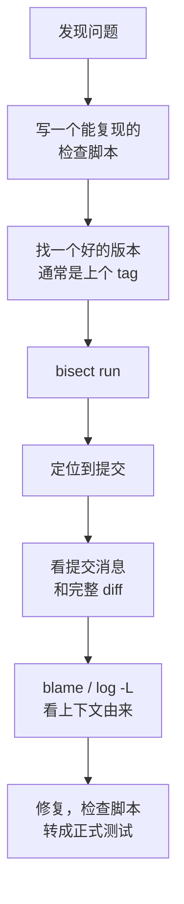

# bisect 与 blame：定位问题

「上周还好好的，现在不行了」，这类问题最适合交给 Git。历史里每个提交都是一份完整的快照，所以**哪个提交引入了问题**是一个可以机械回答的问题：二分查找。`git bisect` 做的就是这件事，配合一个自动判断好坏的脚本，几百个提交的范围几分钟就能定位到一个。

找到「哪个提交」之后，还要回答「这行代码为什么是这样」：`git blame`、`git log -S`、`git log -L` 负责这一半。这一章两部分都讲，最后讲怎么让历史本身更适合被这样查。

## 二分查找的威力

你知道一个好的提交（比如上一个发版标签 `v1.0.2`）和一个坏的提交（`HEAD`），问题出在中间某处。每测一个中间点就能排除一半，所以最多需要测 $\lceil \log_2 N \rceil$ 次。


一个人的项目，两次发版之间通常几十个提交，五六次就能定位。比起逐个回忆「最近改了什么」，这是一个可以闭着眼执行的流程。

## 手动 bisect

以 hatch-shelf 为例，假设 `v1.0.3` 出了问题，`v1.0.0` 是好的：

```bash
git bisect start
git bisect bad v1.0.3          # 这个版本是坏的
git bisect good v1.0.0         # 这个版本是好的
```

```text
Bisecting: 31 revisions left to test after this (roughly 5 steps)
[83670d771a494bd6f7340d60947c7b1b5fb71edf] Merge branch 'main' into claude/focused-snyder-557e2d
```

两个版本之间有 64 个提交，第一个被选中测试的恰好是第 3 章提到的那个合并提交，本章后面讲 `--first-parent` 时会回到这一点。

Git 把 HEAD 分离到中间的一个提交上，你构建、测试，然后告诉它结果：

```bash
git bisect good    # 这个提交没问题
git bisect bad     # 这个提交有问题
git bisect skip    # 这个提交没法测（比如编译不过），换一个邻近的
```

重复几次后 Git 会输出 `<ID> is the first bad commit` 和这个提交的详情。结束后回到原来的分支：

```bash
git bisect reset
```

几个实用命令：

| 命令 | 作用 |
|---|---|
| `git bisect log` | 打印到目前为止的每一步，可以保存下来 |
| `git bisect replay <文件>` | 按保存的 log 重放，标错了一步时用：编辑 log 删掉错的那行再重放 |
| `git bisect visualize --oneline` | 看还剩下哪些候选提交 |
| `git bisect terms --term-old=fast --term-new=slow` | 换术语，找的不是「坏」而是「变慢」或「某功能出现」时更不容易绕晕 |

> [!TIP]
> 「好」和「坏」只是「旧状态」和「新状态」的叫法。想找「某个功能是哪个提交加上的」，同样可以 bisect：没有这个功能的是 old，有的是 new。

## 自动 bisect：bisect run

手动测几次还行，构建一次要两分钟就很烦了。`git bisect run` 让一个脚本来判断每个提交：

```bash
git bisect start HEAD v1.0.2
git bisect run /tmp/bisect-check.sh
```

脚本的退出码决定结果：

| 退出码 | 含义 |
|---|---|
| 0 | 好 |
| 1–127（125 除外） | 坏 |
| 125 | 跳过，这个提交测不了 |
| 128 及以上 | 中止整个 bisect |

### 一个完整的例子

在一个 100 个提交的小仓库里，第 63 个提交把手续费计算改成了取整，导致 `fee(10)` 从 `0.6` 变成了 `1`。检查脚本：

```bash
#!/usr/bin/env bash
# /tmp/bisect-check.sh：fee(10) 应该等于 0.6
node -e 'import("./fee.js").then(m => process.exit(m.fee(10) === 0.6 ? 0 : 1))'
```

```bash
git bisect start HEAD HEAD~99
git bisect run /tmp/bisect-check.sh
```

```text
Bisecting: 49 revisions left to test after this (roughly 6 steps)
[a601940...] chore: step 50
running '/tmp/bisect-check.sh'
Bisecting: 24 revisions left to test after this (roughly 5 steps)
[7b1ab47...] chore: step 75
running '/tmp/bisect-check.sh'
Bisecting: 12 revisions left to test after this (roughly 4 steps)
[a2151b4...] chore: step 62
running '/tmp/bisect-check.sh'
Bisecting: 6 revisions left to test after this (roughly 3 steps)
[fc619a5...] chore: step 68
running '/tmp/bisect-check.sh'
Bisecting: 2 revisions left to test after this (roughly 2 steps)
[30032d0...] chore: step 65
running '/tmp/bisect-check.sh'
Bisecting: 0 revisions left to test after this (roughly 1 step)
[4bf958a...] chore: step 64
running '/tmp/bisect-check.sh'
Bisecting: 0 revisions left to test after this (roughly 0 steps)
[ead0209...] chore: step 63
running '/tmp/bisect-check.sh'
ead02099d631ee8e2ac462b4e7860b2277656407 is the first bad commit
```

依次测了第 50、75、62、68、65、64、63 个提交，一共 7 次，和 $\lceil \log_2 99 \rceil = 7$ 一致。

### 写好检查脚本的要点

**脚本放在仓库外面**。bisect 会在提交之间来回切换，脚本放在仓库里，旧提交上可能没有它，或者是一个旧版本。

**新写的测试也放在外面，运行时拷进去**。问题往往是「现在才发现」，旧提交里自然没有覆盖它的测试。以 hatch-shelf 为例，假设发现阅读器某个版本开始不再渲染 `[!WARNING]` 提示块：

```bash
#!/usr/bin/env bash
# /tmp/bisect-callout.sh
set -u
cd "$(git rev-parse --show-toplevel)"

# 依赖装不上（锁文件损坏、某个中间版本的问题）就跳过这个提交
pnpm install --frozen-lockfile --silent || exit 125

# 把仓库外的回归测试拷进去，跑完删掉，不污染工作区
cp /tmp/callout.test.ts app/reader-web/src/callout.bisect.test.ts
pnpm --filter @shelf/reader-web exec vitest run src/callout.bisect.test.ts
code=$?
rm -f app/reader-web/src/callout.bisect.test.ts
exit $code
```

**把「测不了」和「坏了」区分开**。编译失败、依赖装不上，应该返回 125 跳过，而不是 1。否则 bisect 会把一个和问题无关的编译错误当成罪魁祸首。

**不要让脚本留下改动**。脚本在工作区留下修改或未跟踪文件，下一次 checkout 可能失败。上面的脚本在退出前删掉了拷进去的测试；更省心的办法是在第 8 章讲的独立 worktree 里跑 bisect。

### 合并提交和 --first-parent

主线上有合并提交时，bisect 可能会把你带进被合并分支的内部提交（上面 hatch-shelf 的例子第一步就停在一个合并提交上），而那些提交可能从没单独构建过。Git 2.29 起：

```bash
git bisect start --first-parent
```

只沿着第一个 parent 走，也就是只在主线上那些「合进来之后」的状态之间二分。定位到某个合并提交后，再对那个分支内部单独 bisect。

线性历史在这里的优势很明显：每个提交都在主线上，每个都应当能独立构建，bisect 最顺。第 3 章推荐「变基后快进合并」，第 4 章推荐 `rebase -i --exec` 检查每个提交，都是在为这一刻做准备。

## blame：这行是谁、何时、为什么

```bash
git blame -L 40,60 app/src/reader/bridge.ts
```

每行显示最后修改它的提交、作者和时间。但默认的 blame 很容易把你引向错误的提交，几个选项能显著改善：

| 选项 | 作用 |
|---|---|
| `-w` | 忽略空白变化，缩进调整不会抢走这一行 |
| `-M` | 识别同一文件内被移动的行 |
| `-C` | 识别从同一提交里其他文件复制或移动过来的行；`-C -C`、`-C -C -C` 范围更大、更慢 |
| `--ignore-rev <提交>` | 跳过指定提交，把行归到它之前的那次修改 |
| `--ignore-revs-file <文件>` | 从文件读一批要跳过的提交 |

### 跳过格式化提交

> [!WARNING]
> 本节提到的 GitHub 网页 blame 自动读取 `.git-blame-ignore-revs` 是平台行为，按写作时的情况整理，以 GitHub 官方文档为准；其他托管平台不一定支持。

引入 Prettier、改了缩进规则后，一次大面积格式化会让几乎所有行的 blame 都指向它，blame 就失去了意义。解决办法是把这类提交登记在仓库根目录的 `.git-blame-ignore-revs` 里：

```text
# 全仓 Prettier 格式化
4b8e2c1a9d3f5e7b6c0a1d2e3f4a5b6c7d8e9f01
```

然后让本地 blame 默认读它：

```bash
git config blame.ignoreRevsFile .git-blame-ignore-revs
```

GitHub 网页上的 blame 视图也会自动读取仓库根目录的这个文件。

这也是为什么大面积格式化要**单独成一个提交**，不和任何逻辑改动混在一起，见[《前端工程化与 Web 平台》](../frontend-engineering/08-eslint-prettier.md#大面积格式化的提交)。另外，第 4 章的 filter-repo 会改写所有提交 ID，这个文件里的 ID 也会随之失效，要重新生成。

## 比 blame 更好用的：按内容搜历史

blame 只告诉你每一行**最后一次**被谁改。很多时候你想问的是别的问题。

### 某段文本什么时候出现或消失：-S

```bash
git log -S 'getDatabasePath' --oneline
```

`-S`（pickaxe）找出「这段字符串的出现次数发生变化」的提交，也就是引入它或删除它的提交。一个函数被删了、一个配置项不见了，用它一步到位。加 `-p` 同时看改动。

`-G` 是正则版本，并且只要匹配的行在 diff 里出现就算，包括只改了这一行其他部分的提交：

```bash
git log -G 'APP_VARIANT\s*===' --oneline -- app/
```

### 一个函数的完整演变：-L

```bash
git log -L :handleMessage:app/src/reader/bridge.ts
git log -L 40,60:app/src/reader/bridge.ts
```

`-L` 追踪一个函数或一段行的历史，每个提交只显示这一段的变化。它跟得住行号的漂移，比反复 blame 再 blame 父提交高效得多。`:函数名:` 的写法靠 diff 驱动的「函数头」规则找到函数的起点。Git 内置的驱动里没有 TypeScript，默认规则把不以空白开头的行当作函数头，所以顶层的 `export function` 能认出来，类里缩进的方法认不出，这时直接用行号范围。

### 文件改名之后的历史

```bash
git log --follow -p -- app/src/reader/bridge.ts
```

`--follow` 只对单个文件有效，靠相似度推断改名（第 1 章）。改名和大改分开提交，这里才跟得上。

## 一次定位问题的完整流程



最后一步常被省略：bisect 用的检查脚本已经是一个回归测试了，把它整理进测试套件，同一个问题就不会第二次出现。

## 让历史更容易被查

定位得快不快，很大程度上取决于历史是怎么写的：

- **每个提交都能构建、能通过测试**。否则 bisect 会频繁 skip，甚至给出错误的结论
- **一个提交只做一件事**。bisect 定位到一个混了五件事的提交，你还得在里面再找一遍
- **提交消息写「为什么」**。代码 diff 说明了做了什么，消息要说明为什么这样做；blame 带你找到提交，消息才是答案
- **格式化、重命名、移动文件单独提交**，并登记进 `.git-blame-ignore-revs`
- **发版打标签**。「上一个好的版本」直接就是上一个 tag

第 6 章的提交规范和第 7 章的 hooks，就是把这几条变成习惯和自动检查。

## 本章要点

- 二分查找最多测 $\lceil \log_2 N \rceil$ 次，几百个提交几分钟定位
- `bisect run` 按退出码判断：0 好、125 跳过、其余 1–127 坏；测不了要返回 125，不要返回 1
- 检查脚本和新写的回归测试放在仓库外，运行时拷入、结束删掉
- 主线有合并提交时用 `--first-parent`
- blame 加 `-w -M -C`，格式化提交登记在 `.git-blame-ignore-revs`
- 找某段文本的出现与消失用 `log -S`，追一个函数的演变用 `log -L`
