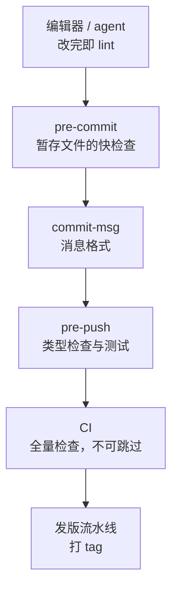

# hooks 与自动化

上一章把规范写下来了：提交消息的格式、代码和内容分开、每个提交都能构建。这一章把规范交给机器：本地用 Git hooks 在提交和推送的那一刻检查，CI 里再检查一遍。两者的关系是「提醒」和「保证」：hook 能被一个参数跳过，CI 不能。

> [!NOTE]
> 本章讲的是 Git 自己的 hooks，在 `git commit`、`git push` 时触发。Claude Code 等 coding agent 也有自己的 hooks（在 agent 调用工具前后触发），概念相近但完全是两套机制，见[《编码 Agent 实战》的 hooks 一章](../coding-agents/04-hooks.md)。两者可以配合：agent 的 hook 管「改完文件立刻 lint」，Git 的 hook 管「提交前最后把关」。

## Git hooks 是什么

hook 是 Git 在特定时刻调用的可执行文件，放在 `.git/hooks/` 下，文件名就是事件名。退出码非 0 时，对应的操作被中止。`git init` 时 Git 会放一组 `.sample` 示例，去掉后缀就能启用。

常用的客户端 hook：

| hook | 触发时机 | 非 0 退出码的效果 | 典型用途 |
|---|---|---|---|
| `pre-commit` | 写提交消息之前 | 中止提交 | lint、格式化、校验暂存的文件 |
| `prepare-commit-msg` | 打开编辑器之前 | 中止提交 | 预填消息，比如从分支名带出 scope |
| `commit-msg` | 消息写完之后 | 中止提交 | 校验消息格式 |
| `post-commit` | 提交完成后 | 无（不能中止） | 通知 |
| `pre-push` | 推送之前 | 中止推送 | 类型检查、测试 |
| `post-checkout`、`post-merge` | 切分支、合并之后 | 无 | 锁文件变了就提示重新安装依赖 |
| `pre-rebase` | 变基之前 | 中止变基 | 禁止变基已推送的分支 |

服务器端还有 `pre-receive`、`update`、`post-receive`，在托管平台上一般用不到，平台用规则集和 CI 替代了它们。

### 为什么不能直接提交 .git/hooks

`.git/` 目录不在版本控制里，你写在 `.git/hooks/` 下的脚本不会随仓库分发，换一台电脑、重新 clone、新开一个 worktree 后就没了。所以出现了两类做法：

1. 把 hook 脚本放在仓库里的普通目录，用 `core.hooksPath` 指过去
2. 用工具（lefthook、husky）管理：配置文件进仓库，工具负责安装

```bash
mkdir -p .githooks
git config core.hooksPath .githooks
```

这样 `.githooks/pre-commit` 就会生效。缺点是每个克隆都要手动执行一次 `git config`，可以放在 `package.json` 的 `prepare` 脚本里，`pnpm install` 时自动执行。

### 用配置定义 hook

> [!WARNING]
> 以配置项定义 hook（`hook.<名字>.command` / `hook.<名字>.event`）是 Git 2.54（2026 年 4 月）加入的功能，2.55 起还可以配置让同一事件的多个 hook 并行运行（按 2.54、2.55 的发布说明整理）。不同版本行为可能不同，用之前以 `git help config` 和 `git help hook` 的本机文档为准。

较新的 Git 允许不写脚本文件，直接在配置里声明 hook，并且同一个事件可以挂多个：

```bash
git config hook.typecheck.event pre-push
git config hook.typecheck.command 'pnpm typecheck'
git hook run pre-push        # 手动触发某个事件的全部 hook，调试用
```

这让「全局给所有仓库挂一个检查」变得容易，比如在 `~/.gitconfig` 里给 `pre-commit` 挂一个密钥扫描（第 9 章）。项目级的 hook 仍建议用下面的工具管理，因为配置项同样不随仓库分发。

## lefthook 与 husky

> [!WARNING]
> lefthook 和 husky 的配置写法在大版本之间有过变化，下面按写作时的版本整理，以两者仓库的 README 和官方文档为准。

| | lefthook | husky |
|---|---|---|
| 实现 | Go 写的单个二进制，npm 包里带着 | 几行 shell，靠 `core.hooksPath` |
| 配置 | 一个 `lefthook.yml` | `.husky/` 下每个 hook 一个 shell 文件 |
| 只处理暂存文件 | 内置 `{staged_files}`、`glob` 过滤 | 通常要搭配 lint-staged |
| 并行 | 内置 `parallel: true` | 自己写 |
| monorepo | `root` 指定子目录 | 自己 `cd` |

两者都能用。monorepo、想要并行、不想多装一个 lint-staged，选 lefthook；团队里已经用惯了 husky + lint-staged，也没必要换。

### husky 的最小配置

```bash
pnpm add -D husky
pnpm exec husky init      # 创建 .husky/pre-commit，并在 package.json 里加 "prepare": "husky"
```

```bash
# .husky/pre-commit
pnpm exec lint-staged
```

```bash
# .husky/commit-msg
pnpm exec commitlint --edit "$1"
```

### 案例：给 hatch-shelf 配 lefthook

hatch-shelf 现在没有任何 Git hook，`CLAUDE.md` 里写的是「声明任务完成前必须通过 `pnpm typecheck`、`pnpm test` 和 `pnpm lint`」，靠人和 agent 自觉。按这个仓库的结构，一份合理的 lefthook 配置是这样：

```yaml
# lefthook.yml
pre-commit:
  parallel: true
  commands:
    app-lint:
      root: "app/"
      glob: "*.{ts,tsx}"
      run: pnpm exec eslint {staged_files}
    books-check:
      glob: "books/**"
      run: pnpm shelf-pack check books/

commit-msg:
  commands:
    commitlint:
      run: pnpm exec commitlint --edit {1}

pre-push:
  parallel: true
  commands:
    typecheck:
      run: pnpm typecheck
    test:
      run: pnpm test
```

```bash
pnpm add -D -w lefthook @commitlint/cli @commitlint/config-conventional
pnpm exec lefthook install
```

几个设计上的考虑：

- **pre-commit 只做快的、只看改动的检查**。ESLint 只跑暂存的文件；`shelf-pack check` 全量也只要一秒左右，只在改了 `books/` 时触发。超过几秒的检查放在 pre-commit 会让人想跳过它
- **pre-push 跑完整的类型检查和测试**。推送的频率比提交低得多，多等半分钟可以接受
- **`root: "app/"`** 让 `{staged_files}` 变成相对 `app/` 的路径，ESLint 在 `app/` 下运行，能找到它自己的配置
- **commitlint 的类型要加上 `content`**，配置见第 6 章

`{staged_files}` 是「暂存的文件名」，但 ESLint 读的是工作区里的文件。如果一个文件只暂存了一部分改动，检查的是工作区的完整版本，而不是将要提交的那部分。多数时候这无伤大雅；在意的话，lint-staged 会在检查前把未暂存的部分临时藏起来。

### hook 的边界

- **能被跳过**：`git commit --no-verify`、`git push --no-verify`。这不是漏洞，是设计：紧急情况下你需要能绕过
- **agent 也会跳过**：coding agent 遇到 hook 失败，有时会尝试加 `--no-verify` 重来。在 agent 的说明里明确禁止，或者用 agent 自己的 hook 拦截这类命令
- **没有安装就不存在**：新克隆的仓库要先 `pnpm install`（触发 `prepare`）或 `lefthook install`
- **变基、cherry-pick 时不会对每个提交运行 pre-commit**。想检查每个提交，用第 4 章的 `rebase -i --exec`

所以 hook 的定位是「把问题拦在最便宜的时刻」，而真正的保证在 CI。

## CI 里的 Git

CI 里的仓库和你本地的不一样，很多和 Git 有关的诡异问题都出在这里。以 GitHub Actions 为例。

> [!WARNING]
> 下面 `actions/checkout` 的默认行为按写作时的版本整理，以该 action 仓库的 README 为准。

### 浅克隆

`actions/checkout` 默认 `fetch-depth: 1`，只拉最新的一个提交，没有历史、没有标签。依赖历史的操作会失败或给出错误结果：

| 操作 | 浅克隆下的表现 |
|---|---|
| `git describe --tags` | 找不到标签，报错 |
| 「上一个 tag 到 HEAD」生成 changelog | 找不到上一个 tag |
| `git diff origin/main...HEAD` | 没有共同祖先 |
| `git log -S`、bisect | 没有历史可查 |

需要历史的 job 显式拉全：

```yaml
- uses: actions/checkout@v5
  with:
    fetch-depth: 0       # 全部历史和标签
```

只需要和 main 比较时，拉全历史太浪费，可以在浅克隆之后按需补：

```bash
git fetch --no-tags --depth=50 origin main
git merge-base origin/main HEAD || git fetch --unshallow origin
```

### 只在相关目录改动时运行

monorepo 里，只改了 `books/` 不需要跑 App 的测试。GitHub Actions 有 `paths` 过滤：

```yaml
on:
  push:
    branches: [main]
    paths:
      - "app/**"
      - "packages/**"
      - "pnpm-lock.yaml"
```

更细的判断可以在 job 里用 Git 自己算：

```bash
if git diff --quiet "$BASE" HEAD -- app/ packages/; then
  echo "App 相关代码没有变化，跳过"
  exit 0
fi
```

`git diff --quiet` 有差异时退出码为 1，没有时为 0，适合放在条件里。

### 检查生成的文件有没有同步

有些文件是生成的、又要进仓库（比如 API 客户端代码、锁文件）。CI 里重新生成一次，再看工作区是否干净，就能发现「改了源头忘了重新生成」：

```bash
pnpm install --frozen-lockfile
pnpm run codegen
git diff --exit-code || { echo "生成的文件和提交的不一致，请本地重新生成后提交"; exit 1; }
```

`git status --porcelain` 输出稳定的机器可读格式，用来判断「有没有未跟踪的新文件」：

```bash
test -z "$(git status --porcelain)" || { git status; exit 1; }
```

### 在容器里：dubious ownership

在容器里运行的 job，仓库目录的属主常常和运行 Git 的用户不一致，Git 出于安全考虑会拒绝操作，报 `detected dubious ownership in repository`。确认目录可信后：

```bash
git config --global --add safe.directory "$GITHUB_WORKSPACE"
```

不要图省事写成 `safe.directory '*'`，那等于关掉了这项检查。

### 从 CI 里提交

发版流水线有时要提交（写回版本号、CHANGELOG）并打 tag：

```bash
git config user.name "release-bot"
git config user.email "release-bot@users.noreply.github.com"
git add app/app.json CHANGELOG.md
git commit -m "chore(release): v${VERSION}"
git tag -a "v${VERSION}" -m "v${VERSION}"
git push origin HEAD:main "v${VERSION}"
```

几个要点：

- **用一个独立的身份**，不要用你自己的邮箱，否则看不出哪些提交是机器做的
- **只 add 明确的文件**，不要 `git add -A`，CI 的工作区里可能有构建产物
- **推送可能因为 main 前进了而失败**：在 checkout 后、提交前，main 上又有了新提交。发版流水线要么限制并发，要么失败后让人重新触发，不要在 CI 里自动 `pull --rebase` 后重推，那样发出去的包和 tag 指向的代码可能不一致
- GitHub Actions 用默认的 `GITHUB_TOKEN` 推送，不会再触发新的工作流，这是防止循环触发的设计

完整的发版流水线设计见[《部署与 CI/CD》的 CI/CD 一章](../deploy-release/05-ci-cd.md)。

## 本地与 CI 的分工



越靠前越快、越便宜，但也越容易被跳过；越靠后越慢，但越可靠。同一项检查可以出现在多个位置，比如类型检查在 pre-push 和 CI 里都跑，前者给你更早的反馈，后者是最终的保证。

## 本章要点

- Git hook 是在提交、推送等时刻运行的可执行文件，非 0 退出码中止操作
- `.git/hooks` 不随仓库分发，用 `core.hooksPath` 或 lefthook / husky 管理
- pre-commit 只做快的、只看改动的检查；pre-push 跑类型检查和测试；commit-msg 校验格式
- hook 能被 `--no-verify` 跳过，是提醒而不是保证；保证在 CI
- CI 默认浅克隆，依赖历史和标签的 job 要 `fetch-depth: 0`
- 用 `git diff --exit-code` 检查生成文件是否同步；从 CI 提交用独立身份、只 add 明确的文件

## 动手练习

1. **手写一个 commit-msg hook**：在练习仓库里建 `.githooks/commit-msg`，`git config core.hooksPath .githooks`，让不以 Conventional Commits 类型开头的消息提交失败。分别用 `update stuff`、`feat(app): x` 提交，再用 `--no-verify` 提交一次 `update`。

   验证：第一次提交打印你的报错、`echo $?` 为 1；第二次成功；第三次也成功，说明 hook 只是提醒。

   参考答案（记得 `chmod +x`）：

   ```sh
   #!/bin/sh
   head -1 "$1" | grep -qE '^(feat|fix|docs|chore|refactor|content)(\([a-z-]+\))?!?: .+' && exit 0
   echo "提交消息不符合 Conventional Commits：$(head -1 "$1")" >&2
   exit 1
   ```

2. **复现 CI 的浅克隆**：给练习仓库较早的一个提交打附注标签 `v1`，然后 `git clone --depth 1 file://<仓库绝对路径> shallow`，在 `shallow` 里运行 `git describe --tags`；再 `git fetch --unshallow --tags` 后重试。

   验证：第一次报 `fatal: No names found, cannot describe anything.`；补全历史后输出形如 `v1-1-g<哈希>`。

   参考答案：本地路径克隆会忽略 `--depth`，要写成 `file://` 才会真正浅克隆。浅克隆里没有标签指向的那个提交，`describe` 无从找起，这就是 CI 里要 `fetch-depth: 0` 的原因。

3. **用退出码判断要不要跑**：在练习仓库建 `app/` 和 `books/` 两个目录并提交，再提交一次只改 `books/` 的改动。分别运行 `git diff --quiet HEAD~1 HEAD -- app/; echo $?` 和把 `app/` 换成 `books/` 的同一条命令。

   验证：`app/` 输出 0（没有变化，可以跳过），`books/` 输出 1。

   参考答案：`--quiet` 隐含 `--exit-code`，有差异返回 1，这正是本章「只在相关目录改动时运行」那段脚本的判断依据。
