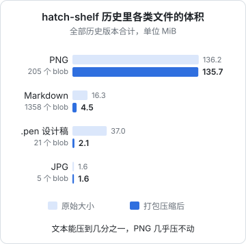
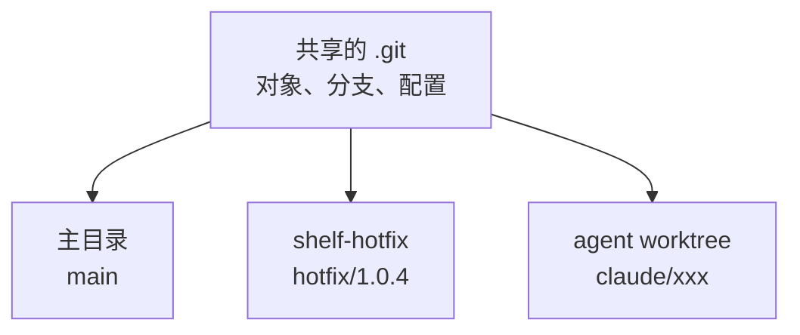

# 大仓库：LFS、sparse checkout、partial clone 与 worktree

Git 的设计假设是：仓库里主要是文本，每个人都有完整的历史。这个假设在两种情况下会失效：仓库里有大量二进制文件，或者仓库大到你只需要其中一小部分。这一章先学会诊断仓库为什么大，然后介绍 Git 提供的几种应对手段，最后讲 worktree，它解决的是另一个问题：同一个仓库同时检出好几份。

案例是 hatch-shelf 自己：一个代码只有几兆的仓库，`.git` 目录写作时是 148 MB。

## 先诊断：大在哪里

```bash
git count-objects -vH
```

```text
count: 445
size: 8.09 MiB
in-pack: 3794
packs: 1
size-pack: 138.97 MiB
prune-packable: 0
garbage: 0
size-garbage: 0 bytes
```

`size-pack` 是打包后的体积，`size` 是还没打包的松散对象。接下来要知道是哪些文件贡献了体积。第 1 章的那条管道命令可以按扩展名汇总，`%(objectsize:disk)` 是对象在磁盘上实际占用的大小（压缩、增量之后）：

```bash
git rev-list --objects --all \
  | git cat-file --batch-check='%(objecttype) %(objectsize) %(objectsize:disk) %(rest)' \
  | awk '$1 == "blob" { ext = $4; sub(/.*\./, "", ext); raw[ext] += $2; disk[ext] += $3; n[ext]++ }
         END { for (e in n) printf "%-8s %5d  %8.1f MiB  %8.1f MiB\n", e, n[e], raw[e]/1048576, disk[e]/1048576 }' \
  | sort -k5 -n -r | head
```

在 hatch-shelf 上的结果画出来是这样：



这张图说明了两件事：

**PNG 占了仓库的九成以上。** 这些是每本书的封面（`books/<id>/cover.png` 和 `design/covers/` 下的同一张图，内容相同所以只存一份）和设计稿导出的插图，平均每张半兆多。

**增量压缩对文本极其有效，对已压缩的二进制几乎无效。** 设计稿 `.pen` 改了 21 版，原始合计 37 MiB，打包后只有 2.1 MiB，因为每一版之间大部分内容相同，Git 只存差异。PNG 本身就是压缩格式，改一个像素整个文件的字节都会变，两个版本之间找不到可复用的片段，存几版就占几倍。

这引出了大仓库问题的核心：**历史只增不减**。工作区里删掉一张图、换一张更小的图，历史里那张旧图仍然在，每个 clone 都要下载它。

> [!TIP]
> 想看某个提交范围给仓库增加了多少体积，`git rev-list --disk-usage --objects v1.0.2..v1.0.3` 直接给出字节数。在 CI 里对每个 PR 算一次，超过阈值就提醒，是防止仓库悄悄变胖的便宜办法。

### 多大算大

> [!WARNING]
> 单文件大小限制、仓库体积建议值、LFS 的免费存储和流量额度都是托管平台的规则，按写作时的情况整理，各平台不同且会调整，以 GitHub 等平台的官方文档为准。

对一个人的仓库，几个经验上的阈值：

| 体积 | 感受 | 建议 |
|---|---|---|
| 几十 MB 以内 | 无感 | 什么都不用做 |
| 100 MB 到 1 GB | clone 要等一会儿，CI 每次检出多花几十秒 | 新增的二进制考虑 LFS；CI 用浅克隆 |
| 1 GB 以上 | 明显影响日常操作 | 迁移二进制到 LFS 或外部存储，必要时改写历史 |
| 单个文件接近 100 MB | 托管平台可能直接拒收 | 必须用 LFS 或移出仓库 |

hatch-shelf 的 148 MB 处在第二档：不紧急，但书越写越多，每本书一张封面，增长是可预期的。

## Git LFS：大文件存在别处

Git LFS（Large File Storage）的思路是：仓库里只存一个几百字节的**指针文件**，真正的内容存在 LFS 服务器上，检出时按需下载。

```text
version https://git-lfs.github.com/spec/v1
oid sha256:4d7a214614ab2935c943f9e0ff69d22eadbb8f32b1258daaa5e2ca24d17e2393
size 612345
```

它通过 Git 的 clean / smudge 过滤器实现：`git add` 时 clean 过滤器把文件内容上传到本地 LFS 缓存、把指针写进暂存区；检出时 smudge 过滤器把指针换回真实内容。对 Git 来说，它只看到了指针。

```bash
brew install git-lfs
git lfs install                       # 每台机器一次，在全局配置里注册过滤器

git lfs track "design/**/*.png"       # 写进 .gitattributes
git add .gitattributes
git commit -m 'chore: 设计稿图片改用 LFS'
```

`.gitattributes` 里会多出一行：

```text
design/**/*.png filter=lfs diff=lfs merge=lfs -text
```

**`track` 只影响以后新加的文件**，已经在历史里的 PNG 不变。要把历史里的也迁过去，需要改写历史：

```bash
git lfs migrate info --everything --include="*.png"     # 先看会迁多少
git lfs migrate import --everything --include="*.png"   # 改写全部分支和标签
```

`migrate import` 和第 4 章的 filter-repo 一样会改写所有提交 ID，同样要强推、所有克隆重新 clone。

### LFS 的代价

LFS 不是免费的午餐：

- **又一个要装的东西**。每台机器、每个 CI 环境都要装 git-lfs，没装的机器检出的是指针文件，构建会以奇怪的方式失败（比如把一个 130 字节的「PNG」打进包里）
- **CI 要显式拉取**。GitHub Actions 的 `actions/checkout` 需要 `lfs: true`
- **托管平台对 LFS 的存储和流量单独计量**，额度用完要付费
- **离线时看不到**还没下载过的 LFS 文件

对 hatch-shelf，有一个具体的权衡：`books/<id>/cover.png` 是要被 `shelf-pack pack` 打进书包、推到手机上的，它必须是真实文件。如果用 LFS，所有运行 `shelf-pack` 的环境都要正确拉取 LFS 内容。而 `design/` 下的插图和导出图只是设计资料，没有任何构建流程依赖它们，是更合适的 LFS 候选。

另一个常被忽略的选项是**不放进 Git**：设计稿导出图如果可以随时从 `.pen` 重新导出，就像 `app/assets/reader/` 一样当作构建产物，进 `.gitignore`。能重新生成的东西不需要版本控制。

## partial clone：先不下载

partial clone 让 clone 时不下载某些对象，等真正用到时再向服务器要。最常用的过滤器：

| 过滤器 | 不下载什么 | 适合 |
|---|---|---|
| `--filter=blob:none` | 所有历史版本的文件内容，只下载提交和 tree；检出时按需取当前版本的 blob | 日常开发的首选 |
| `--filter=blob:limit=1m` | 大于 1 MB 的 blob | 有少量大文件的仓库 |
| `--filter=tree:0` | 连 tree 也不下载 | 一次性构建，用完就扔 |

```bash
git clone --filter=blob:none git@github.com:jarvis/hatch-shelf.git
```

和浅克隆（`--depth=1`）相比，partial clone 保留了**完整的提交历史**，`git log`、`git merge-base`、bisect 都能正常工作，只是查看旧版本的文件内容时要联网补拉。浅克隆则是直接截断历史，适合只需要最新代码的 CI。

> [!NOTE]
> partial clone 需要服务器支持（主流托管平台都支持）。缺点是离线时看不了没下载过的历史内容，`git log -p`、`blame` 这类遍历大量旧版本的命令会触发很多次网络请求。较新的 Git 有 `git backfill` 命令，可以一次性批量补齐缺失的 blob。

## sparse checkout：只检出一部分

partial clone 解决「下载什么」，sparse checkout 解决「检出什么」：工作区里只出现你指定的目录。两者组合效果最好：

```bash
git clone --filter=blob:none --sparse git@github.com:jarvis/hatch-shelf.git
cd hatch-shelf
git sparse-checkout set packages/spec books/system-design
```

`--sparse` 让 clone 一开始只检出根目录下的文件，`set` 之后再加上指定的目录。在 hatch-shelf 上实测：

| 方式 | `.git` 大小 | 工作区 |
|---|---|---|
| 完整克隆 | 148 MB | 全部 1448 个文件 |
| `--filter=blob:none --sparse` | 692 KB | 只有根目录的几个文件 |
| 再 `sparse-checkout set` 两个目录 | 1.6 MB | 根目录 + `packages/spec` + 一本书 |

比如只想在 iPad 上的终端里改一本书，或者给一个只负责写书的 agent 准备一个轻量的工作目录，这样一份克隆就够了。

几个常用命令：

```bash
git sparse-checkout list                 # 当前检出了哪些目录
git sparse-checkout add books/git-deep-dive
git sparse-checkout disable              # 恢复完整检出
```

默认的 cone 模式按目录工作，速度快；不要用旧的按文件模式写复杂规则。

> [!CAUTION]
> sparse checkout 下，pnpm workspace 这类依赖「所有包都在」的工具可能出问题：`pnpm install` 会找不到没检出的 workspace 包。只改内容（Markdown、图片）没问题，要构建和测试代码时，检出的目录要包含完整的依赖链。

## 日常维护：让大仓库操作变快

仓库大了之后，`git status` 变慢通常是因为要扫描整个工作区。几个开关：

```bash
git config core.fsmonitor true       # 用文件系统事件代替全量扫描（macOS、Windows 内置）
git config core.untrackedCache true  # 缓存未跟踪文件的扫描结果
git maintenance start                # 注册后台任务，定期预取、打包、更新提交图
```

`git maintenance start` 会在系统里注册定时任务（macOS 上是 launchd），后台做 `gc` 的增量版本：预取远程对象、写提交图（commit-graph，加速 `log` 和合并基计算）、增量打包。对一个人的仓库来说开不开差别不大，仓库上了 GB 级再考虑。

## worktree：同一个仓库检出多份

worktree 解决的是另一种问题：你需要**同时**在两个分支上工作。传统做法是 stash、切分支、再切回来，或者再 clone 一份。worktree 让一个仓库拥有多个工作目录，共享同一个对象库：

```bash
git worktree add ../shelf-hotfix -b hotfix/1.0.4 v1.0.3   # 新目录、新分支，从 v1.0.3 开始
git worktree add ../shelf-review feat/listen                # 检出已有分支
git worktree list
```

```text
/Users/jarvis/Documents/works/hatch/hatch-shelf  0fd2981 [main]
/Users/jarvis/Documents/works/hatch/shelf-hotfix 0fd2981 [hotfix/1.0.4]
/Users/jarvis/Documents/works/hatch/shelf-review 1f19ac8 [feat/listen]
```

每个 worktree 有自己的 HEAD、暂存区和工作区，但提交、分支、stash、配置是共享的。在一个 worktree 里提交，另一个 worktree 立刻能看到这个提交。

几个用途：

- **线上修复不打断手上的工作**：第 6 章的紧急修复在单独的 worktree 里做，主目录的未提交改动原封不动
- **跑耗时任务**：在一个 worktree 里跑 bisect（第 5 章）或长时间的测试，另一个继续写代码
- **审查分支**：检出别人的分支或 agent 的分支来运行，不影响自己的工作区
- **多个 coding agent 并行**：每个 agent 一个 worktree、一个分支，互不干扰。这是目前并行 agent 的标准做法，见[《编码 Agent 实战》](../coding-agents/05-subagents-parallel.md#并行改代码git-worktree)

### worktree 的规则和坑

- **同一个分支不能同时在两个 worktree 里检出**。这是保护：两个工作区同时往一个分支上提交会互相覆盖。需要时用 `--detach` 检出同一个提交
- **依赖要各自安装**。`node_modules` 在工作目录里，每个 worktree 都要 `pnpm install` 一次。pnpm 的全局内容寻址存储让这一步主要是建链接，不会重复下载（原理见[《前端工程化与 Web 平台》](../frontend-engineering/05-pnpm-monorepo.md#内容寻址存储--符号链接)）。hatch-shelf 用了 `node-linker=hoisted`，平铺的 `node_modules` 里的文件仍是从存储里链接或写时复制过来的，代价不大
- **被忽略的本地文件不会跟过去**：`.env`、本地生成的 `app/assets/reader/`、`ios/` 目录都要在新 worktree 里重新生成或复制
- **用命令删除**：`git worktree remove ../shelf-hotfix`。直接 `rm -rf` 目录会在仓库里留下记录，需要 `git worktree prune` 清理
- **长期保留的 worktree 可以加锁**：`git worktree lock`，防止被 prune 清掉，比如放在移动硬盘上、时常不在线的那种



## 本章要点

- 用 `count-objects` 和 `rev-list --objects | cat-file --batch-check` 诊断仓库为什么大
- 增量压缩对文本有效、对 PNG 这类已压缩的二进制几乎无效；历史只增不减
- LFS 用指针文件代替大文件，代价是每个环境都要装、CI 要显式拉取、平台单独计量；能重新生成的文件不必进仓库
- partial clone（`--filter=blob:none`）保留完整历史、按需下载内容；sparse checkout 只检出指定目录；两者组合可以把克隆缩小两个数量级
- worktree 让一个仓库同时检出多个分支，适合紧急修复、跑 bisect、并行 agent；依赖要各自安装，同一分支不能检出两次

## 动手练习

1. **增量压缩对谁有效**：建两个练习仓库。`txt` 里用 `seq 1 150000 > a.txt` 生成一个约 0.9 MB 的文本，之后每次追加一行再提交，共 10 次；`bin` 里每次用 `head -c 1000000 /dev/urandom > a.bin` 生成新的随机文件再提交，共 10 次。两边都 `git gc` 后比较 `git count-objects -vH` 的 `size-pack`。

   验证：`txt` 只有几百 KiB，`bin` 接近 10 MiB。

   参考答案：文本各版本之间几乎全部相同，打包后只存一份加若干小增量；随机字节和已压缩的 PNG 一样找不到可复用的片段，存几版就占几倍。

2. **同一分支不能检出两次**：在练习仓库里（当前在 main 上）执行 `git worktree add ../wt main`。

   验证：失败并提示 `fatal: 'main' is already used by worktree at '...'`。

   参考答案：这是防止两个工作区同时往一个分支提交。确实需要同一份代码时用 `git worktree add --detach ../wt main`，或者新建分支 `-b`。

3. **rm -rf 留下的记录**：`git worktree add ../wt2 -b tmp` 后直接 `rm -rf ../wt2`，看 `git worktree list`，再执行 `git worktree prune` 后看一次。

   验证：删除后 `wt2` 那一行仍在，末尾标着 `prunable`；prune 之后消失。此时 `git branch` 里 `tmp` 分支还在，需要的话手动删。

   参考答案：worktree 的登记信息在主仓库的 `.git/worktrees/` 下，删目录不会清理它；正确做法是 `git worktree remove`。
