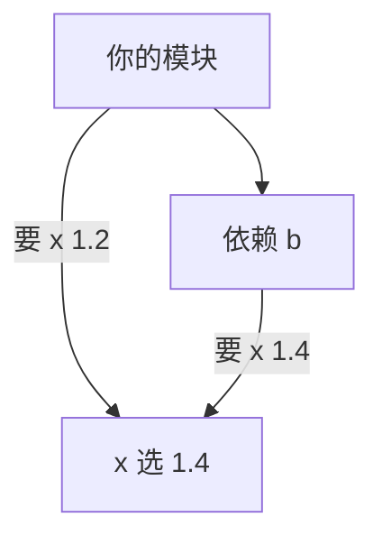
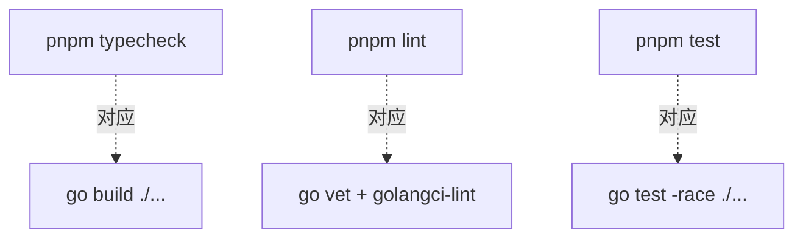

# 模块与工具链

在 TS 项目里，开工前要先做一堆决定：pnpm 还是 npm、ESLint 配哪套规则、Prettier 用几个空格、测试用 Vitest 还是 Jest、构建用 tsc 还是 tsup。Go 把这些决定几乎全做掉了：一个 `go` 命令负责依赖、构建、测试、格式化、静态检查和文档，剩下要选的只有一个 lint 聚合器。

这一章把 Go 的工具链和 npm 生态对照着过一遍，最后搭出本书后面几章共用的项目骨架。

## 安装与版本

macOS 上用 Homebrew 或官网安装包都可以：

```bash
brew install go
go version          # go version go1.26.5 darwin/arm64
go env GOPATH       # /Users/you/go，go install 装的工具在它下面的 bin/
```

把 `$(go env GOPATH)/bin` 加进 `PATH`，后面 `go install` 装的命令行工具才能直接调用。

Go 不需要 nvm 这样的版本管理器。每个项目在 `go.mod` 里写明需要的最低版本，本机的 `go` 发现版本不够时会**自动下载对应的工具链**再执行，这由 `GOTOOLCHAIN` 环境变量控制，默认值是 `auto`。

> [!WARNING]
> 工具链自动切换（`go` / `toolchain` 行的语义）从 Go 1.21 开始提供，之后几个版本细节有过调整。本节按 Go 1.26 的行为描述，以 [go.dev/doc/toolchain](https://go.dev/doc/toolchain) 为准。

## 模块：go.mod 与 go.sum

一个**模块**（module）相当于一个 npm 包：一个目录树，根目录有 `go.mod`。模块里的每个子目录是一个**包**（package），包是导入和编译的单位。

```bash
mkdir shelfcheck && cd shelfcheck
go mod init github.com/jarvis/shelfcheck
```

模块路径通常写成代码仓库的地址。它不需要真的存在，只要你不打算让别人 `go get` 这个模块，写成 `shelfcheck` 也能工作；但写成仓库地址是惯例，以后公开也不用改。

加依赖不需要单独的 install 步骤：在代码里 `import`，然后运行 `go mod tidy`，或者显式 `go get`：

```bash
go get go.yaml.in/yaml/v3@v3.0.6      # 指定版本
go get golang.org/x/sync@latest       # 最新版本
go mod tidy                           # 按代码里实际的 import 增删依赖
```

得到的 `go.mod`：

```text
module github.com/jarvis/shelfcheck

go 1.26.5

require (
	go.yaml.in/yaml/v3 v3.0.6
	golang.org/x/sync v0.24.0
)
```

`go.sum` 记录每个依赖版本的哈希，用于校验下载的代码没被篡改。两个文件都要提交到 git。

### 和 npm 最大的不同：最小版本选择

npm 的 `^1.2.0` 是一个范围，每次安装可能拿到不同版本，所以需要 lockfile 来固定。Go 的 `require` 写的是**最低版本**，构建时用的是「所有依赖要求的最低版本里最高的那个」，这叫最小版本选择（Minimal Version Selection，MVS）。



在这个例子里，你要求 `x` 至少 1.2，你的依赖 `b` 要求至少 1.4，最终用 1.4，**即使 x 已经发布了 1.9 也不会自动用**。结果是：

- 不需要 lockfile，`go.mod` 本身就是可复现的；同样的 `go.mod` 永远构建出同样的依赖树
- 升级永远是你主动做的：`go get -u ./...` 或者 `go get x@latest`
- 不存在「昨天还好好的，今天 CI 装到了一个新的小版本就挂了」

### 大版本写在路径里

Go 的约定是：**导入路径相同，就必须向后兼容**。破坏性变更要换大版本，大版本号写进模块路径：`github.com/jackc/pgx/v5`、`go.yaml.in/yaml/v3`。v4 和 v5 在 Go 看来是两个不同的模块，可以同时存在于一个依赖树里，不会冲突。

`v0.x` 和 `v1.x` 不需要后缀。

### 常用命令对照

| npm / pnpm | Go | 说明 |
|---|---|---|
| `npm init` | `go mod init <path>` | |
| `pnpm add x` | `go get x` | 或写 import 后 `go mod tidy` |
| `pnpm remove x` | 删掉 import 后 `go mod tidy` | |
| `pnpm install` | 不需要 | 构建时自动下载，缓存在 `$(go env GOMODCACHE)` |
| `pnpm outdated` | `go list -m -u all` | 列出可升级的依赖 |
| `pnpm update` | `go get -u ./...` | 升级直接依赖到最新小版本 |
| `pnpm why x` | `go mod why -m x` | 为什么需要这个模块 |
| `pnpm link` | `go.mod` 里的 `replace` | 指向本地目录调试 |
| `pnpm-workspace.yaml` | `go work init` | 多模块本地联调 |
| `npx tool` | `go run pkg@version` | 不安装直接运行 |
| `devDependencies` 里的 CLI | `go get -tool` | 见下文 |

## 项目结构

Go 没有 `src/` 目录，也没有统一的脚手架。社区里比较一致的结构是这样：

```text
shelfcheck/
├── go.mod
├── go.sum
├── cmd/
│   └── shelfcheck/
│       └── main.go          # package main，入口
├── internal/
│   └── book/
│       ├── manifest.go      # package book
│       ├── lint.go
│       └── lint_test.go     # 测试文件和源码放在一起
├── .golangci.yml
└── Makefile
```

- **`cmd/<名字>/`**：每个可执行程序一个目录，里面是 `package main`。`go build ./cmd/shelfcheck` 产出的二进制就叫 `shelfcheck`。一个仓库可以有多个程序，比如 `cmd/server` 和 `cmd/migrate`
- **`internal/`**：编译器强制的私有目录。`internal/` 下的包只能被它的父目录树里的代码导入，别的模块导入会编译失败。这比 TS 里靠约定、靠 `exports` 字段限制要可靠
- 小项目完全可以只有一个 `main.go`，不要为了结构而结构。等真有第二个包时再拆

包名用简短的小写单词，不用下划线和驼峰：`book`、`entry`、`httpx`。不要起 `utils`、`common`、`helpers` 这种名字，它们说明不了包里有什么，最后会变成杂物间。

## 格式化：gofmt

```bash
gofmt -l .          # 列出格式不对的文件
gofmt -w .          # 原地格式化
go fmt ./...        # 等价于 gofmt -l -w，作用于包
```

`gofmt` 没有任何配置项：Tab 缩进、花括号不换行、import 分组排序都是定死的。编辑器装好 Go 插件（VS Code 的 Go 扩展，底层是官方语言服务器 gopls）后保存即格式化，并自动整理 import。

`./...` 是 Go 命令里常见的写法，意思是「当前目录及所有子目录里的包」，相当于 glob 的 `**`。

## 静态检查：go vet

```bash
go vet ./...
```

`go vet` 是官方自带的检查器，专找「能编译、但几乎肯定是 bug」的代码：`Printf` 的格式动词和参数类型不匹配、复制了带锁的结构体、不可达代码、错误的结构体 tag 等。它误报很少，`go test` 运行时也会自动跑其中一部分。

```go
package main

import "fmt"

func main() {
	n := 3
	fmt.Printf("共 %s 本书\n", n) // vet: Printf format %s has arg n of wrong type int
}
```

## lint 聚合器：golangci-lint

ESLint 在 Go 生态里对应的是 **golangci-lint**：它本身不实现规则，而是把几十个独立的 linter 聚合在一起，并行跑、统一配置、统一输出。

安装推荐用 Homebrew 或官方提供的二进制，而不是 `go install`，这样它不会和项目依赖互相影响：

```bash
brew install golangci-lint
golangci-lint version
```

一份适合个人项目的起步配置，放在项目根目录 `.golangci.yml`：

> [!WARNING]
> 下面的配置是 golangci-lint **v2** 的格式（2025 年发布，顶层要写 `version: "2"`），v1 的配置文件不能直接用，可以用 `golangci-lint migrate` 转换。本节在 v2.15 上验证过，linter 的名字和选项会随版本变化，以 [golangci-lint.run](https://golangci-lint.run) 的文档为准。

```yaml
version: "2"

linters:
  default: standard        # errcheck、govet、ineffassign、staticcheck、unused
  enable:
    - bodyclose            # http 响应体忘了 Close
    - errorlint            # 用 == 比较 error、类型断言 error
    - gosec                # 常见安全问题
    - misspell
    - revive
    - unconvert
  exclusions:
    presets:
      - std-error-handling # 不要求检查 fmt.Fprintf、Close 之类的返回值
    rules:
      - path: _test\.go
        linters: [gosec]   # 测试代码不跑安全检查
  settings:
    revive:
      rules:
        - name: exported
          disabled: true   # 个人项目不强制给每个导出名字写注释

formatters:
  enable:
    - gofumpt
    - goimports
```

几个值得开的 linter：

| linter | 抓什么 |
|---|---|
| errcheck | 忽略了函数返回的 `error`，Go 里最常见的 bug |
| staticcheck | 大而全的检查：废弃 API、无效代码、可简化的写法，相当于 `eslint:recommended` |
| errorlint | 用 `err == ErrX` 而不是 `errors.Is`，第 4 章讲为什么 |
| bodyclose | `http.Get` 之后没关 `resp.Body`，会泄漏连接 |
| gosec | 硬编码凭据、SQL 拼接、过宽的文件权限 |
| gofumpt | 比 gofmt 更严格一点的格式化，规则仍然固定 |

`std-error-handling` 这条排除规则值得说一下：v2 默认不再排除任何东西，`errcheck` 会对每个没检查返回值的 `fmt.Fprintf` 报错。在[第 8 章](08-build-a-cli.md)的 CLI 项目上不开排除直接跑，得到的是这样的输出：

```text
cmd/shelfcheck/main.go:83:15: Error return value of `fmt.Fprintf` is not checked (errcheck)
			fmt.Fprintf(stdout, "✗ %s\n", r.name)
			           ^
6 issues:
* errcheck: 6
```

往终端打印失败了也做不了什么，这类报错打开预设排除即可。真正要关心的是业务代码里被忽略的 `error`。

```bash
golangci-lint run ./...        # 检查
golangci-lint fmt ./...        # 用配置里的 formatters 格式化
golangci-lint fmt --diff ./... # 只看差异，CI 里用
```

## 项目里的工具依赖：go tool

TS 项目会把 `drizzle-kit`、`tsx` 这类 CLI 放进 `devDependencies`，团队成员 `pnpm install` 后版本一致。Go 的对应物是 `go.mod` 里的 `tool` 指令：

> [!WARNING]
> `go get -tool` 和 `go tool <名字>` 运行模块工具是 Go 1.24 加入的功能，更老的版本要用 `tools.go` 加空白导入的老办法。以 [go.dev/doc/modules/managing-dependencies](https://go.dev/doc/modules/managing-dependencies) 为准。

```bash
go get -tool golang.org/x/perf/cmd/benchstat@latest
go tool benchstat old.txt new.txt     # 用 go.mod 里锁定的版本运行
```

`go.mod` 里多出一行：

```text
tool golang.org/x/perf/cmd/benchstat
```

适合这样管理的是和项目代码紧密相关的生成器和分析工具：`stringer`、`sqlc`、`benchstat`。golangci-lint 官方不推荐这样装，它依赖多，会把一大堆间接依赖带进你的 `go.mod`。

## 文档：go doc

不用离开终端就能看任何包的文档：

```bash
go doc strings.Cut
go doc -all net/http.ServeMux | less
go doc github.com/jackc/pgx/v5/pgxpool.Pool
```

```text
package strings // import "strings"

func Cut(s, sep string) (before, after string, found bool)
    Cut slices s around the first instance of sep, returning the text before
    and after sep. The found result reports whether sep appears in s. If sep
    does not appear in s, cut returns s, "", false.
```

网页版是 pkg.go.dev，搜任何公开模块都能看到文档、版本列表和被引用次数。Go 的文档就是源码里紧挨着声明的注释，所以第三方库的文档质量普遍不错。

## 任务脚本：Makefile

Go 没有 `package.json` 的 `scripts`。最常见的替代是 Makefile，它在 macOS 和 Linux 上都是现成的：

```makefile
.PHONY: build test lint check

VERSION ?= $(shell git describe --tags --always --dirty)

build:
	go build -trimpath -ldflags "-s -w -X main.version=$(VERSION)" -o bin/shelfcheck ./cmd/shelfcheck

test:
	go test -race ./...

lint:
	go vet ./...
	golangci-lint run ./...

check: lint test
```

Makefile 的缩进必须是 Tab。不喜欢 make 的语法可以用 `just`，或者干脆写一个 `scripts/` 目录放 shell 脚本。

## 把检查串起来

和 hatch-shelf 仓库里「声明完成前必须通过 typecheck、test、lint」的规矩一样，Go 项目也该有一条命令跑完所有检查。对应关系是：



Go 的编译速度很快，`go build ./...` 在小项目上通常一两秒，所以「类型检查」和「构建」在 Go 里就是同一件事。CI 里一般这样写：

```bash
test -z "$(gofmt -l .)" || { gofmt -l .; exit 1; }   # 格式不对就失败
go vet ./...
golangci-lint run ./...
go test -race ./...
```

## 本章要点

- 一个 `go` 命令覆盖依赖、构建、测试、格式化、vet 和文档；外加一个 golangci-lint 就够了
- `go.mod` 写最低版本，最小版本选择让构建天然可复现，不需要 lockfile；升级永远是主动的
- 大版本号写在导入路径里（`/v5`），同一模块的不同大版本可以共存
- `cmd/<名字>/` 放入口，`internal/` 是编译器强制的私有目录；小项目一个 `main.go` 就够
- `gofmt` 没有配置项；`go vet` 误报很少，一定要跑
- golangci-lint v2 配置要写 `version: "2"`，默认不排除任何报错，按需打开预设排除
- 项目内工具用 `go get -tool` 管理，任务脚本用 Makefile
