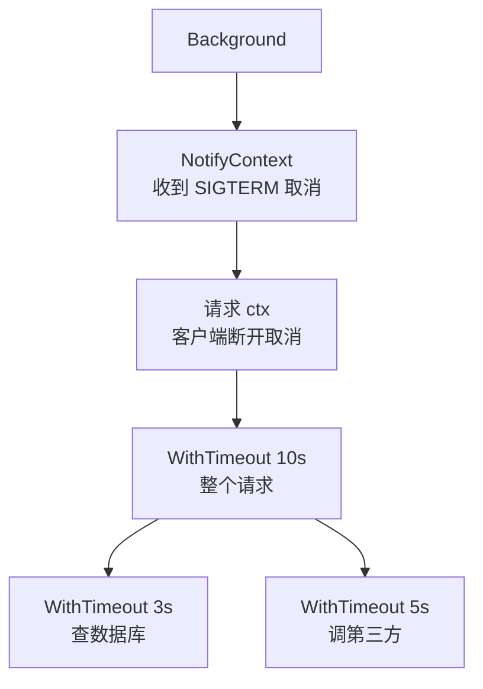

# context、超时与取消

上一章留下了一个问题：goroutine 一旦启动，外面怎么叫它停下？Node 里你会传一个 `AbortSignal`：`fetch(url, { signal })`，超时或用户取消时调用 `controller.abort()`。Go 的对应物是 `context.Context`，而且比 `AbortSignal` 用得普遍得多：**标准库和几乎所有第三方库里，凡是可能阻塞的函数，第一个参数都是 `ctx`**。

这一章讲 context 的用法和规矩，最后写一个能优雅退出的后台 worker。

## Context 是什么

```go
type Context interface {
	Deadline() (deadline time.Time, ok bool) // 什么时候到期
	Done() <-chan struct{}                   // 被取消或到期时关闭
	Err() error                              // 为什么结束：Canceled 或 DeadlineExceeded
	Value(key any) any                       // 请求范围内的附带数据
}
```

核心就是 `Done()` 返回的那个 channel：**context 被取消时它会被关闭**，所有在等它的 goroutine 同时收到通知（从已关闭的 channel 接收会立即返回，第 5 章讲过）。

和 `AbortController` 对照：

| AbortController | context |
|---|---|
| `new AbortController()` | `ctx, cancel := context.WithCancel(parent)` |
| `AbortSignal.timeout(5000)` | `context.WithTimeout(parent, 5*time.Second)` |
| `controller.abort(reason)` | `cancel()`，或 `WithCancelCause` 的 `cancel(err)` |
| `signal.aborted` | `ctx.Err() != nil` |
| `signal.addEventListener("abort", fn)` | `<-ctx.Done()`，或 `context.AfterFunc(ctx, fn)` |
| `AbortSignal.any([a, b])` | 天然支持：子 context 在父 context 取消时也会取消 |
| 不传就没有 | 永远要传，不知道传什么就传 `context.Background()` |

## context 是一棵树

context 不可修改，每次「加点东西」都是基于父 context 派生一个新的子 context。父被取消，所有子孙都被取消；子被取消，不影响父。



这张图就是一个 HTTP 服务里 context 的典型结构：进程收到 SIGTERM，所有请求都会收到取消信号；某个客户端断开，只取消它自己的请求；数据库查询有自己更短的超时，但也不会超过整个请求剩余的时间，因为**子 context 的截止时间取自己和父亲中较早的那个**。

## 四种派生方式

```go
package main

import (
	"context"
	"errors"
	"fmt"
	"time"
)

func slowQuery(ctx context.Context, d time.Duration) (string, error) {
	select {
	case <-time.After(d): // 模拟一个需要 d 时间的操作
		return "rows", nil
	case <-ctx.Done(): // 被取消或超时，立刻返回
		return "", ctx.Err()
	}
}

func main() {
	root := context.Background()

	// 1. 超时
	ctx, cancel := context.WithTimeout(root, 50*time.Millisecond)
	defer cancel() // 一定要调用，释放计时器；即使已经超时
	_, err := slowQuery(ctx, 200*time.Millisecond)
	fmt.Println(err, errors.Is(err, context.DeadlineExceeded))

	// 2. 手动取消
	ctx2, cancel2 := context.WithCancel(root)
	go func() {
		time.Sleep(20 * time.Millisecond)
		cancel2()
	}()
	_, err = slowQuery(ctx2, time.Second)
	fmt.Println(err)

	// 3. 带原因的取消
	ctx3, cancel3 := context.WithCancelCause(root)
	cancel3(errors.New("用户点了停止"))
	fmt.Println(ctx3.Err(), "|", context.Cause(ctx3))

	// 4. 附带值，见后文
	type ctxKey string
	ctx4 := context.WithValue(root, ctxKey("requestID"), "req-42")
	fmt.Println(ctx4.Value(ctxKey("requestID")))
}
```

```text
context deadline exceeded true
context canceled
context canceled | 用户点了停止
req-42
```

`WithTimeout` 和 `WithCancel` 返回的 `cancel` 函数**必须调用**，惯例是紧跟一行 `defer cancel()`。忘了调用，在父 context 结束前，子 context 和它的计时器都不会被释放；`go vet` 会检查出这种遗漏。

> [!WARNING]
> `WithCancelCause` / `Cause` 从 Go 1.20 开始提供，`AfterFunc`、`WithoutCancel`、`WithDeadlineCause` 从 Go 1.21 开始提供。以 `context` 包文档为准。

## 使用规矩

Go 官方对 context 有几条明确约定，几乎所有代码库都遵守：

1. **作为第一个参数传递，命名为 `ctx`**：`func (s *Store) List(ctx context.Context, storeID int64) ...`
2. **不要存进结构体字段**。context 代表「这一次调用」的生命周期，存起来就和调用脱钩了。例外是像 `http.Request` 这种本身就代表一次调用的对象
3. **不要传 `nil`**。不知道传什么就传 `context.Background()`；还没想好、留着以后改的地方传 `context.TODO()`
4. **只有发起操作的一方取消**。被调用的函数只监听 `ctx.Done()`，不去取消别人给它的 context

在被调用一方，响应取消有两种方式：调用本身接受 ctx 的函数（数据库、HTTP、`time` 之外的大部分阻塞操作都接受），或者在循环里定期检查 `ctx.Err()`：

```go
for _, file := range files {
	if err := ctx.Err(); err != nil {
		return err // 已经被取消，不再处理剩下的文件
	}
	if err := process(file); err != nil {
		return err
	}
}
```

## 在 HTTP 客户端和数据库里传 ctx

```go
package main

import (
	"context"
	"fmt"
	"io"
	"net/http"
	"net/http/httptest"
	"time"
)

func fetchStatus(ctx context.Context, url string) (string, error) {
	req, err := http.NewRequestWithContext(ctx, http.MethodGet, url, nil)
	if err != nil {
		return "", err
	}
	resp, err := http.DefaultClient.Do(req)
	if err != nil {
		return "", fmt.Errorf("fetch status: %w", err) // 底层错误里已经带了 URL
	}
	defer resp.Body.Close()
	body, err := io.ReadAll(resp.Body)
	return string(body), err
}

func main() {
	// 一个故意很慢的测试服务器
	slow := httptest.NewServer(http.HandlerFunc(func(w http.ResponseWriter, r *http.Request) {
		select {
		case <-time.After(time.Second):
			fmt.Fprint(w, "ok")
		case <-r.Context().Done(): // 客户端放弃了，服务端也别再干了
		}
	}))
	defer slow.Close()

	ctx, cancel := context.WithTimeout(context.Background(), 100*time.Millisecond)
	defer cancel()
	_, err := fetchStatus(ctx, slow.URL)
	fmt.Println(err)
}
```

```text
fetch status: Get "http://127.0.0.1:58339": context deadline exceeded
```

这个例子同时演示了两端：客户端用 `http.NewRequestWithContext` 绑定超时，超时后连接被中断；服务端用 `r.Context()` 感知客户端已经断开，停止无用的工作。`http.Get(url)` 这种不带 ctx 的便捷函数没有超时，生产代码里不要用。

数据库也一样，pgx 的每个查询方法第一个参数都是 ctx：

```go
rows, err := pool.Query(ctx, "SELECT ... WHERE store_id = $1", storeID)
```

ctx 被取消时，pgx 立即停止等待并返回错误。它的默认做法是给底层连接设置截止时间、中断读写，这条连接随之作废，连接池会换一条新的；如果希望 Postgres 那一侧也立刻停止执行这条查询，可以在连接配置里把 `BuildContextWatcherHandler` 换成 `pgconn.CancelRequestContextWatcherHandler`，让 pgx 额外发送一个取消请求。细节以 pgx 的文档为准。

## 进程信号：signal.NotifyContext

CLI 被 Ctrl-C、容器被 `docker stop` 时，进程会收到 SIGINT 或 SIGTERM。把信号转成 context 取消，整个程序就能用同一套机制退出：

```go
package main

import (
	"context"
	"fmt"
	"os"
	"os/signal"
	"syscall"
	"time"
)

func main() {
	ctx, stop := signal.NotifyContext(context.Background(), os.Interrupt, syscall.SIGTERM)
	defer stop()

	fmt.Println("运行中，按 Ctrl-C 退出（3 秒后自动结束）")
	select {
	case <-ctx.Done():
		fmt.Println("收到信号，开始清理")
	case <-time.After(3 * time.Second):
		fmt.Println("正常结束")
	}
}
```

`stop()` 之后再按 Ctrl-C 会恢复默认行为（直接结束进程）。所以清理阶段如果卡住了，用户再按一次 Ctrl-C 就能强制退出，这是 CLI 应有的礼貌。

## context.Value：只放请求范围的数据

NestJS 里，请求级别的数据（当前用户、租户、请求 id）可以放在 `REQUEST` 作用域的 provider 里，或者 `AsyncLocalStorage` 里。Go 用 `context.WithValue`：

```go
package main

import (
	"context"
	"fmt"
)

// 键用未导出的类型，别的包无法构造出同样的键，不会冲突
type ctxKey int

const tenantKey ctxKey = 0

func WithTenant(ctx context.Context, storeID int64) context.Context {
	return context.WithValue(ctx, tenantKey, storeID)
}

func TenantFrom(ctx context.Context) (int64, bool) {
	id, ok := ctx.Value(tenantKey).(int64)
	return id, ok
}

func main() {
	ctx := WithTenant(context.Background(), 7)
	if id, ok := TenantFrom(ctx); ok {
		fmt.Println("当前门店", id)
	}
}
```

两条纪律：

- **键用未导出的自定义类型**，并且提供 `WithXxx` / `XxxFrom` 两个函数，不让调用方直接碰键
- **只放跨 API 边界、跟着请求走的数据**：请求 id、认证后的用户、租户。函数需要的业务参数要显式传，不要藏在 context 里。`ctx.Value` 返回 `any`，编译器帮不了你，藏得越多越难查

## 案例：能优雅退出的后台 worker

把前面的东西组合起来：一个常驻 worker 定时从数据库取任务（这里用一个函数模拟），每个任务有自己的超时；收到 SIGTERM 后不再取新任务，等手上的任务做完再退出，但最多等一个宽限期。这和[《软件架构与系统设计》队列一章](../system-design/04-queues-jobs.md)里 NestJS 版的 worker 做的是同一件事。

```go
package main

import (
	"context"
	"errors"
	"fmt"
	"log/slog"
	"os"
	"os/signal"
	"syscall"
	"time"
)

type Job struct {
	ID       int
	Duration time.Duration // 模拟任务耗时
}

var queue = []Job{{1, 30 * time.Millisecond}, {2, 300 * time.Millisecond}, {3, 20 * time.Millisecond}}

// claimNext 模拟 SELECT ... FOR UPDATE SKIP LOCKED 取一个任务
func claimNext(ctx context.Context) (*Job, error) {
	if err := ctx.Err(); err != nil {
		return nil, err
	}
	if len(queue) == 0 {
		return nil, nil
	}
	j := queue[0]
	queue = queue[1:]
	return &j, nil
}

func runJob(ctx context.Context, j *Job) error {
	ctx, cancel := context.WithTimeout(ctx, 100*time.Millisecond) // 单个任务的超时
	defer cancel()
	select {
	case <-time.After(j.Duration):
		return nil
	case <-ctx.Done():
		return fmt.Errorf("job %d: %w", j.ID, ctx.Err())
	}
}

// work 一直取任务、做任务，直到 stopCtx 被取消。
// 正在做的任务用 jobCtx，它在 stopCtx 取消后还能再活一个宽限期。
func work(stopCtx context.Context, log *slog.Logger) {
	ticker := time.NewTicker(50 * time.Millisecond)
	defer ticker.Stop()
	for {
		select {
		case <-stopCtx.Done():
			log.Info("worker stopped")
			return
		case <-ticker.C:
		}

		job, err := claimNext(stopCtx)
		if err != nil || job == nil {
			continue
		}

		// 任务不直接用 stopCtx：收到 SIGTERM 时不要把手上的任务立刻掐掉
		jobCtx, cancel := context.WithCancel(context.WithoutCancel(stopCtx))
		stopGrace := context.AfterFunc(stopCtx, func() {
			time.AfterFunc(2*time.Second, cancel) // 宽限期过了才真正取消
		})
		err = runJob(jobCtx, job)
		stopGrace()
		cancel()

		switch {
		case errors.Is(err, context.DeadlineExceeded):
			log.Warn("job timed out, will retry", "job", job.ID)
		case err != nil:
			log.Error("job failed", "job", job.ID, "err", err)
		default:
			log.Info("job done", "job", job.ID)
		}
	}
}

func main() {
	log := slog.New(slog.NewTextHandler(os.Stdout, &slog.HandlerOptions{
		ReplaceAttr: func(_ []string, a slog.Attr) slog.Attr {
			if a.Key == slog.TimeKey {
				return slog.Attr{} // 示例输出里去掉时间
			}
			return a
		},
	}))
	ctx, stop := signal.NotifyContext(context.Background(), os.Interrupt, syscall.SIGTERM)
	defer stop()

	ctx, cancel := context.WithTimeout(ctx, 600*time.Millisecond) // 示例里用超时模拟收到 SIGTERM
	defer cancel()
	work(ctx, log)
}
```

```text
level=INFO msg="job done" job=1
level=WARN msg="job timed out, will retry" job=2
level=INFO msg="job done" job=3
level=INFO msg="worker stopped"
```

这里用到了两个不太常见的函数：

- `context.WithoutCancel(stopCtx)`：派生一个**不随父亲取消**的 context，但保留父亲里的值（请求 id 之类）。任务用它，SIGTERM 来了也不会被立刻中断
- `context.AfterFunc(stopCtx, f)`：父 context 取消时执行 `f`。这里用它在收到停止信号后启动一个 2 秒的宽限计时器，到点再取消任务

部署时，Docker 默认在 SIGTERM 之后等 10 秒才发 SIGKILL，宽限期要比它短；任务确实可能更久，就在 compose 里调大 `stop_grace_period`。即使最后被强杀，任务也应该是幂等的，下次启动能重新捡起来。

## 计时器的几个细节

> [!WARNING]
> Go 1.23 修改了 `time.Timer` / `time.Ticker` 的实现：不再引用的计时器可以被立即回收，`Reset`/`Stop` 之后也不会再收到过期的旧值。更老的版本里，在循环中反复 `time.After` 会累积未触发的计时器。以 [go.dev/doc/go1.23](https://go.dev/doc/go1.23) 的 Timer changes 一节为准。

- `time.After(d)` 写起来最短，适合一次性的超时；在高频循环里用 `time.NewTimer` 并复用，或者直接用 context
- `time.Ticker` 用完要 `Stop()`
- 不要用 `time.Sleep` 等待「可能被取消」的事：它不响应 context。可以取消的等待都写成 `select` + `ctx.Done()`

## 本章要点

- context 是 Go 版的 `AbortSignal`，但贯穿整个生态：凡是可能阻塞的函数，第一个参数都是 `ctx`
- context 是一棵树：父取消则子孙全部取消；子的截止时间不会晚于父
- `WithTimeout` / `WithCancel` 返回的 `cancel` 必须调用，紧跟 `defer cancel()`
- 不存进结构体、不传 nil、只有发起方取消；循环里定期检查 `ctx.Err()`
- HTTP 客户端用 `NewRequestWithContext`，服务端用 `r.Context()` 感知断开；pgx 的查询同样随 ctx 取消立即返回
- `signal.NotifyContext` 把 SIGINT / SIGTERM 变成 context 取消
- `context.Value` 只放请求 id、用户、租户这类请求范围的数据，键用未导出类型
- 优雅退出：停止取新任务，手上的任务用 `WithoutCancel` + 宽限期，任务本身要幂等
