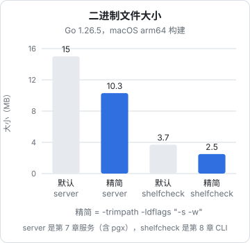

# 构建与部署

部署一个 NestJS 服务，镜像里要有 Node 运行时、`node_modules`、编译后的 JS，几百 MB 是常态；发一个 Node CLI，对方要先装 Node。Go 的产物是**一个静态链接的二进制文件**：没有运行时依赖，拷过去就能跑。这是一人公司选 Go 写工具和小服务的最大理由，这一章把它用足：构建参数、交叉编译、把文件嵌进二进制、最小镜像，以及不用 Docker 时直接交给 systemd。

## go build 的几个参数

```bash
go build -o bin/server ./cmd/server
```

生产构建通常再加三样：

```bash
CGO_ENABLED=0 go build \
  -trimpath \
  -ldflags "-s -w -X main.version=v1.0.0" \
  -o bin/server ./cmd/server
```

| 参数 | 作用 |
|---|---|
| `CGO_ENABLED=0` | 不链接 C 代码，产出完全静态的二进制，不依赖系统的 libc |
| `-trimpath` | 去掉二进制里的本机绝对路径（`/Users/you/...`），构建结果可复现，也不泄露目录结构 |
| `-ldflags "-s -w"` | 去掉符号表和 DWARF 调试信息，体积小三分之一；代价是不能用调试器单步调试，panic 栈信息不受影响 |
| `-ldflags "-X main.version=..."` | 在链接时给 `main` 包的字符串变量赋值，用来注入版本号 |

用第 7 章的服务和第 8 章的 CLI 实测：



服务大一些是因为带了 pgx 和整个 `net/http`。和一个 NestJS 镜像里动辄上百 MB 的 `node_modules` 比，这已经是另一个数量级了。

## 版本信息

第 8 章的 CLI 里有一行 `var version = "dev"`，构建时用 `-X` 覆盖：

```bash
go build -ldflags "-X main.version=$(git describe --tags --always --dirty)" ./cmd/shelfcheck
```

另外，Go 会自动把模块依赖和 VCS 信息写进二进制。不需要任何额外配置，用 `go version -m` 就能查看任何一个 Go 二进制是怎么构建的：

```bash
go version -m bin/shelfcheck
```

```text
bin/shelfcheck: go1.26.5
	path	github.com/jarvis/shelfcheck/cmd/shelfcheck
	mod	github.com/jarvis/shelfcheck	(devel)
	dep	go.yaml.in/yaml/v3	v3.0.6	h1:zcDfvjXEqTQmpjniUBLc91xYJMB2c4QOFxEF/LCEckM=
	dep	golang.org/x/sync	v0.24.0	h1:iqiDrGoDgyuvAKrhLQthUEzU/R378N78gXbBjxed7oA=
	build	-buildmode=exe
	build	-compiler=gc
	build	-trimpath=true
	build	CGO_ENABLED=0
	build	GOARCH=arm64
	build	GOOS=darwin
```

程序里也能读到这些信息，加一个 `version` 子命令很方便，线上排查「跑的到底是哪个提交」时特别有用：

```go
package main

import (
	"fmt"
	"runtime/debug"
)

var version = "dev"

func printVersion() {
	fmt.Println("version:", version)
	if info, ok := debug.ReadBuildInfo(); ok {
		fmt.Println("go:", info.GoVersion)
		for _, s := range info.Settings {
			if s.Key == "vcs.revision" || s.Key == "vcs.time" || s.Key == "vcs.modified" {
				fmt.Printf("%s: %s\n", s.Key, s.Value)
			}
		}
	}
}

func main() { printVersion() }
```

```text
version: dev
go: go1.26.5
vcs.revision: 3bb0d5b9e0f79ff0bed1085a0a33e23c2057c2d5
vcs.time: 2026-11-04T07:35:34Z
vcs.modified: false
```

`vcs.*` 只有在 git 仓库里用 `go build` 构建时才有。Docker 构建时如果没有把 `.git` 拷进构建上下文，就拿不到，这时靠 `-X` 注入的版本号。

## 交叉编译

在 Mac 上直接构建 Linux 服务器用的二进制，只需要设两个环境变量：

```bash
GOOS=linux GOARCH=amd64 CGO_ENABLED=0 go build -trimpath -ldflags "-s -w" -o bin/server-linux-amd64 ./cmd/server
GOOS=linux GOARCH=arm64 CGO_ENABLED=0 go build -trimpath -ldflags "-s -w" -o bin/server-linux-arm64 ./cmd/server
GOOS=windows GOARCH=amd64 CGO_ENABLED=0 go build -trimpath -ldflags "-s -w" -o bin/shelfcheck.exe ./cmd/shelfcheck
file bin/server-linux-amd64 bin/shelfcheck.exe
```

```text
bin/server-linux-amd64: ELF 64-bit LSB executable, x86-64, version 1 (SYSV), statically linked, Go BuildID=..., stripped
bin/shelfcheck.exe:     PE32+ executable (console) x86-64, for MS Windows
```

不需要交叉编译工具链，不需要 Docker，不需要虚拟机，几秒钟完成。常用组合：

| 目标 | GOOS | GOARCH |
|---|---|---|
| 大多数云服务器、VPS | `linux` | `amd64` |
| ARM 服务器（AWS Graviton、部分 VPS）、树莓派 4/5 | `linux` | `arm64` |
| Apple Silicon Mac | `darwin` | `arm64` |
| Intel Mac | `darwin` | `amd64` |
| Windows | `windows` | `amd64` |

`go tool dist list` 列出全部支持的组合。

### CGO 的代价

上面的一切都建立在 `CGO_ENABLED=0` 上。一旦依赖用到了 C 代码（最常见的是 `mattn/go-sqlite3`），交叉编译就需要目标平台的 C 编译器，二进制也会动态链接 libc，`scratch` / distroless 镜像里跑不起来。

建议：**能找到纯 Go 实现就用纯 Go 实现**。SQLite 有纯 Go 的 `modernc.org/sqlite`；pgx 本身就是纯 Go 的。构建脚本里一律显式写 `CGO_ENABLED=0`，让依赖了 C 的库在构建时就报错，而不是在部署后才发现。

## 把文件嵌进二进制：embed

单二进制部署的最后一块拼图是静态文件：前端页面、SQL 迁移、模板、示例数据。`//go:embed` 指令在编译时把文件打包进二进制：

```go
package main

import (
	"embed"
	"fmt"
	"io/fs"
	"net/http"
	"os"
	"time"
)

//go:embed static
var staticFiles embed.FS

func main() {
	if len(os.Args) > 1 && os.Args[1] == "healthcheck" {
		os.Exit(healthcheck())
	}
	sub, _ := fs.Sub(staticFiles, "static") // 去掉路径前缀 static/
	http.Handle("GET /", http.FileServerFS(sub))
	fmt.Println("listening on :8080")
	_ = http.ListenAndServe(":8080", nil)
}

// healthcheck 给 Docker HEALTHCHECK 用：镜像里没有 curl，就让程序自己检查自己
func healthcheck() int {
	c := http.Client{Timeout: 2 * time.Second}
	resp, err := c.Get("http://127.0.0.1:8080/")
	if err != nil {
		return 1
	}
	resp.Body.Close()
	if resp.StatusCode != http.StatusOK {
		return 1
	}
	return 0
}
```

`embed.FS` 实现了第 8 章的 `fs.FS` 接口，所以能直接交给 `http.FileServerFS`，也能交给 `shelfcheck` 的 `Check`。注释 `//go:embed static` 必须紧挨在变量声明上面，`//` 和 `go` 之间不能有空格；路径是相对于这个 `.go` 文件的，不能用 `..` 引用上级目录。

一个 Vite 构建出来的管理后台，放进 `static/` 嵌进去，整个产品就是一个文件。

`healthcheck` 子命令是为下一节的最小镜像准备的：镜像里没有 curl 和 shell，健康检查只能靠程序自己。

## 最小镜像

Docker 多阶段构建的原理见[《Docker 与容器》的多阶段构建一章](../docker-containers/04-multi-stage.md)。Go 服务的版本是这样：

> [!WARNING]
> 镜像标签（`golang:1.26`、`gcr.io/distroless/static-debian12`）会随新版本和新的 Debian 发行版更新，`static-debian12` 之后可能有基于更新 Debian 的标签。以 Docker Hub 上 golang 镜像页面和 GoogleContainerTools/distroless 仓库的说明为准。

```dockerfile
# ---- 构建阶段 ----
FROM golang:1.26 AS build
WORKDIR /src

# 先只拷 go.mod / go.sum 下载依赖，依赖不变时这一层走缓存
COPY go.mod go.sum ./
RUN go mod download

COPY . .
ARG VERSION=dev
RUN CGO_ENABLED=0 go build -trimpath \
    -ldflags "-s -w -X main.version=${VERSION}" \
    -o /out/server ./cmd/server

# ---- 运行阶段 ----
FROM gcr.io/distroless/static-debian12:nonroot
COPY --from=build /out/server /server
USER nonroot:nonroot
EXPOSE 8080
ENTRYPOINT ["/server"]
```

运行阶段用的是 distroless 的 `static` 镜像：它只包含 CA 证书、时区数据、`/etc/passwd` 里的 nonroot 用户，没有 shell、没有包管理器，本身只有约 2 MB。最终镜像大小约等于二进制大小加 2 MB，十几 MB。

为什么不直接用 `scratch`（完全空的镜像）？因为空镜像里**没有 CA 证书**，程序调用任何 HTTPS 接口都会报证书错误；也**没有时区数据**，`time.LoadLocation("Asia/Shanghai")` 会失败。用 scratch 的话要自己把这两样拷进去，或者在代码里 `import _ "time/tzdata"` 把时区库编进二进制（大约增加 450 KB）。distroless/static 把这些都准备好了，还提供了非 root 用户，是更省心的选择。

需要进容器排查问题时，distroless 有带 busybox shell 的 `:debug` 标签；平时用不带 shell 的版本，攻击面最小。

### 在 compose 里跑

```yaml
services:
  counter-lite:
    image: ghcr.io/jarvis/counter-lite:${TAG:-latest}
    environment:
      DATABASE_URL: postgres://counter:${DB_PASSWORD}@db:5432/counter?pool_max_conns=8
      PORT: "8080"
    depends_on:
      db:
        condition: service_healthy
    healthcheck:
      test: ["CMD", "/server", "healthcheck"]
      interval: 10s
      timeout: 3s
      retries: 3
    stop_grace_period: 20s
    restart: unless-stopped
```

`healthcheck` 用的是二进制自带的子命令（第 7 章的服务照上一节的写法加一个即可），因为镜像里没有 curl。`stop_grace_period` 要比程序里 `srv.Shutdown` 的超时（第 7 章设的 15 秒）稍长，留出完成优雅退出的时间。

## 不用 Docker：systemd

只有一个二进制文件时，Docker 甚至不是必需的。直接拷到服务器，交给 systemd 管理，是最朴素也最省资源的部署方式。systemd 的完整用法见[《Linux 运维基础》的 systemd 一章](../linux-essentials/04-systemd.md)。

```bash
GOOS=linux GOARCH=amd64 CGO_ENABLED=0 go build -trimpath -ldflags "-s -w" -o bin/server ./cmd/server
scp bin/server deploy@vps:/opt/counter-lite/server.new
ssh deploy@vps 'mv /opt/counter-lite/server.new /opt/counter-lite/server && sudo systemctl restart counter-lite'
```

先传成 `server.new` 再 `mv`，是因为 `mv` 在同一个文件系统内是原子的：进程要么看到旧文件，要么看到新文件，不会读到传了一半的文件。

```ini
# /etc/systemd/system/counter-lite.service
[Unit]
Description=counter-lite
After=network-online.target
Wants=network-online.target

[Service]
User=counter
EnvironmentFile=/etc/counter-lite/env
ExecStart=/opt/counter-lite/server
Restart=on-failure
RestartSec=2s
TimeoutStopSec=20s

# 基本的加固：只读文件系统、私有 /tmp、不能提权
ProtectSystem=strict
PrivateTmp=true
NoNewPrivileges=true

[Install]
WantedBy=multi-user.target
```

```bash
sudo systemctl daemon-reload
sudo systemctl enable --now counter-lite
journalctl -u counter-lite -f          # 第 7 章 slog 输出的 JSON 日志都在这里
```

systemd 停止服务时先发 SIGTERM，等 `TimeoutStopSec` 后再发 SIGKILL，和 Docker 的行为一致，第 6 章和第 7 章的优雅退出代码不用改。

Docker 和 systemd 怎么选：服务器上已经用 compose 跑着 Postgres 和 NestJS 的，Go 服务也放进 compose，统一管理；只有这一个服务、或者是一台很小的机器，systemd 更轻。

## 运行时的两个开关

> [!WARNING]
> 以下是 Go 运行时的环境变量，行为随版本有调整（例如 1.25 起 GOMAXPROCS 默认参考容器 CPU 限额）。以 `runtime` 包文档和 [go.dev/doc/gc-guide](https://go.dev/doc/gc-guide) 为准。

Go 程序在容器里运行时，有两个环境变量值得了解：

- **`GOMEMLIMIT`**：给 GC 一个软内存上限，比如容器限制 256 MB 时设 `GOMEMLIMIT=200MiB`。接近这个值时 GC 会更积极地回收，减少被 OOM Killer 杀掉的概率。不设的话，GC 只按堆增长比例（`GOGC`，默认 100）触发，不知道容器的内存限制
- **`GOMAXPROCS`**：同时运行 Go 代码的系统线程数。Go 1.25 起在 Linux 上默认会参考 cgroup 的 CPU 限额，一般不用手动设

一个小服务的常驻内存通常在十几到几十 MB。同样功能的 Node 进程，光运行时就要四五十 MB 起步，这在一台 1 GB 内存的小 VPS 上是能感觉到的差别。

## 发布 CLI：GoReleaser

服务部署到自己的服务器，CLI 则要发给别人。手动为五个平台构建、打包、算校验和、上传 GitHub Release 很繁琐，GoReleaser 把它们变成一个配置文件：

```yaml
# .goreleaser.yaml
version: 2
builds:
  - main: ./cmd/shelfcheck
    env: [CGO_ENABLED=0]
    goos: [linux, darwin, windows]
    goarch: [amd64, arm64]
    flags: [-trimpath]
    ldflags: ["-s -w -X main.version={{.Version}}"]
archives:
  - formats: [tar.gz]
    format_overrides:
      - goos: windows
        formats: [zip]
checksum:
  name_template: checksums.txt
```

```bash
git tag v0.1.0 && git push --tags
goreleaser release --clean     # 一般放在 CI 里，由 tag 触发
```

> [!WARNING]
> GoReleaser 的配置格式有过不兼容的升级（`version: 2`，`archives.format` 改为 `formats` 等）。上面的写法按 2025 年之后的 v2 版本整理，以 [goreleaser.com](https://goreleaser.com) 的文档和 `goreleaser check` 的提示为准。

CI 流水线的组织方式（tag 触发、制品上传）和其他语言没有区别，见[《部署与发布》的 CI/CD 一章](../deploy-release/05-ci-cd.md)。

## 构建优化：PGO

最后提一个进阶选项。Go 支持**按运行时 profile 优化编译**（Profile-Guided Optimization）：从生产环境采集一份 CPU profile，命名为 `default.pgo` 放在 `main` 包目录下，`go build` 会自动用它做更激进的内联等优化，官方给出的典型收益是几个百分点的 CPU。对一人公司的小服务来说通常用不着，等真的遇到 CPU 瓶颈、并且已经用第 9 章的方法找过热点之后，再考虑它。

## 本章要点

- 生产构建：`CGO_ENABLED=0`、`-trimpath`、`-ldflags "-s -w -X main.version=..."`；本书两个例子精简后分别是 10 MB 和 2.5 MB
- `go version -m` 和 `debug.ReadBuildInfo` 能看到二进制的依赖和 git 提交，加一个 `version` 子命令
- `GOOS` / `GOARCH` 两个变量就能交叉编译；前提是不用 CGO，能选纯 Go 实现就选纯 Go
- `//go:embed` 把前端页面、迁移、模板编进二进制，`embed.FS` 实现了 `fs.FS`
- 镜像用多阶段构建 + distroless/static，十几 MB，自带 CA 证书和时区；健康检查用程序自己的子命令
- 只有一个服务时 systemd 比 Docker 更轻；传文件用「先传 .new 再 mv」保证原子替换
- 容器里设 `GOMEMLIMIT`；CLI 发布交给 GoReleaser
