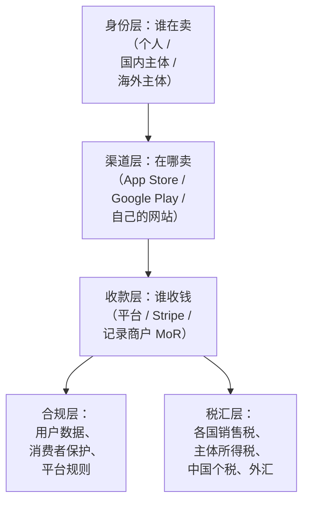
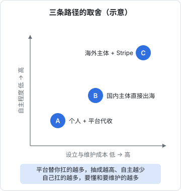
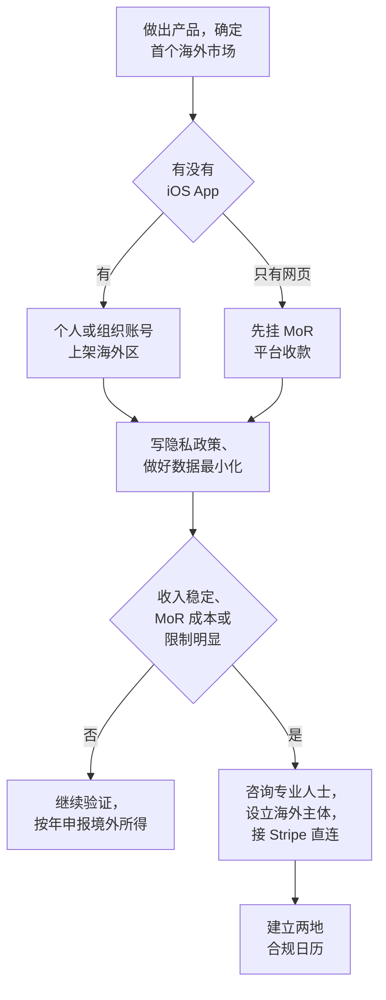

# 出海全景：三条路径与先后顺序

独立开发者想做海外市场，脑子里冒出来的问题通常是一串：要不要注册一家美国公司？Stripe 能不能用？App Store 美区怎么收钱？GDPR 会不会罚到我头上？钱进了海外账户怎么拿回来？这些问题网上都有答案，但答案之间互相打架，因为每个人的出发点不一样：有人卖 iOS App，有人卖网页 SaaS，有人只是接海外外包。

这一章不急着回答具体问题，先把整张地图摊开：出海到底涉及哪几层事务，有哪几条典型路径，以及一个人应该按什么顺序推进。

> [!WARNING]
> 本书按 2025 年前后的各国法规、平台政策、费用和门槛整理，只讲框架和流程，不构成法律、税务或外汇意见；这些规定可能已调整，以美国国税局（IRS）、FinCEN、国家外汇管理局、国家税务总局和 Apple / Google / Stripe 等平台的官方最新说明为准，设立海外主体、跨境税务、大额资金往来动手前请咨询律师或注册会计师。

## 这本书讲什么、适合谁、怎么读

**讲什么**：一个身在中国大陆的人，把软件产品卖给海外用户，从「用什么身份」到「钱合法地回到自己手里」之间的全部环节。

| 章 | 解决的问题 |
|---|---|
| 1 出海全景 | 有哪几条路，先做什么后做什么 |
| 2 海外主体 | 要不要、在哪里、怎么设立和维护一家海外公司 |
| 3 Stripe 与海外收款 | 网页产品怎么收全世界的钱 |
| 4 App Store 海外区 | iOS（顺带 Google Play）在海外上架和结算 |
| 5 GDPR 与隐私政策 | 处理海外用户数据的规则 |
| 6 海外云与域名 | 服务器、域名、邮件放在哪里、怎么不被封 |
| 7 税务与汇款 | 每一层的税归谁管，钱怎么回到境内 |

**适合谁**：已经能独立做出产品、准备面向海外用户收费的独立开发者。默认你读过或至少翻过[《国内合规实务》](../opc-compliance-cn/)（国内主体、ICP、个人信息保护法）、[《财务与税务》](../opc-finance/)（记账、税种、发票）和[《定价与商业模式》](../pricing-monetization/)（定价、IAP 佣金、退款）。这三本里讲过的内容，本书只点到为止。

**怎么读**：第 1 章必读，它决定你走哪条路，后面的章节有的可以跳。只上 App Store 的，重点读第 4、5、7 章；做网页 SaaS 的，第 2、3、5、6、7 章都要读。

## 出海涉及的五层事务

把出海拆开看，是五层互相独立又互相牵制的事：

几个关键的牵制关系：

- **身份决定收款**。Stripe 不支持中国大陆的商户直接开户，这一条就把很多人推向了海外主体或第三方平台
- **收款方式决定税务负担**。用 App Store 或记录商户（Merchant of Record，下文简称 MoR），各国的消费税由平台代收代缴；用 Stripe 直连，这件事落在你自己身上
- **税务居民身份不随公司搬家**。你人在中国大陆、是中国税务居民，注册一家海外公司并不会让你的个人所得「出海」，这一点第 7 章细讲

## 三条典型路径

按身份和收款方式组合，独立开发者常见的是三条路：

| | 路径 A：个人 + 平台代收 | 路径 B：国内主体直接出海 | 路径 C：海外主体 |
|---|---|---|---|
| 身份 | 中国大陆个人 | 国内个体户或一人有限公司 | 美国 LLC、香港公司、新加坡公司等 |
| 典型渠道 | App Store 个人开发者、MoR 平台卖网页产品 | App Store 组织账号、MoR 平台 | Stripe 直连、App Store 组织账号 |
| 收款 | 平台结算到个人银行卡或跨境收款账户 | 平台结算到公司账户，企业收外汇 | 海外公司银行账户 |
| 各国消费税 | 平台处理 | 平台处理 | Stripe 直连时自己处理 |
| 一次性成本 | 几乎没有 | 低（主体已经有了） | 中到高：注册、代理、银行 |
| 年度维护 | 个人年度汇算要申报境外所得 | 正常的国内记账报税 | 两地合规：海外年报和申报 + 国内个税 |
| 适合 | 验证期，收入不确定 | 国内已有主体，海外是第二市场 | 海外是主战场，需要 Stripe 直连、海外 B2B 客户 |

这张图说的是一个朴素的取舍：**平台替你扛的事越多，你的自主权越少、抽成越高；自己扛的事越多，你要懂的东西和要维护的合规越多**。没有哪条路绝对更好，只有和你当前阶段匹配的路。

### 路径 A：先用平台验证

对绝大多数刚起步的独立开发者，这条路是起点：

- iOS App 用个人开发者账号上架海外区，苹果在各地区作为销售方或代理方处理消费税，钱按月结算到你的银行账户（第 4 章）
- 网页产品挂在 MoR 平台上卖，平台作为法律意义上的卖方，向买家收款、开票、代缴各国税，再把扣除费用后的钱付给你（第 3 章）

优点是**今天就能开始收钱**，不用注册任何公司。代价是平台抽成较高、账户风控在别人手里，而且收入到了个人名下，同样要在国内依法申报个税。

### 路径 B：国内主体直接出海

已经有国内个体户或一人有限公司的，可以直接用它出海：App Store 组织账号以公司名义上架，MoR 平台也大多接受企业卖家。海外收入进入公司账户，按国内企业的规则记账、报税、收结汇。

这条路的难点不在海外，而在国内：企业收取境外服务款的单证、代扣代缴、出口服务的增值税处理，都要代账会计熟悉跨境业务（第 7 章和《财务与税务》）。

### 路径 C：设立海外主体

当出现下面这些信号时，才值得认真考虑海外主体：

- 需要 Stripe 直连（订阅逻辑复杂、MoR 抽成已经肉疼、需要灵活的计费）
- 海外 B2B 客户要求和一家当地公司签约、对公付款
- 海外收入已经稳定，值得为它付出每年固定的维护成本

海外主体不是「避税工具」，也不是「出海标配」。它是一个**需要每年持续投入的法律实体**，第 2 章会讲清楚它带来的义务。

## 一个人的推进顺序

不管最后走哪条路，顺序大致是这样：

背后的原则只有一条：**合规成本跟着收入走**。在还不知道有没有人付钱的时候，花钱注册海外公司、开银行账户、请注册代理，是把固定成本提前了。反过来，当收入已经起来，还靠个人账户硬收、不申报，是把风险往后堆。

## 贯穿全书的假设场景

为了让后面每章都有落脚点，全书用一个**假设场景**：把作者自己的项目 hatch-shelf 做成面向海外的付费产品。

hatch-shelf 现在是一个**个人自用**的 iOS 离线 Markdown 书架：Expo 写的 App，书存在手机本地，用 SQLite 记索引和阅读进度，WebView 里跑阅读器，通过 AirDrop 或局域网导入书籍，App 本身不联网。假设它要做成产品，会长出两部分：

| 部分 | 内容 | 涉及的章 |
|---|---|---|
| iOS App | 在 App Store 海外区上架，基础功能免费，高级功能用 IAP 解锁 | 第 4、5 章 |
| 网页服务 | 一个「云同步 + 网页阅读」的订阅服务，跑在 Cloudflare Workers 和 R2 上，用 Stripe 或 MoR 收费 | 第 3、5、6 章 |

这个场景的合规特征很有代表性：App 端几乎不碰个人数据（离线、无账号），网页端有账号、有用户上传的内容、有订阅扣款。同一个产品，两端的合规负担差别很大，正好用来说明「架构选择就是合规选择」。

再强调一次，这是假设：hatch-shelf 目前没有上架，也没有收费计划。

## 常见的误区

| 误区 | 实际情况 |
|---|---|
| 「注册个美国公司就不用在国内交税了」 | 你是中国税务居民，个人从境外取得的所得同样要依法申报；居民个人控制的低税地公司无合理理由不分配利润，税务机关有权调整（第 7 章） |
| 「GDPR 管不到中国人」 | GDPR 按「是否向欧盟境内的人提供商品或服务」判断适用，与你在哪里无关（第 5 章） |
| 「钱放在海外账户里就不用管外汇」 | 资金从境外进入境内，以及个人换汇，都在外汇管理框架下（第 7 章） |
| 「上了 App Store 美区，税的事苹果全管了」 | 苹果处理的是用户端的消费税和部分预提税，你的所得税仍是你的事 |
| 「先收着，等做大了再合规」 | 一些义务（例如申报境外所得、平台税务表格）从第一笔收入就开始了 |

## 本章要点

- 出海涉及五层事务：身份、渠道、收款、合规、税汇，它们互相牵制
- 三条典型路径：**个人 + 平台代收**、**国内主体直接出海**、**海外主体**；平台扛得越多，抽成越高、自主越少
- 绝大多数人应该从路径 A 起步，**合规成本跟着收入走**
- 海外主体是需要持续维护的法律实体，不是避税工具；中国税务居民身份不随公司改变
- 本书讲框架和流程，费用、税率、门槛以官方最新规定为准，关键决策前咨询专业人士
