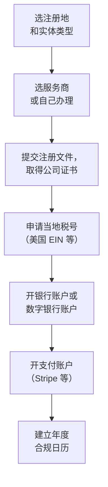
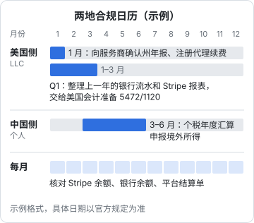

# 海外主体

「要不要注册一家海外公司」是出海讨论里最热闹的话题，也是最容易被中介带节奏的话题。搜索结果里到处是「几百美元注册美国公司，轻松开通 Stripe」的广告，很少有人告诉你：这家公司每年要交什么表、你作为中国税务居民要承担什么申报义务、资金从这家公司回到你手里要经过哪些关口。

这一章讲清楚三件事：什么时候真的需要海外主体；常见几个地区的主体各自是什么样的框架；以及设立之后，两边（海外和国内）各有哪些持续义务。

> [!WARNING]
> 本章涉及的公司法、税法和外汇管理规定按 2025 年前后的情况整理，各地规定和执行口径都可能已调整；费用、时限、申报门槛以注册地官方机构和国家外汇管理局、商务部、国家发展改革委的最新规定为准，设立前请咨询熟悉跨境业务的律师或注册会计师。

## 先问：你真的需要吗

回到第 1 章的判断：海外主体解决的是**身份**问题，它能带来的东西很具体：

| 海外主体能解决的 | 海外主体解决不了的 |
|---|---|
| 以支持的国家身份开 Stripe 等支付账户 | 你作为中国税务居民的个人所得税义务 |
| 开当地银行账户，收海外客户的对公付款 | 资金进入境内时的外汇管理要求 |
| 和海外 B2B 客户签约时，对方更愿意和当地公司打交道 | 产品本身的合规（GDPR、平台规则） |
| 在 App Store 等平台以公司名义展示开发者 | 平台的风控和封号风险 |

如果你只做 iOS App，个人账号或国内主体就够了；如果你做网页产品、MoR 平台的抽成和限制你还能接受，也不需要。**只有当「必须 Stripe 直连」或「必须有当地主体签约」成为真实需求时，才进入下一步。**

## 常见的几个注册地

> [!WARNING]
> 各地的设立要求、税务结构和 Stripe 支持国家按 2025 年前后的情况整理，可能已调整，以各地公司注册机构、税务机关和 Stripe 官网的当前说明为准。

独立开发者讨论最多的是美国、中国香港、新加坡、英国。下面只讲每个地区的**结构性特点**，具体费用和时限变化快，不写。

| | 美国 LLC | 香港有限公司 | 新加坡私人有限公司 | 英国 Ltd |
|---|---|---|---|---|
| 设立方式 | 在某个州提交组建文件，可远程 | 公司注册处网上注册，可远程 | 需要当地居民董事，通常通过服务商 | Companies House 网上注册，可远程 |
| 硬性要求 | 注册代理（Registered Agent）、州年报 | 公司秘书、本地注册地址、**每年审计** | 本地居民董事、公司秘书、本地注册地址 | 注册地址、年度确认声明和账目 |
| 税务结构 | 单一成员 LLC 默认是「穿透实体」，本身通常不缴联邦所得税 | 地域来源征税，可就非香港来源利润申请豁免，但要经过审查 | 公司所得税，有针对初创公司的减免安排 | 公司税，增值税注册另有门槛 |
| 银行开户 | 远程开户有选择，但对非居民审核严 | 传统银行开户对无本地业务的公司门槛高 | 银行开户通常要求实质性联系 | 远程开户有数字银行可选 |
| 和支付平台的关系 | Stripe 支持；Stripe Atlas 就是帮人设立美国公司的服务 | Stripe 支持 | Stripe 支持 | Stripe 支持 |

几点说明：

- **Stripe 支持哪些国家以 Stripe 官网当前列表为准**。截至写作时中国大陆的商户不能直接开户，这是很多人设立海外主体的直接原因
- 香港的「离岸豁免」不是自动的，是在报税时提出申请，税务局可能发问卷、要求证明利润来源；以为「香港公司不交税」是常见误解
- 新加坡要求至少一名本地居民董事，没有当地关系的人通常要付费请服务商提供「代名董事」，这本身是一笔持续成本，也有风险

### 美国 LLC 为什么最常被推荐

> [!WARNING]
> Form 5472 / 1120 申报要求、漏报罚款和 BOI 报告范围按 2025 年前后的规定整理，FinCEN 的规则仍在变化，以美国国税局（IRS）、FinCEN 和注册州政府的最新说明为准。

因为它**设立门槛最低**：不要求美国居民身份、不要求本地董事、多数州可以全程在线，加上 Stripe Atlas 这类一条龙服务，几天内就能拿到公司和联邦税号（EIN）。

但它的维护义务常被低估。一个由非美国人 100% 持有的单一成员 LLC，在美国联邦税法上通常被视为「无视实体」（disregarded entity），即使没有应税收入，也有**信息申报义务**：每年提交 Form 5472 并附一份形式上的 Form 1120，报告这家公司和外国所有者之间的交易。不报的罚款很重，具体金额以美国国税局（IRS）当年规定为准。此外还有：

- **州层面**：年报、特许经营税（例如特拉华州对 LLC 有年度税），各州规则不同
- **注册代理**：每年续费，断了会影响公司状态
- **受益所有人信息报告（BOI）**：美国《公司透明法》（Corporate Transparency Act）曾要求大多数公司向 FinCEN 报告受益所有人。2025 年 FinCEN 发布过期中最终规则，大幅调整了适用范围。这条规则仍可能变化，**设立时以 FinCEN 的最新说明为准**

另外要想清楚美国税的实质问题：你的 LLC 有没有在美国构成「与美国贸易或业务有实际联系的收入」（ECI）。人在中国、服务器在海外、客户在全球的软件业务，结论取决于具体事实，**这是必须问美国税务专业人士的问题**，不要听中介一句「不用交税」。

## 设立流程的共性

不管选哪里，流程框架相似：

每一步的坑：

1. **选服务商**：比价时问清楚「首年价格」和「每年续费」各包含什么（注册代理、地址、年报代办、税务申报）。很多低价套餐只包含注册，申报另收费
2. **注册地址**：用服务商的地址很常见，但部分银行和支付平台会要求「实际经营地址」，如实填写你在中国的地址，不要编造
3. **银行开户**：KYC 会问你的业务是什么、客户在哪、资金从哪来。如实回答，并准备好网站、产品截图、合同等材料
4. **税号**：非美国人申请 EIN 没有 SSN 的话走单独的申请渠道，时间更长

### 如实是底线

各个环节都会问到你的身份、住址、业务和资金来源。**任何虚构的地址、借用的身份、代持的安排，都是在给自己埋雷**：轻则账户被关、资金被冻结，重则涉及银行欺诈和洗钱调查。服务商「建议」你这么做的，换一家服务商。

## 国内这一侧：境外投资与外汇登记

> [!WARNING]
> 本节列出的规定名称和文号按 2025 年前后的情况整理，可能已修订或被替代，以国家外汇管理局、商务部、国家发展改革委的最新规定为准。

这是中介最少提、但最不能忽略的一层。一个中国大陆居民在境外设立公司，在中国法律上属于**对外投资**，涉及的规定框架是：

| 主体 | 相关规定 | 大致内容 |
|---|---|---|
| 境内企业对外投资 | 《企业境外投资管理办法》（国家发展改革委）、《境外投资管理办法》（商务部）、外汇管理的直接投资登记 | 境内公司投资设立境外公司，需按规定办理发改委、商务部门的核准或备案，以及银行的外汇登记（ODI） |
| 境内居民个人设立境外特殊目的公司 | 《国家外汇管理局关于境内居民通过特殊目的公司境外投融资及返程投资外汇管理有关问题的通知》（汇发〔2014〕37 号） | 以境内资产或权益、或以境外资产或权益进行投融资的特殊目的公司，境内居民要办理外汇登记 |
| 个人境外所得和账户 | 《个人所得税法》《个人外汇管理办法》 | 境外所得要申报个税；个人跨境资金往来受外汇管理（第 7 章） |

对独立开发者，最常见的情况是**个人直接在海外注册一家小公司做软件业务**。这种情况是否需要、能否办理外汇登记，取决于具体结构（有没有境内资产、钱从哪里出去、未来是否有返程投资），实务中各地口径也有差异。**这是需要咨询熟悉外汇管理的律师的问题**，至少要做到：

- 注册资本不要从境内汇出去「实缴」，除非走了合规的对外投资程序
- 不要用海外公司反过来投资、控制境内的公司，那会进入「返程投资」的监管框架
- 保留好所有设立文件和资金往来记录

如果你已经有国内的一人有限公司，想让它设立海外子公司，那就是境内企业对外投资（ODI），程序更正规也更复杂，通常需要专业机构协助。

## 设立之后：两地合规日历

> [!WARNING]
> 下表的申报事项和周期按 2025 年前后的规定整理，具体日期和门槛可能已调整，以美国国税局（IRS）、注册州政府和国家税务总局的最新规定为准。

海外主体最大的成本不是注册费，而是**每年都要做、做漏了就罚的事**。以美国单一成员 LLC 为例，框架如下：

| 事项 | 归谁管 | 频率 |
|---|---|---|
| 州年报、特许经营税 | 注册州 | 每年 |
| 注册代理续费 | 服务商 | 每年 |
| Form 5472 + Form 1120 形式申报 | IRS | 每年 |
| 各州销售税（如果 Stripe 直连且达到经济关联门槛） | 各州 | 按州要求 |
| 中国个人所得税年度汇算，申报境外所得 | 中国税务机关 | 每年 |
| 银行账户、支付账户的信息更新和 KYC 复核 | 银行、平台 | 不定期 |

把这张表写成你自己的日历，并在每一项旁边写清楚「谁负责（自己 / 服务商 / 会计）」。一个人最容易出的问题不是不懂，而是**忘了**。下图是一份示例日历，把这些事排进一年的 12 个月，具体日期以官方规定为准：

## 退出：注销比设立麻烦

和国内主体一样，海外公司的注销也要清算、交最后一期申报、关闭账户。一家「不用了就扔着」的公司，年费和申报义务会继续累积，州政府可能会把公司状态改成「不良」，罚款和滞纳金继续计算。决定不做时，按注册地的程序正式解散。

## 本章要点

- 海外主体解决**身份**问题（开 Stripe、当地签约、对公收款），解决不了中国税务居民的个税义务和外汇管理
- 美国 LLC 设立最容易，但有 **Form 5472 等信息申报义务**；香港离岸豁免要申请和审查；新加坡要本地居民董事
- 所有 KYC 环节**如实填写**，不编地址、不借身份、不代持
- 中国居民设立境外公司涉及**境外投资和外汇登记**框架（ODI、汇发〔2014〕37 号等），具体是否适用要咨询专业人士
- 每年的维护义务比注册费更重要，建立两地合规日历；不用了要正式注销
