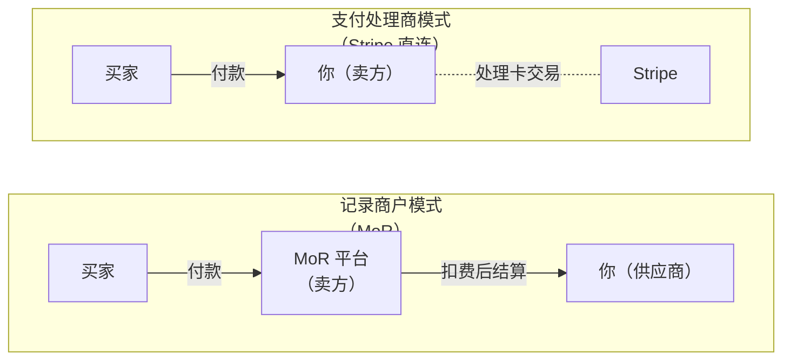
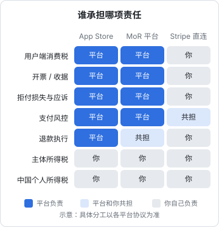
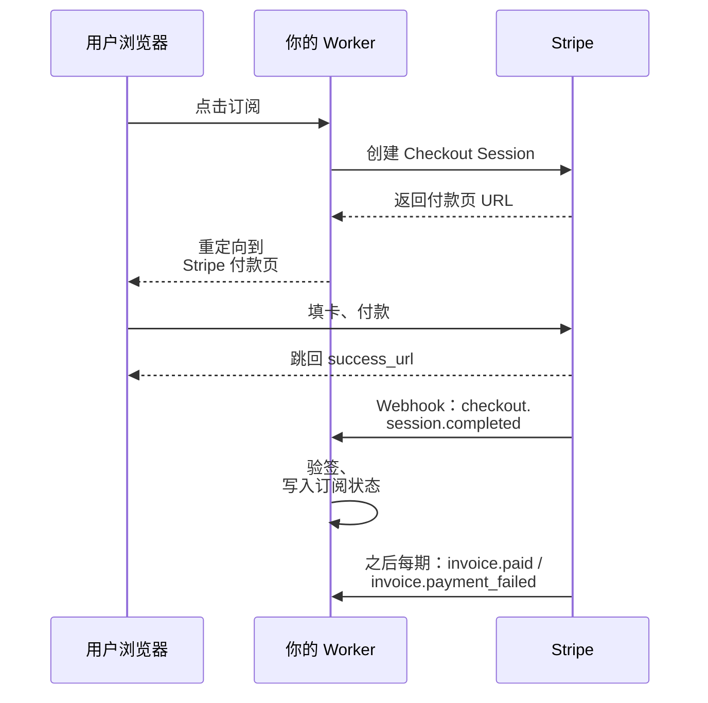
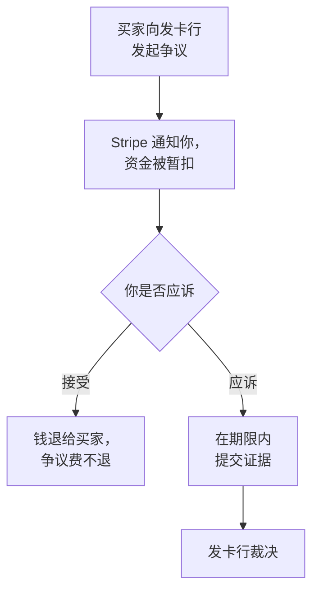

# Stripe 与海外收款

网页产品卖给海外用户，核心问题是：**谁来向用户收这笔钱，并对这笔交易负法律责任**。答案只有两类：你自己（通过 Stripe 这样的支付处理商），或者一个替你当卖方的平台（记录商户，Merchant of Record，MoR）。这一章先讲这两类的本质区别，再讲各自怎么接入，最后讲一个人最怕的风控和拒付。

国内的微信支付、支付宝接入在[《定价与商业模式》](../pricing-monetization/)里讲过；退款政策的设计也在那本书里，本章只补充海外特有的部分。

> [!WARNING]
> 本章按 2025 年前后的情况整理，支付平台支持的国家、费率、结算方式和审核政策经常调整，可能已变化；平台名称只作举例，接入前以 Stripe 和各 MoR 平台官网的当前说明和协议为准。

## 支付处理商与记录商户

两者在用户看来都是「一个付款页」，但法律关系完全不同：



Stripe 直连模式下，卡交易通过 Stripe 处理。

| | Stripe 直连 | MoR 平台 |
|---|---|---|
| 法律上的卖方 | 你 | 平台 |
| 买家账单上显示 | 你的名字或品牌 | 平台名称（有的可加你的品牌） |
| 各国销售税 / 增值税 | **你负责**：判断义务、注册、收取、申报 | 平台负责 |
| 发票 / 收据 | 你开（Stripe 可以帮你生成） | 平台开 |
| 拒付和欺诈 | 你承担损失，你应诉 | 平台主要承担，政策各家不同 |
| 费用 | 较低的处理费 + 你自己的税务合规成本 | 较高的综合费率，含税务和风控 |
| 开户要求 | 需要 Stripe 支持国家的主体 | 多数接受个人或各国公司，以平台列表为准 |
| 灵活度 | 高：计费模型、结账流程、数据都在你手里 | 中：受平台功能和规则约束 |



这张矩阵是本书最重要的一张图之一，第 7 章讲税务时还会回到它。它说明的是：**MoR 的高费率买的不是「收款」，而是「替你当卖方」**。对一个人来说，各国增值税注册和申报是一件极其琐碎的事，在收入还小的时候，用 MoR 把它外包出去通常更划算。

## 什么时候用 MoR，什么时候用 Stripe 直连

> [!WARNING]
> Stripe 支持的开户国家按 2026 年 11 月 Stripe 官网「Stripe global availability」页面整理（列表里有中国香港，没有中国大陆）；Stripe Managed Payments 的商户所在地和商品范围按 2026 年 11 月 Stripe 文档「Managed Payments eligibility」页面整理；Lemon Squeezy 的现状按其 2026-01-28 官方博客整理；Polar、Creem 按各自官方文档整理。这些平台变化很快，以 Stripe 和各 MoR 平台官网的当前支持列表和协议为准。

| 情况 | 建议 |
|---|---|
| 没有海外主体，人在中国大陆 | MoR（Stripe 不支持中国大陆商户直接开户） |
| 面向个人消费者，买家分布在几十个国家 | MoR，省掉各国增值税 |
| 主要卖给美国企业客户，需要对公发票、按合同计费 | Stripe 直连更合适 |
| 计费逻辑复杂（用量计费、分账、多币种定制） | Stripe 直连 |
| 收入稳定，MoR 费率差额已经超过请会计处理税务的成本 | 考虑迁移到 Stripe 直连 |

常被提到的 MoR 平台有 Paddle、Lemon Squeezy、Gumroad，近两年又多了 Stripe Managed Payments、Polar、Creem 等。它们的定位有差别：有的偏 SaaS 订阅，有的偏数字商品和创作者，有的偏开发者工具。下表只写定位和适用场景，费率变化快，不写，以各平台定价页为准：

| 平台 | 定位 | 适合谁 |
|---|---|---|
| Paddle | 老牌 MoR，偏 SaaS 和桌面软件 | 订阅制 SaaS、桌面软件 |
| Lemon Squeezy | 2024 年被 Stripe 收购。2026-01 的官方博客说团队在做 Stripe Managed Payments，目标是给现有用户一条迁过去的路，没有宣布关停 | 已经在用的可以继续用，但要关注迁移安排；新项目先看 Stripe Managed Payments |
| Stripe Managed Payments | Stripe 自己的 MoR：在 Stripe 账户里给 Checkout / Payment Links 打开这个选项，Stripe 就成为法律上的卖方，负责 80 多个国家的销售税 / 增值税、反欺诈、拒付和交易层面的客服 | **已有 Stripe 支持地区主体**（美国、加拿大、欧洲多国、澳大利亚、中国香港、日本、新加坡等）、卖纯数字商品、想同时保留 Stripe 生态的人 |
| Polar | 开源（Apache 2.0）的计费平台，托管版是 MoR；订阅、一次性购买、license key、文件下载、GitHub 仓库访问权限都能当「权益」发放 | 卖开发者工具、模板、开源项目赞助 / 付费版的独立开发者 |
| Creem | 面向 SaaS 和 AI 初创的 MoR，支持订阅、试用、license key、客户门户；开通正式收款前要过店铺审核，要求有自有域名的网站 | 订阅制 SaaS / AI 工具的个人开发者 |
| Gumroad | 偏创作者和数字商品（电子书、课程、素材） | 卖一次性数字商品，不需要复杂订阅逻辑 |

关于 Stripe Managed Payments 的几个限制（按 Stripe 文档）：

- **商户所在地有白名单**，不含中国大陆；人在中国大陆、没有海外主体的，用不了。它的买家也有限制国家，**中国大陆的买家不能购买**
- **只卖全自动交付的数字商品**：软件、SaaS、AI 服务、电子书、在线课程等。咨询、设计、开发外包这类专业服务和一对一辅导不在范围内
- 只支持 Checkout 和 Payment Links，不支持 Connect 平台和嵌入式支付组件；订阅要通过 Checkout 或 Payment Links 创建
- Stripe 会做资格审核，争议率过高会失去资格

Polar 和 Creem 的文档没有列出接受的卖家国家清单，注册前直接在后台或向客服确认你的身份能不能开通、钱能结算到哪里。

选择时看四件事：

1. **是否接受你的身份和国籍**：注册前看清支持的卖家国家列表
2. **结算方式**：能否结算到你能合法收款的账户（国内银行账户的外币收款、或你的海外公司账户）
3. **产品审核**：多数 MoR 对产品类型有审核，有的不接受某些类别（例如部分 AI 产品、成人内容、金融服务）
4. **迁移成本**：订阅存在平台里，将来要迁走时，用户的支付方式通常不能直接导出，要求用户重新订阅

## 接入 Stripe：一个最小可用的订阅系统

假设你已经有海外主体并开好了 Stripe 账户。以假设场景中 hatch-shelf 的「云同步」订阅为例，服务跑在 Cloudflare Workers 上。整体流程：



关键设计原则：**订阅状态以 webhook 为准，不以浏览器跳回为准**。用户可能付完款就关了页面，跳回的 `success_url` 只用来展示「处理中」。

### 创建 Checkout Session

```ts
// src/billing.ts —— 运行在 Cloudflare Workers 上
import Stripe from "stripe";

export function stripeClient(env: Env) {
  return new Stripe(env.STRIPE_SECRET_KEY, {
    httpClient: Stripe.createFetchHttpClient(),
  });
}

export async function createCheckout(env: Env, userId: string, email: string) {
  const stripe = stripeClient(env);
  const session = await stripe.checkout.sessions.create({
    mode: "subscription",
    line_items: [{ price: env.STRIPE_PRICE_SYNC_MONTHLY, quantity: 1 }],
    customer_email: email,
    client_reference_id: userId, // webhook 里用它找回你的用户
    success_url: `${env.APP_URL}/billing/success?session_id={CHECKOUT_SESSION_ID}`,
    cancel_url: `${env.APP_URL}/pricing`,
    automatic_tax: { enabled: true }, // 需要先在 Stripe Tax 中配置，见下文
  });
  return session.url!;
}
```

价格（Price）在 Stripe 后台或用 API 预先建好，代码里只引用 ID。不要在前端传金额。

### 处理 webhook

Workers 环境没有 Node 的 `crypto` 模块，验签要用异步版本加 Web Crypto：

```ts
// src/webhook.ts
import Stripe from "stripe";
import { stripeClient } from "./billing";

const cryptoProvider = Stripe.createSubtleCryptoProvider();

export async function handleStripeWebhook(req: Request, env: Env) {
  const stripe = stripeClient(env);
  const body = await req.text(); // 必须是原始文本，不能先 JSON.parse
  const sig = req.headers.get("stripe-signature") ?? "";

  let event: Stripe.Event;
  try {
    event = await stripe.webhooks.constructEventAsync(
      body, sig, env.STRIPE_WEBHOOK_SECRET, undefined, cryptoProvider,
    );
  } catch {
    return new Response("bad signature", { status: 400 });
  }

  // 幂等：Stripe 可能重复投递同一事件
  const seen = await env.DB.prepare("SELECT 1 FROM stripe_events WHERE id = ?")
    .bind(event.id).first();
  if (seen) return new Response("ok");

  switch (event.type) {
    case "checkout.session.completed": {
      const s = event.data.object;
      await env.DB.prepare(
        "UPDATE users SET stripe_customer_id = ?, plan = 'sync' WHERE id = ?",
      ).bind(s.customer, s.client_reference_id).run();
      break;
    }
    case "customer.subscription.updated":
    case "customer.subscription.deleted": {
      const sub = event.data.object;
      const active = sub.status === "active" || sub.status === "trialing";
      await env.DB.prepare(
        "UPDATE users SET plan = ? WHERE stripe_customer_id = ?",
      ).bind(active ? "sync" : "free", sub.customer).run();
      break;
    }
    case "invoice.payment_failed":
      // 发邮件提醒用户更新支付方式；Stripe 自身也有重试和催缴设置
      break;
  }

  await env.DB.prepare("INSERT INTO stripe_events (id, type) VALUES (?, ?)")
    .bind(event.id, event.type).run();
  return new Response("ok");
}
```

这段代码体现了三条通用原则，换成 NestJS 也一样：

- **验签用原始请求体**。NestJS 默认会解析 JSON，需要为 webhook 路由保留 raw body
- **按事件 ID 幂等**。重复投递是常态，不是异常
- **订阅状态只由 webhook 改**。前端、跳回页都只读

### 让用户自助管理

取消订阅、换卡、看历史账单，不要自己做，用 Stripe 的客户门户（Customer Portal）：

```ts
const portal = await stripe.billingPortal.sessions.create({
  customer: user.stripeCustomerId,
  return_url: `${env.APP_URL}/account`,
});
return Response.redirect(portal.url, 303);
```

很多地区的消费者保护规则要求**取消订阅要和订阅一样容易**，用门户可以天然满足这一点。

### 本地联调

```bash
# 安装 Stripe CLI 后登录，把测试模式的事件转发到本地 Worker
stripe login
stripe listen --forward-to localhost:8787/webhooks/stripe
# 另开一个终端触发测试事件
stripe trigger checkout.session.completed
```

`stripe listen` 会打印一个测试用的 webhook 签名密钥，填到本地的 `.dev.vars` 里，不要提交进仓库。

## Stripe 直连时的税：Stripe Tax 只是工具

> [!WARNING]
> Stripe Tax 的功能范围和对接的申报服务按 2025 年前后的情况整理，可能已调整，以 Stripe 官方文档为准；注册和申报义务以各国税务机关的规定为准。

开了 `automatic_tax` 不等于税的事解决了。Stripe Tax 能做的是：根据买家地址**计算**应收的税、在结账时**收取**、**监控**你在哪些地方接近了需要注册的门槛。但：

- **注册**：在某个国家或美国某个州产生纳税义务后，要由你（或你委托的服务商）去当地注册税号，然后把税号填进 Stripe
- **申报和缴纳**：收上来的税要按当地周期申报、缴纳。Stripe 有对接的申报服务，但责任主体仍是你

第 7 章会讲各国销售税的框架。这里只需记住：**选择 Stripe 直连，就是选择自己做各国的税务合规**。

## 风控与拒付

支付账户被冻结，是一人公司最可怕的事故之一：钱在账上、取不出来，客户还在扣费。

### 降低被风控的概率

- **如实填写业务描述**，网站上要有清楚的产品说明、价格、退款政策、联系方式、服务条款和隐私政策
- **业务变化要报备**：卖的东西变了（比如加了 AI 生成内容），在后台更新业务描述
- **不要突然放量**：上线后流量和金额突变，容易触发审查。大型推广前可以先联系平台
- **退款要及时**：用户要求退款时爽快退，比等他发起拒付好得多

### 拒付（chargeback / dispute）

> [!WARNING]
> 争议费、应诉期限和争议率监控标准由 Stripe 和卡组织规定，本节按 2025 年前后的情况整理，以 Stripe 官方文档和卡组织的当前规则为准。

买家可以绕过你，直接向发卡行否认这笔交易。发卡行会先把钱从你的账户扣走，还会收一笔争议费。流程大致是：



应诉证据要提前准备好，因为平时就要记：

| 证据 | 怎么积累 |
|---|---|
| 用户同意了条款和价格 | 结账页明示价格和续费规则，记录同意时间 |
| 用户确实使用了服务 | 登录日志、使用记录（按隐私政策允许的范围） |
| 你提供过退款渠道 | 退款政策页面、往来邮件 |
| 续费前提醒过 | 年付续费前的提醒邮件 |

**争议率过高**会被卡组织列入监控项目，甚至导致账户关闭。对一人公司，控制争议率最有效的办法是：价格写清楚、续费前提醒、退款别犹豫。

## 收到的钱去哪里

- **Stripe 直连**：结算到你海外主体的银行账户。从海外账户再到个人手里，是第 7 章的话题
- **MoR**：按平台周期结算到你绑定的收款方式，可能是国内银行账户接收外汇汇款，也可能是跨境收款服务商的账户。**用哪种方式，要和你后续的结汇路径一起考虑**，不要只看手续费

## 本章要点

- 支付处理商（Stripe）让你当卖方，MoR 平台替你当卖方；**MoR 的高费率买的是各国税务、开票和拒付的责任**
- 中国大陆个人或没有海外主体时，MoR 是现实选择；Stripe 不支持中国大陆商户直接开户，Stripe Managed Payments 同样要求商户在支持地区
- 新一批 MoR：Stripe Managed Payments（Stripe 账户内开启，限支持地区的主体和纯数字商品）、Polar（开源，偏开发者工具）、Creem（偏 SaaS / AI 工具）；Lemon Squeezy 在向 Stripe Managed Payments 过渡
- Stripe 订阅的三条原则：**原始请求体验签、按事件 ID 幂等、订阅状态只由 webhook 改**；自助管理用客户门户
- Stripe Tax 负责计算和收取，**注册和申报的责任仍在你**
- 风控靠如实描述、清晰的条款和及时退款；拒付证据要平时积累
