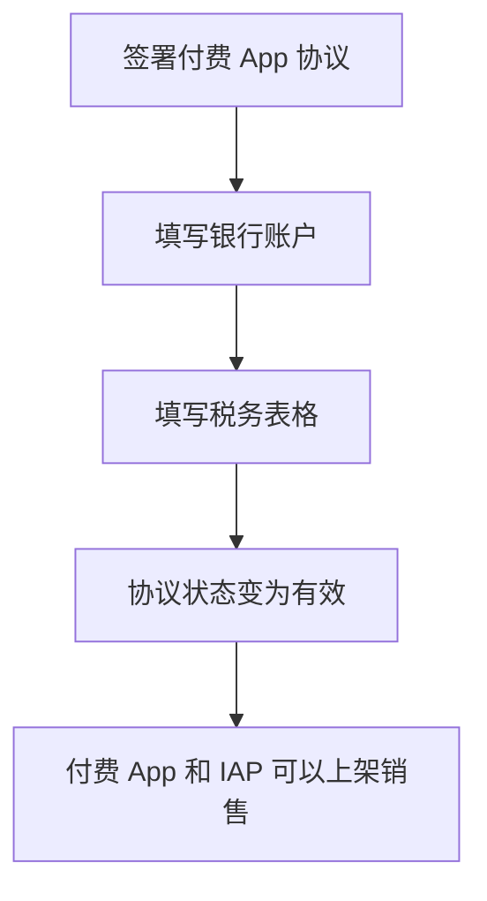

# App Store 海外区

对一个人来说，App Store 是最省心的出海通道：苹果在全球大多数国家和地区替你收款、处理用户端的消费税、做支付风控，每月把钱结算到你的银行账户。你不需要海外主体，也不需要 Stripe。

但「省心」不等于「什么都不用管」。这一章讲上架海外区时要处理的几件事：账号类型、协议税务和银行、价格与地区、各地区的特殊规则，以及顺带讲 Google Play。IAP 的技术接入、佣金框架、小型企业计划，《定价与商业模式》已经讲过，这里不重复；上架中国大陆区需要的 App 备案等资质，在《国内合规实务》里。

> App Store 的协议、税务表格、地区规则近几年变化频繁。**本章只讲框架，具体以 App Store Connect 中的最新协议、苹果开发者网站的说明和《App 审核指南》为准。**

## 账号类型：个人还是组织

| | 个人 | 组织 |
|---|---|---|
| 商店里显示的卖方 | 你的法定姓名 | 公司的法定名称 |
| 需要的材料 | Apple 账户、身份验证 | 法律实体、邓白氏编码（D-U-N-S Number）、公司网站、有签约权的人 |
| 适合 | 路径 A：个人验证期 | 路径 B / C：国内或海外主体 |
| 迁移 | 个人账号可以申请转为组织账号，需要联系苹果 | — |

两个容易忽略的点：

- **个人账号会公开你的真实姓名**，在欧盟地区还可能要公开更多联系信息（见下文「欧盟的交易者身份」）
- **App 可以在账号之间转移**，但有条件（例如某些功能、IAP 状态会影响），所以账号类型尽量一开始就想好

## 协议、税务和银行

在 App Store Connect 的「协议、税务和银行业务」里，要完成三件事才能卖付费 App 或 IAP：



### 税务表格

苹果会要求你提交美国税务表格，因为苹果是美国公司，你在美国区的收入在美国税法下可能需要预提所得税：

| 你的身份 | 一般填写的表格 |
|---|---|
| 非美国个人 | W-8BEN |
| 非美国实体（国内公司、香港公司等） | W-8BEN-E |
| 美国实体（如美国 LLC） | 情况较复杂：单一成员 LLC 是「无视实体」，表格类型取决于所有者身份，向税务专业人士确认 |

W-8BEN 和 W-8BEN-E 上可以根据所在国与美国的税收协定**申请协定待遇**，降低美国区收入的预提税率。中国与美国之间有税收协定，能否适用、适用哪一条和什么税率，以表格说明、协定原文和专业意见为准。填表时需要一个中国的纳税人识别号（个人通常是身份证号）。

这里预提的是**美国的税**，和你在中国的纳税义务是两回事。已在美国被预提的部分，回国申报时能否抵免、怎么抵免，见第 7 章。

部分其他国家和地区也可能要求补充税务信息，按 App Store Connect 的提示填写。

### 银行账户

- 账户名必须与开发者账号的法定名称一致：个人账号用你本人的账户，组织账号用公司账户
- 可以用中国境内的银行账户收款，苹果会按规定的币种和方式结算；也可以用海外主体的账户
- 苹果按财务月结算，在财务月结束后一段时间内付款，未达到最低付款金额的会累积到下个月。具体周期和门槛以苹果的付款说明为准

用中国境内的账户接收苹果的结算，资金进入境内时会涉及外汇收款申报和后续结汇，个人和企业的规则不同，第 7 章细讲。

## 苹果在交易里是什么角色

这一点决定了「税是谁的」。在苹果的协议里，苹果在不同地区以**代理人**或**佣金代理/转售方**的身份向用户销售你的 App。实际效果是：

- 用户付款时的增值税、商品服务税、销售税，在苹果负责的地区由**苹果计算、收取和缴纳**
- 你拿到的是扣除这些税和佣金之后的收入
- 苹果给你的是**收入报告和付款记录**，不是中国的发票。国内入账时怎么处理，参见《财务与税务》

所以 App Store 本质上是一个 MoR：第 3 章那张责任矩阵里，App Store 和 MoR 平台的位置基本相同。

## 价格与地区

### 价格

苹果提供一套全球价格点。你可以选一个**基准国家或地区**设置价格，苹果按汇率和税率变化自动为其他地区生成等值价格；也可以手动为个别地区单独定价。

几个实务建议：

- **以你最大的市场为基准**，例如美国
- **低收入地区单独调低价格**是常见做法，等值换算的美区价格在一些地区明显偏贵
- **订阅调价有规则**：涨价可能需要用户同意，降价和涨价对现有订阅者的影响不同，调价前看清楚苹果的说明

### 地区可用性

在「定价与销售范围」里选择上架哪些国家和地区。几种常见的取舍：

| 情况 | 处理 |
|---|---|
| 没有办 App 备案 | 不勾选中国大陆，只上海外区 |
| App 涉及地区受限内容（例如某些 AI 功能、加密货币） | 按地区排除，并核对当地法规 |
| 想先在少数市场验证 | 先上几个英语市场，再逐步扩 |

**上架中国大陆区和上架海外区是两套合规**：前者需要国内的 App 备案等资质，后者需要本书讲的这些。不少中国开发者的选择是先只上海外区。

## 各地区的特殊规则

这部分变化最快，只列出你需要知道「有这么回事」的条目：

### 欧盟的交易者身份

欧盟《数字服务法》（Digital Services Act，DSA）要求在线平台核实「交易者」的身份并向消费者展示。落到 App Store 上：在欧盟地区分发 App 的开发者，需要在 App Store Connect 中声明自己是否是**交易者**（trader）；是交易者的，地址、电话、邮箱等联系信息会在欧盟地区的 App 页面上公开展示。未完成声明的 App 可能无法在欧盟地区上架。

对个人开发者，这意味着如果你以营利为目的分发 App，你的联系信息可能会被公开。几种应对：

- 如实判断自己是否属于交易者，不要为了隐私而虚报
- 使用专门的商务联系方式（单独的电话号码、商务邮箱）
- 如果有公司主体，用公司的注册地址和联系方式

### 欧盟的替代分发和支付条款

欧盟《数字市场法》（Digital Markets Act，DMA）之后，苹果在欧盟提供了替代条款：替代应用市场、替代支付方式等，对应的费用结构与标准条款不同，并且已经调整过多次。**对大多数独立开发者，维持标准条款最简单**；如果考虑替代条款，务必仔细算账并读最新版本的协议。

### 其他地区

- **美国**：法院判决后，美国区对引导外部购买的限制有较大变化
- **日本、韩国**：当地立法要求平台开放替代支付等选项，规则陆续落地

这些变化对独立开发者的意义主要是：**可能出现绕开 IAP、降低成本的合规选项**，但每个都有条件和代价，用之前读当时的指南。

## 上架流程中的海外要点

### 出口合规：加密声明

每次提交构建版本，苹果都会问 App 是否使用了加密。只用了系统提供的 HTTPS 等标准加密的 App，通常属于豁免范围。可以在 Info.plist 里预先声明，省得每次回答。Expo 项目写在 `app.json` 里：

```json
{
  "expo": {
    "ios": {
      "config": {
        "usesNonExemptEncryption": false
      }
    }
  }
}
```

这会生成 `ITSAppUsesNonExemptEncryption = NO`。只有在确实不使用非豁免加密时才这么写；如果你自己实现了加密算法，要按美国出口管理规定和苹果的说明处理，部分国家（例如法国）对加密产品另有申报要求。

### 年龄分级和内容

年龄分级问卷要如实填写，苹果近年调整过分级体系和问卷内容。含用户生成内容、AI 生成内容的 App，审核时会关注举报、屏蔽和内容过滤机制。

### 本地化

商店元数据（名称、副标题、描述、关键词、截图）可以按语言分别设置。出海的第一步不一定是翻译 App 本身，**先把英文元数据和截图做好**，对搜索和转化影响最大。关键词和 ASO 在《获客与增长》里讲。

### 隐私

App 隐私标签（Privacy Nutrition Label）、隐私清单（Privacy Manifest）和 App 跟踪透明度（ATT）是全球统一要求，第 5 章和 GDPR 一起讲。

## 假设场景：hatch-shelf 上架海外区

| 事项 | 选择 | 理由 |
|---|---|---|
| 账号 | 验证期用个人账号；收入稳定后视情况转组织 | 合规成本跟着收入走 |
| 地区 | 先不勾选中国大陆 | 未办 App 备案 |
| 商业模式 | 免费下载 + 一次性 IAP 解锁高级功能 | App 离线、无服务端成本，适合买断 |
| 税务表格 | W-8BEN，按表格说明申请协定待遇 | 非美国个人 |
| 银行 | 本人境内银行账户 | 收款后按个人外汇规则处理 |
| 欧盟 | 如实声明交易者身份，准备商务联系方式 | DSA 要求 |
| 加密声明 | `usesNonExemptEncryption: false` | App 不联网，不涉及非豁免加密 |

## 顺带说 Google Play

Android 出海基本等于 Google Play。框架和 App Store 类似，差别在于：

- **开发者账号**：个人和组织账号都需要身份验证，组织账号同样需要邓白氏编码。近年新建的个人账号在正式发布前，需要先完成一段有真实测试人员参与的封闭测试，具体要求以 Play 管理中心的说明为准
- **收款资料**：卖付费应用和应用内商品需要设置付款资料。**能否以中国大陆身份开设、支持哪些收款方式，以 Play 管理中心当前支持的地区列表为准**；不支持时，常见做法是用海外主体的账户
- **Google Play 结算**：数字商品原则上要走 Play 的结算系统，部分地区有替代结算方案
- **税务**：Google 在许多地区同样作为代收代缴方处理用户端的税，也会要求填写美国税务信息
- **测试设备**：国内开发需要能访问 Google 服务的测试环境

## 本章要点

- App Store 本质上是一个 MoR：用户端的消费税在苹果负责的地区由苹果处理，你拿到的是扣税扣佣后的收入
- 上架付费内容前要完成**付费 App 协议、银行账户、税务表格**；非美国个人填 W-8BEN，实体填 W-8BEN-E，可按税收协定申请待遇
- 个人账号公开真实姓名；**欧盟 DSA 交易者声明**可能公开你的联系信息，提前准备商务联系方式
- 中国大陆区和海外区是两套合规，未办 App 备案就先只上海外区
- 地区规则（欧盟 DMA、美国、日本、韩国）变化快，用到时读最新的指南和协议
