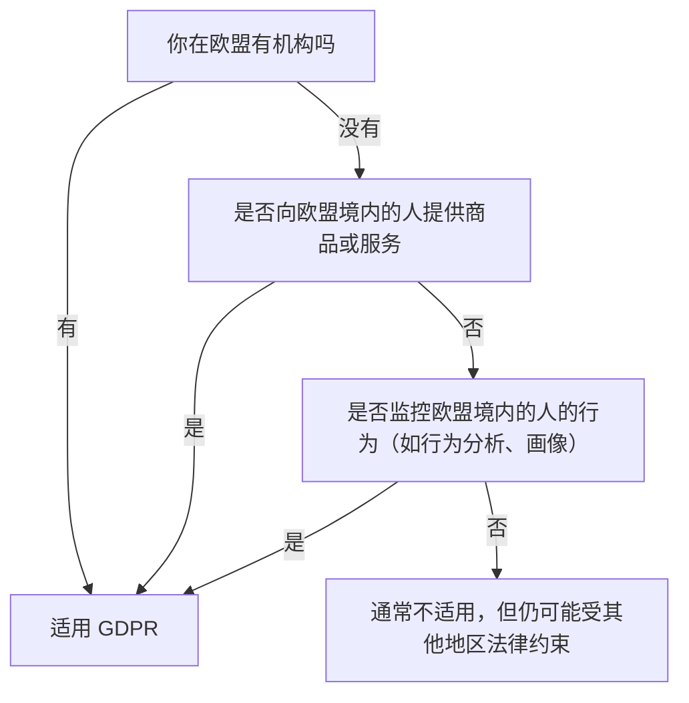
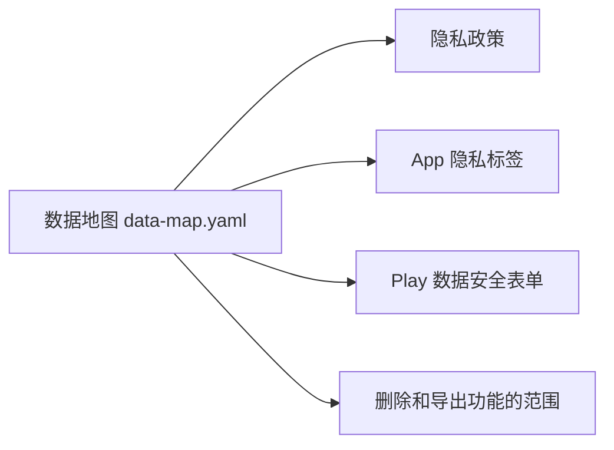

# GDPR 与隐私政策

只要你的产品有欧洲用户，欧盟的《通用数据保护条例》（General Data Protection Regulation，GDPR）就可能适用。很多中国开发者对它的印象是「天价罚款」和「烦人的 Cookie 弹窗」，要么忽视，要么恐慌。其实 GDPR 的核心思想和中国的《个人信息保护法》高度相似，后者在立法时就大量参考了它。读过[《国内合规实务》第 6 章](../opc-compliance-cn/06-pipl.md)的话，你已经掌握了一大半。

这一章讲 GDPR 的适用范围和核心规则，再讲英国、美国和应用商店层面的隐私要求，最后落到工程实现和一份隐私政策的骨架。

> 本章不是法律意见。GDPR 条文本身相对稳定，但各国监管机构的指引和执法案例在不断积累。**处理大量或敏感个人数据、面向儿童、做画像或自动化决策的产品，请咨询熟悉欧盟数据保护法的律师。**

## 它管不管得到我

GDPR 第 3 条规定了地域范围。对设在欧盟境外的你，关键是第 3 条第 2 款：**即使你不在欧盟设立机构，只要你向欧盟境内的人提供商品或服务（无论是否收费），或者监控他们在欧盟境内的行为，就适用 GDPR**。

判断「是否在向欧盟提供服务」，看的是有没有针对欧盟用户的迹象：用欧盟国家的语言、以欧元定价、提到欧盟的用户或客户、在欧盟地区的应用商店上架等。仅仅是网站在欧洲能被访问，一般不足以构成。



适用之后还有一条常被忽略的义务：**第 27 条要求境外的控制者或处理者在欧盟指定一名代表**。例外是偶发的、不涉及大规模处理特殊类别数据、对个人权利风险低的处理。小产品是否落在例外里，要按实际情况判断；需要指定代表时，市场上有专门提供欧盟代表服务的机构。

### 罚款是怎么回事

GDPR 规定的罚款上限确实很高（最高可达 2000 万欧元或全球年营业额的 4%，取较高者），这也是它出名的原因。但实际执法中，罚款与违规的性质、规模、是否配合整改相关。对独立开发者来说，更现实的风险是：用户投诉、平台审核要求、B2B 客户在采购时要求你证明合规。**把合规当成产品质量的一部分**，而不是只为了躲罚款。

## 核心概念

| GDPR 术语 | 含义 | 与个人信息保护法的对应 |
|---|---|---|
| 个人数据（personal data） | 与已识别或可识别的自然人有关的任何信息，包括 IP 地址、设备 ID、Cookie 标识 | 个人信息 |
| 特殊类别数据 | 种族、政治观点、宗教、健康、生物识别等 | 敏感个人信息（范围不完全相同） |
| 控制者（controller） | 决定处理目的和方式的一方 | 个人信息处理者 |
| 处理者（processor） | 代表控制者处理数据的一方，例如你用的云服务、邮件服务 | 受托人 |
| 数据主体 | 数据所指向的个人 | 个人 |

对你的产品：**你是控制者**，你用的 Cloudflare、Stripe、邮件服务商等多数情况下是处理者（Stripe 在某些处理活动上自己也是控制者，看它的数据处理条款）。

## 处理的六种合法性基础

GDPR 第 6 条规定，每一项处理活动都必须有合法性基础，共六种：同意、履行合同、法定义务、保护重大利益、公共任务、正当利益。独立开发者常用的是其中三种：

| 合法性基础 | 适用场景 | 注意 |
|---|---|---|
| 履行合同 | 为了提供用户订阅的服务所必需的处理：账号、同步数据、扣款 | 只覆盖「必需」的部分 |
| 正当利益 | 安全日志、防欺诈、基本的服务改进 | 要做权衡测试：你的利益不能凌驾于用户的权利之上 |
| 同意 | 营销邮件、非必要的分析和追踪 Cookie、个性化广告 | 必须自由、具体、知情、明确；撤回要和给出一样容易；不能预先勾选 |

这里和中国法有一个明显差别：《个人信息保护法》大量依赖「同意」，GDPR 则鼓励你**先找最合适的基础**，「同意」反而是要求最严格的一种。不要什么都弹窗要同意。

## 数据主体的权利

GDPR 给了个人一组权利，你的产品要能响应：

| 权利 | 落到功能上 |
|---|---|
| 知情权 | 隐私政策 |
| 访问权 | 用户能拿到你存的关于他的数据副本 |
| 更正权 | 用户能修改资料 |
| 删除权（被遗忘权） | 删除账号时真的删除数据，包括备份的处理策略 |
| 限制处理权 | 争议期间暂停某些处理 |
| 可携带权 | 以结构化、通用、机器可读的格式导出数据 |
| 反对权 | 尤其是反对基于正当利益的处理和直接营销 |
| 不受纯自动化决策约束的权利 | 对用户有重大影响的自动化决策要有人工介入渠道 |

响应请求有时限要求（一般是一个月内，特定情况可以延长）。一个人的做法是：**把导出和删除做成产品里的自助功能**，邮件请求只处理例外。

## 数据传出欧盟

GDPR 第五章规定，个人数据传到欧盟以外，要有合法的传输机制：

- **充分性认定**：欧盟委员会认定某个国家或地区的保护水平充分，可以自由传输。美国的「欧盟-美国数据隐私框架」（EU-U.S. Data Privacy Framework）在 2023 年获得充分性认定，传给已加入该框架的美国企业可以依赖它
- **标准合同条款**（Standard Contractual Clauses，SCCs）：最常用的机制，大型云服务商的数据处理协议里通常已经包含
- 其他机制：有约束力的公司规则、特定情况下的例外

对你最实际的影响是**数据存在哪里、谁能访问**。如果你本人在中国大陆远程访问存有欧盟用户数据的服务器，这本身也可能构成向第三国的传输。中国目前没有获得欧盟充分性认定，所以：

- 尽量**少碰**原始个人数据：日常运维看聚合指标和脱敏日志
- 选择欧盟或已有充分性安排的地区存储欧盟用户数据（第 6 章）
- 在隐私政策中如实说明数据的存储地和访问方

反方向的问题：**海外产品也服务中国大陆用户，把他们的数据存在海外**，就进入了中国的数据出境规则，见《国内合规实务》第 6 章。

## 处理者和数据处理协议

GDPR 第 28 条要求控制者和处理者签订**数据处理协议**（Data Processing Agreement，DPA）。好消息是：主流服务商都有标准 DPA，多数在你接受服务条款时已经纳入，或者在后台可以签署。你要做的是：

1. 列出所有处理用户数据的第三方服务
2. 确认每家都有 DPA，保存一份
3. 在隐私政策里列出这些「子处理者」的类别或名单

## 数据泄露

发生个人数据泄露，GDPR 第 33 条要求控制者在知悉后 72 小时内通知监管机构（除非不太可能给个人带来风险），高风险的还要通知受影响的个人。一个人做不到 24 小时值班，但可以做到：

- 有一份写好的泄露响应清单：如何判断范围、谁要通知、通知模板
- 日志和告警能让你**及时知道**出事了（[《可观测性与性能》](../observability-performance/)一书讲监控）
- 第一时间轮换密钥、封堵漏洞，并记录每一步

## 其他地区和平台的要求

| 范围 | 主要规则 | 对独立开发者的要点 |
|---|---|---|
| 英国 | 英国 GDPR 和《2018 年数据保护法》（Data Protection Act 2018） | 框架和欧盟 GDPR 基本一致，脱欧后单独执行；有自己的境外代表要求 |
| 美国 | 没有统一的联邦隐私法；加州《消费者隐私法》（CCPA，经 CPRA 修订）和其他各州法律；儿童相关的 COPPA | 各州法律多有营收或用户数量门槛，小产品可能达不到，但面向儿童要格外小心 |
| 欧盟 Cookie | 《电子隐私指令》（ePrivacy Directive）及各成员国的实施法律 | 在设备上存储或读取非必要信息（分析、广告 Cookie）需要事先同意 |
| Apple | 隐私标签、隐私清单（PrivacyInfo.xcprivacy）、ATT | 全球适用，审核会查 |
| Google Play | 数据安全表单 | 全球适用 |

### 最省事的 Cookie 策略：不用

Cookie 横幅最大的成本是同意管理。如果你的网站只用**严格必要的 Cookie**（登录会话、购物车、安全），通常不需要征求同意。分析方面可以选择不使用 Cookie、不跨站追踪、只统计聚合数据的方案，再咨询是否还需要同意。少一个弹窗，转化更好，合规也更简单。

### Apple 的隐私清单

App 或其使用的 SDK 调用某些「需要说明理由的 API」（例如读取文件时间戳、UserDefaults），要在隐私清单中声明原因。Expo 项目可以在 `app.json` 中配置，下面是一个示例，具体的 API 类别和原因代码以苹果文档为准：

```json
{
  "expo": {
    "ios": {
      "privacyManifests": {
        "NSPrivacyAccessedAPITypes": [
          {
            "NSPrivacyAccessedAPIType": "NSPrivacyAccessedAPICategoryUserDefaults",
            "NSPrivacyAccessedAPITypeReasons": ["CA92.1"]
          }
        ]
      }
    }
  }
}
```

## 工程落地：从数据地图开始

合规的第一步不是写隐私政策，而是**搞清楚你到底收集了什么**。给自己的产品写一份数据地图，放进仓库：

```yaml
# docs/data-map.yaml —— 假设场景：hatch-shelf 云同步服务
- data: 邮箱
  purpose: 登录、账单通知
  basis: 履行合同
  stored_in: Cloudflare D1
  retention: 账号存续期间；删除账号后清除
  processors: [Cloudflare, 邮件服务商]
- data: 用户上传的书籍文件
  purpose: 同步到用户的其他设备
  basis: 履行合同
  stored_in: Cloudflare R2（存储位置按用户所在地选择）
  retention: 用户删除即删除
  processors: [Cloudflare]
- data: 支付信息
  purpose: 订阅扣款
  basis: 履行合同
  stored_in: 由 Stripe 存储，我方只存 customer id
  processors: [Stripe]
- data: 访问日志（IP、User-Agent）
  purpose: 安全和排障
  basis: 正当利益
  retention: 短期滚动删除
  processors: [Cloudflare]
```

这份文件同时是隐私政策、App 隐私标签、Google Play 数据安全表单的**单一来源**，也很适合交给编码 agent 去对照代码检查有没有遗漏的收集点。



### 架构就是合规

假设场景里的两端，合规负担差别巨大：

| | iOS App | 云同步服务 |
|---|---|---|
| 账号 | 无 | 有，邮箱登录 |
| 数据位置 | 只在用户手机上 | 你的服务器上 |
| 你作为控制者处理的个人数据 | 几乎没有（IAP 由苹果处理） | 邮箱、文件、日志、支付关联 |
| 隐私标签 | 可能做到「未收集数据」 | 需要逐项声明 |
| 要做的功能 | 基本没有 | 导出、删除、DPA、泄露响应 |

**不收集的数据不需要保护**。每加一项数据收集前问一句：没有它，产品能不能工作？

## 隐私政策的骨架

隐私政策要用清晰、易懂的语言写，并且和你的实际做法一致。一份面向海外用户的隐私政策至少包括：

1. 你是谁、怎么联系你（以及欧盟代表，如适用）
2. 收集哪些数据、从哪里来
3. 每类数据的用途和合法性基础
4. 和谁共享：处理者类别、是否出售数据（美国各州法律关心这一点）
5. 跨境传输：数据存在哪里，用什么机制
6. 保存期限
7. 用户的权利和行使方式
8. Cookie 和类似技术
9. 儿童：是否面向儿童，最低年龄
10. 向监管机构投诉的权利
11. 政策变更方式和生效日期

可以让编码 agent 根据数据地图起草，但**每一句都要你自己核对是否属实**。隐私政策写的比实际做得多或少，都是问题。国内版和海外版隐私政策可以分开写，各自对应适用的法律。

## 本章要点

- GDPR 第 3 条第 2 款：向欧盟境内的人提供商品或服务就适用，与你在哪里无关；境外处理者可能需要指定**欧盟代表**
- 每项处理都要有合法性基础，常用的是**履行合同、正当利益、同意**；同意要求最严格，不要滥用
- 用户的访问、删除、可携带等权利，做成**自助的导出和删除功能**
- 数据出欧盟要有传输机制；从中国访问欧盟用户数据也要考虑；第三方服务都要有 **DPA**
- 用一份**数据地图**驱动隐私政策、隐私标签和数据安全表单；最好的合规是不收集
