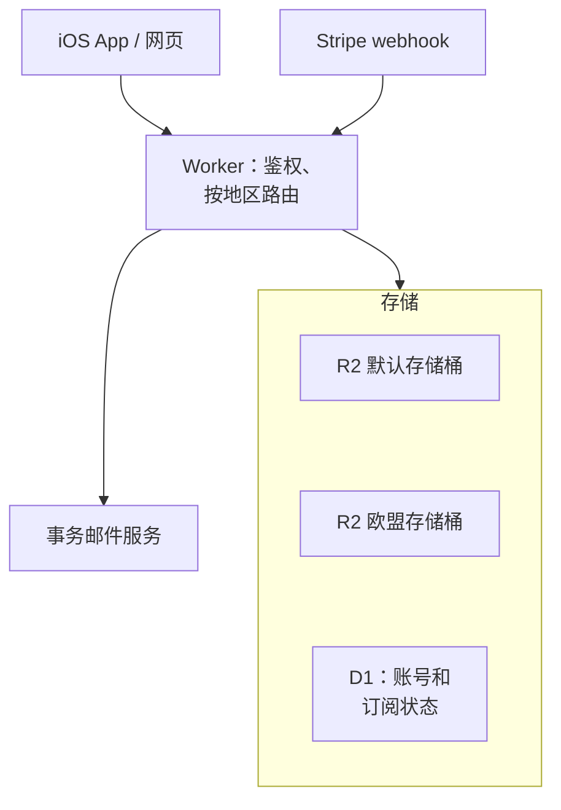

# 海外云与域名

面向海外用户的产品，服务器、域名、邮件通常都放在海外。技术上这比国内简单：不需要 ICP 备案，不需要实名认证域名，开个账号就能部署。但对一个身在中国大陆的人来说，有几类问题是国内开发者特有的：用什么付款、账号会不会被风控、数据该放哪个地区、从国内怎么运维、邮件为什么总进垃圾箱。

这一章不讲各家云的技术细节（Cloudflare Workers、R2、D1 的运行模型和部署在[《云与边缘》](../cloud-and-edge/)里），只讲出海时的选择和风险。

> [!WARNING]
> 本章按 2025 年前后的情况整理，各家云服务的支持地区、付款方式、风控政策随时调整，可能已变化；提到的服务商只作举例，以各家官网和服务条款的当前版本为准。

## 选地区：用户在哪、数据该在哪

国内做产品，选机房看的是延迟和备案；出海时多了一个维度：**数据驻留**。

| 用户主要在 | 计算放哪 | 数据放哪 | 考虑 |
|---|---|---|---|
| 美国 | 美国东部或西部 | 同上 | 最常见，生态最全 |
| 欧盟 | 欧盟地区 | 欧盟地区 | 简化 GDPR 的跨境传输问题（第 5 章） |
| 全球分散 | 边缘计算（如 Workers），就近执行 | 主数据选一个地区，必要时按用户所在地分区存储 | 计算全球化容易，数据全球化难 |
| 包括中国大陆 | 海外服务器从大陆访问速度不稳定 | 涉及数据出境规则 | 见[《国内合规实务》](../opc-compliance-cn/)，通常要单独做国内版 |

**边缘计算不等于数据在边缘**。Workers 的代码在离用户最近的节点执行，但它读写的 D1、R2 等存储有自己的物理位置。需要把欧盟用户的数据留在欧盟时，要在存储层面指定。以 R2 为例，可以在创建存储桶时指定欧盟司法管辖区：

```bash
# 创建一个数据保存在欧盟司法管辖区的 R2 存储桶
npx wrangler r2 bucket create shelf-sync-eu --jurisdiction eu
```

```toml
# wrangler.toml —— 两个存储桶，按用户所在地区路由
[[r2_buckets]]
binding = "BOOKS_DEFAULT"
bucket_name = "shelf-sync"

[[r2_buckets]]
binding = "BOOKS_EU"
bucket_name = "shelf-sync-eu"
jurisdiction = "eu"
```

是否真的要按地区分库，取决于你的用户规模和合同要求。对小产品，**选一个合规机制清楚的地区集中存储、在隐私政策中写清楚**，往往就够了；当欧盟企业客户在采购时明确要求数据驻留，再做分区。

## 账号与付款

### 用什么付款

大多数海外云服务接受国际卡组织（Visa、Mastercard 等）的信用卡。国内银行发行的双币或全币种信用卡通常可以用，但：

- 个别服务商或个别交易会被拒，原因可能是发卡行风控，也可能是服务商对某些国家的卡有限制
- 用公司名义付款的话，用公司名下的卡更利于记账，参见[《财务与税务》](../opc-finance/)
- 有海外主体的，用海外主体的卡付海外服务费，凭证链更清楚

### 账号风控

账号被封是比宕机更彻底的事故。降低风险的做法：

| 风险 | 做法 |
|---|---|
| 注册信息不一致触发审查 | 姓名、地址、付款卡、公司信息如实且一致 |
| 账号被盗用来挖矿或发垃圾邮件 | 根账号开启多因素认证，日常用权限受限的子账号和 API 令牌 |
| 账单失控 | 设置预算告警和硬上限（如果服务支持），按量计费的服务尤其要设 |
| 单一账号被封导致全部业务停摆 | 代码在 Git、备份在另一家服务商、域名注册商和云服务商分开 |
| 违反服务条款的地区限制 | 部分服务（尤其是 AI 模型 API）有支持国家和地区的列表，注册和使用都要遵守 |

最后一条要单独强调：**服务商的地区限制是服务条款的一部分**，用技术手段绕过不仅可能导致封号，也可能违反出口管制相关的规定。选型时把「这家服务是否向我所在的地区提供」作为第一个筛选条件。

### 多云不是目的，可迁移才是

一个人不需要真正的多云架构，但需要**在一家服务商出问题时能搬走**：

- 部署用 Docker Compose 或 wrangler 这类声明式配置，而不是在控制台里手点
- 数据库定期导出到另一家的对象存储（备份策略见[《PostgreSQL 运维》](../database-ops/)）
- DNS 托管和域名注册不要和唯一的云服务商绑死

## 域名

### 在哪注册

海外的域名注册商（Cloudflare Registrar、Porkbun、Namecheap 等）注册通用顶级域名，**不需要中国的实名认证**。和在国内注册商注册的区别：

| | 国内注册商 | 海外注册商 |
|---|---|---|
| 实名认证 | 需要，未实名的域名不能解析 | 不需要中国实名，但要提供真实的注册人信息 |
| 用于 ICP 备案 | 可以 | 备案要求域名在国内注册商实名，海外注册的通常要转入 |
| WHOIS 隐私 | 有隐私保护 | 多数默认或免费提供隐私保护 |
| 付款 | 人民币 | 外币信用卡 |

**如果这个域名将来也要给国内版用（需要 ICP 备案），一开始就在国内注册商注册**，或者准备好以后转入。纯海外产品在海外注册商注册更方便。

几个通用的注意事项：

- **注册人信息要真实**。ICANN 的规则要求注册商核验联系方式，新注册或修改信息后会收到验证邮件，不验证可能导致域名被暂停
- **开启自动续费和注册商锁**，并让续费卡长期有效。域名过期被抢注，是比服务器宕机更难挽回的事故
- **国家和地区顶级域名有自己的规则**：例如 `.eu` 要求注册人在欧盟或欧洲经济区有居所或国籍等关联，中国大陆个人不能直接持有。用之前查清注册条件和该顶级域名的政策稳定性

### DNS

用 Cloudflare 一类的 DNS 托管，域名注册商只负责续费。DNS 记录本身就是配置，建议在仓库里留一份记录清单（不含密钥），方便迁移。

## 邮件：发得出去，还要进得了收件箱

出海产品高度依赖邮件：注册验证、密码重置、账单、续费提醒。新域名发出的邮件进垃圾箱是常态，要靠配置建立信任。

### 发送方案

- **事务邮件**用专门的事务邮件服务（如 Amazon SES、Postmark、Resend 等），不要用自己的服务器直接发，新服务器的 IP 信誉通常很差
- **营销邮件**用另一个子域名或另一家服务，避免营销邮件的投诉拖累事务邮件
- **收信**用企业邮箱服务，或者用域名转发到个人邮箱

### 三条必配的 DNS 记录

> [!WARNING]
> SPF / DKIM / DMARC 的写法和主要邮箱服务商对批量发信者的要求按 2025 年前后的情况整理，可能已调整，以你的邮件服务商文档和 Gmail、Outlook 等发件人指南的当前版本为准。

```text
; SPF：声明哪些服务可以用这个域名发信（include 的值以邮件服务商文档为准）
example.com.            TXT  "v=spf1 include:<邮件服务商提供的域> ~all"

; DKIM：邮件服务商给你一对密钥，公钥放在 DNS
<selector>._domainkey.example.com.  TXT  "v=DKIM1; k=rsa; p=<公钥>"

; DMARC：告诉收件方 SPF/DKIM 不通过时怎么处理，并把报告发给你
_dmarc.example.com.     TXT  "v=DMARC1; p=none; rua=mailto:dmarc@example.com"
```

DMARC 可以先从 `p=none` 开始观察报告，确认所有合法发信源都通过后再逐步收紧到 `quarantine` 或 `reject`。主要邮箱服务商近年对批量发信者提出了更严格的要求（身份验证、一键退订、低投诉率），营销邮件尤其要遵守。

### 邮件里的合规

> [!WARNING]
> 营销邮件的同意和退订要求按 2025 年前后的欧盟规则和美国《CAN-SPAM 法》整理，可能已调整，以各成员国监管机构和美国联邦贸易委员会（FTC）的最新说明为准。

- 营销邮件需要用户同意（欧盟）或至少提供退订方式（美国《CAN-SPAM 法》），带上真实的联系地址
- 事务邮件不要夹带营销内容，否则可能被认定为营销邮件
- 邮件服务商是你的数据处理者，记得列入数据地图和 DPA 清单（第 5 章）

## 从国内运维海外服务

你人在国内，服务在海外，日常运维会遇到网络问题：控制台打开慢、SSH 连接不稳定、部署时拉镜像超时。几个和合规不冲突的做法：

- **部署交给 CI**：在海外的 CI 运行器里构建和部署，本地只推代码（[《部署与 CI/CD》](../deploy-release/)）
- **少登服务器**：用 Workers 这类无服务器平台，或者把运维动作脚本化，减少交互式操作
- **监控和告警走推送**：告警推到你能稳定收到的渠道，而不是依赖打开海外的仪表盘
- 网络访问使用合规的渠道，不在服务器上部署违反国内规定的服务

还有一层隐私上的考虑：从国内访问存有欧盟用户个人数据的系统，在 GDPR 下可能构成数据传输（第 5 章）。**日常运维尽量只看聚合指标和脱敏日志**，既省事也合规。

## 案例：hatch-recordwall 的曲库服务

作者的另一个项目 hatch-recordwall（唱片墙）是一个个人自用的播放器，曲库部分是一个架在 Cloudflare R2 前面的 Worker，用 `wrangler deploy` 部署。它不是商业产品，但有两个做法可以直接借鉴到出海项目上：

- **存储桶不设公共读**，所有访问都经过 Worker 用令牌鉴权。这样数据访问有一个统一的入口，以后要加日志、限流、按地区路由都只改一处
- **本地开发用 `wrangler dev` 起一个本机的曲库**，和线上配置同构，部署只是把同一份配置推上去

把它推广到假设场景的云同步服务：



## 本章要点

- 出海选地区多了**数据驻留**维度；边缘计算不等于数据在边缘，需要时在存储层指定地区（如 R2 的欧盟司法管辖区）
- 账号风控是一级风险：信息如实一致、根账号 MFA、预算告警、备份放另一家；**遵守服务商的地区限制**
- 海外注册商注册通用域名不需要中国实名，但注册人信息要真实；要做 ICP 备案的域名放国内注册商；开自动续费和注册商锁
- 邮件用事务邮件服务，配好 **SPF、DKIM、DMARC**，营销和事务分开
- 从国内运维：部署交给 CI、少登服务器、日常只看脱敏数据
