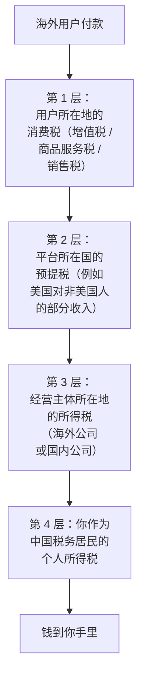
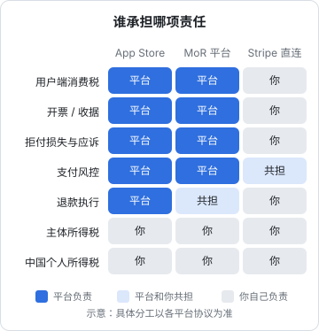
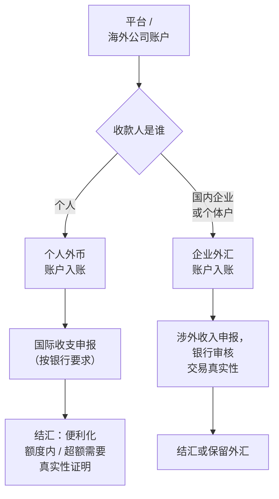

# 税务与汇款

前面几章一直把税和钱往后推，这一章集中处理。出海的税务之所以让人头大，是因为同一笔收入同时落在好几个国家的税法里：用户所在地要收消费税，平台所在地可能要预提，主体注册地要收所得税，而你作为中国税务居民，还要在国内申报。最后钱回到境内，又要经过外汇管理这一关。

这一章不给答案，给的是**一张分层的地图**：每一层的税归谁管、由谁处理、你需要准备什么。看清楚哪几层落在你身上，再去问专业人士具体的问题，效率会高很多。记账、发票、国内税种的基础在[《财务与税务》](../opc-finance/)里，本章只讲跨境部分。

> [!WARNING]
> 本章按 2025 年前后的各国税法和中国外汇管理规定整理，只是框架，不构成税务或法律意见；税率、门槛、申报期限和执行口径都可能已调整，以国家税务总局、国家外汇管理局、各国税务机关和开户银行的最新规定为准，并请咨询注册会计师、税务师或熟悉跨境业务的律师。

## 一笔收入的四层税

以一个海外用户付了一笔订阅费为例，从用户到你的口袋，可能经过四层：

不是每层都一定发生，哪几层落在你身上取决于第 1 章选的路径：

| 层 | 路径 A：个人 + 平台 | 路径 B：国内主体 | 路径 C：海外主体 + Stripe |
|---|---|---|---|
| 1 用户端消费税 | 平台处理 | 平台处理 | **你处理**（借助 Stripe Tax 等工具） |
| 2 平台预提税 | 可能有，填税务表格申请协定待遇 | 可能有，同左 | 视主体所在地而定 |
| 3 主体所得税 | 无单独主体 | 国内企业所得税或个体户经营所得 | 主体注册地的规则 |
| 4 中国个人所得税 | **申报境外所得** | 从公司取得工资、分红时缴纳 | **申报境外所得**，注意受控外国企业规则 |

这张图在第 3 章出现过。现在可以更清楚地看到它的含义：**MoR 和 App Store 帮你拿掉了第 1 层，而这一层恰恰是最琐碎、涉及国家最多的一层**；第 3、4 层无论走哪条路都在你身上。

## 第 1 层：各国的数字服务消费税

> [!WARNING]
> 各地区的消费税框架、OSS 方案和美国各州经济关联门槛按 2025 年前后的规定整理，可能已调整，以欧盟委员会、英国税务海关总署（HMRC）和各州税务部门的最新规定为准。

大多数国家和地区对向本地消费者提供的数字服务征收消费税，而且**无论卖方在哪里**。几个主要框架：

| 地区 | 框架 | 要点 |
|---|---|---|
| 欧盟 | 增值税，B2C 数字服务按**消费者所在成员国**的税率征收 | 境外卖家可以通过「一站式服务」（OSS）的非欧盟方案在一个成员国注册，统一申报所有成员国的税；B2B 交易通常适用反向征收，由买方自行申报 |
| 英国 | 增值税 | 对境外卖家的注册规则和本地企业不同，以英国税务海关总署（HMRC）的规定为准 |
| 美国 | 各州销售税，没有联邦层面的销售税 | 2018 年最高法院 Wayfair 案后，各州可以按「经济关联」（销售额或交易笔数达到州门槛）要求境外卖家登记；SaaS 和数字商品在各州是否应税差别很大 |
| 其他 | 澳大利亚、日本、加拿大、印度等都对境外数字服务征税 | 规则和门槛各不相同 |

光看这张表就能理解为什么一人公司应该尽量让平台处理这一层。如果走 Stripe 直连：

1. 开启 Stripe Tax，让它监控各地的门槛
2. 收到「接近门槛」的提醒后，评估是否需要注册
3. 注册后把税号录入，开始收税
4. 按各地周期申报，可以委托申报服务商

## 第 2 层：平台预提税

> [!WARNING]
> 预提税率和协定待遇按 2025 年前后的规定整理，可能已调整，以美国国税局（IRS）的表格说明、中美税收协定原文和平台的税务说明为准。

主要发生在美国。美国公司向非美国人支付某些类型的收入时，可能需要预提美国所得税。这就是 App Store、Google Play、部分 MoR 平台让你填 W-8BEN 或 W-8BEN-E 的原因（第 4 章）。

要点只有两个：

- **认真填税务表格**，按中美税收协定申请协定待遇，可以降低或免除预提
- **保留预提的凭证**（平台的税务报表），在中国申报境外所得时可能用于抵免

## 第 3 层：经营主体的所得税

### 国内主体（路径 B）

国内企业取得境外收入，首先是正常的企业所得税或个体户经营所得，这部分在《财务与税务》里讲过。跨境特有的几个问题，要让代账会计给出书面处理方案：

- **增值税**：向境外单位提供的部分服务，在符合条件时可以适用零税率或免税，有专门的规定和备案、留存资料要求，不是自动适用
- **境外已缴税款的抵免**：被境外预提的税，在企业所得税中能否抵免、怎么抵免，有专门规定
- **向境外支付的代扣代缴**：反方向，你付海外 SaaS 费用时可能产生代扣代缴义务，[《财务与税务》第 3 章](../opc-finance/03-invoices.md)提过
- **收入确认的凭证**：平台结算单、收入报告、银行入账记录，三者要能对上

### 海外主体（路径 C）

主体注册地的规则在第 2 章讲过框架：美国单一成员 LLC 的信息申报、香港的利得税和离岸豁免申请、新加坡的公司所得税。**海外主体的报税请当地的会计师做**，这是海外主体固定成本的一部分。

## 第 4 层：中国个人所得税

> [!WARNING]
> 本节引用的《个人所得税法》条款、境外所得申报期限、反避税和 CRS 规定按 2025 年前后的情况整理，可能已修订，以国家税务总局的最新公告和个人所得税 App 的当年指引为准。

这是最多人忽略、也最不能忽略的一层。

### 居民个人的全球所得

《个人所得税法》第一条规定：在中国境内有住所，或者无住所而一个纳税年度内在中国境内居住累计满 183 天的个人，为居民个人；**居民个人从中国境内和境外取得的所得，都要依法缴纳个人所得税**。

所以，你人在中国大陆，用个人身份在 App Store 海外区、MoR 平台取得的收入，就是境外所得，要申报。相关规定还包括财政部、税务总局关于境外所得个人所得税政策的公告。

| 问题 | 框架 |
|---|---|
| 什么时候申报 | 居民个人从中国境外取得所得的，应当在取得所得的次年 3 月 1 日至 6 月 30 日内申报纳税（《个人所得税法》第十三条） |
| 怎么申报 | 通过个人所得税 App 或电子税务局的年度汇算 / 境外所得申报功能，具体入口以税务机关当年的指引为准 |
| 所得怎么归类 | 平台收入属于经营所得、特许权使用费所得还是劳务报酬所得，适用的计税方法不同，**这是要问专业人士的问题** |
| 境外已缴的税 | 可以按规定抵免，但抵免额不超过该境外所得按中国税法计算的应纳税额（《个人所得税法》第七条） |
| 需要的材料 | 平台的收入报告、付款记录、境外完税凭证、银行入账记录 |

### 受控外国企业规则

如果你通过海外公司做生意，利润留在公司不分配，是不是就不用交中国个税？《个人所得税法》第八条规定了反避税条款，其中一项是：**居民个人控制的，或者居民个人和居民企业共同控制的、设立在实际税负明显偏低的国家（地区）的企业，无合理经营需要，对应当归属于居民个人的利润不作分配或者减少分配的**，税务机关有权按照合理方法进行纳税调整。

「实际税负明显偏低」「合理经营需要」怎么判断，要结合具体情况和配套规定。结论是：**海外公司不是把利润藏起来的地方**。

### 信息交换

中国参与了金融账户涉税信息自动交换（CRS）。你在参与 CRS 的国家和地区（例如中国香港、新加坡）开立的金融账户，账户信息可能被交换给中国税务机关。美国没有参与 CRS，而是有自己的 FATCA 体系，但**这不改变你的申报义务**。最稳妥的心态是：假设税务机关能看到你的所有境外账户。

## 汇款：钱怎么回到境内

> [!WARNING]
> 个人结汇便利化额度、外汇账户和申报要求按 2025 年前后的规定整理，可能已调整，以国家外汇管理局和开户银行的最新规定为准。

税之外，钱从境外进入境内、从外币变成人民币，受外汇管理规定约束。中国对**经常项目**（货物和服务贸易、收益等）基本可兑换，对**资本项目**（投资、借贷等）有管制。出海软件业务的收入，在性质上属于服务贸易，是经常项目，但要能证明**交易真实**。

### 个人收款

个人外汇的基本规定是《个人外汇管理办法》（中国人民银行令〔2006〕第 3 号）及其实施细则。框架如下：

- **入账**：境外汇入的外汇可以进入个人外币账户，银行会要求你说明款项性质，按要求如实申报
- **结汇**：个人每年有结汇的**年度便利化额度**，额度内凭本人身份证件办理并如实申报用途；超过额度，要凭交易真实性的证明材料（例如平台收入报告、合同）办理。额度标准和材料要求以国家外汇管理局和银行的最新规定为准
- **个体工商户**：可以按规定开立外汇结算账户，以经营名义收付，比个人身份更适合持续的经营性收入

### 企业收款

国内企业收取境外服务款，按经常项目外汇管理的规定（国家外汇管理局《经常项目外汇业务指引》等）办理：在银行开立经常项目外汇账户，入账时做国际收支申报，银行审核交易的真实性。要准备的单证一般包括合同或平台协议、发票或收入报告等，具体以开户银行的要求为准。

### 跨境收款服务商

MoR 平台等结算时，常见的收款方式之一是持牌的跨境收款服务商：它在境外给你一个收款账户，再把钱结汇或汇入你的境内账户。选择时：

- 确认对方是**持牌机构**，且业务范围覆盖你这类收入（服务贸易、数字服务）
- 确认收款人主体（个人还是企业）与你的业务身份一致
- 保留每一笔的入账和结汇记录，和平台的结算单对得上

### 绝对不要做的事

| 行为 | 为什么不能做 |
|---|---|
| 把一笔大额拆成多笔、用亲友的额度结汇 | 属于分拆结售汇，是外汇管理明确禁止的行为，会被列入关注名单，影响后续办理 |
| 通过地下钱庄「换汇」 | 违法，资金可能被冻结，还可能涉及刑事责任 |
| 用虚拟货币（如稳定币）把收入转回境内 | 中国对虚拟货币相关业务活动有明确的禁止性规定；资金来源不清，银行卡被冻结的风险高 |
| 编造交易性质（例如把服务收入申报为赡家款） | 虚假申报，违反外汇管理规定 |

这些「方法」在网上被广泛传播，但它们共同的问题是：**一旦出事，损失的不只是手续费，而是整笔资金和你的信用记录**。合规路径慢一点、手续多一点，但每一笔都站得住。

## 一年的跨境财税日历

把前面各章的时间点合在一起，一个人的年度清单大致如下（具体日期以各地最新规定为准）：

| 时间 | 事项 | 路径 |
|---|---|---|
| 每月 | 下载 App Store、MoR、Stripe 的结算报表，和银行入账核对 | 全部 |
| 每月 / 每季 | 海外消费税申报（如果自己注册了） | C |
| 每年年初 | 收集平台的年度税务报表、境外完税凭证 | 全部 |
| 每年 3 月 1 日至 6 月 30 日 | 中国个税年度汇算，申报境外所得 | A、C |
| 每年 | 海外主体的年报、信息申报、所得税申报 | C |
| 每年 | 国内企业所得税汇算清缴，处理跨境收入和抵免 | B |
| 发生时 | 每笔结汇如实申报，保留证明材料 | 全部 |

### 什么时候必须找专业人士

| 情况 | 找谁 |
|---|---|
| 第一次申报境外所得，不确定所得归类 | 国内税务师或注册会计师 |
| 设立或维护海外主体 | 注册地的会计师，以及懂外汇的国内律师 |
| 走 Stripe 直连、接近各国消费税门槛 | 跨境税务服务商 |
| 年收入增长到需要考虑主体结构调整 | 能同时看两地的跨境税务顾问 |
| 收到任何税务机关或银行的问询 | 先找专业人士，再回复 |

一次专业咨询的费用，和做错一次的代价比，几乎总是值得的。

## 全书回顾

| 章 | 核心结论 |
|---|---|
| 1 出海全景 | 三条路径，合规成本跟着收入走，多数人从「个人 + 平台」起步 |
| 2 海外主体 | 解决身份问题，不解决中国税务居民的义务；持续维护比注册重要 |
| 3 Stripe 与海外收款 | MoR 的费率买的是卖方责任；Stripe 直连意味着自己做各国税务 |
| 4 App Store 海外区 | 苹果是事实上的 MoR；协议、税务表格、银行三件事；欧盟交易者声明 |
| 5 GDPR 与隐私政策 | 向欧盟提供服务就适用；数据地图驱动一切；不收集是最好的合规 |
| 6 海外云与域名 | 数据驻留、账号风控、域名续费、邮件三条 DNS 记录 |
| 7 税务与汇款 | 四层税各归其主；中国个税申报境外所得；结汇如实、绝不拆分 |

## 本章要点

- 一笔海外收入可能经过**四层税**：用户端消费税、平台预提税、主体所得税、中国个人所得税
- MoR 和 App Store 拿掉了最琐碎的第 1 层；第 3、4 层无论哪条路径都在你身上
- **中国税务居民要就全球所得纳税**，境外所得在次年 3 月 1 日至 6 月 30 日申报，境外已缴税款可按规定抵免；海外公司不分配利润可能被纳税调整
- 汇款走经常项目，关键是**证明交易真实**；个人有年度便利化额度，超额凭真实性材料
- 不拆分结汇、不走地下钱庄、不用虚拟货币、不虚假申报；拿不准的先问专业人士

## 接下来读什么

到这里，从国内主体到海外市场，从定价到收款，从记账到报税，一人公司在「经营」这条线上的手续都走完了。按导读的顺序，最后一本是[《用 AI 撑起一人公司》](../ai-native-opc/)：把技术、运维、AI、Agent 和经营串起来，看研发、客服、运营、营销、财务这些岗位，怎么由你加上一组 agent 来承担。如果你决定把海外服务的基础设施做得更扎实，可以先翻[《云与边缘》](../cloud-and-edge/)。
