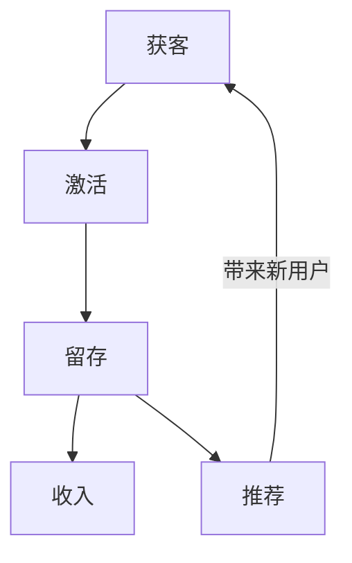
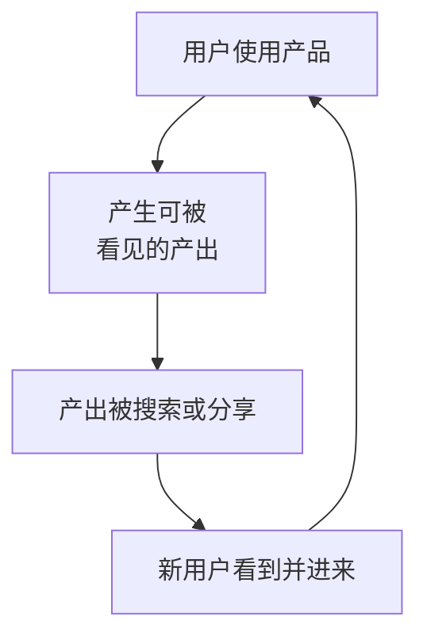
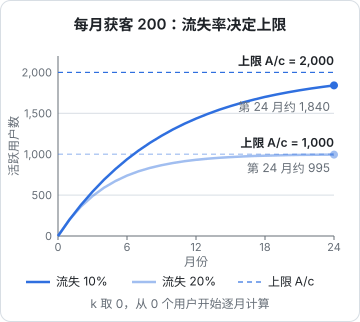

# 增长模型

产品做出来了，没人用，这是独立开发者最常见的结局。原因很少是「产品不够好」，更多是从来没有想清楚：**用户从哪里来、为什么留下、留下的人会不会带来新的人**。这一章先搭一个思考增长的框架，后面八章再逐个展开具体渠道和方法。

## 这本书讲什么、适合谁、怎么读

这本书写给已经有产品（或者快有了）、但不知道怎么让人知道它的独立开发者。它假设你：

- 能自己把产品做出来、部署上线，技术不是瓶颈
- 没有市场预算，或者预算很少，主要靠时间和内容换用户
- 主要面向国内用户，渠道以小红书、公众号、即刻、V2EX、B 站、抖音、行业社群、App Store 中国区为主；出海渠道在[冷启动](06-cold-start.md)一章里带过

全书九章：

| 章 | 内容 | 解决的问题 |
|---|---|---|
| 1 | 增长模型 | 用什么框架思考增长 |
| 2 | SEO | 让搜索的人找到你 |
| 3 | 社交媒体 | 在内容平台上被看见 |
| 4 | 社区运营 | 在别人的社区里做客，在自己的社区里做主 |
| 5 | ASO | 让 App Store 里搜索的人点进来、装上 |
| 6 | 冷启动 | 前 100 个用户怎么来 |
| 7 | 留存 | 来了的人为什么走、怎么留住 |
| 8 | 渠道评估 | 有限的时间该押在哪个渠道上 |
| 9 | 激活与小预算付费投放 | 新手引导怎么做，要不要花钱买安装、怎么投 Apple Ads |

建议先读第 1 章和第 8 章建立框架，再按自己产品的形态挑渠道章节读。做 App 的重点看第 5 章，做网站和 SaaS 的重点看第 2 章，所有人都该读第 6、7 章。

**本书不讲的**：文案怎么写见[《文案与内容》](../copywriting-content/)，指标体系、埋点、漏斗、A/B 测试见[《数据分析与埋点》](../product-analytics/)，定价见[《定价与商业模式》](../pricing-monetization/)。本书提到数据时只讲到「为什么要看、看什么方向」。

另外，**本书不引用任何具体产品的增长数字**。网上流传的「一篇笔记带来 X 万用户」大多口径不明、只代表幸存者。我们关心的是机制：为什么某种做法会起作用、什么条件下会失效。

## 增长不是「推广」

很多技术人把增长理解成「产品做完之后发几篇帖子」。这种理解有两个问题：

1. **把增长当成一次性动作**。发完帖子，来一波人，然后归零。真正的增长是一个能持续运转的系统
2. **只看入口，不看出口**。拉来 1000 个人，第二周只剩 20 个，再多的推广也是往漏桶里倒水

所以本书说的「增长」包括三件事：**获客**（让人来）、**留存**（让人留）、**传播**（让留下的人带来新人）。三者缺一，增长都会停下来。

## AARRR：最常用的分段框架

AARRR（也叫海盗指标）把用户生命周期分成五段：

| 阶段 | 英文 | 问题 | 一人公司的典型手段 |
|---|---|---|---|
| 获客 | Acquisition | 用户从哪里知道你 | SEO、内容平台、社区、应用商店 |
| 激活 | Activation | 第一次用有没有体会到价值 | 新手引导、默认数据、减少注册步骤 |
| 留存 | Retention | 会不会回来再用 | 解决高频问题、提醒、持续更新 |
| 收入 | Revenue | 会不会付钱 | 定价、付费墙位置、试用 |
| 推荐 | Referral | 会不会介绍给别人 | 分享功能、口碑、邀请机制 |



AARRR 的用处在于**定位瓶颈**。用户少的时候，直觉是「获客不够」，但很可能真正的问题在激活：来的人不少，打开一次就走了。这时候加大获客投入只会放大浪费。

一个实用的顺序是**从后往前修**：先确认留下来的少数人是真的需要它（留存），再优化第一次体验（激活），最后才放大获客。没有留存的获客是在烧时间。

## 漏斗与飞轮

AARRR 是一个**漏斗**：每一层都有流失，上面倒进去多少，下面就按比例漏出多少。漏斗思维的推论是「想要更多结果，就往顶部倒更多流量」，这对有广告预算的公司成立，对一人公司则不太现实。

另一种思路是**增长飞轮**（growth loop）：每一批用户的行为本身会带来下一批用户。



常见的飞轮类型：

| 飞轮 | 机制 | 例子类型 |
|---|---|---|
| 内容飞轮 | 用户产出的内容被搜索引擎收录，带来新用户 | 问答社区、模板站、公开分享页 |
| 分享飞轮 | 产品产出天然适合分享，分享时带着产品标识 | 生成海报、年度报告、带水印的导出 |
| 协作飞轮 | 用产品必须拉别人一起用 | 团队工具、共享清单、多人编辑 |
| 创作者飞轮 | 你持续产出内容，内容带来用户，用户反馈变成新内容 | 公开构建（build in public） |

一人公司最容易启动的是**创作者飞轮**：你本人就是那个持续产出内容的人。代价是它和你的时间强绑定，第 8 章会讨论怎么权衡。

设计产品时可以问自己：**用户用得越多，会不会让更多人知道这个产品？** 如果答案是「不会」，那获客就只能靠你自己一直推，增长会很累。

## 增长方程：把直觉写成算式

把一个月的用户变化写成算式，能帮你看清该优化哪一项：

$$
N_{t+1} = N_t \times (1 - c) + A + N_t \times k
$$

- $N_t$：本月活跃用户数
- $c$：月流失率（离开的比例）
- $A$：靠你主动获客带来的新用户
- $k$：每个活跃用户每月平均带来的新用户数（推荐系数）

三个推论：

1. **稳态上限**。如果 $k$ 很小可以忽略，用户数会趋向 $A / c$。每月获客 200、流失率 20%，上限就是 1000 人。想突破，要么多获客，要么降流失，而**降流失往往比多获客便宜**。$k$ 不可忽略、但仍小于 $c$ 时，上限是 $A / (c - k)$：下面 TypeScript 示例的基线取 $k = 0.02$，上限是 $200 / 0.18 \approx 1111$ 人，比忽略 $k$ 时多约 11%
2. **流失是复利**。流失率从 20% 降到 10%，上限直接翻倍，而且每一个拉来的人都更值钱
3. **推荐系数决定能不能脱离你自己**。当 $k > c$ 时，即使 $A = 0$ 用户也会增长。绝大多数产品做不到，但 $k$ 每提高一点，你需要亲自推的就少一点

下图取 $k = 0$、从零用户开始，按上面的算式逐月算出两种流失率下的用户数：



可以用几行 TypeScript 模拟一下不同参数的效果：

```typescript
// growth-sim.ts：用 node growth-sim.ts 直接运行（Node 22.6+ 需加 --experimental-strip-types，更新版本默认支持）
type Params = { acquire: number; churn: number; referral: number };

function simulate(p: Params, months: number): number[] {
  const series: number[] = [];
  let users = 0;
  for (let m = 0; m < months; m++) {
    users = users * (1 - p.churn) + p.acquire + users * p.referral;
    series.push(Math.round(users));
  }
  return series;
}

const scenarios: Record<string, Params> = {
  "基线": { acquire: 200, churn: 0.2, referral: 0.02 },
  "获客翻倍": { acquire: 400, churn: 0.2, referral: 0.02 },
  "流失减半": { acquire: 200, churn: 0.1, referral: 0.02 },
};

for (const [name, p] of Object.entries(scenarios)) {
  const s = simulate(p, 24);
  console.log(name.padEnd(6), "第 6 月", s[5], "第 24 月", s[23]);
}
```

这里的参数是随手设的，用来比较相对差异，不代表任何真实产品。跑一下会发现：「获客翻倍」需要你多花一倍的推广时间，「流失减半」可能只需要修好几个体验问题，长期效果却接近甚至更好。

## 一人公司的增长约束

大公司的增长方法论很多不适用于一个人，原因在于约束不同：

| 约束 | 含义 | 应对 |
|---|---|---|
| 时间是唯一预算 | 每小时花在推广上，就少一小时写代码 | 优先选能「复利」的渠道：内容会被长期搜到，帖子三天就沉 |
| 没有品牌背书 | 用户不认识你，天然不信任 | 用真实身份、真实过程建立信任，公开构建 |
| 渠道风险集中 | 一个平台封号或改规则，流量归零 | 至少两个渠道，并把用户沉淀到自己能触达的地方 |
| 无法 7×24 运营 | 不能每天发十条内容、实时回复 | 选节奏慢、内容寿命长的渠道，用 agent 处理重复劳动 |
| 样本小 | 用户少，数据噪声大 | 少依赖统计显著，多依赖和用户直接对话 |

最后一条很重要。大公司做增长靠 A/B 测试，一人公司在用户只有几百人时，测试很难得出可靠结论。这个阶段**和十个用户聊一遍，比看一个月的报表更有用**。

## 为什么还是要看数据

虽然样本小，数据仍然必要，因为人的直觉在增长问题上特别容易出错：

- 你记得那个热情反馈的用户，忘了二十个沉默离开的
- 某个渠道帖子点赞很多，但带来的人可能一个都没留下
- 你以为用户卡在付费，其实他们根本没走到付费那一步

所以至少要能回答三个问题：**用户从哪个渠道来**、**来了之后有没有完成关键动作**、**过一段时间还在不在**。怎么定义指标、怎么埋点、怎么算留存和漏斗，是《数据分析与埋点》的内容。本书只要求你在每个渠道上做好**来源标记**，第 6 章会给出最简单的做法。

## 先给自己的产品画一张增长图

读后面的章节之前，建议先花半小时回答下面这些问题，写在项目的 `docs/growth.md` 里：

```markdown
# 增长假设

## 用户是谁
- 一句话描述目标用户：
- 他们平时在哪些平台活跃：
- 他们遇到这个问题时会搜什么词：

## 激活
- 用户第一次体会到价值的那一刻是什么（aha moment）：
- 从打开到这一刻需要几步：

## 留存
- 这个问题多久发生一次（每天 / 每周 / 每月 / 一次性）：
- 用户为什么会回来：

## 传播
- 用户用完会不会想给别人看：
- 产品产出能不能被搜到或分享：

## 渠道候选（先列，第 8 章再评估）
1.
2.
3.
```

以作者的 hatch-counter（给中小餐饮门店用的经营管理工具）为例，写出来大概是：

- 用户是餐饮门店的店主，活跃在抖音、小红书的餐饮经营类内容和各种餐饮老板群里，很少逛 V2EX
- aha moment 是「导入一份收银报表，第一次看到按配方算出来的食材消耗」
- 问题每天都发生（每天营业），天然高频，留存有基础
- 传播主要靠老板之间口口相传，产品本身的产出（经营报表）不适合公开分享

这样一写，渠道方向就清楚了：技术社区基本没用，要去的是餐饮老板聚集的地方；SEO 价值有限；口碑和行业社群是主力。后面每一章都会回到这类分析。

## 本章要点

- 增长 = 获客 + 留存 + 传播，只做获客是往漏桶里倒水
- **AARRR** 用来定位瓶颈，修的顺序通常是从后往前：先留存，再激活，最后放大获客
- **飞轮**比漏斗更适合一人公司：让用户的使用本身带来新用户
- 增长方程 $N_{t+1} = N_t(1-c) + A + N_t k$ 说明：降流失往往比多获客便宜
- 一人公司的约束是时间、信任、渠道风险，选渠道要优先考虑复利和抗风险
- 小样本阶段和用户直接对话比看报表有用，但来源标记必须从第一天做起
