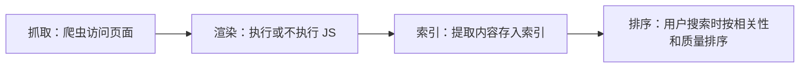

# SEO

搜索是最「诚实」的流量：用户主动输入一个词，说明他此刻就有这个需求。SEO（搜索引擎优化）做的事情，是让有需求的人在搜索时能找到你。它见效慢，但内容一旦排上去，会在几个月甚至几年里持续带来访问，这正是一人公司最需要的复利型渠道。

这一章讲清楚搜索引擎怎么工作、国内搜索的特殊情况、技术 SEO 的必做项，以及怎么用内容去覆盖关键词。

## 「搜索」不只是搜索引擎

在国内，用户搜索的地方远不止网页搜索引擎：

| 搜索入口 | 搜什么 | 对你意味着什么 |
|---|---|---|
| 百度、必应、搜狗等网页搜索 | 工具、教程、问题的解决办法 | 传统 SEO，靠网站内容 |
| 微信搜一搜 | 公众号文章、小程序、视频号 | 公众号文章本身就是可被搜到的内容 |
| 小红书站内搜索 | 「好用的 xx App」「xx 怎么做」 | 很多年轻用户把它当搜索引擎用，笔记标题和正文就是关键词 |
| 抖音、B 站站内搜索 | 教程、评测、对比 | 视频标题、简介、字幕都会参与检索 |
| App Store 搜索 | 应用 | 见[ASO](05-aso.md) |
| AI 助手 | 直接问「有什么工具能做 xx」 | 回答常基于网页内容，好的公开内容会间接受益 |

所以本章说的 SEO 是广义的：**让你的内容在用户会搜的地方，用用户会用的词，被找到**。网页 SEO 是基础，其他平台的站内搜索原理相通，在第 3 章会再提到。

## 搜索引擎怎么工作

不管哪家搜索引擎，流程都差不多：



每一步都可能出问题：

- **抓取**：爬虫找不到你的页面（没有外链、没有 sitemap），或被 `robots.txt` 挡住
- **渲染**：页面内容全靠前端 JS 渲染，爬虫拿到的 HTML 是一个空的 `<div id="root">`
- **索引**：页面质量太低、内容重复，被判定不值得收录
- **排序**：内容和搜索词不相关，或者同类内容里你的不够好

排查时也按这个顺序：先确认被抓到、被收录，再谈排名。

## 国内网页搜索的特殊情况

做国内用户的网站，有几点和面向 Google 的通用教程不同：

- **备案**：网站服务器在中国大陆，必须先完成 ICP 备案才能开放访问。服务器在境外虽然可以不备案，但国内访问速度和稳定性会受影响，部分搜索引擎对境外站点的收录也可能不够积极。备案流程见《国内合规实务》
- **JS 渲染**：不同搜索引擎对 JS 渲染页面的支持程度不一，而且会变。稳妥的做法是**让关键内容直接出现在服务器返回的 HTML 里**，不依赖前端渲染
- **站长工具**：百度有「搜索资源平台」，必应有 Bing Webmaster Tools，Google 有 Search Console。上线后都去注册、验证站点、提交 sitemap，这样能看到收录情况和搜索词
- **移动优先**：国内搜索流量大部分来自手机，页面在手机上要能正常看、加载要快

各家平台的具体规则和工具名称会变，以官方说明为准。

## 技术 SEO：上线前的必做清单

技术 SEO 不难，但漏一项可能导致整个站点不被收录。以一个 Vite + React 的站点为例。

### 1. 让 HTML 里有内容

纯 SPA（单页应用）的 `index.html` 里只有一个空容器，这是 SEO 的头号问题。根据站点类型选方案：

| 站点类型 | 推荐方案 |
|---|---|
| 官网、着陆页、文档 | 纯静态 HTML，或用 Astro、VitePress 这类静态站生成器 |
| 内容页很多的站（博客、模板库） | 构建时预渲染（SSG），每个页面生成一份 HTML |
| 需要登录的应用本体 | 不需要 SEO，SPA 即可；把营销页和应用分开 |

最常见的正确结构是：**营销站和应用分离**。`example.com` 是静态官网，负责被搜到；`app.example.com` 是 SPA 应用，负责被使用。hatch-counter 就是这么做的：官网是一个纯静态的单页（Vite 构建，资源全部相对路径），店主用的网页端是另一个应用，两者互不影响。

### 2. 每个页面的基础标签

```html
<!doctype html>
<html lang="zh-CN">
  <head>
    <meta charset="utf-8" />
    <meta name="viewport" content="width=device-width, initial-scale=1" />
    <!-- 标题：用户会搜的词放前面，品牌放后面 -->
    <title>餐饮门店库存管理：拍进货单自动入库 | 产品名</title>
    <!-- 描述：搜索结果里的摘要，写给人看，说清楚能解决什么问题 -->
    <meta name="description" content="导入收银报表按配方扣库存，拍照识别手写进货单，记开支算盈亏。给中小餐饮门店用的经营管理工具。" />
    <link rel="canonical" href="https://example.com/" />
    <!-- 社交分享卡片 -->
    <meta property="og:title" content="餐饮门店库存管理工具" />
    <meta property="og:description" content="拍进货单自动入库，按配方算食材消耗。" />
    <meta property="og:image" content="https://example.com/og.png" />
  </head>
</html>
```

几条原则：

- `title` 每页唯一，控制在搜索结果能完整显示的长度内，别堆砌关键词
- `description` 不直接影响排名，但影响点击率，要写成一句有吸引力的话
- `canonical` 告诉搜索引擎哪个 URL 是正式版本，避免带参数的 URL 被当成重复内容

### 3. robots.txt 和 sitemap

`robots.txt` 放在站点根目录：

```text
User-agent: *
Allow: /
Disallow: /api/

Sitemap: https://example.com/sitemap.xml
```

sitemap 可以在构建时生成。下面是一个 Node 脚本，扫描 `dist/` 下的 HTML 文件生成 `sitemap.xml`：

```typescript
// scripts/sitemap.ts：在 vite build 之后运行
import { readdirSync, statSync, writeFileSync } from "node:fs";
import { join, relative } from "node:path";

const SITE = "https://example.com";
const DIST = "dist";

function walk(dir: string): string[] {
  return readdirSync(dir).flatMap((name) => {
    const full = join(dir, name);
    if (statSync(full).isDirectory()) return walk(full);
    return name.endsWith(".html") ? [full] : [];
  });
}

const urls = walk(DIST)
  .filter((f) => !f.endsWith("404.html"))
  .map((f) => {
    const path = "/" + relative(DIST, f).replace(/index\.html$/, "").replace(/\.html$/, "");
    const lastmod = statSync(f).mtime.toISOString().slice(0, 10);
    return `  <url><loc>${SITE}${path}</loc><lastmod>${lastmod}</lastmod></url>`;
  });

const xml = `<?xml version="1.0" encoding="UTF-8"?>
<urlset xmlns="http://www.sitemaps.org/schemas/sitemap/0.9">
${urls.join("\n")}
</urlset>
`;

writeFileSync(join(DIST, "sitemap.xml"), xml);
console.log(`sitemap: ${urls.length} urls`);
```

在 `package.json` 里串起来：

```json
{
  "scripts": {
    "build": "vite build && node scripts/sitemap.ts"
  }
}
```

（Node 22 早期版本运行 `.ts` 需要加 `--experimental-strip-types`，较新版本已默认支持。）

### 4. 结构化数据

结构化数据用 JSON-LD 告诉搜索引擎「这个页面描述的是一个软件应用」，有机会在搜索结果里显示更丰富的信息。各家搜索引擎对它的支持程度不同，加上没有坏处：

```html
<script type="application/ld+json">
{
  "@context": "https://schema.org",
  "@type": "SoftwareApplication",
  "name": "产品名",
  "applicationCategory": "BusinessApplication",
  "operatingSystem": "Windows, macOS, Android",
  "description": "给中小餐饮门店用的经营管理工具"
}
</script>
```

不要在结构化数据里写页面上没有的内容（比如编造的评分），这可能被判定为作弊。

### 5. 速度和可访问性

- 图片压缩并指定宽高，避免布局跳动
- 首屏不要等大量 JS 下载完才显示内容
- 用浏览器开发者工具里的 Lighthouse 跑一遍，把明显的问题修掉

性能的细节见《前端工程化与 Web 平台》。

## 关键词：用户会搜什么

技术 SEO 只是「不被扣分」，真正带来流量的是内容。内容的起点是关键词：**你的目标用户在遇到问题时，会在搜索框里输入什么？**

### 找关键词的方法

1. **问用户**：访谈时问「你之前遇到这个问题时是怎么找办法的？搜了什么？」这是最准的来源
2. **看搜索联想**：在百度、小红书、抖音的搜索框里输入核心词，看下拉联想和「相关搜索」
3. **看竞品**：同类产品的官网标题、文章标题在用什么词
4. **看站长工具**：上线一段时间后，搜索资源平台和 Search Console 会告诉你实际带来点击的词
5. **让 agent 发散**：给出产品描述和用户画像，让模型列出用户可能的搜索说法，再人工筛选

### 关键词分层

| 类型 | 例子 | 特点 | 一人公司的策略 |
|---|---|---|---|
| 核心词 | 「库存管理软件」 | 搜索量大，竞争极激烈 | 别指望排上去，作为方向参考 |
| 长尾词 | 「小饭馆怎么管进货」「手写进货单怎么录入」 | 搜索量小，意图明确，竞争小 | **主战场** |
| 问题词 | 「餐饮成本怎么算」 | 用户还没想到要用工具 | 写教程文章，文末引出产品 |
| 对比词 | 「A 和 B 哪个好」「A 的替代品」 | 用户在做选择 | 写诚实的对比页 |

一人公司拼不过大公司的核心词，但长尾词的总量往往很大，而且每个词背后的需求更具体、转化更好。

## 内容 SEO：写什么

### 教程型内容

围绕用户的「问题词」写教程，产品作为解决方案之一出现。比如面向餐饮店主写「小餐馆每月食材成本怎么算」，讲清楚手工算法，最后提一句「如果不想每月手算，可以用工具自动做」。

好的教程内容有三个特点：**真的能解决问题**（不用产品也能照着做）、**比现有搜索结果更好**（更具体、更新、有例子）、**结构清晰**（用 H2/H3 分段，搜索引擎和读者都容易理解）。

### 程序化 SEO

当关键词有固定模式时，可以用数据批量生成页面，比如：

- 「xx 格式转 yy 格式」：每种格式组合一页
- 「xx 城市 yy 行业的 zz」：每种组合一页
- 模板库：每个模板一个独立页面

这对开发者是天然优势：一份数据加一个模板，构建时生成几百个页面。但要注意**每个页面必须有独立的价值**，只是替换关键词、内容几乎一样的页面会被判定为低质量，甚至拖累整站。

### 用户产出的公开内容

如果产品允许用户公开分享自己的产出（分享页、公开主页、作品集），每个分享页都是一个可被搜到的页面，这就是第 1 章说的内容飞轮。设计这类功能时，要让分享页有清晰的标题、描述和指向产品的入口，同时提供「不公开」的选项，尊重隐私。

## 外链与提及

搜索引擎会把其他网站对你的链接当作「投票」。一人公司不要去买外链（有被惩罚的风险），比较健康的来源是：

- 在 V2EX、掘金、少数派等社区发真正有价值的内容，自然带上链接
- 开源一部分工具代码，GitHub 仓库和 README 会被引用
- 被别人的「工具推荐」「xx 合集」类文章收录，可以主动、礼貌地联系作者
- 在 Awesome 列表、导航站提交收录

第 4 章会更详细地讲怎么在社区里做客而不被当成广告。

## 用 agent 做 SEO 的重复劳动

SEO 里有大量适合交给 agent 的活：

- 根据关键词列表生成文章大纲，人来补充真实经验
- 批量检查页面的 `title`、`description` 是否缺失或重复
- 根据数据生成程序化页面
- 每月读一次站长工具导出的搜索词，找出「有展示没点击」的页面，建议改标题

但**不要让 AI 批量生成没有真实信息的文章**。这类内容很难排上去，也会伤害读者对你的信任。AI 写作的边界见《文案与内容》。

## 本章要点

- 国内的「搜索」包括网页搜索、微信搜一搜、小红书和抖音的站内搜索，都要考虑
- 排查顺序：先确认被**抓取、收录**，再谈排名
- 技术 SEO 必做：关键内容在 HTML 里、每页唯一的 title 和 description、robots.txt、sitemap
- 营销站和应用分离：静态官网负责被搜到，SPA 应用负责被使用
- 一人公司的主战场是**长尾词**和**问题词**，用真正有用的教程去覆盖
- 程序化 SEO 是开发者的优势，但每个页面都要有独立价值
- SEO 见效以月计，越早开始越好
