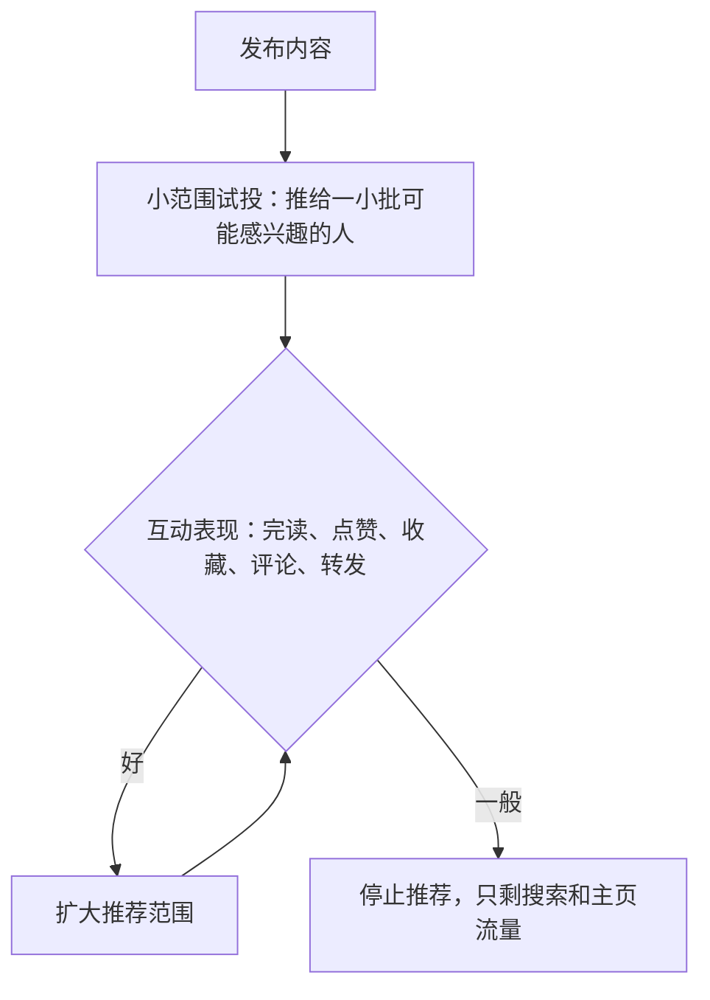
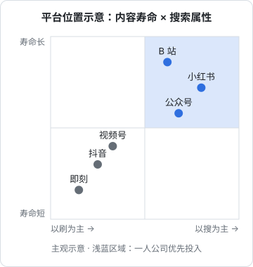
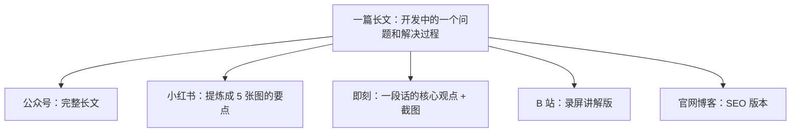

# 社交媒体

对没有预算的独立开发者来说，内容平台几乎是唯一能「免费」触达大量陌生人的地方。但每个平台的用户、内容形式、分发机制都不一样，同一份内容原样发到六个平台，大概率六个都没效果。

这一章先讲平台分发的共同逻辑，再逐个分析小红书、公众号、即刻、B 站、抖音这几个国内主要平台，最后讲一个人怎么可持续地做内容。

## 平台分发的共同逻辑

几乎所有内容平台都在用类似的方式决定一条内容给多少人看：



这带来几个推论：

1. **粉丝少也能有流量**。推荐算法看的是单条内容的表现，新号的好内容也能被推出去
2. **开头决定一切**。试投阶段用户只给你几秒，标题、封面、前三秒决定了有没有后续
3. **收藏比点赞更有价值**。收藏说明内容有长期价值，平台也倾向于把高收藏的内容推给搜索相关词的人
4. **流量会突然归零**。一条内容爆了，下一条可能只有几十个阅读，这是正常的，不代表账号出了问题

各平台具体权重和规则不公开，而且经常调整，以上只是普遍规律。

## 两个关键维度：内容寿命和搜索属性

选平台时最值得看的两个维度是：

- **内容寿命**：一条内容发出后多久还能带来流量。信息流里的内容几天就沉了，能被搜到的内容可以持续很久
- **搜索属性**：用户在这个平台上是「刷」还是「搜」。有搜索习惯的平台，内容可以长期被有需求的人找到



图中位置是作者根据平台机制做的主观判断，用来帮助思考，不是测量结果。对一人公司来说，**右上角的平台更值得优先投入**：你没有精力每天发内容，需要的是一条内容能工作很久。

## 国内主要平台

### 小红书

| 维度 | 特点 |
|---|---|
| 用户 | 年轻用户多，女性比例高，近年各类人群都在扩大 |
| 内容形式 | 图文笔记为主，视频也在增加 |
| 用户行为 | **大量用户把它当搜索引擎**，搜「好用的 App」「效率工具推荐」「xx 怎么做」 |
| 适合的产品 | 面向普通消费者的工具类 App、效率工具、生活类产品、设计类产品 |

小红书对独立开发者特别重要，因为它同时有推荐和搜索两种分发。一篇写得好的笔记，发布时靠推荐获得第一波流量，之后很长时间里还会被搜索关键词的人看到。

写法上的要点：

- **封面图是标题**：首图上用大字写清楚这篇笔记解决什么问题，比如「独立开发者自用的 5 个 Mac 工具」
- **标题和正文包含用户会搜的词**：想想用户在搜索框里怎么说，就把那个说法写进去
- **以分享视角而不是广告视角**：「我做了一个工具解决自己的 xx 问题」比「xx App 全新上线」更容易被接受
- **真实截图和使用场景**：比精修的宣传图更可信

平台对站外导流（留外部链接、联系方式等）有限制，违规会被限流甚至处罚。发布前读一遍社区规范，具体规则以平台最新说明为准。通常的做法是在笔记里说清楚产品名字，让感兴趣的人自己去 App Store 或搜索引擎搜。

### 微信公众号

| 维度 | 特点 |
|---|---|
| 用户 | 覆盖面最广，各年龄段都有 |
| 内容形式 | 长图文 |
| 分发 | 订阅推送、朋友圈和群转发、微信搜一搜，近年也加入了推荐分发 |
| 适合 | 深度文章、教程、行业观察，To B 产品和面向专业人群的产品 |

公众号的价值在于**长文能讲清楚复杂的事**，并且文章会被微信搜一搜收录，成为长期可被搜到的内容。对 To B 产品，一篇讲透某个行业问题的公众号文章，被转发到行业群里，可能比任何推广都有效。

公众号的另一个价值是**沉淀**：关注你的人是可以反复触达的。产品更新、新功能发布都可以推送给他们。

### 即刻

即刻是国内独立开发者、产品经理、创业者相对集中的社区，有「圈子」按兴趣聚集，其中有不少和独立开发、AI 产品、效率工具相关的圈子。

| 适合 | 不适合 |
|---|---|
| 公开构建（build in public）：分享开发过程、数据、思考 | 面向普通消费者的大众产品获客（用户基数有限） |
| 获取早期种子用户和反馈 | 一次性广告式发布 |
| 结识同行、交流经验 | |

即刻的内容寿命较短，但用户质量高、反馈直接，适合在产品早期获得第一批愿意试用并给反馈的人。

### B 站

| 维度 | 特点 |
|---|---|
| 用户 | 年轻用户为主，学习类、科技类内容受欢迎 |
| 内容形式 | 中长视频 |
| 分发 | 推荐 + 站内搜索，好视频的长尾流量很长 |
| 适合 | 开发过程记录、技术教程、产品演示、工具评测 |

B 站对开发者友好的地方在于用户愿意看长内容，而且「我用 X 周做了一个 App」这类开发记录天然有故事性。视频制作成本高于图文，但一条好视频的寿命可能长达数年。

### 抖音和视频号

抖音用户量最大、覆盖人群最广，推荐算法决定了几乎一切。它的问题是**内容寿命短、制作门槛相对高**（需要持续产出短视频），对一人公司来说投入产出比要仔细算。

但对某些产品，抖音是绕不过去的。hatch-counter 的目标用户是餐饮门店店主，他们刷的是抖音上的餐饮经营类内容，很少用小红书搜工具，更不会上 V2EX。如果要做内容获客，就得去抖音讲「小饭馆怎么控制食材成本」这类店主真正关心的问题。

视频号的特点是和微信社交关系打通，内容容易在熟人之间传播，适合本来就在微信生态里的目标用户。

### 平台选择速查

| 你的产品 | 优先考虑 |
|---|---|
| 面向普通消费者的 App | 小红书 → 抖音 / B 站 |
| 开发者工具 | 即刻、V2EX（第 4 章）、B 站技术区、掘金 |
| 效率工具、生产力 App | 小红书、即刻、少数派（第 4 章） |
| To B、垂直行业工具 | 公众号、行业社群（第 4 章）、行业用户所在的短视频平台 |
| AI 产品 | 即刻、小红书、B 站 |

**一开始只选一到两个平台**。分散在五个平台各发几条，不如在一个平台上坚持发三个月。

## 公开构建

公开构建（build in public）是指在社交媒体上持续分享产品的开发过程：做了什么、遇到什么问题、怎么决策、数据怎么样。它对一人公司特别有效，原因是：

- **内容源源不断**：你每天都在做产品，素材是现成的，不需要额外找选题
- **建立信任**：用户看着你一步步把产品做出来，比看广告更相信你
- **早期用户自然积累**：关注你过程的人，就是产品上线时的第一批用户
- **获得反馈**：在做之前就能听到潜在用户的意见

可以分享的内容类型：

| 类型 | 例子 |
|---|---|
| 进展 | 「今天把离线同步做完了，踩了三个坑」 |
| 决策 | 「为什么我放弃了订阅制改成买断」 |
| 失败 | 「上线一周，留存很差，我分析了原因」 |
| 技术 | 「用 Expo 做 iOS 离线阅读器的架构」 |
| 数字 | 收入、用户数等（是否公开、公开到什么程度由你决定） |

注意边界：公开构建不等于公开一切。用户隐私、商业机密、还没想好的计划，都不需要分享。是否公开收入数字也是个人选择，公开会吸引关注，也会吸引竞争者和质疑。

## 一个人怎么做内容

最大的挑战不是「写什么」，而是**持续**。几个让内容可持续的做法：

### 一鱼多吃

写一篇深度内容，拆成多个平台的版本：



注意每个平台要按它的形式重写，不是复制粘贴。小红书要图片化、短句化；即刻要口语化、有观点；公众号可以展开细节。

### 建立素材库

在开发过程中随手记录可以变成内容的东西：

```markdown
<!-- content-ideas.md -->
## 2026-11
- [ ] 离线阅读器为什么不用 EAS Update（决策类）
- [ ] AirDrop 导入的坑：文件名编码（技术类）
- [ ] 第一个用户反馈：想要夜间模式（进展类）
- [x] 用 agent 写书的工作流（已发即刻 11-01）
```

### 用 agent 改写，但保留自己的声音

agent 很适合做「一鱼多吃」里的改写：给它原文和目标平台的风格要求，生成初稿。但要人工修改，加入只有你才知道的细节和真实感受。让人一眼看出是 AI 写的内容，在所有平台上效果都不好。具体方法见《文案与内容》。

### 固定节奏

与其想到就发，不如定一个可持续的节奏，比如「每周一条小红书、每两周一篇公众号、即刻随时」。节奏比数量重要，平台和读者都会适应你的频率。

## 不要做的事

- **买粉、刷量**：违反平台规则，数据虚高会误导你的判断，被发现会被处罚
- **硬广**：用户和平台都排斥纯广告内容
- **追无关热点**：带来的流量和你的产品没有关系
- **一次发完就放弃**：内容平台需要积累，前几十条没起色很正常
- **忽视评论**：评论区是最直接的用户反馈来源，也是互动权重的一部分

## 本章要点

- 平台推荐的共同逻辑：小范围试投 → 看互动 → 扩大或停止，粉丝少也能有流量
- 选平台看**内容寿命**和**搜索属性**，一人公司优先选内容能长期被搜到的平台
- 小红书兼具推荐和搜索，是面向消费者产品的重点；公众号适合深度内容和 To B；即刻适合公开构建和种子用户；B 站适合长视频和开发记录；抖音覆盖广但寿命短
- 去目标用户在的平台，而不是你自己常逛的平台
- **公开构建**让内容源源不断，同时积累信任和早期用户
- 一开始只做一到两个平台，用「一鱼多吃」和固定节奏让内容可持续
