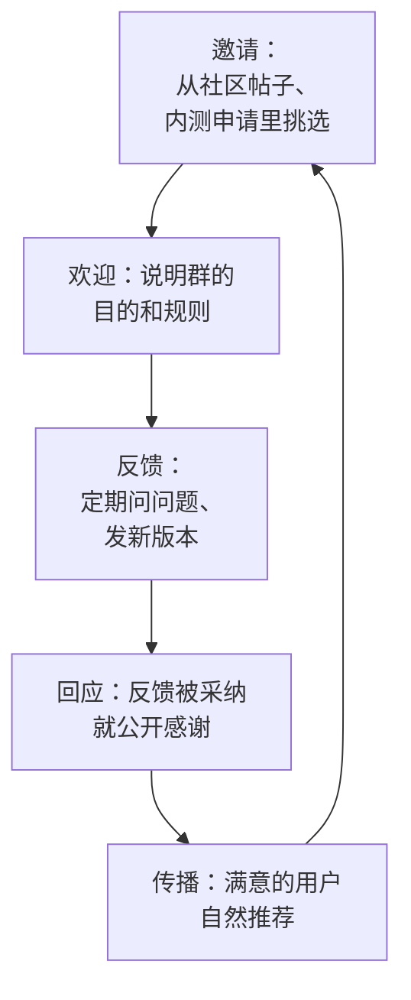

# 社区运营

内容平台是「广播」：你发，算法决定谁看到。社区则是「对话」：一群有共同兴趣或身份的人聚在一起，彼此认识、互相回应。在社区里，信任来得慢，但一旦建立，转化率远高于陌生流量。

社区运营分两件事：**在别人的社区里做客**（V2EX、少数派、掘金、行业群），和**建自己的社区**（用户群、反馈渠道）。前者是获客，后者是留存和传播。

## 社区和内容平台的区别

| 维度 | 内容平台 | 社区 |
|---|---|---|
| 分发 | 算法推荐 | 成员主动浏览、版主排序、时间线 |
| 关系 | 你和读者是单向的 | 成员之间互相认识 |
| 信任来源 | 内容本身 | 你在社区里的历史和身份 |
| 对广告的容忍度 | 中等 | 很低，常有明确规则 |
| 适合 | 触达大量陌生人 | 获得高质量早期用户和深度反馈 |

社区最重要的一条规则：**先成为成员，再推广产品**。一个注册当天就发产品链接的账号，在任何社区都会被当成广告。

## 在别人的社区里做客

### V2EX

V2EX 是国内程序员和互联网从业者聚集的老牌社区，按节点组织话题。对独立开发者来说：

- **有专门展示自己作品的节点**（如「分享创造」），在那里发自己做的产品是被允许和欢迎的
- **在其他节点发推广内容会被移动或删除**，严重的会被封号
- 用户以开发者为主，眼光挑剔，评论直接，好产品会收到很有价值的反馈，粗糙的产品也会被直接批评
- 适合开发者工具、效率工具、技术相关产品，以及想听同行意见的早期产品

发帖前先读社区规则，规则以站点最新说明为准。

一篇好的 V2EX 产品帖长什么样？以 hatch-shelf 为例（它目前是自用项目，这里假设要公开发布）：

```markdown
标题：做了一个 iOS 离线 Markdown 书架，AI 写的书 AirDrop 到手机上读

正文：
起因：最近用 Claude Code 写了很多学习笔记和长文，想在手机上舒服地离线看，
试了几个 Markdown 阅读器都不太满意（目录、代码高亮、公式支持各有缺失）。

做了什么：
- 电脑上一条命令打包，AirDrop 或局域网传到手机
- 支持代码高亮、KaTeX 公式、Mermaid 图
- 完全离线，不联网、不要账号

技术栈：Expo + SQLite + WebView 阅读器（截图 x3）

现状：自用了两个月，目前 TestFlight 内测，想听听大家的意见：
1. 这种「电脑写、手机读」的需求你们有吗？
2. 还缺什么功能？

内测链接放在评论区 / 可以私信我
```

这个结构的要点：**从自己的问题出发**、**说清楚做了什么**、**给出技术细节**（开发者社区喜欢）、**诚实说明现状**、**主动请求反馈**。

### 少数派、掘金等内容社区

| 社区 | 用户 | 适合发什么 |
|---|---|---|
| 少数派 | 效率工具、数字生活爱好者 | 工具使用心得、工作流分享，产品作为工作流的一部分出现 |
| 掘金 | 前端、移动端、后端开发者 | 技术文章，比如「用 Expo 做离线阅读器的架构」 |
| GitHub | 开发者 | 开源工具本身，README 就是产品介绍 |

这些社区的共同点是：**用有价值的内容换曝光**。写一篇真正有用的技术文章，文末提一句「这是我在做 xx 产品时遇到的问题」，比直接写产品介绍效果好得多。

### 行业社群

对垂直行业产品，最有效的社区往往不在互联网圈，而在行业内部：

- 微信群：行业交流群、本地商家群、供应商群
- QQ 群：部分行业和年龄段仍然大量使用
- 行业论坛、协会、线下活动
- 行业垂直 App 里的社区板块

hatch-counter 的目标用户是餐饮店主。他们在哪里交流？餐饮老板群、食材供应商拉的客户群、本地商户群、餐饮培训机构的学员群。在这些群里，一个店主说「我用这个工具管进货挺方便」，比任何广告都有说服力。

进入行业社群的方式：

1. **先成为行业里的人**：了解行业的术语、痛点、常见做法，最好的方式是去和用户面对面聊（见[《产品思维》](../product-thinking/)的用户访谈）
2. **提供价值**：在群里回答问题、分享有用的资料（比如一份「餐饮成本核算表格模板」），不急着提产品
3. **通过关键人物**：群主、行业里有影响力的人、供应商，他们的推荐有放大效果
4. **让种子用户带你进群**：早期用户满意了，请他们把你拉进他们的群，或者帮你介绍

行业社群对广告极其敏感。在群里直接发产品介绍，大概率被踢出群。

## 怎么在社区里不被当成广告

| 做 | 不做 |
|---|---|
| 先参与讨论几周，建立账号历史 | 注册当天发产品 |
| 在规定的节点或板块发产品 | 在不相关的帖子下留言推广 |
| 从问题和故事出发 | 一上来就列功能 |
| 诚实说明产品的局限 | 夸大或隐瞒 |
| 认真回复每一条评论，包括批评 | 只回复好评，或和批评者争吵 |
| 公开自己是开发者 | 用小号假装路人推荐 |

最后一条要特别强调：**用小号自问自答、假装用户推荐**，一旦被发现（社区成员对此非常敏锐），会彻底毁掉你在这个社区的信任，而且这种事情会被截图传播。

## 回应批评

在社区发产品，一定会收到批评。处理原则：

- **区分三类批评**：真实的问题（感谢并记录）、需求不匹配（「这个产品不是为你设计的」，礼貌说明）、单纯的情绪（不用纠缠）
- **不辩解，问细节**：「你说的卡顿是在哪个页面？用的什么设备？」比「我这里不卡啊」有用
- **公开改进**：修好了某个被指出的问题，回到原帖说一声，这会让旁观者对你印象很好

## 建自己的社区

在别人的社区获客之后，要把用户沉淀到自己能触达的地方。原因很简单：平台的流量属于平台，规则一变就没了；**自己能直接联系到的用户，才是真正属于你的资产**。

### 选什么形式

| 形式 | 优点 | 缺点 | 适合 |
|---|---|---|---|
| 微信群 | 用户最熟悉，门槛最低 | 信息流式，难以检索，满员要建新群，管理成本高 | 早期种子用户、To B 客户群 |
| 企业微信群 | 有管理工具，可以对接客户管理 | 用户对企业微信的接受度不如个人微信 | To B、需要客服的产品 |
| 公众号 | 一对多推送，内容可沉淀 | 互动弱 | 发布更新和长文 |
| 即刻圈子 / 小红书群聊 | 和平台内容结合 | 依赖平台 | 平台内的用户 |
| 邮件列表 | 不依赖任何平台，自己完全掌控 | 国内用户看邮件的习惯较弱 | 开发者、海外用户 |
| 自建论坛 / Discord | 可检索、可沉淀 | 冷启动难，要有足够活跃度 | 用户量较大之后 |

早期最实际的组合是：**一个微信群（或企业微信群）+ 一个公众号 + App 内的反馈入口**。

### 种子用户群怎么运营

种子用户群的目的不是热闹，而是**获得反馈、建立关系、让用户成为传播者**。



几个要点：

- **控制规模**：前期一个群几十人足够，人太多反而没人说话
- **说清楚规则**：这个群是干什么的、可以发什么、不可以发什么
- **让反馈有回音**：用户提的建议，做了就在群里说「这是 xx 提的，已经上线了」。这是让用户持续参与的最强动力
- **你本人在场**：一人公司最大的优势是用户能直接和开发者对话，这是大公司给不了的体验
- **定期发起话题**：「下个版本想做 A 还是 B？」「你们平时怎么用这个功能？」

### 反馈渠道

除了群，App 和网站里要有一个低门槛的反馈入口。hatch-counter 的做法值得参考：开户由开发者在管理后台办理，每个门店都是直接认识的客户，客户在使用中遇到问题可以直接联系到人，项目里也专门有一个给客户群发通知的工具。在用户量少的阶段，这种「每个用户都认识」的关系是最强的留存手段。

App 内反馈可以很简单：

```typescript
// 在设置页放一个「反馈」入口，预填设备和版本信息，减少来回询问
import * as Application from "expo-application";
import * as Device from "expo-device";
import { Linking } from "react-native";

export function openFeedback() {
  const info = [
    `版本：${Application.nativeApplicationVersion} (${Application.nativeBuildVersion})`,
    `设备：${Device.modelName}，系统 ${Device.osVersion}`,
  ].join("\n");
  const body = encodeURIComponent(`\n\n---\n${info}`);
  // 收件地址换成你自己的反馈邮箱
  Linking.openURL(`mailto:feedback@example.com?subject=${encodeURIComponent("反馈")}&body=${body}`);
}
```

`expo-application` 和 `expo-device` 是 Expo 的常用模块，用 `npx expo install expo-application expo-device` 安装以获得与当前 SDK 匹配的版本。

## 社区运营的时间成本

社区运营很耗时间，而且是持续的。要给它设边界：

- **固定时间处理**：每天固定一个时段看群和社区，而不是随时盯着
- **整理常见问题**：重复问题写成文档，下次直接发链接
- **让 agent 帮忙**：汇总一周的群聊和反馈，按主题归类，标出需要回复的和可以进入需求池的。注意用户的聊天内容属于个人信息，处理时要遵守隐私规定，不要上传到不可信的服务
- **适时放权**：有特别活跃、热心的用户，可以请他们帮忙解答新人的问题

## 本章要点

- 社区靠信任运转，**先成为成员，再推广产品**
- V2EX 有专门展示作品的节点，开发者用户反馈直接；少数派、掘金适合用有价值的内容换曝光
- 垂直行业产品最有效的社区往往在行业内部：微信群、行业活动、关键人物推荐
- 从问题和故事出发、诚实说明局限、认真回复批评；绝不用小号自问自答
- 把用户沉淀到自己能触达的地方：微信群、公众号、App 内反馈入口
- 种子用户群的核心是**让反馈有回音**，你本人在场是一人公司的独特优势
