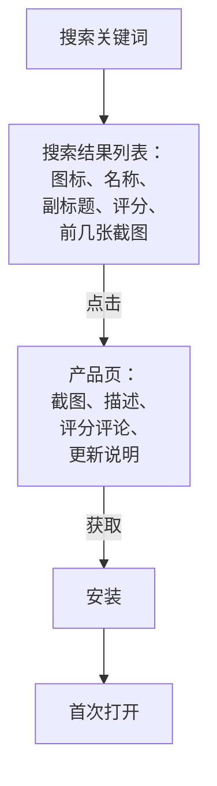

# ASO

ASO（App Store Optimization，应用商店优化）就是应用商店里的 SEO。对 App 来说，应用商店的搜索往往是最稳定的获客来源：用户搜「记账」「番茄钟」「离线阅读」，说明他此刻就想装一个这样的 App。

ASO 要解决两个问题：**被搜到**（关键词覆盖和排名）和**被点开、被安装**（产品页的转化）。这一章以 App Store 中国区为主，最后简要说明国内安卓应用商店的情况。

## 用户在应用商店里的路径



每一步都有流失，ASO 优化的就是前三步：

| 环节 | 影响因素 | 优化方向 |
|---|---|---|
| 被搜到 | 名称、副标题、关键词字段、下载量和评分等 | 关键词覆盖 |
| 列表中被点击 | 图标、名称、副标题、评分、首屏截图 | 一眼看懂是什么 |
| 产品页转化 | 截图、预览视频、评论、描述 | 打消顾虑、展示价值 |

搜索结果里，用户通常只看几秒就决定点不点。所以**图标、名称、副标题和前几张截图**是最重要的资产。

## 元数据：哪些字段影响搜索

App Store Connect 里和 ASO 相关的主要字段：

| 字段 | 长度限制（以 App Store Connect 当前说明为准） | 是否参与搜索 | 修改方式 |
|---|---|---|---|
| App 名称 | 30 字符 | 是，权重最高 | 随新版本提交 |
| 副标题 | 30 字符 | 是 | 随新版本提交 |
| 关键词 | 100 字符 | 是，用户不可见 | 随新版本提交 |
| 推广文本 | 170 字符 | 否 | 随时修改，无需审核新版本 |
| 描述 | 较长 | 一般认为 App Store 不参与搜索 | 随新版本提交 |
| 更新说明 | — | 否 | 每个版本 |

各字段的长度限制和规则由 Apple 决定，可能调整，提交前以 App Store Connect 页面的提示为准。

### App 名称

名称是权重最高的字段。常见写法是「品牌名 - 核心关键词」或「品牌名：功能描述」：

- 「书架 - 离线 Markdown 阅读器」
- 「掌柜眼：餐饮门店进销存」

注意：

- 品牌名要短、好记、好搜。如果品牌名本身没人搜，后面的关键词就是被搜到的主要途径
- 不要堆砌关键词，审核可能不通过，用户看着也不舒服
- 不要使用别人的商标或品牌名

### 副标题

副标题显示在名称下方，是对名称的补充。写法上：**说清楚给谁用、解决什么问题**，同时包含名称里没覆盖的关键词。比如「AI 写的书，AirDrop 到手机离线读」。

### 关键词字段

关键词字段用户看不到，只用于搜索匹配。写法规则（以 Apple 官方说明为准）：

- 用英文逗号分隔，逗号后不需要空格（空格也占字符）
- 不要重复名称和副标题里已经有的词，系统会自动组合
- 不要写竞品品牌名、无关热门词
- 中文关键词考虑同义词和用户的不同说法：「笔记、备忘、记录」「阅读、看书、读书」

一个示例：

```text
markdown,md,电子书,离线,阅读器,看书,文档,代码高亮,公式,技术书,学习笔记,epub,txt,AirDrop
```

（`epub`、`txt` 只有在 App 真的支持这些格式时才能写，否则属于误导。）

### 怎么选关键词

和第 2 章 SEO 的思路一样：

1. **列候选**：用户会怎么描述这个需求？竞品的名称和副标题用了哪些词？App Store 搜索框的联想词有哪些？
2. **评估三个维度**：相关性（用户搜这个词时真的想要你的 App 吗）、热度（有多少人搜）、竞争度（搜这个词出来的前几名有多强）
3. **新 App 先打长尾**：「笔记」这种大词被大厂占满了，「Markdown 离线阅读」这种词竞争小、相关性高
4. **定期复盘**：每次更新版本时，看看哪些词带来了展示和下载，调整关键词

App Store Connect 的「App 分析」可以看到来自搜索的展示和下载情况。第三方 ASO 工具能看到关键词热度和排名，是否需要付费工具，可以在用户量起来之后再决定。

## 产品页：截图是最重要的转化工具

大多数用户不会读描述，**截图就是你的落地页**。

### 截图怎么做

| 原则 | 说明 |
|---|---|
| 前两三张最重要 | 搜索结果里只显示前几张，决定点不点 |
| 每张截图讲一个卖点 | 顶部一句大字说明这一屏的价值，下面是真实界面 |
| 卖点写用户收益，不写功能名 | 「手机上离线读完一本技术书」好过「支持 Markdown 渲染」 |
| 用真实界面 | 美化可以，但不能展示 App 里没有的功能 |
| 按重要性排序 | 第一张放最核心的价值，不是启动页或登录页 |
| 适配要求的尺寸 | 按 App Store Connect 要求的设备尺寸提供 |

一个截图规划的例子：

| 顺序 | 大字标题 | 画面 |
|---|---|---|
| 1 | 你的 AI 笔记，变成手机上的书 | 书架首页，几本封面 |
| 2 | 代码、公式、图表都能看 | 阅读页，带代码高亮和公式 |
| 3 | 电脑一条命令，手机立刻能读 | 导入流程 |
| 4 | 完全离线，不要账号 | 飞行模式下阅读 |
| 5 | 夜间、护眼主题随心切换 | 主题对比 |

截图可以用 Figma 等设计工具制作模板，或者用脚本批量生成：在模拟器里截好原始图，再用 HTML 模板加上标题文字和设备边框，用浏览器自动化工具导出。这类重复工作很适合交给 agent。

### 图标

图标在搜索结果里非常小，要**在小尺寸下依然能辨认**：

- 一个简单的主体形状，不要放文字（太小看不清）
- 和同类竞品的图标有区分度
- 在浅色和深色背景下都清楚

### 预览视频

App 预览视频会在产品页自动播放（静音）。如果 App 的价值需要动起来才能看懂（比如手势操作、动画效果），值得做一个；否则静态截图就够。

### 评分和评论

评分直接影响点击率和转化率，也被普遍认为会影响搜索排名。

**在合适的时机请求评分**。iOS 提供系统级的评分弹窗，用户不用离开 App 就能打分。在 Expo 里用 `expo-store-review`：

```typescript
import * as StoreReview from "expo-store-review";

// 在用户刚完成一次有价值的操作之后调用，比如读完一章、成功导入第三本书
export async function maybeAskForReview(successCount: number) {
  if (successCount !== 3) return;
  if (!(await StoreReview.isAvailableAsync())) return;
  await StoreReview.requestReview();
}
```

安装：在 `app/` 下运行 `npx expo install expo-store-review`。

要点：

- **时机**：在用户刚获得价值之后（完成任务、达成成就），不要在启动时、出错时、用户正在操作时弹
- **系统会限制频率**：调用 `requestReview()` 不保证一定弹出，系统会控制同一用户看到的次数，所以不要把它绑在按钮上当作「去评分」的唯一途径。如果要放一个「给我们评分」按钮，应该直接跳转到 App Store 的评论页面
- **不要诱导好评**：不能用奖励换好评，也不要先问「你喜欢吗」再只把满意的用户引到评分（这类做法违反 Apple 的审核规则，具体以审核指南为准）

**回复评论**：在 App Store Connect 里可以回复用户评论。认真回复差评，说明问题已修复或正在修复，用户有可能会更新评分，其他潜在用户也会看到你的态度。

## 版本更新和推广文本

- **定期更新**：持续更新的 App 显得「还活着」，也给你调整关键词和截图的机会
- **更新说明写给人看**：「修复了一些问题」不如「修复了导入大文件时偶尔卡住的问题，感谢 xx 的反馈」
- **推广文本可以随时改**：不需要提交新版本，适合放限时活动、新功能预告

App Store 还提供自定义产品页、产品页优化（A/B 测试截图）、App 内活动等功能，可以在用户量起来后研究。这些功能的可用范围和规则以 Apple 官方文档为准。

## App Store 中国区的特殊情况

- **备案**：在中国大陆提供 App 需要完成 App 备案，Apple 要求在 App Store Connect 里填写备案号。没有备案号的 App 可能无法在中国大陆上架或更新，流程见[《国内合规实务》](../opc-compliance-cn/)
- **特定类别的资质**：部分类别（如涉及游戏、新闻、金融、生成式 AI 等）需要额外资质或许可，上架前确认清楚
- **内购和支付**：数字内容和服务一般需要使用 Apple 的内购，见[《定价与商业模式》](../pricing-monetization/)
- **本地化**：元数据和截图用简体中文，用语符合国内用户习惯

以上规定都可能调整，以 Apple 和主管部门的最新要求为准。

## 国内安卓应用商店

国内没有统一的 Google Play，安卓应用分发分散在各手机厂商商店和第三方商店（如华为、小米、OPPO、vivo 的应用商店，以及应用宝等）。它们和 App Store 的主要区别：

| 方面 | 情况 |
|---|---|
| 渠道数量 | 多，每家都要单独注册开发者账号、单独提交 |
| 上架资质 | 通常要求企业或个体工商户主体、App 备案，很多商店要求软件著作权证书，要求因商店而异 |
| 审核 | 各家标准不同，隐私政策、权限申请、个人信息收集合规检查较严 |
| ASO | 每家的搜索规则和可填写的字段不同 |

对一人公司来说，同时维护五六个安卓商店的成本很高。常见的策略是：

- **先做 iOS**，验证需求后再上安卓
- **安卓先用官网直接下载 APK**：hatch-counter 的安卓端就是在官网上扫码下载安装，不依赖应用商店。适合 To B 产品（客户由你直接对接，不需要应用商店获客）
- **需要商店获客时，先上用户占比最大的一两家**

## 本章要点

- ASO = 被搜到（关键词）+ 被点开、被安装（产品页转化）
- 名称、副标题、关键词字段参与搜索，名称权重最高；关键词不要重复、不要用竞品品牌
- 新 App 先打竞争小、相关性高的长尾词
- **截图就是落地页**：前两三张最重要，每张讲一个用户收益
- 在用户刚获得价值时请求评分，不诱导好评，认真回复差评
- 中国区需要 App 备案号，部分类别需要额外资质；国内安卓商店分散，资质要求更多，一人公司可以先 iOS、安卓先走官网下载
