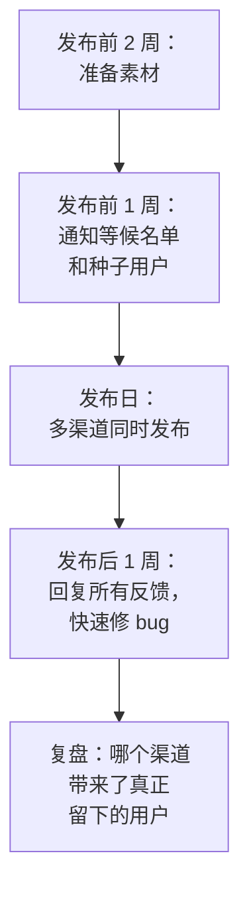

# 冷启动

前面几章讲的渠道，都有一个共同的前提：你已经有一些内容、一些评分、一些用户。但产品刚上线时，这些都是零。没有用户就没有评价，没有评价就没人信任，没人信任就没有用户，这就是冷启动的困境。

这一章讲怎么打破这个循环：前 100 个用户从哪来、怎么准备一次发布、怎么标记来源，以及出海时的常见渠道。

## 冷启动的目标不是数量

很多人把冷启动理解为「尽快拿到很多用户」。但这个阶段真正要的是：

1. **验证有人真的需要**：不是礼貌性地说「挺好的」，而是愿意持续用、愿意付钱
2. **找到最匹配的那群人**：谁用得最多、最满意？他们有什么共同特征？
3. **获得第一批真实评价和案例**：后续所有渠道都需要这些信任素材

所以前 100 个用户里，**10 个深度用户比 1000 个路过的人有价值**。这个阶段的指标不是用户总数，而是有多少人在第二周、第四周还在用（第 7 章会详细讲留存）。

## 做不能规模化的事

冷启动阶段最有效的方法，往往是那些「没法规模化」的手工活：

| 手工活 | 为什么有效 |
|---|---|
| 一个一个私信邀请潜在用户 | 每个用户都是精挑细选的，反馈质量高 |
| 亲自帮用户完成第一次设置 | 用户一定能体会到价值，你也能看到他卡在哪 |
| 用户反馈的问题当天修好 | 用户会惊讶、会感动、会告诉别人 |
| 上门或视频演示 | 对 To B 产品，这几乎是唯一的成交方式 |
| 给每个早期用户写感谢信 | 建立个人关系，用户会成为你的传播者 |

这些事在用户多了以后做不过来，但在前 100 个用户阶段，它们是你能给出的最好体验，也是一人公司对抗大公司的独特优势：**大公司的用户永远见不到开发者，而你的用户可以直接和你对话**。

hatch-counter 的冷启动就是典型的手工模式：开户由开发者在管理后台亲自办理，门店店主通过手机号登录。每一个客户都是直接对接的，开户时就能了解店里的情况，帮店主把第一份收银报表导进去。项目里还准备了一家虚构川菜馆的 mock 数据和照着走的操作手册，演示时能直接展示完整的使用效果。这种方式慢，但每一个用户都能真正用起来。

## 前 100 个用户从哪来

### 1. 你自己的关系网

最近的用户来源是你已经认识的人：朋友、前同事、社交媒体上的关注者。注意：

- **只邀请真正符合目标用户画像的人**，朋友出于人情的使用和反馈会误导你
- 请他们**介绍符合条件的人**，比他们自己用更有价值

### 2. 上线前的等候名单

在产品开发期间就建立等候名单（waitlist）：一个简单的着陆页，说明你要做什么，留下联系方式就能在上线时收到通知。[《一人公司方法论》](../opc-playbook/)的「快速验证」一章有用 Cloudflare Worker + D1 搭建等候名单的完整例子。

等候名单的价值：

- 验证需求：有多少人愿意留下联系方式
- 上线时有一批现成的用户可以通知
- 可以问一两个问题筛选用户（「你现在怎么解决这个问题？」）

### 3. 公开构建积累的关注者

第 3 章讲的公开构建，在冷启动时兑现：关注你开发过程的人，就是上线时最可能尝试的人。

### 4. 目标用户聚集的社区

第 4 章的社区：V2EX 的作品展示节点、即刻相关圈子、行业社群。在社区发产品时，附带一个**专属的内测邀请**（比如「前 50 名免费」「内测期间所有功能开放」），给早期用户一个尝试的理由。

### 5. 直接找到有这个问题的人

去搜索有这个问题的人在哪里抱怨：

- 小红书搜「xx 好难用」「有没有 xx 的工具」，在笔记评论区里找到有需求的人
- V2EX、即刻里搜相关的求助帖
- 竞品的应用商店差评：这些用户明确表达了不满

找到之后，礼貌地私信，说明你做了一个可能解决他问题的东西，问他愿不愿意试试。注意不要群发、不要骚扰，被拒绝就不再打扰。

## 准备一次发布

国内没有类似 Product Hunt 那样集中的产品发布平台，发布通常是在多个渠道同时进行。一次发布的准备清单：



### 素材清单

| 素材 | 用途 |
|---|---|
| 一句话介绍 | 所有渠道都要用，说清楚给谁用、解决什么问题 |
| 三段式介绍：问题、方案、现状 | 社区帖子 |
| 产品截图 3–5 张 | 所有渠道 |
| 30 秒演示视频或 GIF | 小红书、即刻、B 站 |
| 开发故事 | 公众号长文、V2EX 帖子 |
| 着陆页 | 统一的落脚点 |
| 常见问题 | 提前准备好回答 |

### 发布日

- 在选定的渠道同时发布，内容按平台改写
- **整天在线**：发布后的几个小时是互动最多的时候，及时回复每条评论
- 准备好应对突发：服务器扛不住、出现严重 bug、被质疑时怎么回应

### 发布不是一次性的

一次发布带来的流量通常在几天内就会衰减。不要把所有希望押在一次发布上：

- **每个大版本都可以是一次小发布**：新功能、重大改进都值得再发一次
- **持续在社区里出现**：发布之后继续分享进展和思考
- **积累案例和评价**：每一个满意的用户都可以成为下次发布的素材（征得同意后）

## 给每个渠道打上来源标记

冷启动阶段你会同时尝试多个渠道。如果不标记来源，一个月后你就不知道用户是从哪来的，也就没法判断哪个渠道值得继续投入（第 8 章）。

### 最简单的做法：链接参数

给每个渠道发出的链接加上来源参数：

```text
https://example.com/?from=v2ex
https://example.com/?from=xhs-1102
https://example.com/?from=jike
https://example.com/?from=wechat-group
```

着陆页读取参数，在用户注册或留下联系方式时一起保存：

```typescript
// 着陆页：首次访问时记住来源，注册时一起提交
const KEY = "signup_source";

export function rememberSource() {
  const from = new URLSearchParams(location.search).get("from");
  // 只记第一次的来源，后续访问不覆盖
  if (from && !localStorage.getItem(KEY)) {
    localStorage.setItem(KEY, from.slice(0, 64));
  }
}

export function getSource(): string {
  return localStorage.getItem(KEY) ?? document.referrer.split("/")[2] ?? "direct";
}
```

参数名用 `from` 还是行业通用的 `utm_source` 都可以，关键是**统一**。

### 问用户

不是所有渠道都能带链接（小红书笔记通常不能放外链，行业群里口口相传也没有链接）。所以在注册流程或首次使用时，加一个可选的问题：

```text
你是从哪里知道我们的？
○ 小红书  ○ 公众号  ○ 即刻  ○ V2EX  ○ B 站  ○ 抖音
○ 朋友推荐  ○ App Store 搜索  ○ 其他：____
```

这个简单的问题，在没有任何埋点系统的情况下，就能告诉你大致的渠道分布。App 通过 App Store 安装时拿不到网页来源参数，这个问题就更重要了。

更系统的归因和埋点方法见[《数据分析与埋点》](../product-analytics/)。

## 出海渠道速览

如果产品面向海外用户，冷启动的思路相同，但渠道不同。这里只做简要介绍，主体选择、收款、合规见[《出海实务》](../going-global/)。

| 渠道 | 特点 | 适合 |
|---|---|---|
| Product Hunt | 集中的新产品发布平台，有每日排行 | 面向科技爱好者、早期使用者的产品，适合做一次集中发布 |
| Hacker News（Show HN） | 技术社区，用户挑剔，反馈直接，对营销腔很反感 | 开发者工具、有技术深度的产品 |
| Reddit | 按兴趣分版块，每个版块规则不同，很多版块禁止自我推广 | 找到目标用户所在的版块，先参与再分享 |
| X（Twitter） | 海外独立开发者公开构建的主要阵地 | 公开构建、积累关注者 |
| Indie Hackers | 独立开发者社区 | 分享经验、结识同行，获客效果视产品而定 |
| Google 搜索 + 英文内容 | SEO 原理同第 2 章，英文长尾词空间大 | 长期获客 |
| App Store 海外区 | ASO 原理同第 5 章，需要做多语言本地化 | App |

海外社区和国内一样，**最讨厌的是只来发广告的人**。每个社区都有自己的文化和规则，发之前花时间读一读版规和热门帖子。

## 冷启动阶段的常见错误

- **等完美了再发布**：产品永远不会完美，早点让真实用户用起来，才知道哪里该改
- **一开始就花钱买量**：没验证留存就投广告，钱只是在加速流失
- **追求数字好看**：用奖励刷来的用户，大部分不会留下，还会污染你的数据
- **只发布一次**：发布后几天流量归零，就觉得「推广没用」
- **不跟踪来源**：不知道哪个渠道有效，下次只能重新猜
- **忽视最早的用户**：前 10 个用户的反馈，比之后 1000 个人的数据都重要

## 本章要点

- 冷启动的目标是**验证需求和找到最匹配的用户**，10 个深度用户比 1000 个路人有价值
- 做不能规模化的事：一对一邀请、亲自帮用户上手、当天修 bug
- 前 100 个用户来自：关系网、等候名单、公开构建的关注者、目标社区、主动寻找有问题的人
- 发布是多渠道同时进行的，发布日整天在线，每个大版本都可以再发布一次
- **从第一天开始标记来源**：链接加参数，注册时问一句「从哪里知道我们」
- 出海渠道（Product Hunt、Hacker News、Reddit、X）思路相同，同样先参与再推广
