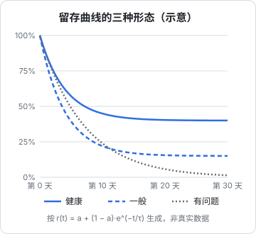
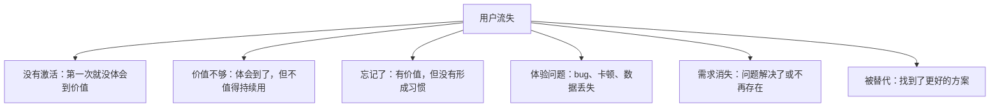

# 留存

第 1 章的增长方程说明了一件事：流失率决定了用户规模的上限。每月获客再多，如果大部分人用一次就走，用户数很快会停在一个很低的水平。留存是增长的地基，地基不稳，上面的获客投入都是浪费。

这一章讲留存曲线怎么看、用户为什么会走、怎么通过激活和持续价值留住用户，以及召回流失用户的方法。具体怎么计算留存率、怎么埋点，留给[《数据分析与埋点》](../product-analytics/)。

## 留存曲线的三种形态

把同一时期注册的用户放在一起（叫一个**同期群**，cohort），统计他们在第 1 天、第 7 天、第 30 天……还有多少比例在使用，画出来就是留存曲线。



图中三条曲线按公式 $r(t) = a + (1-a)e^{-t/\tau}$ 生成，用来示意形态，不代表任何真实产品的数据。几乎所有产品的留存曲线一开始都会急剧下降，关键在于**曲线最后会不会变平**：

| 形态 | 含义 | 应对 |
|---|---|---|
| 下降后在较高水平变平 | 有一群用户找到了持续价值，产品和这群人匹配 | 找到这群人的特征，去获取更多类似的人 |
| 下降后在很低的水平变平 | 少数人留下了，但大多数人没体会到价值 | 先研究留下的人和离开的人的区别，优化激活 |
| 一直下降到接近零 | 没有人找到持续使用的理由 | 停止获客，回到产品本身 |

曲线是否变平，比任何单个时间点的留存率都重要。如果曲线一直下降到零，任何获客手段都救不了，这时候应该回到[《产品思维》](../product-thinking/)，重新审视问题和方案。

### 留存要按产品的使用频率看

不同产品的「正常使用频率」不同，衡量留存的周期也应该不同：

| 产品类型 | 自然使用频率 | 看什么留存 |
|---|---|---|
| 门店经营工具（如 hatch-counter） | 每天营业都要用 | 日留存、周留存 |
| 阅读、学习类 App | 每周几次 | 周留存 |
| 记账、财务工具 | 每月几次 | 月留存 |
| 报税、旅行规划 | 一年一次或几次 | 年度复购，留存不是主要指标 |

一个每年用一次的产品，用日留存来衡量，会得出完全错误的结论。先想清楚**这个问题本来多久发生一次**，再决定看什么周期的留存。

## 用户为什么会走

用户离开的原因大致可以分成几类：



| 原因 | 典型信号 | 怎么办 |
|---|---|---|
| 没有激活 | 大部分人只打开过一次 | 优化新手引导，缩短到达价值的路径 |
| 价值不够 | 用了几次后逐渐减少 | 回到产品，找到更核心的价值 |
| 忘记了 | 偶尔回来用，用的时候很满意 | 提醒、和用户已有习惯绑定 |
| 体验问题 | 流失前有报错、反馈中有抱怨 | 修 bug，提升稳定性 |
| 需求消失 | 用户明确说「不需要了」 | 正常，不用强留 |
| 被替代 | 用户提到竞品 | 研究竞品，找到差异化 |

最直接的了解方式是**问**。对已经流失的用户，发一条简短的消息：「看到你最近没怎么用了，方便说说原因吗？哪怕一句话也很有帮助。」回复率不会高，但每一条回复都很有价值。

## 激活：留存从第一次使用开始

很多流失其实发生在第一天：用户下载了、打开了、看了一眼、觉得不知道怎么用或者没意思，就再也没回来。**激活**就是让新用户尽快体会到产品价值的过程。

### 找到 aha moment

aha moment 是用户第一次真正体会到「这个产品对我有用」的时刻。第 1 章让你写下了它，现在要验证：

- 对比留下来的用户和离开的用户，留下来的人在第一次使用时做了什么、离开的人没做？
- 问留下来的用户：「你是什么时候觉得这个东西有用的？」

几个例子：

| 产品 | 可能的 aha moment |
|---|---|
| hatch-shelf | 第一次在手机上打开一本自己的书，看到代码和公式正常显示 |
| hatch-counter | 导入第一份收银报表，看到按配方算出的食材消耗 |
| 记账 App | 记完一周的账，第一次看到消费分类图 |

### 缩短到达 aha moment 的路径

找到 aha moment 之后，激活优化的目标就是：**让尽可能多的新用户、尽可能快地到达这一刻**。

| 方法 | 例子 |
|---|---|
| 减少注册前的步骤 | 先让用户体验，再要求注册；或者完全不需要账号 |
| 提供示例数据 | hatch-shelf 内置示例书，打开就能看到阅读效果，不用先学怎么导入 |
| 引导第一个关键动作 | 首页空状态直接告诉用户「点这里导入第一本书」 |
| 去掉非必要的设置 | 默认值足够好，高级设置往后放 |
| 人工帮助 | To B 产品亲自帮用户完成第一次配置（第 6 章） |

空状态的设计尤其重要。一个空白的首页加一个「暂无数据」，是最常见的激活杀手。好的空状态告诉用户**这里会有什么、下一步做什么**。空状态和引导文案的写法见[《写给开发者的设计课》](../design-for-devs/)。

## 持续价值：让用户有理由回来

激活解决的是「第一次」，持续价值解决的是「第二次、第十次」。

### 和用户已有的习惯绑定

最稳的留存，是让产品成为用户已有习惯的一部分，而不是要求用户养成新习惯：

- hatch-counter 绑定的是门店每天的营业节奏：每天收银、定期进货，用户本来就要做这些事
- 阅读类 App 可以绑定通勤、睡前这些已有的时间段
- 开发者工具可以集成到用户已经在用的编辑器、终端、CI 里

### 让价值随使用累积

用户用得越久，产品对他越有价值，离开的成本就越高：

- 积累的数据（历史记录、笔记、书库）
- 个性化的设置和习惯
- 逐渐完善的配置（配方、分类、模板）

注意这里说的是**价值累积**，不是**锁定**。让用户能方便地导出自己的数据，反而会增加信任。hatch-shelf 的原则是「文件即真相」，书都是普通的 Markdown 文件，用户随时可以带走，这让用户敢于把内容放进来。

### 持续更新

- 定期发布有意义的更新，让用户感到产品在进步
- 把用户反馈的功能做出来，并告诉提出建议的人（第 4 章）
- 更新说明写清楚改了什么、对用户有什么好处

## 提醒与召回

### 推送和通知

推送是双刃剑：恰当的提醒帮用户回来，过度的推送让用户关掉通知甚至卸载。

| 好的推送 | 坏的推送 |
|---|---|
| 用户自己设置的提醒（「每晚 9 点提醒我阅读」） | 「好久不见，快回来看看吧」 |
| 和用户有关的状态变化（「你的导出已完成」） | 和用户无关的营销活动 |
| 有实际信息量（「本周食材成本比上周高，主要是猪肉」） | 没有信息量的「你有新消息」 |
| 频率克制 | 每天多条 |

原则：**每一条推送都要对用户有用**。在请求通知权限前，先告诉用户会推送什么、为什么有用，而不是一打开 App 就弹系统权限框。

用 Expo 做本地提醒（用户自己设置的阅读提醒，不需要服务端）：

```typescript
import * as Notifications from "expo-notifications";

export async function scheduleDailyReminder(hour: number, minute: number) {
  const { status } = await Notifications.requestPermissionsAsync();
  if (status !== "granted") return false;

  await Notifications.cancelAllScheduledNotificationsAsync();
  await Notifications.scheduleNotificationAsync({
    content: { title: "读一会儿书", body: "接着上次的进度继续" },
    trigger: {
      type: Notifications.SchedulableTriggerInputTypes.DAILY,
      hour,
      minute,
    },
  });
  return true;
}
```

`expo-notifications` 的触发器写法在不同 SDK 版本间有过变化，以上写法基于近期 SDK 的文档，使用前请对照你项目所用 SDK 版本的官方文档确认。远程推送还需要配置 APNs 和服务端，复杂度高很多，早期能用本地提醒解决的就不要上远程推送。

### 召回流失用户

对已经流失的用户，可以尝试召回，但期望要放低：

- **有新价值时再联系**：「你之前反馈的 xx 问题已经解决了」比「好久不见」有效得多
- **选用户能接受的渠道**：公众号推送、用户群公告、产品更新说明；对 To B 客户可以直接联系
- **只联系一两次**：反复骚扰只会让用户更反感
- **合规**：营销短信、邮件需要用户事先同意，并提供退订方式，具体要求以《个人信息保护法》等法规和主管部门规定为准，见[《国内合规实务》](../opc-compliance-cn/)

召回的投入产出比通常不如提升激活和持续价值。**把注意力放在不让用户流失上，比流失后再拉回来更有效**。

## 为什么必须看数据

留存是最需要数据的环节，因为流失是**沉默的**：离开的用户不会告诉你，你只能从数据里发现他们不见了。

你至少需要能回答：

- 每周新来的用户，过一周、一个月后还剩多少？曲线有没有变平？
- 留下来的用户和离开的用户，在第一次使用时有什么不同？
- 某次更新之后，留存有没有变化？
- 不同渠道来的用户，留存有没有差别？（这会直接影响第 8 章的渠道评估）

这些问题需要你记录用户的关键行为（埋点）、按同期群计算留存、做漏斗分析。具体怎么做，包括自托管的 PostHog、Umami 等工具的使用，见《数据分析与埋点》。

在数据系统建立之前，至少做到两点：**用户表里记录注册时间和来源**，**记录用户最后一次活跃的时间**。有了这两个字段，就能粗略看出留存情况。

## 本章要点

- 留存曲线的关键是**会不会变平**，一直降到零的产品不该继续获客
- 留存周期要和产品的**自然使用频率**匹配
- 流失原因：没激活、价值不够、忘记了、体验问题、需求消失、被替代；最直接的了解方式是问
- **激活**：找到 aha moment，缩短到达它的路径；示例数据和好的空状态很有效
- **持续价值**：绑定已有习惯、让价值随使用累积（但允许导出）、持续更新
- 推送要克制，每一条都对用户有用；召回不如预防流失
- 流失是沉默的，留存必须靠数据发现，具体方法见《数据分析与埋点》
