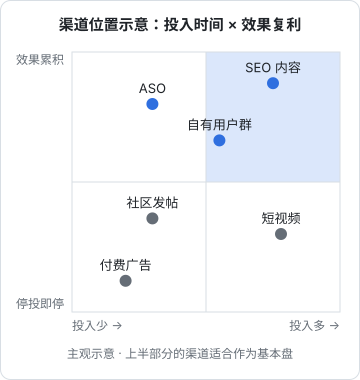
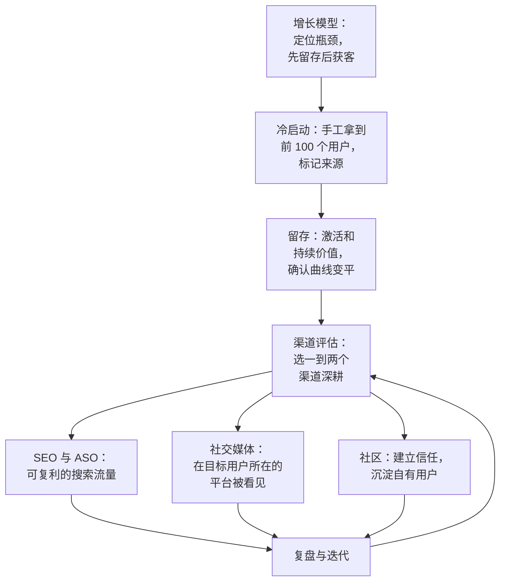

# 渠道评估

读到这里，你面前有一长串可以做的事：写 SEO 文章、发小红书、做 B 站视频、混 V2EX、进行业群、优化 ASO……一个人不可能全做。这一章讲怎么在有限的时间里选择渠道、怎么判断一个渠道值不值得继续，以及什么时候该放弃。

## 为什么要专注

有一种常见的观点：**大多数成功的产品，主要增长来自一个核心渠道**，而不是平均分布在十个渠道上。对一人公司来说，这个道理更加明显：

- 每个渠道都有学习曲线：平台规则、内容形式、用户口味，都需要时间摸索
- 渠道效果需要积累：SEO 要几个月，内容账号要几十条，社区信任要几周
- 精力分散的结果是每个渠道都停留在「刚入门」的水平

所以渠道评估的目标不是「找出所有可能的渠道」，而是**找到一到两个最适合你的渠道，然后深耕**。

## 第一步：列出候选渠道

先把所有可能的渠道列出来，不做判断。可以按这个清单逐项过一遍：

| 类别 | 渠道 |
|---|---|
| 搜索 | 网页 SEO、微信搜一搜、小红书搜索、App Store 搜索 |
| 内容平台 | 小红书、公众号、即刻、B 站、抖音、视频号 |
| 社区 | V2EX、少数派、掘金、GitHub、行业社群 |
| 直接触达 | 私信邀请、地推、上门演示、熟人介绍 |
| 合作 | 和互补产品互推、行业关键人物推荐、渠道商代理 |
| 产品内 | 分享功能、邀请机制、用户产出的公开页面 |
| 付费 | 平台广告、信息流广告、KOL 推广 |
| 出海 | Product Hunt、Hacker News、Reddit、X、Google SEO |

然后结合第 1 章写下的增长假设，划掉明显不相关的：目标用户不在那里的、产品形态不适合的、成本明显承受不了的。

## 第二步：用 ICE 给渠道打分

剩下的候选渠道，用 **ICE** 打分排序：

| 维度 | 问题 | 打分 |
|---|---|---|
| Impact（影响） | 如果做成了，能带来多少**合适的**用户？ | 1–10 |
| Confidence（信心） | 我有多大把握能做成？有没有证据？ | 1–10 |
| Ease（容易） | 需要多少时间和钱？我擅长吗？ | 1–10 |

ICE 分数 = 三项的平均值（也有人用乘积，效果类似，关键是同一份表里口径一致）。

打分是主观的，但写下来的过程会逼你想清楚每个渠道的假设。下面是一个用脚本管理渠道评估的例子，评估数据写在 YAML 里，和代码一起放在仓库中：

```yaml
# docs/channels.yaml
- name: 抖音餐饮经营内容
  impact: 8
  confidence: 4
  ease: 3
  note: 目标用户集中，但需要做短视频，没经验
- name: 餐饮老板微信群
  impact: 7
  confidence: 6
  ease: 6
  note: 已有两个种子用户愿意拉群
- name: 官网 SEO（餐饮成本类长尾词）
  impact: 5
  confidence: 5
  ease: 7
  note: 店主搜索习惯不确定，但写教程是我擅长的
- name: V2EX
  impact: 1
  confidence: 8
  ease: 9
  note: 能发，但用户里几乎没有餐饮店主
```

```typescript
// scripts/ice.ts：node scripts/ice.ts docs/channels.yaml
// 需要先 pnpm add -D yaml
import { readFileSync } from "node:fs";
import { parse } from "yaml";

type Channel = { name: string; impact: number; confidence: number; ease: number; note?: string };

const file = process.argv[2] ?? "docs/channels.yaml";
const channels = parse(readFileSync(file, "utf8")) as Channel[];

const ranked = channels
  .map((c) => ({ ...c, ice: (c.impact + c.confidence + c.ease) / 3 }))
  .sort((a, b) => b.ice - a.ice);

for (const c of ranked) {
  console.log(`${c.ice.toFixed(1)}  ${c.name}  (I${c.impact} C${c.confidence} E${c.ease})`);
}
```

这份示例数据以 hatch-counter 的情况为背景，分数是演示用的主观判断。注意 V2EX 的「容易」和「信心」都很高，但「影响」极低：用户不在那里，做得再好也没用。**Impact 要按「合适的用户」来打分，而不是按平台的总流量**。

## 第三步：考虑复利和风险

ICE 只看短期，还要补两个长期维度：

- **复利**：今天的投入，三个月后还在不在产生效果？SEO 文章、App Store 评分、公众号关注者会累积；一次性的帖子、付费广告停了就没了
- **可控性**：渠道是否掌握在你自己手里？平台规则一变，流量会不会归零？



图中的位置是一般情况下的主观判断，具体到你的产品可能不同。一人公司的渠道组合，比较健康的结构是：

- **一个能复利的长期渠道**作为基本盘（SEO、ASO、公众号、自有用户群）
- **一个能快速见效的短期渠道**用来验证和冷启动（社区发帖、私信邀请）
- 至少有一个渠道**不完全依赖单一平台**，避免平台风险

## 第四步：小步实验

选出排名靠前的一两个渠道后，不要直接全力投入，先做一个**有时间限制的小实验**：

```yaml
# experiments/2026-11-wechat-groups.yaml
channel: 餐饮老板微信群
hypothesis: 通过种子用户拉群，在群里分享成本核算模板，能带来愿意试用的店主
duration: 4 周
budget: 每周 3 小时，不花钱
actions:
  - 请两位种子用户各拉进一个老板群
  - 每周在群里分享一份实用资料（成本核算表、进货记录模板）
  - 有人问起时再介绍产品
success_criteria:
  - 4 周内至少 5 家门店开户试用
  - 其中至少 2 家在第 4 周仍在每天使用
stop_criteria:
  - 被移出群，或群里对工具类信息明显反感
result: # 实验结束后填写
```

这个格式和[《一人公司方法论》](../opc-playbook/)里「快速验证」一章的实验记录一致。关键在于**事先写好成功标准和停止标准**，避免实验结束后根据结果编理由。

成功标准里要包含**留存**，而不只是「来了多少人」。一个渠道带来 100 个注册但一周后全走了，不如另一个渠道带来 5 个人全部留下。这就是为什么第 6 章要你从第一天就标记来源：没有来源标记，就无法按渠道看留存。

## 用经济账评估渠道

用户量和收入起来之后，可以用更量化的方式评估渠道。两个核心概念：

- **CAC**（获客成本）：通过某个渠道获得一个付费用户的平均成本
- **LTV**（用户生命周期价值）：一个用户在整个使用期间带来的总收入（扣除成本后）

一个渠道是否健康，粗略看 **LTV 是否明显大于 CAC**，以及收回 CAC 需要多长时间。

对一人公司，计算 CAC 时**一定要把你自己的时间算进去**。「免费」的渠道其实一点都不免费：

$$
\text{CAC} = \frac{\text{直接花费} + \text{投入小时数} \times \text{你的时薪}}{\text{该渠道带来的付费用户数}}
$$

你的时薪可以按「这些时间如果拿去接外包或上班能挣多少」来估。这样算下来，经常会发现某个看起来免费的渠道，其实比付费广告还贵；也会发现某个需要花点钱的方案，因为省时间反而更划算。

LTV 用最粗的口径估：每个付费用户每月带来的毛利，除以月流失率（平均能留多少个月）：

$$
\text{LTV} \approx \frac{\text{每月毛利}}{\text{月流失率}}, \qquad \text{回本月数} = \frac{\text{CAC}}{\text{每月毛利}}
$$

一个算例，**数字都是示例假设**：月费 99 元、每用户每月可变成本 15 元（与[《定价与商业模式》第 8 章](../pricing-monetization/08-case-hatch-counter.md)的假设一致），每月毛利 84 元；月流失率 8%，LTV $\approx 84 / 0.08 = 1050$ 元；你的时薪按 100 元算。

| | 内容渠道（发笔记） | 付费投放 |
|---|---|---|
| 直接花费 | 0 | 1,500 元 |
| 投入时间 | 20 小时 × 100 元 = 2,000 元 | 3 小时 × 100 元 = 300 元 |
| 带来的付费用户 | 4 | 6 |
| CAC | $2000 / 4 = 500$ 元 | $1800 / 6 = 300$ 元 |
| LTV / CAC | $1050 / 500 = 2.1$ | $1050 / 300 = 3.5$ |
| 回本月数 | $500 / 84 \approx 6.0$ 个月 | $300 / 84 \approx 3.6$ 个月 |

只看现金，内容渠道「免费」；把时间算进去，这个月它比投放贵。但这张表只算了当月：内容渠道的笔记下个月还会被搜到，投放停了就没有，所以还要结合前面第三步的「复利」一起看，而不是只看一个月的 CAC。

LTV 和 CAC 的具体计算、口径和分析方法见[《数据分析与埋点》](../product-analytics/)，定价对 LTV 的影响见[《定价与商业模式》](../pricing-monetization/)。

## 什么时候放弃一个渠道

放弃一个渠道和放弃一个产品一样难，因为你已经投入了时间。几个判断信号：

| 信号 | 含义 |
|---|---|
| 实验期结束，没达到成功标准 | 按事先约定停下，除非有明确的新假设 |
| 带来的用户留存明显低于其他渠道 | 用户不匹配，量再大也没用 |
| 投入持续增加，效果不变 | 已经到了这个渠道对你的上限 |
| 你非常讨厌做这件事 | 一人公司无法长期坚持讨厌的事，换一个渠道 |
| 平台规则变化，风险变大 | 及时分散 |

但也要警惕**放弃得太早**：SEO 和内容账号通常需要几个月才能看到效果，一两周没效果就放弃，什么渠道都做不成。区分方法是看**先行指标**：SEO 的收录量和展示量在不在增长？内容的收藏和搜索流量在不在增长？先行指标在涨，就再给一些时间。

## 每月一次渠道复盘

把渠道评估变成固定的习惯，每月花一小时复盘：

```markdown
# 2026-11 渠道复盘

## 各渠道数据
| 渠道 | 投入小时 | 新用户 | 4 周后仍活跃 | 付费 |
|---|---|---|---|---|
|  |  |  |  |  |

## 本月结论
- 继续：
- 加大：
- 停止：
- 新实验：

## 用户怎么说
- （从「从哪里知道我们」问题和用户访谈里摘录）
```

这份复盘可以交给 agent 帮你整理：给它渠道表、来源统计和用户反馈记录，让它汇总成上面的格式并指出变化，你来做最后的判断。

## 全书回顾

最后把整本书串起来：



增长没有捷径，但有顺序：**先确认有人需要并且留下，再找到最适合的一两个渠道，持续投入并定期复盘**。

## 本章要点

- 大部分增长通常来自一个核心渠道，一人公司要**专注一到两个渠道深耕**
- 用 **ICE** 给渠道打分，Impact 按「合适的用户」而不是平台总流量计算
- 补充考虑**复利**和**可控性**：长期渠道打底，短期渠道验证，避免依赖单一平台
- 先做有时间限制的小实验，事先写好成功和停止标准，成功标准要包含留存
- 计算 CAC 时把自己的时间算进去，「免费」渠道往往并不免费
- 根据先行指标判断该坚持还是放弃，每月固定复盘

## 接下来读什么

这本书多次提到「要看数据」，但没有讲怎么看。接下来读《数据分析与埋点》，学习该看哪些指标、怎么设计埋点、怎么计算留存和 LTV，让本书的渠道评估和留存分析有数据支撑。用户和收入起来之后，再读[《财务与税务》](../opc-finance/)，把赚到的钱管清楚。
