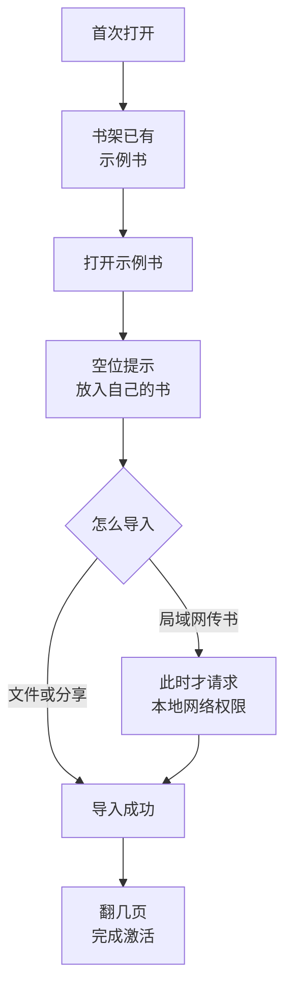
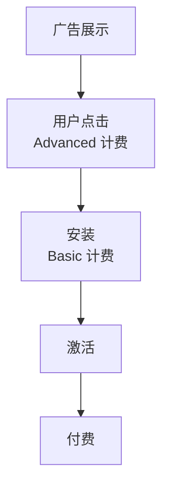

# 激活与小预算付费投放

前八章讲的渠道几乎都不花钱，花的是时间。等到留存曲线变平、来源标记也做好了，很多人会想试试另一种办法：花一点钱，买一些确定的流量。

这一章把两件事放在一起讲，因为它们是连着的：**付费投放买来的是安装，真正能用来算账的是激活**。新手引导决定了一个安装有多大概率变成激活用户，也就决定了一次安装最多值多少钱。前半章讲激活怎么定义、新手引导有哪几种做法，后半章讲小预算投放的实操，以 App Store 上的 Apple Ads 为主。

## 先定义激活，再谈投放

[第 1 章](01-growth-models.md#aarrr最常用的分段框架)说过，AARRR 的修理顺序通常是从后往前。投放处在漏斗最顶端，它会把下面每一层的问题放大：

- 激活率低，每一笔广告费里大部分买来的是「打开一次就走」的人
- 不知道激活率，就算不出一次安装值多少钱，出价只能凭感觉
- 不按来源区分激活，就分不清是广告带来的人不行，还是新手引导不行

所以顺序是：先把激活定义成一个能记录的指标，看清楚自然流量的激活率，再决定要不要花钱、出价出多少。

## 激活指标怎么定义

### aha moment 是感受，激活事件是动作

[第 7 章](07-retention.md#找到-aha-moment)讲过 aha moment：用户第一次觉得「这个东西对我有用」的时刻。它是一种感受，没法直接统计。激活指标要做的，是找一个**能记录、和这种感受高度相关的动作**来代替它。

以书巢（hatch-shelf）为例，aha moment 是「第一次在手机上打开一本自己的书，看到代码和公式正常显示」。对应的动作可以有好几种候选：

| 候选动作 | 好处 | 问题 |
|---|---|---|
| 打开了示例书 | 几乎人人都能做到 | 太容易，看过示例书不代表会把自己的书放进来 |
| 导入了第一本自己的书 | 用户已经投入了自己的内容 | 导入后没打开也算 |
| 导入并在自己的书里翻过几页 | 最接近 aha moment | 需要多记一个阅读事件 |

一般选第三种，或者第二种的加强版。原则是：**这个动作发生了，用户大概率已经体会到价值；没发生，大概率还没有**。

### 激活 = 关键事件 + 门槛 + 时间窗

只写「导入了一本书」还不够，还要说清楚做到什么程度、在多长时间内做到。一个完整的激活定义有三部分：

| 组成 | 书巢的例子（示例假设） | hatch-counter 的例子（示例假设） |
|---|---|---|
| 关键事件 | 导入一本自己的书，并在里面翻页 | 导入收银报表 |
| 门槛 | 至少翻过 3 页 | 至少 1 份，且识别出配方消耗 |
| 时间窗 | 首次打开后 3 天内 | 开户后 24 小时内 |

时间窗按产品的自然使用频率定（第 7 章的[留存周期](07-retention.md#留存要按产品的使用频率看)）：门店每天营业，24 小时内没导入，说明卡住了；读书是每周几次的事，给 3 天更合理。时间窗太短，慢热的用户被算成没激活；太长，「三周后偶然回来导了一本」也被算进来，看不出引导本身的问题。漏斗转化窗口的取舍见[《数据分析与埋点》第 5 章](../product-analytics/05-funnels.md#定义一个漏斗时要决定的事)。

### 怎么验证这个定义选对了

激活定义不是拍脑袋定下就完事，要回头看它和留存的关系。做法见[《数据分析与埋点》第 1 章](../product-analytics/01-metrics.md#激活找到啊哈时刻)：把一段时间内的新用户按「是否在时间窗内激活」分成两组，比较几周后的留存。

一个算例，**数字全部是示例假设**：某月新用户 200 人，其中 70 人在 3 天内激活，激活率 35%。4 周后，激活组还在用的有 28 人（40%），未激活组 130 人里还在用的有 6 人（约 5%）。两组差距很大，说明这个定义抓住了关键动作；如果两组留存差不多，就换一个候选动作再看。

两点提醒：

- 这是**相关**，不是因果。也可能是本来就认真的用户才会第一天导入。要确认引导改动有没有用，见下文[怎么判断引导有没有用](#怎么判断引导有没有用)
- 样本小的时候数字波动很大，几十个人的激活率差几个百分点不说明问题。这时候和几个没激活的用户聊一聊，比看比例更有用

## 新手引导的几种形态

定义好激活之后，新手引导只有一个目标：**让更多新用户在时间窗内完成激活事件**。常见的几种形态：

| 形态 | 做法 | 适合 | 反模式 |
|---|---|---|---|
| 产品导览 | 首次打开时几页滑动介绍，或在界面上逐个高亮按钮 | 有一两个不直观、但必须知道的操作 | 五六页介绍、讲功能而不讲用户能得到什么、不能跳过 |
| 清单 | 首页一张「上手清单」，列 3–5 个步骤，做完一项勾一项 | 激活需要好几步，比如 To B 工具的开户配置 | 把可选设置也塞进去，清单永远做不完 |
| 空状态引导 | 没有内容的页面直接告诉用户下一步做什么 | 几乎所有产品，成本最低 | 只写「暂无数据」 |
| 示例数据 | 预置一份能直接看的内容 | 价值要「看到结果」才能体会的产品 | 示例数据删不掉，或和用户自己的数据混在一起分不清 |
| 渐进式权限请求 | 用到某个功能时才请求对应权限，先说明用途 | 需要通知、相机、定位、本地网络等权限的 App | 一打开就连弹几个系统权限框 |
| 延迟注册 | 先让用户用，需要同步或付费时再要求注册 | 核心价值不依赖账号的产品 | 注册墙挡在第一屏 |

### 产品导览：越短越好

导览最大的问题是用户会直接跳过，而且跳过之后什么都没记住。能用界面本身说清楚的，就不要靠导览。确实需要时，控制在一两屏，讲「你能用它做什么」，不讲「这个按钮叫什么」，并且始终能跳过。

### 清单：适合步骤多的产品

清单把「激活」拆成几个看得见的小目标，适合 hatch-counter 这种开户后要导报表、录配方、设门店信息的工具。清单里只放和激活直接相关的步骤，做完就收起来，不要一直挂在首页。

不要把清单做成打卡和连续天数这类机制。它们会制造一种「必须每天来」的压力，对阅读、学习类产品尤其不合适：用户该来的时候自然会来。

### 空状态和示例数据：最便宜的两种

这两种是一人公司性价比最高的引导，第 7 章已经提过。书巢的做法是两者结合：首次打开时书架里已经有示例书，点开就能看到代码高亮、公式和图表的效果；书架上同时有一个明确的入口告诉用户怎么放进自己的书。示例书可以删除，删除后不会再出现。空状态的写法见[《写给开发者的设计课》第 7 章](../design-for-devs/07-states-and-copy.md#首次使用的空态)。

### 渐进式权限请求

系统权限框每种只能弹一次，用户点了「不允许」，之后只能请他去系统设置里手动打开。所以要在用户**正要用到**这个功能时才请求，并先用自己的界面说明为什么需要。

书巢的局域网传书会触发 iOS 的「本地网络」权限。如果在首次启动时就请求，用户还不知道传书是什么，很可能拒绝；放到用户点「开启传书」之后再触发，权限框出现时用户正想从电脑传书，理由自然成立。



通知权限也是同样的道理：等用户自己设置了阅读提醒再请求，写法见[第 7 章](07-retention.md#推送和通知)。

### 怎么判断引导有没有用

改一次引导，就看一次改动前后的激活率。用户量小的时候，前后对比会受很多因素干扰（季节、渠道变化、某篇笔记突然带来一批人），所以：

- 一次只改一处，记下改动日期
- 按来源分开看激活率，避免把「这周来的人不一样」当成「引导变好了」
- 用户多到能分组时，再做 A/B 测试，样本量怎么估见[《数据分析与埋点》](../product-analytics/)第 6 章

## 什么时候值得花钱投放

付费投放和第 8 章的其他渠道一样，要放进渠道评估里比较，而不是因为「别人都在投」。值得试一试的前提：

1. **留存曲线已经变平**：带来的人有一部分能留下来，否则广告费只是加速流失
2. **知道自然流量的激活率**：这是估算一次安装值多少钱的基础
3. **算得出保本线**：一个安装最多能花多少钱
4. **这笔钱亏光了能接受**：第一次投放大概率要交学费

保本线的思路和[《投流与数据分析》第 2 章](../paid-traffic/02-unit-economics.md)一样，换成 App 的口径：

$$
\text{保本 CPI} = \text{每个安装的激活率} \times \text{激活用户的付费率} \times \text{每个付费用户到手收入}
$$

一个算例，**数字全部是示例假设**：一款买断制 App，每个付费用户扣掉平台佣金后到手 20 元；安装后激活率 35%，激活用户里 15% 会付费。那么每个安装平均值 $0.35 \times 0.15 \times 20 = 1.05$ 元。也就是说，平均一个安装的成本超过 1 元左右就是亏的。

这个算例说明了一件事：**低价买断的工具类 App，靠付费投放很难回本**，除非激活率和付费率都很高。订阅制产品可以用 LTV 代替「到手收入」，算法见[第 8 章](08-channel-evaluation.md#用经济账评估渠道)。不管哪种，提高激活率都会直接抬高你能承受的出价。

## Apple Ads 实操

> [!WARNING]
> 本节的产品形态、计费方式、预算上限、投放位置、匹配类型和中国大陆区要求，按 2026 年 11 月 Apple Ads 官网帮助页面（ads.apple.com 的 Compare Solutions、Ad Placement Options、Keywords、Advertise in Mainland China 等页面）和 Apple 广告中国大陆指南（2026 年 7 月版 PDF）整理。Apple Ads 的规则调整频繁，动手前以 ads.apple.com 帮助中心和账户后台的实际选项为准。

### 名字和投放位置

Apple Search Ads 已经改名为 **Apple Ads**。改名的时间按 9to5Mac 等媒体的报道是 2025 年 4 月，原因是广告位早已不只在搜索结果里；Apple 官网现在统一用 Apple Ads 这个名字，旧的 searchads.apple.com 帮助链接会跳转到 ads.apple.com。

App Store 里目前有四种广告位：Today 标签页、搜索标签页、搜索结果、其他 App 的产品页（「你可能也喜欢」）。对小预算来说，最值得先试的是**搜索结果**：用户正在搜，意图最明确。

### Basic 和 Advanced

Apple Ads 分 Basic 和 Advanced 两种，按官网的对比页：

| | Basic | Advanced |
|---|---|---|
| 计费 | 按安装（CPI），自己设最高单次安装成本 | 按点击（CPT），自己设最高单次点击出价 |
| 预算上限 | 每个 App 每月最多 1 万美元 | 不设上限，按广告系列设每日预算 |
| 投放位置 | 只有搜索结果 | 四种广告位都可以 |
| 关键词 | 不能选，由系统自动匹配 | 可以自己选关键词、设匹配类型和否定关键词 |
| 报表 | 简单的概览面板 | 详细报表，可按关键词、搜索词看 |
| 归因 | 支持 AdServices 归因 API | AdServices 归因 API 和 Apple Ads 平台 API |
| App 数量 | 最多 50 个 | 不限 |

怎么选：

- **Basic**：设一个月预算和最高 CPI，剩下交给系统。适合第一次试水、没时间管关键词的人。它的好处是只为安装付钱，坏处是你看不到钱花在了哪些搜索词上，也就学不到东西
- **Advanced**：要自己搭广告系列、选词、调价，每周要花时间看报表。好处是能看到「哪些词带来了安装」，这些词还能反过来指导第 5 章的 [ASO 关键词](05-aso.md#怎么选关键词)

### 按安装付费和按点击付费

两种计费可以换算。Advanced 按点击付费，真正的单次安装成本取决于点击后有多少人安装：

$$
\text{实际 CPI} = \frac{\text{平均 CPT}}{\text{点击到安装的转化率}}
$$

**示例假设**：平均每次点击 2 元，点击的人里 40% 安装，实际每个安装 5 元。点击到安装的转化率主要由产品页（截图、评分、副标题）决定，所以第 5 章的产品页优化同时也在降低投放成本。



不管哪种计费，平台只管到安装为止，后面的激活和付费要靠你自己的产品。比较投放效果时，最终要看的是**每个激活用户的成本**，而不是每个安装的成本。

### 预算怎么设

- **Basic**：一个月预算，所有选中的国家和地区共用；花完当月就暂停。官网的上限是每个 App 每月 1 万美元，这是上限，不是建议值
- **Advanced**：按广告系列设每日预算，没有总上限

小预算的设法：先定一个**这次测试最多亏多少**，再除以测试天数得到每日预算。止损线和放量规则见[《投流与数据分析》第 8 章](../paid-traffic/08-small-budget-testing.md#止损线花多少钱还没转化就该停)，那里的方法是为抖音、小红书写的，换成 Apple Ads 一样适用：没达到最少样本量之前不下结论，到了止损线还没有转化就停。

### 关键词和匹配类型

Advanced 的搜索结果广告系列要自己选关键词。官网帮助页里的几个概念：

| 概念 | 含义 |
|---|---|
| 广泛匹配 | 新加关键词的默认类型，会匹配近似词和相关词；实际匹配到了哪些搜索词，在「搜索词」报表里看 |
| 精确匹配 | 只匹配这个词和非常接近的变体，展示少，但点击率和转化通常更高 |
| Search Match | 系统根据产品页元数据、同类 App 等信息自动匹配搜索，不需要自己加词 |
| 否定关键词 | 不想出现的搜索词。默认是精确否定；广泛否定要求这几个词同时出现才排除 |

关键词保存后匹配类型就不能改了，想换类型只能重新加一个。

官网的最佳实践建议把广告系列按用途分开：品牌词、品类词、竞品词各一个系列，用精确匹配、关掉 Search Match；另开一个「发现」系列，打开 Search Match 和广泛匹配去找新词，再把前几个系列里已有的词作为否定关键词加进去，避免自己和自己竞价。发现系列里表现好的搜索词，挪到对应系列里做精确匹配。

小预算时不必一开始就开四个系列。一个可行的起步：先开品类词系列，精确匹配 5–10 个和产品最相关的词（可以直接用第 5 章 ASO 里整理的关键词），再开一个小预算的发现系列找新词。品牌词在用户量小、没人搜你名字的阶段意义不大。

### 出价

- **手动出价**：给每个关键词设最高 CPT。实际扣费可能低于你设的最高价，但不会超过它。不知道出多少时，后台会给出建议出价，可以从建议值附近开始，按几天的数据再调
- **Maximize Conversions**：Advanced 搜索结果广告系列可以用自动出价，按目标单次获客成本（CPA）出价，系统自己调。按官网说明，这种系列要求打开 Search Match
- **Basic**：只设一个最高 CPI，系统会给建议值

出价上限不要超过前面算出的保本 CPI 换算成的 CPT。按示例假设，保本 CPI 约 1 元、点击到安装 40%，最高 CPT 就不应超过 0.4 元左右；如果这个价格根本拿不到展示，说明当前的激活率和付费率撑不起这个渠道，应该先回去改产品和引导。

本书不给各品类的「平均 CPT」「平均 CPI」：网上流传的数字口径不明、地区和品类差别很大，以你自己账户里几天的真实数据为准。

### 中国大陆区能不能投

能投，但门槛比其他地区高得多。按官网帮助页和 Apple 广告中国大陆指南：

- 中国大陆在 Apple Ads 可投放的国家和地区列表里，但**产品页广告位在中国大陆不可用**，其他广告位可能还要额外的素材授权文件
- **主体和 App 都要先通过审核**，审核通过前广告系列不会投放。主体文件、行业资质、素材授权文件在账户设置的文件页上传
- 位于中国大陆的企业要提交《有效在线协议确认函》并盖章；**不是企业的个人广告主，要提供个体工商户营业执照**，没有执照的纯个人开发者账号无法在中国大陆投放
- 按 App 内容上传行业资质，很多类别要求增值电信业务经营许可证或 ICP 备案；指南还列出了一批非企业主体可能不能投放的类别，其中包括图书 / 期刊、游戏、音视频娱乐、金融等

书巢这类阅读 App，在大陆投放前要先弄清楚：自己的 App 在 Apple 那边会被归到哪个类别、需要哪些资质、个体户能不能投。指南里没有逐个说明「阅读用户自己的文件」这类工具会怎么归类，**本书依据有限，以提交审核后 Apple 的答复为准**。App 备案本身见第 5 章的[中国区特殊情况](05-aso.md#app-store-中国区的特殊情况)和[《国内合规实务》](../opc-compliance-cn/)。

Apple Ads Basic 能否投放中国大陆，官网帮助页没有写明，以后台实际可选的国家和地区为准。

### 归因：AdServices

App Store 的安装拿不到网页链接上的来源参数，第 6 章的[链接参数](06-cold-start.md#最简单的做法链接参数)在这里不起作用。Apple 为 Apple Ads 提供了 **AdServices** 框架，按 Apple 开发者文档：

- App 在设备上调用 `AAAttribution.attributionToken()` 取一个令牌（iOS 14.3 起可用）
- 把令牌以纯文本 POST 到 `https://api-adservices.apple.com/api/v1/`，返回这次安装是否来自 Apple Ads，以及广告系列、广告组、关键词等 ID
- 令牌有效期 24 小时；刚拿到就请求可能返回 404，文档建议每隔 5 秒重试，最多 3 次
- 用户在下载前 30 天内点过、或 24 小时内看过 Apple Ads 广告，`attribution` 才是 `true`；使用了年龄或性别设置的广告组一律返回 `false`
- 按官网帮助页，AdServices 归因数据最多保留 21 天

```swift
import AdServices

// 首次启动时调用一次，把令牌交给自己的服务端去换归因记录
let token = try AAAttribution.attributionToken()
```

对接 AdServices 意味着 App 要发起一次网络请求，通常还要一个服务端来存结果。书巢的原则是 App 不联网，所以它不会接 AdServices，投放时只能看 Apple Ads 后台的安装数，再结合第 6 章[问用户](06-cold-start.md#问用户)「从哪里知道我们」大致判断。有服务端的产品，可以把归因结果和自己的激活事件关联起来，按关键词算每个激活用户的成本。埋点的接法见[《数据分析与埋点》第 3 章](../product-analytics/03-instrumentation.md#expo-app)。

## 其他付费渠道简述

> [!WARNING]
> 本节 Google App Campaigns 的描述按 2026 年 11 月 Google Ads 帮助中心「About App campaigns」页面整理；Meta 和国内安卓应用商店的广告规则本书没有逐一核实，依据有限，以各平台后台和官方帮助中心为准。

- **Google App Campaigns**：在 Google 搜索、Google Play、YouTube、展示广告网络等位置推广 App。你提供文字、图片、视频素材，以及起始出价、预算、语言和地区，系统自动组合素材并选择投放位置，可以按安装或应用内操作优化。对国内用户基本用不上，适合出海的安卓 App
- **Meta（Facebook、Instagram）**：有面向 App 安装的广告目标，靠兴趣和人群定向，适合出海、视觉表现力强的产品。和 Apple Ads 相比，用户不是在搜索，意图弱，素材要求高
- **国内内容平台**：小红书聚光、腾讯广告、巨量引擎等，按内容加热或信息流投放。小预算怎么投、怎么算、怎么止损，见[《投流与数据分析》](../paid-traffic/)，其中小红书见[第 5 章](../paid-traffic/05-xiaohongshu.md)，微信和腾讯广告见[第 6 章](../paid-traffic/06-wechat-channels.md)
- **国内安卓应用商店**：各家商店都有自己的推广产品，规则、准入和起投金额不同，以各商店开发者后台为准

## 一次小预算投放实验

和第 8 章的渠道实验一样，事先写好假设、预算、成功和停止标准：

```yaml
# experiments/2026-12-apple-ads.yaml
channel: Apple Ads Advanced，搜索结果，中国以外的一个地区
hypothesis: 搜索「markdown reader」这类词的人，激活率不低于自然流量
duration: 3 周
budget: 每日预算固定，总额以亏光也能接受为限
setup:
  - 品类词系列：精确匹配 8 个词，最高 CPT 不超过保本线
  - 发现系列：Search Match 打开，预算为品类词系列的一半
  - 每周把发现系列里有安装的搜索词挪到品类词系列，没转化的加为否定词
success_criteria:
  - 每个激活用户的成本低于保本线
  - 广告带来的用户激活率不明显低于自然流量
stop_criteria:
  - 花到总预算一半时，仍没有任何激活用户
result: # 实验结束后填写
```

这里的地区、词和比例都是示例。实验结束后，不管结论是继续、调整还是停止，都把结果写进第 8 章的[每月渠道复盘](08-channel-evaluation.md#每月一次渠道复盘)。

## 本章要点

- 付费投放买的是安装，算账要看激活；**先定义激活，再决定要不要投、出多少钱**
- 激活定义 = 关键事件 + 门槛 + 时间窗，时间窗按产品的自然使用频率定；定义选得对不对，看激活组和未激活组的留存差距
- 新手引导的几种形态：产品导览要短、清单只放激活步骤、空状态和示例数据最划算、权限在用到时才请求、能延迟注册就延迟；不用打卡和连续天数制造压力
- 保本 CPI = 激活率 × 付费率 × 每个付费用户到手收入；低价买断的 App 很难靠投放回本
- Apple Ads：Basic 按安装付费、只投搜索结果、不能选词；Advanced 按点击付费、能选词和广告位。小预算从品类词精确匹配加一个小的发现系列起步
- 中国大陆区要主体和 App 审核，个人需个体工商户营业执照，部分类别不对非企业主体开放
- AdServices 能告诉你安装是否来自 Apple Ads，但需要联网和服务端；Google、Meta 和国内平台的投放方法链到《投流与数据分析》
