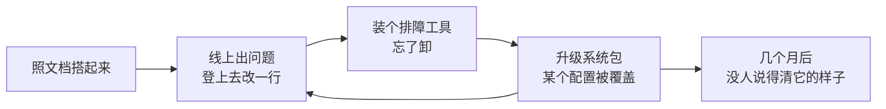
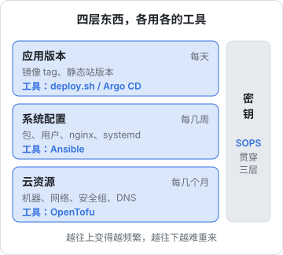
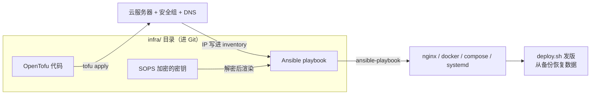

# 为什么要 IaC

线上那台服务器是怎么变成现在这个样子的？如果答案是「照着一份 README 敲了两三个小时，中间又改过几次配置」，那它就是一台只存在一份的机器：坏了、被删了、要换个地域，你得凭文档和记忆再敲一遍，而且没法保证敲出来的和原来一样。**基础设施即代码**（Infrastructure as Code，IaC）要解决的就是这件事：把「机器应该长什么样」写成代码，放进 Git，让工具负责把现实变成代码描述的样子。这一章先讲清它为什么值得做、做的是哪几层，再交代贯穿全书的练习。

## 关于这本书

### 讲什么

这本书讲四样工具，各管一层：

| 章节 | 工具 | 管什么 |
|---|---|---|
| [Terraform / OpenTofu](02-opentofu.md) | OpenTofu | 云上的资源：机器、网络、安全组、DNS |
| [Ansible 配置管理](03-ansible.md) | Ansible | 机器里面：包、用户、nginx、systemd、compose 文件 |
| [密钥管理](04-secrets.md) | SOPS（顺带比较 Vault） | 密码和令牌怎么跟着代码一起进 Git 而不泄露 |
| [GitOps 与 Argo CD](05-gitops-argocd.md) | Argo CD | 应用版本由集群主动从 Git 拉取、持续对齐 |
| [一个人的 IaC 落地](06-solo-iac.md) | 全部 | 一个人该做到哪一步、怎么维护、怎么演练重建 |

章节顺序和书单大纲略有不同：密钥管理挪到了 GitOps 前面，因为 Ansible 那一章立刻就要用到它。

### 适合谁

适合已经有一台在跑的服务器、并且读过[《部署与 CI/CD》](../deploy-release/)[《一人运维手册》](../production-ops/)的读者。那两本讲的是「怎么部署」「怎么守住」，默认机器已经在那里；这本书讲的是**机器本身怎么用代码描述出来**。部署脚本、零停机、备份、加固这些内容不再重复，需要时会点名回到那两本。

GitOps 那一章需要一点 Kubernetes 的基础概念（Pod、Deployment、Service），不熟悉也能读懂思路，细节可以配合[《Kubernetes 入门到实战》](../kubernetes/)。

### 怎么读

建议按顺序读，因为全书是一个连续的练习：第 2 章开出机器，第 3 章把它配好，第 4 章补上密钥，第 6 章把它们串成一次完整的重建演练。第 5 章是一条支线，讲的是如果将来上了 Kubernetes，应用交付这一层怎么换成 GitOps。

本书的命令和配置以 OpenTofu 1.10 及以上、ansible-core 2.17 及以上、SOPS 3.9 及以上为准。provider 和 collection 的版本变化快，书里写的版本约束是示例，动手前以各自的 registry 和官方文档为准。

## 雪花服务器

运维圈有个说法叫**雪花服务器**（snowflake server）：每一台都独一无二，因为它是被一系列手工操作「雕刻」出来的，没有任何记录能完整描述它。

一台手工搭的机器通常会经历这样的生命周期：



每一步单独看都合理，问题在于累积：文档描述的是第一天的机器，而线上跑的是第三百天的机器。两者之间的差距叫**配置漂移**（configuration drift）。漂移平时不会报错，它只会在你最需要重建的时候冒出来：

- 机器被云厂商回收，或者系统盘坏了，要从零再起一台
- 要换一个地域、换一家云
- 要起一套和生产一样的测试环境
- 某个配置被改坏了，却没人记得原来是什么

### 文档为什么不够

hatch-counter（一个 NestJS + Postgres 的门店管理服务）的部署文档写得很认真：从「刚注册完云账号」开始，19 步，每步标明在哪儿跑、末尾写着「应该看到」什么。它已经比大多数项目好得多，但仍然有文档天然的三个问题：

1. **没法验证**：文档写着「安全组只放行 22 / 80 / 443」，但线上那台是不是真的只开了这三个，读文档回答不了
2. **没法执行**：重建时要人逐条复制粘贴，两三个小时里任何一步看错，后面全错
3. **会过期**：线上改了配置，文档要靠自觉同步，而自觉是最先在半夜两点失效的东西

IaC 的思路是：把文档里那些「应该是什么样」的句子，换成工具能读、能执行、能对比的代码。文档仍然需要，但它只用来解释「为什么」，不再承担「是什么」。

## 声明式与命令式

写 IaC 代码有两种风格：

| | 命令式（imperative） | 声明式（declarative） |
|---|---|---|
| 写的是 | 一串步骤：先装这个、再改那个 | 最终状态：应该有这些东西 |
| 例子 | shell 脚本、`deploy.sh` | OpenTofu 的 HCL、K8s 的 YAML |
| 重复执行 | 要自己处理「已经做过了」的情况 | 工具对比现状，只补差额 |
| 删除 | 要专门写删除步骤 | 从代码里删掉，工具负责删现实里的 |
| 擅长 | 有严格顺序的流程（迁移、切换） | 描述「有什么」 |

看一个具体的差别。命令式地开放防火墙端口：

```bash
ufw allow 80/tcp
ufw allow 443/tcp
```

再跑一遍没问题，因为 `ufw` 自己处理了重复。但如果哪天你决定关掉 80，要另写一条 `ufw delete allow 80/tcp`；而原来那段脚本里依然写着 `allow 80`，下次有人照着跑，端口又开回来了。

声明式的写法描述的是集合本身：

```hcl
locals {
  open_ports = ["22", "443"]
}
```

把 80 从列表里删掉，工具对比后发现现实中多了一条规则，就把它删掉。**代码就是现状的完整描述**，这是声明式最大的价值。

### 幂等

两种风格都追求同一个性质：**幂等**（idempotent），即执行一次和执行多次结果相同。幂等是 IaC 能放心反复运行的前提：你不需要记得上次跑到哪一步，再跑一遍就行，没变化的部分什么也不做。

声明式工具天然幂等。命令式脚本要自己写判断，比如 hatch-counter 的 `gen-env.sh` 在目标文件已经存在时拒绝覆盖，就是在手工实现幂等。Ansible 处在两者之间：它的 playbook 是一串有顺序的任务，但每个任务（模块）都是声明式的，「确保这个包已安装」而不是「安装这个包」。

## 可变与不可变

另一个维度是机器本身能不能改：

- **可变基础设施**（mutable）：机器一直在，变更通过登上去修改完成。Ansible 是这个世界的典型工具
- **不可变基础设施**（immutable）：机器从不修改，要变更就用新镜像起一台新的，再把旧的扔掉。容器、自建机器镜像、K8s 是这个世界的工具

容器已经让应用层变成了不可变的：hatch-counter 发一版服务端，是换一个镜像 tag，而不是登上去改代码。但宿主机本身（nginx、证书、systemd 单元、compose 文件）还是可变的。对一个人、一台机器来说，**宿主机可变 + 应用不可变**是最务实的组合，本书也按这个组合来写。完全不可变（每次改 nginx 配置都重建整台机器）对一台带着数据库的机器来说代价太高。

## IaC 管的四层东西



分层的依据是**变化频率和重来的代价**：

- **云资源**几个月才动一次，但动错了代价最大（删掉一台带数据的机器）。它需要一个能在执行前精确告诉你「将要发生什么」的工具，这就是 OpenTofu 的 `plan`
- **系统配置**每几周改一次，改错了通常能马上修回来。它需要一个能登上机器、按顺序做事、并且重复执行安全的工具，这就是 Ansible
- **应用版本**每天都可能变。hatch-counter 用 `deploy.sh` 处理（《部署与 CI/CD》讲过），上了 K8s 之后可以换成 Argo CD
- **密钥**横跨所有层：云厂商的 API 令牌给 OpenTofu 用，数据库密码给 Ansible 渲染进配置文件，K8s 的 Secret 给应用用

常见的错误是用一个工具干所有层的活：用 Ansible 去调云 API 开机器（能做，但没有 `plan`，删除也很难写对），或者用 OpenTofu 的 provisioner 登上机器跑脚本（OpenTofu 官方文档自己都把它列为最后手段）。各用各的，交界处只传一点点信息（比如机器的 IP），整个系统才好维护。

## 贯穿练习：重建 hatch-counter 的那台机器

### 现状

hatch-counter 线上是一台云服务器（Ubuntu），上面跑着：

- **宿主机上**：nginx（按域名分发给五个站）、certbot（证书续期）、一个 systemd 常驻的上线代理 `agent.sh`
- **docker compose 里**：一个 Postgres 容器（数据在命名卷）、一个服务端容器（镜像来自私有镜像仓库）
- **机器外面**：对象存储桶（单据原图）、镜像仓库、DNS 解析

搭起它靠的是部署文档的 19 步，加上 `deploy/` 目录里的几份脚本：`push.sh` 把文件传上去，`gen-env.sh` 在机器上生成带随机密码的配置，`deploy.sh` 发版。

### 目标

用代码把这台机器完整描述出来，做到**一条命令开机器、一条命令配好，再从备份恢复数据，就能接手线上流量**：



最终在 hatch-counter 仓库里多出一个 `infra/` 目录：

```text
infra/
  .sops.yaml                  # 哪些文件用哪把钥匙加密
  tofu/
    modules/
      server-alicloud/        # 国内云的实现
      server-hcloud/          # 海外云的实现
    envs/prod/                # 生产环境：调用其中一个模块
  ansible/
    ansible.cfg
    site.yml
    inventory/hosts.yml       # 由 OpenTofu 生成
    group_vars/counter/
      main.yml                # 不敏感的变量
      secrets.sops.yaml       # SOPS 加密的变量
    roles/
      base/  docker/  nginx/  certbot/  counter_app/
```

几个约束会贯穿全书：

- **不绑死云厂商**：OpenTofu 部分把厂商相关的代码关在一个模块里，换云只换模块
- **不改变发版方式**：`deploy.sh` 继续负责发版，IaC 管的是机器，不管版本。两者的边界在第 3 章会专门讲
- **不泄露任何东西**：书中所有域名用 `example.com`，IP 用文档专用的 `203.0.113.0/24` 网段，密钥全部是占位符

## IaC 的代价

IaC 不是免费的，值得在开始前说清楚：

| 代价 | 具体是什么 |
|---|---|
| 学习成本 | 四样工具各有自己的语法和心智模型 |
| 维护成本 | provider 和 collection 会升级、会废弃参数，代码也会「腐烂」 |
| 双轨风险 | 一旦有了代码，再登上机器手改，就会制造漂移，而且比没有代码时更隐蔽 |
| 初次投入 | 把一台已有的机器反向写成代码，比从零写还费劲 |

收益则集中在少数几个时刻：重建、迁移、复制环境、回答「线上到底是什么配置」。对一个人来说，这些时刻一年可能只有一两次，但每一次都是高压时刻，而且通常不是你选的时间。IaC 是在平静的日子里，为那几个糟糕的时刻提前付费。

具体做到什么程度，[一个人的 IaC 落地](06-solo-iac.md)那一章会给出建议。先说结论：一个人最值得做的是 Ansible 管系统配置加上 SOPS 管密钥；OpenTofu 开机器次之；GitOps 只有在真的上了 K8s 时才值得。

## 本章要点

- 手工搭的机器会**漂移**，文档描述的永远是第一天的样子；IaC 把「应该是什么样」写成可执行、可对比的代码
- **声明式**描述最终状态，工具补差额，删除也自动；**命令式**适合有严格顺序的流程；两者都要追求**幂等**
- 对一个人一台机器，**宿主机可变 + 应用不可变**最务实
- IaC 分四层：云资源（OpenTofu）、系统配置（Ansible）、应用版本（部署脚本或 Argo CD）、密钥（SOPS），各用各的工具，交界处只传少量信息
- 贯穿练习：把 hatch-counter 那台靠 19 步文档搭起来的机器，改成「开机器、配系统、恢复数据」三条命令
- IaC 是为重建、迁移这类高压时刻提前付费；一个人优先做 Ansible + SOPS
