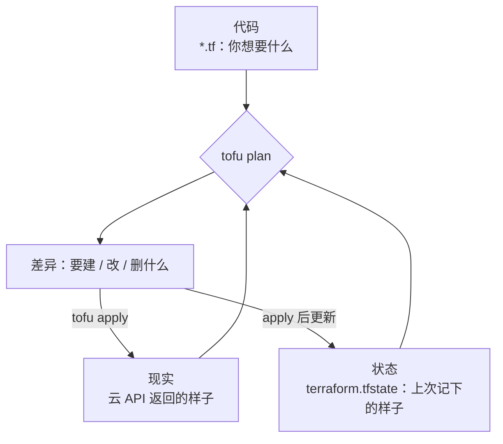

# Terraform / OpenTofu

这一章用 OpenTofu 把 hatch-counter 那台机器「开」出来：一台云服务器、一个只放行 22 / 80 / 443 的安全组、一把 SSH 公钥、几条 DNS 记录。重点不在某家云的参数，而在 OpenTofu 的工作方式：它怎么知道现实是什么样、怎么算出要改什么、状态文件为什么是整套系统里最需要保护的东西，以及怎么把云厂商的差异关进一个模块里。

## Terraform 和 OpenTofu 是什么关系

Terraform 是 HashiCorp 做的 IaC 工具，用 HCL（HashiCorp Configuration Language）描述资源，靠各家云厂商维护的 **provider** 去调 API。2023 年 8 月 HashiCorp 把 Terraform 的许可证从开源的 MPL 2.0 改成了 BSL（Business Source License），社区随即从最后一个 MPL 版本分叉出 **OpenTofu**，交给 Linux 基金会托管，2024 年初发布了第一个正式版。

对使用者来说，两者目前的关系是：

| | Terraform | OpenTofu |
|---|---|---|
| 命令 | `terraform` | `tofu` |
| 许可证 | BSL | MPL 2.0 |
| HCL 语法 | 基本一致 | 基本一致，各自加了新特性 |
| provider | 共用同一批 provider | 同左，有自己的 registry 镜像 |
| 独有特性举例 | HCP Terraform 云服务集成 | 状态文件客户端加密、provider 里用 `for_each` |

一个人用，许可证的差别几乎不影响你（BSL 限制的是拿它做竞争性的商业服务）。本书选 OpenTofu 有两个实际理由：**状态加密**是内置的（下文会用到），以及它是社区治理、不会再变一次许可证。下文所有 `tofu` 命令换成 `terraform` 基本都能跑，差异处会注明。

## 核心模型：代码、状态、现实

OpenTofu 的一切都围绕三样东西：



- **代码**是期望状态
- **现实**是云上真实存在的资源
- **状态文件**是 OpenTofu 记下的「代码里的哪个资源对应现实里的哪个 ID」，外加上次看到的属性

为什么需要状态文件？因为云 API 只认 ID。代码里写的是 `alicloud_instance.app`，云上那台机器叫 `i-xxxxxxxx`，这层映射只能存在某个地方。没有状态文件，OpenTofu 就分不清「这台机器是我管的」还是「别人手工建的」，也就不敢删任何东西。

`tofu plan` 做的事是：刷新状态（向云 API 查一遍现实）→ 和代码对比 → 列出差异。`tofu apply` 再把差异执行掉。这个「先看后做」的两步是 OpenTofu 最大的价值：**动生产之前，你能逐行看到将要发生什么**。

## HCL 速成

HCL 是一种声明式的配置语言，结构是「块」：

```hcl
# 块类型 "资源类型" "本地名字" { 参数 }
resource "hcloud_server" "app" {
  name        = "counter-prod"
  server_type = var.server_type          # 引用变量
  image       = "ubuntu-24.04"
  ssh_keys    = [hcloud_ssh_key.me.id]   # 引用另一个资源的属性，自动形成依赖
  labels = {
    app = "counter"
  }
}
```

几类常用的块：

| 块 | 作用 |
|---|---|
| `terraform { }` | OpenTofu 自身的设置：版本要求、provider 来源、状态存在哪 |
| `provider "x" { }` | 某个 provider 的配置：地域、凭证来源 |
| `resource "类型" "名" { }` | 要管理的资源 |
| `data "类型" "名" { }` | 只读查询：查最新的系统镜像、查可用区 |
| `variable "名" { }` | 输入参数 |
| `output "名" { }` | 输出值，给人看或给别的工具用 |
| `locals { }` | 本地计算的中间值 |
| `module "名" { }` | 调用另一个目录里的一组代码 |

资源之间的引用（`hcloud_ssh_key.me.id`）会自动建立依赖图，OpenTofu 按图的顺序并行创建，不需要你写先后。

## 先写模块的接口

练习的约束是「不绑死云厂商」。做法是：**把厂商相关的代码关在一个模块里，模块对外只暴露一个通用的接口**。生产环境只认这个接口。

接口要什么、给什么，从 hatch-counter 的需求反推：

```hcl
# modules/server-*/variables.tf（每个实现都一样）
variable "name" {
  type        = string
  description = "机器名，也用作资源名前缀"
}

variable "ssh_public_key" {
  type        = string
  description = "部署用户的 SSH 公钥"
}

variable "open_tcp_ports" {
  type        = list(string)
  default     = ["22", "80", "443"]
  description = "对公网开放的 TCP 端口。5432 和 3000 永远不该出现在这里"
}

variable "size" {
  type        = string
  description = "机型，由各实现自己解释"
}

variable "user_data" {
  type        = string
  description = "cloud-init 配置，明文"
}
```

```hcl
# modules/server-*/outputs.tf（每个实现都一样）
output "ipv4" {
  value = local.ipv4
}

output "id" {
  value = local.id
}
```

接口里刻意没有地域、VPC、可用区这些概念：它们是厂商特有的，由模块内部决定或作为模块自己的可选变量。

## 实现一：海外云（Hetzner Cloud）

Hetzner 的 provider 简单，适合先看清结构：

```hcl
# modules/server-hcloud/main.tf
terraform {
  required_providers {
    hcloud = {
      source  = "hetznercloud/hcloud"
      version = "~> 1.0" # 示例约束，动手前去 registry 看当前版本后收紧到具体的小版本
    }
  }
}

variable "location" {
  type    = string
  default = "fsn1"
}

resource "hcloud_ssh_key" "deploy" {
  name       = "${var.name}-deploy"
  public_key = var.ssh_public_key
}

resource "hcloud_firewall" "web" {
  name = "${var.name}-web"

  dynamic "rule" {
    for_each = var.open_tcp_ports
    content {
      direction  = "in"
      protocol   = "tcp"
      port       = rule.value
      source_ips = ["0.0.0.0/0", "::/0"]
    }
  }
}

resource "hcloud_server" "this" {
  name         = var.name
  server_type  = var.size # 机型名称会随厂商调整，以控制台为准
  image        = "ubuntu-24.04"
  location     = var.location
  ssh_keys     = [hcloud_ssh_key.deploy.id]
  firewall_ids = [hcloud_firewall.web.id]
  user_data    = var.user_data

  lifecycle {
    prevent_destroy = true
    ignore_changes  = [user_data, image]
  }
}

locals {
  ipv4 = hcloud_server.this.ipv4_address
  id   = hcloud_server.this.id
}
```

两个值得注意的写法：

- **`dynamic` 块**：端口列表有几个元素就生成几条 `rule`。安全组规则因此和 `open_tcp_ports` 这个列表严格一致，从列表里删掉一个端口，`plan` 会显示删掉对应的规则
- **`lifecycle`**：`prevent_destroy` 让任何会删掉这台机器的计划直接报错，必须先改代码才能删，防的是手滑；`ignore_changes` 忽略 `user_data` 和 `image` 的变化，因为这两个属性一变就意味着重建整台机器，而 cloud-init 只在第一次开机时生效，之后改它没有意义

## 实现二：国内云（阿里云）

hatch-counter 实际跑在阿里云上（域名备案要求机器在境内）。同一个接口，阿里云要多管 VPC、交换机和安全组规则：

```hcl
# modules/server-alicloud/main.tf
terraform {
  required_providers {
    alicloud = {
      source  = "aliyun/alicloud"
      version = "~> 1.0" # 示例约束；这个 provider 迭代很快，参数名偶有调整，以 registry 文档为准
    }
  }
}

variable "system_disk_size" {
  type    = number
  default = 40
}

data "alicloud_zones" "available" {
  available_resource_creation = "VSwitch"
  available_instance_type     = var.size
}

data "alicloud_images" "ubuntu" {
  owners      = "system"
  name_regex  = "^ubuntu_24_04_x64"
  most_recent = true
}

resource "alicloud_vpc" "this" {
  vpc_name   = var.name
  cidr_block = "10.10.0.0/16"
}

resource "alicloud_vswitch" "this" {
  vswitch_name = var.name
  vpc_id       = alicloud_vpc.this.id
  cidr_block   = "10.10.1.0/24"
  zone_id      = data.alicloud_zones.available.zones[0].id
}

resource "alicloud_security_group" "web" {
  security_group_name = "${var.name}-web"
  vpc_id              = alicloud_vpc.this.id
}

resource "alicloud_security_group_rule" "ingress" {
  for_each = toset(var.open_tcp_ports)

  security_group_id = alicloud_security_group.web.id
  type              = "ingress"
  ip_protocol       = "tcp"
  nic_type          = "intranet" # VPC 网络必须写 intranet
  policy            = "accept"
  port_range        = "${each.value}/${each.value}"
  priority          = 1
  cidr_ip           = "0.0.0.0/0"
}

resource "alicloud_ecs_key_pair" "deploy" {
  key_pair_name = "${var.name}-deploy"
  public_key    = var.ssh_public_key
}

resource "alicloud_instance" "this" {
  instance_name              = var.name
  instance_type              = var.size
  image_id                   = data.alicloud_images.ubuntu.images[0].id
  vswitch_id                 = alicloud_vswitch.this.id
  security_groups            = [alicloud_security_group.web.id]
  key_name                   = alicloud_ecs_key_pair.deploy.key_pair_name
  system_disk_category       = "cloud_essd"
  system_disk_size           = var.system_disk_size
  internet_max_bandwidth_out = 5
  user_data                  = base64encode(var.user_data)

  lifecycle {
    prevent_destroy = true
    ignore_changes  = [user_data, image_id]
  }
}

locals {
  ipv4 = alicloud_instance.this.public_ip
  id   = alicloud_instance.this.id
}
```

对比两个实现，差别都被关在模块里：Hetzner 的防火墙规则是资源的内嵌块，阿里云的是独立资源；Hetzner 的镜像写名字，阿里云要先用 `data` 查出 ID；阿里云的公网带宽是机器的属性。生产环境的代码对这些一无所知。

`ignore_changes` 里加上 `image_id` 在阿里云上尤其要紧：`most_recent = true` 每次 `plan` 都会查到最新的镜像，系统镜像一更新，不忽略的话 `plan` 就会提议重建机器。

## 生产环境：调用模块

```hcl
# envs/prod/versions.tf
terraform {
  required_version = ">= 1.10"

  required_providers {
    cloudflare = {
      source  = "cloudflare/cloudflare"
      version = "~> 5.0"
    }
    local = {
      source  = "hashicorp/local"
      version = "~> 2.0"
    }
    alicloud = {
      source  = "aliyun/alicloud"
      version = "~> 1.0"
    }
  }
}

# provider 的配置写在根模块，模块里只声明需要哪个 provider。
# 凭证走环境变量（ALICLOUD_ACCESS_KEY / ALICLOUD_SECRET_KEY），不写进代码
provider "alicloud" {
  region = "cn-shanghai"
}
```

换云时，除了改 `module` 的 `source`，这里的 `provider` 块和 `required_providers` 也要换成对应厂商的（Hetzner 的令牌走 `HCLOUD_TOKEN` 环境变量）。这是根模块里唯一和厂商有关的几行。

```hcl
# envs/prod/main.tf
variable "ssh_public_key" {
  type = string
}

variable "dns_zone_id" {
  type = string
}

locals {
  name = "counter-prod"
  # 五个站同一台机器，nginx 按域名分发
  hostnames = ["api", "app", "admin", "docs", "@"]
}

module "server" {
  source = "../../modules/server-alicloud"
  # 换云只改这两行：
  # source = "../../modules/server-hcloud"
  # size   = "cx22"

  name           = local.name
  size           = "ecs.e-c1m2.large" # 2 核 4G，规格名以控制台为准
  ssh_public_key = var.ssh_public_key
  user_data = templatefile("${path.module}/cloud-init.yaml.tftpl", {
    ssh_public_key = var.ssh_public_key
  })
}

resource "cloudflare_dns_record" "site" {
  for_each = toset(local.hostnames)

  zone_id = var.dns_zone_id
  name    = each.value
  type    = "A"
  content = module.server.ipv4
  ttl     = 300
  proxied = false
}

# 把 IP 写成 Ansible 的 inventory：两个工具之间只传这一点信息
resource "local_file" "inventory" {
  filename        = "${path.module}/../../../ansible/inventory/hosts.yml"
  file_permission = "0644"
  content = yamlencode({
    all = {
      children = {
        counter = {
          hosts = {
            (local.name) = {
              ansible_host = module.server.ipv4
              ansible_user = "deploy"
            }
          }
        }
      }
    }
  })
}

output "ipv4" {
  value = module.server.ipv4
}
```

DNS 用 Cloudflare 只是示例：DNS 和机器解耦之后，DNS 托管在哪家都行，境内备案域名也可以用云厂商自己的解析服务，换一个 provider 的资源即可。Cloudflare provider 在 5.x 里把记录资源从 `cloudflare_record` 改名成了 `cloudflare_dns_record`，网上的旧例子大多还是 4.x 的写法，注意区分。

### cloud-init：第一次开机做的最少的事

cloud-init 只负责让 Ansible 能连上来，其余一律交给 Ansible：

```yaml
#cloud-config
# envs/prod/cloud-init.yaml.tftpl
users:
  - name: deploy
    groups: [sudo]
    shell: /bin/bash
    sudo: "ALL=(ALL) NOPASSWD:ALL"
    ssh_authorized_keys:
      - ${ssh_public_key}
package_update: true
packages:
  - python3
```

为什么不在 cloud-init 里多做点？因为它只在第一次开机时执行，之后改了不会重跑（上面 `ignore_changes` 也是这个原因）。放在它里面的配置，日后无法通过同一份代码更新，等于又造了一份「只在第一天成立」的文档。

## 状态文件：最需要保护的东西

默认情况下，状态写在当前目录的 `terraform.tfstate` 里。这有三个问题：

1. **含明文敏感数据**：资源属性原样记录，数据库密码、私钥只要经过 OpenTofu，就会以明文出现在状态里
2. **只在一台电脑上**：电脑丢了，OpenTofu 就再也认不出云上那些资源了
3. **没有锁**：两个终端同时 `apply`，状态会被写坏

### 远程后端

一个人最省事的方案是放在 S3 兼容的对象存储里（R2、OSS、自建 MinIO 都行）：

```hcl
# envs/prod/backend.tf
terraform {
  backend "s3" {
    bucket = "counter-tofu-state"
    key    = "prod/terraform.tfstate"
    region = "auto"

    endpoints = {
      s3 = "https://<账号或地域相关的 endpoint>"
    }

    # 非 AWS 的 S3 兼容存储需要关掉这几项 AWS 专属的检查
    skip_credentials_validation = true
    skip_region_validation      = true
    skip_requesting_account_id  = true
    skip_metadata_api_check     = true
    skip_s3_checksum            = true
    use_path_style              = true

    # 1.10 起支持用对象存储自身的条件写入做锁，不再需要 DynamoDB
    use_lockfile = true
  }
}
```

凭证不写在这里，用环境变量 `AWS_ACCESS_KEY_ID` / `AWS_SECRET_ACCESS_KEY` 传入（S3 后端认的就是这两个名字，与存储是不是 AWS 无关）。`use_lockfile` 依赖存储支持条件写入，不是每家 S3 兼容存储都支持，开启前先确认，或者用两个终端同时 `plan` 试一下锁是否生效。

存状态的桶要开**版本控制**：状态被写坏时，可以取回上一个版本。

### 状态加密

OpenTofu 1.7 起支持在客户端加密状态和计划文件，存储方即使被攻破，拿到的也只是密文：

```hcl
# envs/prod/encryption.tf
variable "state_passphrase" {
  type      = string
  sensitive = true
}

terraform {
  encryption {
    key_provider "pbkdf2" "main" {
      passphrase = var.state_passphrase # 至少 16 个字符
    }

    method "aes_gcm" "main" {
      keys = key_provider.pbkdf2.main
    }

    state {
      method = method.aes_gcm.main
    }

    plan {
      method = method.aes_gcm.main
    }
  }
}
```

在 `terraform {}` 块里引用变量需要 1.8 起的「早期求值」特性。口令通过 `TF_VAR_state_passphrase` 环境变量传入，它本身由 SOPS 管理（第 4 章）。这是 Terraform 没有的特性，如果用 Terraform，只能依赖存储端加密。

**口令丢了，状态就解不开了。** 它和第 4 章的 age 私钥一样，属于「必须存在 IaC 体系之外」的那一两样东西。

## 日常工作流

```bash
cd infra/tofu/envs/prod

tofu init                 # 下载 provider、连接后端，生成 .terraform.lock.hcl
tofu fmt -recursive       # 统一格式
tofu validate             # 语法和类型检查，不连云
tofu plan -out=tfplan     # 算出差异并存成文件
tofu apply tfplan         # 只执行刚才看过的那份计划
tofu output -raw ipv4     # 读输出
```

几条纪律：

- **`.terraform.lock.hcl` 进 Git**：它锁定了 provider 的精确版本和校验和，保证换台电脑 `init` 下来的是同一个 provider
- **`.terraform/` 目录、`*.tfstate`、`tfplan` 不进 Git**
- **永远 `plan -out` 再 `apply 文件`**：直接 `tofu apply` 会重新算一次计划，如果这期间现实变了，执行的就不是你刚看过的那份
- **读 `plan` 时盯住三种符号**：`+` 新建、`~` 原地修改、`-/+` 先删再建。看到 `-/+` 落在机器或数据库上，停下来

```text
  # module.server.alicloud_instance.this must be replaced
-/+ resource "alicloud_instance" "this" {
      ~ image_id = "ubuntu_24_04_x64_20G_alibase_A" -> "ubuntu_24_04_x64_20G_alibase_B" # forces replacement
```

`# forces replacement` 那一行告诉你是哪个属性导致了重建。上面这个例子正是忘了把 `image_id` 加进 `ignore_changes` 的后果。

## 把已有的机器收编进来

hatch-counter 那台机器已经存在，不可能删了重开。OpenTofu 的 `import` 块可以把现有资源纳入管理：

```hcl
# envs/prod/imports.tf，收编完成后可以删掉
import {
  to = module.server.alicloud_instance.this
  id = "i-xxxxxxxxxxxx"
}

import {
  to = module.server.alicloud_security_group.web
  id = "sg-xxxxxxxxxxxx"
}
```

然后反复 `tofu plan`，直到它不再提议任何改动：每一处差异都意味着代码和现实不符，要么改代码贴合现实，要么确认现实应该被改。这个过程很枯燥，但它恰好是一次完整的审计：你会发现安全组里多出来的那条「临时」规则。

重构代码时如果改了资源的地址（比如把资源挪进模块），用 `moved` 块告诉 OpenTofu 这是同一个东西，而不是删一个、建一个：

```hcl
moved {
  from = alicloud_instance.app
  to   = module.server.alicloud_instance.this
}
```

## 本章要点

- OpenTofu 是 Terraform 在许可证变更后的开源分叉，命令和 HCL 基本一致，内置状态加密
- 核心模型是**代码、状态、现实**三方对比；`plan` 让你在动生产前逐行看到差异，是它最大的价值
- 不绑死云厂商的办法：**模块接口通用、实现按厂商分**，生产环境只认接口，换云只换 `source`
- 机器资源加 `prevent_destroy`，并用 `ignore_changes` 忽略会触发重建却无意义的属性（`user_data`、镜像）
- cloud-init 只做让 Ansible 能连上的最少的事
- 状态文件含明文敏感信息：放远程后端、开版本控制、开锁、开客户端加密；加密口令要存在体系之外
- 已有机器用 `import` 收编，改地址用 `moved`，`.terraform.lock.hcl` 进 Git
