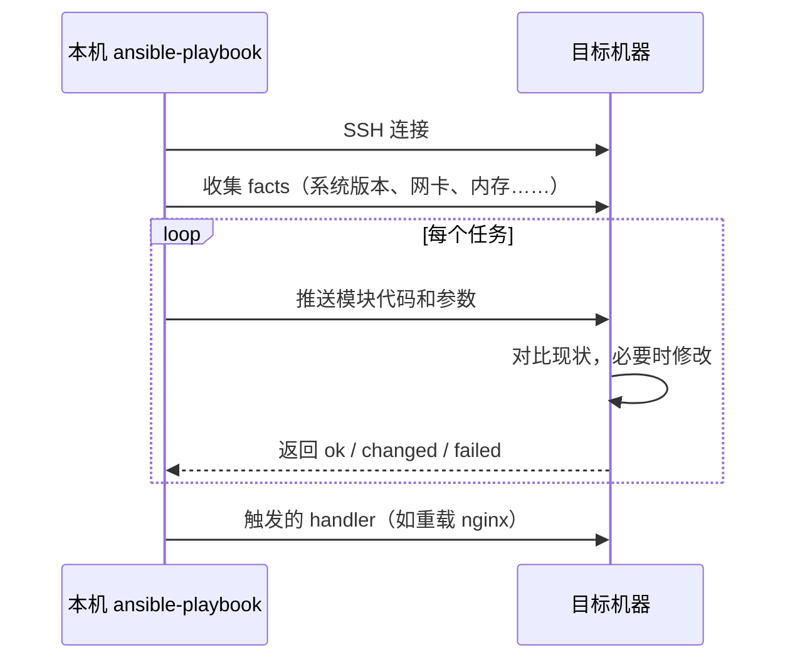

# Ansible 配置管理

上一章开出了一台只有 `deploy` 用户和 Python 的空机器。这一章用 Ansible 把它配成 hatch-counter 线上那台的样子：装 docker、nginx、certbot，放好 compose 文件和 nginx 配置，装上 systemd 常驻的上线代理，把服务端跑起来。重点是 Ansible 的几个核心概念怎么对应到部署文档里的那些步骤，以及哪些事情该交给 Ansible、哪些该继续留给 `deploy.sh`。

> [!WARNING]
> 本章的 playbook 按 ansible-core 2.17 写成。2.19 起引入 data tagging，模板和条件表达式有破坏性变更（`when` 等条件必须求值为布尔值、不再接受字符串式的真假，部分隐式模板和过滤器行为调整），书中写法未在 2.19 上逐条验证；以 Ansible 官方的 Porting Guide for ansible-core 2.19 和 ansible-core changelog 为准，升级后先用 `--check --diff` 跑一遍。

## Ansible 的工作方式

Ansible 是**无代理**的：目标机器上不用装任何常驻程序，只要能 SSH 登录、有 Python。你在本机运行 `ansible-playbook`，它通过 SSH 把一小段 Python 代码（模块）推到目标机器上执行，收回结果，再删掉。



每个任务的结果只有三种：`ok`（已经是期望状态，什么也没做）、`changed`（做了修改）、`failed`。一份写得好的 playbook，**第二次运行时应该全是 `ok`**。如果第二次还有 `changed`，说明某个任务不幂等，它就是将来的隐患。

| 概念 | 是什么 | 对应部署文档里的 |
|---|---|---|
| inventory | 要管哪些机器、怎么连 | `~/.ssh/config` 里那段 `Host` |
| 模块（module） | 一个声明式的操作单元：确保包已装、文件内容是这样 | 一条命令 |
| 任务（task） | 调用一次模块 | 一个步骤 |
| playbook | 按顺序把任务应用到一组机器 | 整份文档 |
| role | 一组相关任务、模板、默认变量的打包 | 文档里的一个章节 |
| handler | 只在被通知时才运行的任务，通常是重启服务 | 「改完配置记得 reload」 |
| facts | 自动收集的目标机器信息 | 「先看一眼是什么系统」 |

## 安装与项目骨架

```bash
# 本机跑：用 pipx 装，与系统 Python 隔离
pipx install --include-deps ansible
ansible --version   # 本书按 ansible-core 2.17 及以上写

# 装要用到的 collection
ansible-galaxy collection install -r infra/ansible/requirements.yml
```

```yaml
# infra/ansible/requirements.yml
collections:
  - name: community.docker
    version: ">=3.6.0"
  - name: community.sops
    version: ">=1.6.0"
  - name: community.general
  - name: ansible.posix
```

```ini
# infra/ansible/ansible.cfg
[defaults]
inventory = inventory/hosts.yml
roles_path = roles
stdout_callback = default
callback_result_format = yaml
# 第 4 章用到：让 *.sops.yaml 结尾的变量文件自动解密
vars_plugins_enabled = host_group_vars,community.sops.sops
# 换了新机器，主机指纹必然变化；第一次连接时接受新指纹
host_key_checking = False

[ssh_connection]
pipelining = True
```

`host_key_checking = False` 是为重建场景做的妥协：新机器的指纹第一次出现时无从校验。更严谨的做法是让 OpenTofu 生成主机密钥并写进 `known_hosts`，一个人用可以先接受这个折中，但要知道它放弃了什么。

inventory 由上一章的 `local_file` 资源生成，长这样：

```yaml
# infra/ansible/inventory/hosts.yml（由 OpenTofu 生成，不要手改）
all:
  children:
    counter:
      hosts:
        counter-prod:
          ansible_host: 203.0.113.10
          ansible_user: deploy
```

先确认连得上：

```bash
cd infra/ansible
ansible counter -m ansible.builtin.ping
```

## 入口 playbook

```yaml
# infra/ansible/site.yml
- name: 配置 hatch-counter 的线上机器
  hosts: counter
  become: true
  roles:
    - base
    - docker
    - certbot
    - nginx
    - counter_app
```

顺序就是依赖：先有基础环境，再有 docker，再申请证书、放正式的 nginx 配置，最后把应用放上去。certbot 排在 nginx 前面的原因见下文「先有鸡还是先有蛋」。每个 role 是一个目录：

```text
roles/nginx/
  tasks/main.yml        # 任务
  handlers/main.yml     # handler
  templates/            # Jinja2 模板
  files/                # 原样拷贝的文件
  defaults/main.yml     # 默认变量（优先级最低）
```

不敏感的变量集中放在 `group_vars`：

```yaml
# infra/ansible/group_vars/counter/main.yml
app_root: /srv/counter
domain: example.com
site_hosts: [api, app, admin, docs]
acme_email: ops@example.com
api_image: registry.example.com/counter/api
# 境内机器访问官方 docker 源很慢，换成云厂商的镜像源
docker_apt_mirror: https://download.docker.com
```

## base：用户、包、防火墙

```yaml
# roles/base/tasks/main.yml
- name: 基础包
  ansible.builtin.apt:
    name: [rsync, curl, ca-certificates, ufw, unattended-upgrades, nginx]
    state: present
    update_cache: true
    cache_valid_time: 3600

- name: 防火墙默认拒绝入站
  community.general.ufw:
    default: deny
    direction: incoming

- name: 放行必要端口
  community.general.ufw:
    rule: allow
    port: "{{ item }}"
    proto: tcp
  loop: ["22", "80", "443"]

- name: 启用防火墙
  community.general.ufw:
    state: enabled
```

云上的安全组（第 2 章）和机器上的 ufw 是两道独立的防线，各自用各自层的工具管。新机的 SSH 初始化和加固、fail2ban 这些内容在[《部署与 CI/CD》拿到机器之后的头半小时](../deploy-release/01-vps-setup.md#拿到机器之后的头半小时)和[《一人运维手册》SSH：从「能用」到「收紧」](../production-ops/01-hardening.md#ssh从能用到收紧)讲过，在这里只是把那些命令翻译成任务，不再重复理由。

`cache_valid_time` 让 `apt update` 在一小时内只跑一次，否则每次运行都是一次 `changed`。

## docker：用声明式的方式加 apt 源

```yaml
# roles/docker/tasks/main.yml
- name: Docker 的 apt 源
  ansible.builtin.deb822_repository:
    name: docker
    types: [deb]
    uris: "{{ docker_apt_mirror }}/linux/ubuntu"
    suites: ["{{ ansible_facts['distribution_release'] }}"]
    components: [stable]
    signed_by: "{{ docker_apt_mirror }}/linux/ubuntu/gpg"

- name: 安装 docker 和 compose 插件
  ansible.builtin.apt:
    name:
      - docker-ce
      - docker-ce-cli
      - containerd.io
      - docker-buildx-plugin
      - docker-compose-plugin
    state: present
    update_cache: true

- name: docker 开机自启
  ansible.builtin.systemd:
    name: docker
    enabled: true
    state: started
```

部署文档里用的是 `curl ... get.docker.com | sh`。那条命令每次执行都会重新跑一遍安装逻辑，结果取决于脚本当天的版本，不是幂等的。换成 apt 源 + 包之后，「装没装、从哪装」变成了可以反复检查的状态。`ansible_facts['distribution_release']` 自动取到 Ubuntu 的代号，系统升级大版本时不用改代码。

## nginx：模板与 handler

nginx 是 Ansible 最能体现价值的地方：配置文件由模板生成，改了才重载，重载前先校验。

```yaml
# roles/nginx/tasks/main.yml
- name: 安装 nginx
  ansible.builtin.apt:
    name: nginx
    state: present

- name: 代理共用的头和维护开关
  ansible.builtin.copy:
    src: "{{ item }}"
    dest: "/etc/nginx/snippets/{{ item }}"
    mode: "0644"
  loop:
    - counter-proxy.conf
    - counter-maintenance.conf
  notify: reload nginx

- name: 站点配置
  ansible.builtin.template:
    src: counter.conf.j2
    dest: /etc/nginx/conf.d/counter.conf
    mode: "0644"
  notify: reload nginx
```

```yaml
# roles/nginx/handlers/main.yml
- name: 检查 nginx 配置
  ansible.builtin.command: nginx -t
  changed_when: false
  listen: reload nginx

- name: 重载 nginx
  ansible.builtin.systemd:
    name: nginx
    state: reloaded
  listen: reload nginx
```

两个 handler 监听同一个名字，按定义顺序执行：先 `nginx -t`，失败就停在这里，不会把一份坏配置 reload 上去。handler 在所有任务跑完后才统一执行，并且同一个 handler 被通知多少次都只跑一次：上面三个文件都改了，nginx 也只重载一次。

模板里用变量生成五个 server 块，域名不再散落在配置文件各处：

```nginx
# roles/nginx/templates/counter.conf.j2

server {
    listen 443 ssl;
    http2 on;
    server_name {{ host }}.{{ domain }};

    ssl_certificate     /etc/letsencrypt/live/{{ host }}.{{ domain }}/fullchain.pem;
    ssl_certificate_key /etc/letsencrypt/live/{{ host }}.{{ domain }}/privkey.pem;


    location / {
        include snippets/counter-maintenance.conf;
        include snippets/counter-proxy.conf;
        proxy_pass http://127.0.0.1:3000;
    }

    root {{ app_root }}/sites/{{ host }}/current;
    location /v1/ {
        include snippets/counter-maintenance.conf;
        include snippets/counter-proxy.conf;
        proxy_pass http://127.0.0.1:3000;
    }

}

```

这里只展示结构。实际的 server 块（官网走根域名、文档站有密码锁、各站的缓存头）照原配置搬进模板即可，nginx 本身的写法[《Nginx 与反向代理》](../nginx-gateway/)讲过。

## certbot：先有鸡还是先有蛋

证书这一步有个循环依赖：正式配置引用证书文件，而 webroot 方式签证书又需要 nginx 先在 80 端口服务挑战文件。手工的解法（先放只处理挑战的临时配置，签完再换正式配置）见[《Nginx 与反向代理》从零上线的顺序](../nginx-gateway/03-https-acme.md#从零上线的顺序)，ACME 本身的原理见[《计算机网络》证书怎么来：ACME](../networking/05-tls.md#证书怎么来acme)。翻译成 Ansible，就是让 certbot 这个 role 在正式配置之前跑一个只含 80 端口的配置：

```yaml
# roles/certbot/tasks/main.yml
- name: 安装 certbot
  ansible.builtin.apt:
    name: certbot
    state: present

- name: ACME 校验目录
  ansible.builtin.file:
    path: /var/www/certbot
    state: directory
    mode: "0755"

- name: 80 端口：ACME 校验 + 跳转 https
  ansible.builtin.template:
    src: acme.conf.j2
    dest: /etc/nginx/conf.d/00-acme.conf
    mode: "0644"
  register: acme_conf

- name: 立即重载，让校验路径生效
  ansible.builtin.systemd:
    name: nginx
    state: reloaded
  when: acme_conf.changed

- name: 申请证书（已有则跳过）
  ansible.builtin.command: >
    certbot certonly --webroot -w /var/www/certbot
    -d {{ item }}.{{ domain }}
    --non-interactive --agree-tos -m {{ acme_email }}
    {{ '--staging' if acme_staging | default(false) else '' }}
  args:
    creates: "/etc/letsencrypt/live/{{ item }}.{{ domain }}/fullchain.pem"
  loop: "{{ site_hosts }}"

- name: 续期后重载 nginx
  ansible.builtin.copy:
    dest: /etc/letsencrypt/renewal-hooks/deploy/reload-nginx.sh
    content: |
      #!/bin/sh
      systemctl reload nginx
    mode: "0755"
```

`ansible.builtin.command` 本身不是幂等的，`creates` 参数补上了这一点：目标文件已存在就跳过。这是把命令式操作塞进 Ansible 时最常用的手法，其他还有 `removes`、`changed_when`、先 `stat` 再 `when`。

这就是 site.yml 里 certbot 排在 nginx 前面的原因，nginx 包本身则在 base 里就装好了。这类顺序问题在已有机器上跑不出来（证书早就在了），只在全新机器上暴露：很容易写成 nginx 在前，而这样的 playbook 在老机器上跑多少次都是绿的。所以第 6 章强调要定期在全新机器上演练。

Let's Encrypt 对同一组域名的签发有频率限制，反复演练重建时给测试环境设 `acme_staging: true`，用它的测试 CA。

## counter_app：放文件，不管版本

这一个 role 要守住一条边界：**Ansible 管机器上应该有什么，`deploy.sh` 管跑哪个版本**。

```yaml
# roles/counter_app/tasks/main.yml
- name: 应用目录
  ansible.builtin.file:
    path: "{{ app_root }}"
    state: directory
    mode: "0755"

- name: 编排文件和部署脚本
  ansible.builtin.copy:
    src: "{{ item.src }}"
    dest: "{{ app_root }}/{{ item.src }}"
    mode: "{{ item.mode }}"
  loop:
    - { src: docker-compose.yml, mode: "0644" }
    - { src: deploy.sh, mode: "0755" }
    - { src: agent.sh, mode: "0755" }

- name: 服务端和数据库的配置（含密钥，第 4 章）
  ansible.builtin.template:
    src: "{{ item }}.j2"
    dest: "{{ app_root }}/{{ item }}"
    mode: "0600"
  loop: [api.env, postgres.env]
  diff: false

- name: 上线代理的 systemd 单元
  ansible.builtin.template:
    src: counter-agent.service.j2
    dest: /etc/systemd/system/counter-agent.service
    mode: "0644"
  notify: restart agent

- name: 上线代理常驻
  ansible.builtin.systemd:
    name: counter-agent
    enabled: true
    state: started
    daemon_reload: true

- name: 第一次部署时写入初始版本
  ansible.builtin.copy:
    dest: "{{ app_root }}/.env"
    content: "API_TAG={{ api_initial_tag }}\n"
    mode: "0644"
    force: false
```

几个细节都在守那条边界：

- **`.env` 用 `force: false`**：文件不存在时才写。`deploy.sh` 每次发版都会改写 `API_TAG` 那一行，如果 Ansible 每次都覆盖它，跑一次 playbook 就把线上版本退回了初始值
- **不在 playbook 里 `docker compose up`**：起容器、跑迁移、健康检查、失败回滚，这套顺序已经写在 `deploy.sh` 里，而且是严格有序的命令式流程，正是 Ansible 不擅长的。重建时配完机器，手工跑一次 `./deploy.sh <版本>` 即可
- **`diff: false`**：带密钥的模板任务关掉 diff，否则 `ansible-playbook --diff` 会把新旧密码都打印出来

原来的 `push.sh` 负责把这些文件传上去，现在这件事由 `copy` 和 `template` 接管了。`push.sh` 可以保留给只想更新一个文件的场景，但两条路径并存时要清楚：以 Ansible 为准，`push.sh` 传上去的改动如果没有回写进 `infra/`，下次跑 playbook 会被覆盖。

## 运行与检查

```bash
cd infra/ansible

ansible-playbook site.yml --check --diff   # 演习：显示会改什么，不真改
ansible-playbook site.yml                  # 真跑
ansible-playbook site.yml                  # 再跑一次，确认全是 ok
ansible-playbook site.yml --tags nginx     # 只跑打了 nginx 标签的任务
ansible-playbook site.yml --limit counter-prod
```

`--check` 是 Ansible 版的 `plan`，但没有 `plan` 可靠：后面的任务依赖前面任务的结果时（比如先装包再改它的配置），演习模式下前面的任务没真执行，后面的任务可能报错或给出不准的结果。把它当作参考，而不是保证。

运行结束的汇总行是最重要的输出：

```text
PLAY RECAP *********************************************************
counter-prod : ok=31  changed=0  unreachable=0  failed=0  skipped=2  rescued=0  ignored=0
```

`changed=0` 意味着机器和代码一致。把「对生产跑一次 `--check`，看 changed 是不是 0」做成每周的例行检查，就是一个人能负担的漂移检测（第 6 章展开）。

### 用 ansible-lint 守住写法

```bash
pipx install ansible-lint
ansible-lint site.yml
```

它会抓出常见的问题：用了短模块名（`apt` 而不是 `ansible.builtin.apt`）、`command` 任务没有 `changed_when`、文件权限没写成字符串等。最后一条值得记住：`mode: 0644` 不加引号会被 YAML 当成八进制数解析，在某些情况下得到意料之外的权限，一律写成 `"0644"`。

## 本章要点

- Ansible **无代理**，通过 SSH 推送模块执行；每个任务的结果是 `ok` / `changed` / `failed`，第二次运行应该全是 `ok`
- 用 role 组织任务，用 `group_vars` 集中变量，用模板生成配置，让域名这类信息只出现一次
- 改配置 `notify` handler，handler 先 `nginx -t` 再 reload，并且只执行一次
- 命令式操作用 `creates`、`changed_when`、`force: false` 补上幂等
- 证书的循环依赖要拆成两段；这类顺序问题只在全新机器上暴露
- 边界：**Ansible 管机器上有什么，`deploy.sh` 管跑哪个版本**；带密钥的任务关掉 diff
- `--check` 是参考不是保证；`changed=0` 是最便宜的漂移检测

## 动手练习

三题共用一个一次性容器当目标机器，不需要云服务器，也不走 SSH。先准备好：

```bash
docker run -d --name ans-lab ubuntu:24.04 sleep infinity
docker exec ans-lab sh -c 'apt-get update -qq && apt-get install -y -qq python3'
ansible-galaxy collection install community.docker
printf 'ans-lab ansible_connection=community.docker.docker\n' > hosts.ini
# 做完清理：docker rm -f ans-lab
```

1. **找出不幂等的任务**：写一个 playbook（`hosts: all`），只有一个任务：`ansible.builtin.command: mkdir -p /srv/demo`。用 `ansible-playbook -i hosts.ini demo.yml` 连跑两次；然后给任务加上 `args: { creates: /srv/demo }`，再跑两次。

   验证：加 `creates` 之前，两次的 PLAY RECAP 都是 `changed=1`；加了之后每次都是 `changed=0`，用 `-v` 运行能看到任务因为 `/srv/demo` 已存在而跳过了命令。

   参考答案：`command` 模块不知道命令做了什么，只要执行了就报 `changed`。`creates` 告诉它「这个路径存在就说明已经做过」，等于把命令式操作补成幂等的，正文里 certbot 申请证书用的就是这一招。

2. **handler 只跑一次**：写三个 `ansible.builtin.copy` 任务，分别往 `/etc/demo/a.conf`、`b.conf`、`c.conf` 写不同的 `content`（先用 `file` 模块建好 `/etc/demo`），三个任务都 `notify: reload demo`；handler 是 `ansible.builtin.command: echo reloaded`。跑两次。

   验证：第一次输出里 `RUNNING HANDLER [reload demo]` 只出现一次，且在所有任务之后；第二次三个 copy 都是 `ok`，handler 根本不出现。

   参考答案：handler 在 play 的任务全部跑完后才统一执行，被通知多少次都只跑一次；没有任务报 `changed` 就不会通知它。这就是正文里「三个文件都改了，nginx 也只重载一次」的机制。

3. **`force: false` 守住的边界**：写一个任务，用 `ansible.builtin.copy` 往 `/srv/app/.env` 写 `content: "API_TAG=0.1.0\n"`，带 `force: false`（先建好目录）。跑一次后，模拟 `deploy.sh` 发了新版：`docker exec ans-lab sh -c 'echo API_TAG=0.2.0 > /srv/app/.env'`。再跑 playbook，然后把 `force: false` 去掉再跑一次。

   验证：每次跑完都用 `docker exec ans-lab cat /srv/app/.env` 看。带 `force: false` 时仍是 `API_TAG=0.2.0`，任务是 `ok`；去掉之后变回 `API_TAG=0.1.0`，任务是 `changed`。

   参考答案：`force: false` 只在文件不存在时写入。去掉它，等于让 Ansible 每次都把线上版本退回初始值，这正是「Ansible 管机器上有什么，`deploy.sh` 管跑哪个版本」要防的事。
