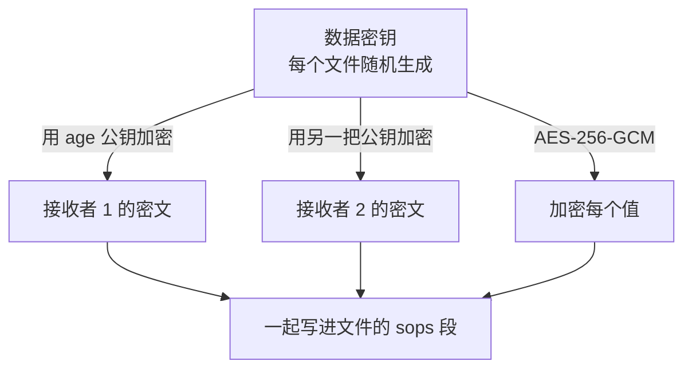

# 密钥管理（SOPS / Vault）

到目前为止，`infra/` 里的代码有两个洞：OpenTofu 需要云厂商的 API 令牌和状态加密口令，Ansible 的 `api.env.j2` 模板需要数据库密码、JWT 密钥、对象存储的 AccessKey。它们不能明文进 Git，可如果不进 Git，「从仓库重建整台机器」就是一句空话。这一章用 SOPS 把密钥加密后和代码放在一起，再讲清它和 Ansible Vault、HashiCorp Vault 这些方案的取舍，以及唯一一把必须存在体系之外的钥匙怎么保管。

## 先回答：为什么不继续在机器上生成

[《部署与 CI/CD》](../deploy-release/)讲过 hatch-counter 现在的做法：模板进仓库，值不进；`gen-env.sh` 在机器上用 `openssl rand` 现生成密码。这个做法的优点是密钥从来不离开那台机器，攻击面极小。

但它和 IaC 有一个根本冲突：**密钥只存在于那台机器上，那台机器就是不可重建的**。设想机器没了，你从备份恢复了 Postgres 的数据卷：

- 数据库里的角色密码是旧的，而新机器上 `gen-env.sh` 生成的是新密码，服务端连不上库
- JWT 密钥换了，所有店主的登录令牌当场失效
- 对象存储的 AccessKey 要重新去控制台建一把

这些都能手工补救，但每一样都是重建时的意外。所以一个想要可重建的系统，密钥必须**存在机器之外的某个地方，并且和代码的版本对应**。选项大致有三类：

| 方案 | 密钥存在哪 | 一个人用的代价 |
|---|---|---|
| 加密文件进 Git（SOPS、Ansible Vault） | 仓库里，密文 | 低：一把私钥，零服务 |
| 密钥管理服务（HashiCorp Vault、OpenBao） | 一个常驻服务 | 高：它本身要部署、备份、解封、高可用 |
| 云厂商的 KMS / Secrets Manager | 云上 | 中：绑定厂商，按调用计费 |
| 密码管理器 CLI（如 1Password 的 `op`） | 密码管理器 | 低到中：依赖第三方服务和订阅 |

一个人、一两台机器，**加密文件进 Git** 几乎总是最合适的：没有新服务要维护，密钥的历史跟着 Git 走，回滚代码时密钥也回到对应版本。

## SOPS 的工作方式

SOPS（Secrets OPerationS）最早由 Mozilla 开发，现在是 CNCF 的项目。它的特点是**只加密值，不加密键**：

```yaml
# 加密前
db_owner_password: 3f9c2a7b1e5d8c04
jwt_secret: 9a1b...

# 加密后（截短示意）
db_owner_password: ENC[AES256_GCM,data:k3Jx...,iv:...,tag:...,type:str]
jwt_secret: ENC[AES256_GCM,data:Qm9v...,iv:...,tag:...,type:str]
sops:
  age:
    - recipient: age1qz...
      enc: |
        -----BEGIN AGE ENCRYPTED FILE-----
        ...
  lastmodified: "2026-11-02T08:00:00Z"
  mac: ENC[AES256_GCM,data:...]
```

键名保持明文带来两个好处：`git diff` 能看出改的是哪个密钥（虽然看不到值）；代码审查时能确认结构没被改坏。文件末尾的 `mac` 保护整份文件的完整性，有人改动或删掉某个键，解密时会报错。

加密用的是**信封加密**：



每个文件有一把随机的数据密钥，值都用它加密；数据密钥本身再用每个接收者的公钥各加密一份。任何一个接收者用自己的私钥解出数据密钥，就能解开整份文件。增加或撤销一个接收者，只需要重新加密数据密钥那一小段，不必重新加密所有值。

接收者的「钥匙」可以是 age、PGP，也可以是云 KMS。一个人用 **age** 最简单：一个文件、一把私钥，没有 PGP 那套信任网的复杂度。

## 动手：age + SOPS

```bash
# 本机跑
brew install sops age

# 生成你的 age 密钥对。SOPS 默认在这个位置找私钥（macOS 上是
# ~/Library/Application Support/sops/age/keys.txt，也可以用 SOPS_AGE_KEY_FILE 指定）
mkdir -p ~/.config/sops/age
age-keygen -o ~/.config/sops/age/keys.txt
# 输出一行 Public key: age1...，这是公钥，可以公开
export SOPS_AGE_KEY_FILE=~/.config/sops/age/keys.txt
```

在仓库里用 `.sops.yaml` 声明哪些文件用哪些钥匙加密：

```yaml
# infra/.sops.yaml
creation_rules:
  # Ansible 的密钥变量
  - path_regex: ansible/group_vars/.*\.sops\.yaml$
    age: >-
      age1qzexamplepublickeyforlaptopxxxxxxxxxxxxxxxxxxxxxxxxxxxx,
      age1qzexamplepublickeyforbackupxxxxxxxxxxxxxxxxxxxxxxxxxxxx
  # OpenTofu 用的云厂商凭证
  - path_regex: tofu/.*\.env$
    age: >-
      age1qzexamplepublickeyforlaptopxxxxxxxxxxxxxxxxxxxxxxxxxxxx,
      age1qzexamplepublickeyforbackupxxxxxxxxxxxxxxxxxxxxxxxxxxxx
```

这里写了两把公钥：一把是日常用的笔记本，一把是**备份钥匙**，私钥离线保存（见下文）。笔记本丢了，用备份钥匙仍能解开所有文件。

创建和编辑密钥文件：

```bash
cd infra

# 生成密码：用 hex，原因见《部署与 CI/CD》——它们要嵌进 postgres:// 连接串
openssl rand -hex 16

# 打开编辑器，保存时自动加密；文件路径匹配 .sops.yaml 的规则
sops edit ansible/group_vars/counter/secrets.sops.yaml
```

在编辑器里写明文：

```yaml
db_owner_password: "<openssl rand -hex 16 的输出>"
db_app_password: "<另一个>"
db_admin_password: "<再一个>"
jwt_secret: "<openssl rand -hex 32 的输出>"
storage_access_key_id: "<对象存储 AccessKey ID>"
storage_access_key_secret: "<对象存储 AccessKey Secret>"
seed_admin_password: "<后台超管初始密码>"
```

保存退出后，磁盘上只有密文。常用命令：

```bash
sops decrypt ansible/group_vars/counter/secrets.sops.yaml   # 解密到标准输出
sops encrypt -i tofu/envs/prod/cloud.env                    # 原地加密一个已有的明文文件
sops updatekeys ansible/group_vars/counter/secrets.sops.yaml  # 改了 .sops.yaml 的接收者后同步
sops rotate -i ansible/group_vars/counter/secrets.sops.yaml   # 换一把新的数据密钥
```

`sops encrypt` / `sops decrypt` / `sops edit` 这组子命令是 3.9 起的写法，旧版本用 `sops -e`、`sops -d` 和直接 `sops 文件名`，网上的教程两种都有。

### 防止明文被提交

最危险的时刻是「先写了明文文件，还没来得及加密就 `git add .`」。两道防线：

```gitignore
# infra/.gitignore
*.dec.yaml
*.plain.*
.terraform/
*.tfstate
*.tfstate.*
tfplan
```

再加一个提交前的检查，确认所有 `*.sops.yaml` 都真的是加密过的（文件里有 `sops:` 段和 `ENC[`）：

```bash
#!/usr/bin/env bash
# infra/scripts/check-encrypted.sh，挂到 pre-commit 或 CI 上
set -euo pipefail
status=0
while IFS= read -r f; do
  if ! grep -q '^sops:' "$f" || ! grep -q 'ENC\[' "$f"; then
    echo "未加密：$f" >&2
    status=1
  fi
done < <(git ls-files '*.sops.yaml' 'infra/tofu/**/*.env')
exit "$status"
```

## 接进 Ansible

上一章的 `ansible.cfg` 已经启用了 `community.sops.sops` 这个 vars 插件。它的效果是：`group_vars` / `host_vars` 下以 `.sops.yaml` 结尾的文件会被自动解密，里面的变量和普通变量一样可用。解密在本机进行，明文只存在于 `ansible-playbook` 进程的内存里。

于是 `api.env.j2` 可以直接引用这些变量，替代 `gen-env.sh` 的工作：

```jinja
{# roles/counter_app/templates/api.env.j2 #}
NODE_ENV=production
PORT=3000
TRUST_PROXY=1

# 迁移用的建表角色（表的 owner）
DATABASE_URL=postgres://counter:{{ db_owner_password }}@postgres:5432/counter
# 业务连接：非 owner，受 RLS 管
APP_DATABASE_URL=postgres://counter_app:{{ db_app_password }}@postgres:5432/counter
# 管理后台
ADMIN_DATABASE_URL=postgres://counter_admin:{{ db_admin_password }}@postgres:5432/counter

JWT_SECRET={{ jwt_secret }}
SEED_ADMIN_PASSWORD={{ seed_admin_password }}

STORAGE_PROVIDER=oss
STORAGE_ACCESS_KEY_ID={{ storage_access_key_id }}
STORAGE_ACCESS_KEY_SECRET={{ storage_access_key_secret }}
```

```jinja
{# roles/counter_app/templates/postgres.env.j2 #}
POSTGRES_USER=counter
POSTGRES_PASSWORD={{ db_owner_password }}
POSTGRES_DB=counter
```

`gen-env.sh` 里特意让 `POSTGRES_PASSWORD` 和 `DATABASE_URL` 共用同一个占位符名，防的是两份文件里的密码对不上。在这里同样的约束由「两个模板引用同一个变量」自然满足，而且一眼就能看出来。

部署文档的第 11 步（给两个应用角色设密码）也可以变成任务。注意 `no_log`，否则密码会出现在 Ansible 的输出里：

```yaml
# roles/counter_app/tasks/roles.yml，在第一次 deploy.sh 跑完迁移后执行
- name: 给应用角色设密码
  ansible.builtin.command:
    cmd: >
      docker compose exec -T postgres
      psql -U counter -d counter -v ON_ERROR_STOP=1
      -c "ALTER ROLE {{ item.role }} LOGIN PASSWORD '{{ item.password }}'"
    chdir: "{{ app_root }}"
  loop:
    - { role: counter_app, password: "{{ db_app_password }}" }
    - { role: counter_admin, password: "{{ db_admin_password }}" }
  loop_control:
    label: "{{ item.role }}"
  no_log: true
  changed_when: true
  tags: [db-roles]
```

`loop_control.label` 让输出里只显示角色名，`no_log` 则保证即使任务失败，错误信息里也不会带出密码。这个任务依赖迁移已经建好了这两个角色，所以单独打标签，在重建流程的特定时刻手工触发（第 6 章的重建手册里会排进去）。

## 接进 OpenTofu

OpenTofu 需要的是环境变量：云厂商的 AccessKey、DNS 的令牌、状态后端的凭证、状态加密口令。把它们写进一个 dotenv 文件并用 SOPS 加密：

```bash
# tofu/envs/prod/cloud.env 加密前的样子（不要提交这个状态）
ALICLOUD_ACCESS_KEY=<...>
ALICLOUD_SECRET_KEY=<...>
CLOUDFLARE_API_TOKEN=<...>
AWS_ACCESS_KEY_ID=<状态桶的 key>
AWS_SECRET_ACCESS_KEY=<状态桶的 secret>
TF_VAR_state_passphrase=<至少 16 个字符>
```

```bash
sops encrypt -i tofu/envs/prod/cloud.env
```

运行 OpenTofu 时用 `sops exec-env` 把它们注入子进程的环境，明文不落盘、不进 shell 历史：

```bash
cd infra/tofu/envs/prod
sops exec-env cloud.env 'tofu plan -out=tfplan'
sops exec-env cloud.env 'tofu apply tfplan'
```

给 OpenTofu 用的云厂商 AccessKey 应该是**专用的子账号**，只授予它要管的那几类资源的权限，和给服务端读写对象存储的那把钥匙分开。《部署与 CI/CD》里「一个消费方一把钥匙」的原则在这里同样适用。

## 唯一一把在体系之外的钥匙

整个体系现在可以从 Git 仓库重建，前提是你手里有 age 私钥。它是**信任的根**，必须存在 IaC 体系之外：

| 存放位置 | 用途 |
|---|---|
| 笔记本上的 `keys.txt` | 日常使用，磁盘要全盘加密 |
| 密码管理器里一条安全笔记 | 换电脑时恢复 |
| 备份钥匙的私钥，打印在纸上或存在离线 U 盘 | 笔记本和密码管理器都失效时的最后手段 |

age 私钥只有一行文本，打印出来完全可行。把备份钥匙的私钥放在一个和笔记本不同的物理位置。每年做一次演练（第 6 章）：在一台干净的机器上只用备份钥匙解开所有文件。

**私钥一旦泄露**，光是换一把新的 age 钥匙并不够：Git 历史里的旧密文仍然能被旧私钥解开。正确的处理是：

1. 生成新的 age 钥匙，更新 `.sops.yaml`，`sops updatekeys` 所有文件
2. **轮换文件里的每一个实际密钥**：数据库密码、JWT 密钥、AccessKey 都换掉
3. 重新跑 Ansible 下发新配置

第 2 步才是关键，也是工作量所在。这也说明了一个通用道理：加密文件进 Git 的方案，安全性最终取决于私钥的保管，而不是加密算法。

## 什么时候需要 Vault

HashiCorp Vault（以及它在许可证变更后的开源分叉 OpenBao）解决的问题比 SOPS 大得多：

- **动态密钥**：应用每次启动向 Vault 申请一个临时的数据库账号，用完自动回收
- **细粒度的访问策略和审计日志**：谁在什么时候读了哪个密钥
- **加密即服务**：应用把数据发给 Vault 加密，自己不碰密钥

这些能力在多人、多服务、有合规审计要求的团队里很有价值。但对一个人来说，Vault 本身就是一个要部署、要备份、重启后要「解封」（unseal）、最好还要高可用的有状态服务。为了管理一台机器上的十几个密钥，再维护一个比应用还复杂的服务，是典型的过度设计。

一个可以参考的判断：当你需要**动态密钥或审计**，或者团队超过几个人、需要按人授权时，再考虑 Vault 或云厂商的 Secrets Manager。在那之前，SOPS 足够。

### 顺便比较 Ansible Vault

Ansible 自带的 `ansible-vault` 也能加密变量文件，不需要额外工具。它和 SOPS 的主要区别：

| | Ansible Vault | SOPS |
|---|---|---|
| 加密粒度 | 整个文件（或单个变量） | 每个值，键名明文 |
| 钥匙 | 一个共享口令 | 多个接收者的公钥，可单独撤销 |
| 谁能用 | 只有 Ansible | OpenTofu、K8s、任意脚本都能用 |
| diff 可读性 | 整个文件变成一团密文 | 能看出哪个键变了 |

本书的密钥要同时给 OpenTofu、Ansible，将来还可能给 K8s（下一章），所以选了跨工具的 SOPS。

## 本章要点

- 「在机器上生成密钥」安全但不可重建；要可重建，密钥必须存在机器之外、并和代码版本对应
- 一个人优先用 **SOPS + age**：只加密值、键名明文，信封加密支持多个接收者
- `.sops.yaml` 写两把公钥：日常一把、离线备份一把；配合 `.gitignore` 和提交前检查防止明文入库
- Ansible 用 `community.sops` vars 插件自动解密，模板直接引用变量；带密码的任务加 `no_log`
- OpenTofu 用 `sops exec-env` 注入环境变量，云 AccessKey 用专用子账号
- age 私钥是**信任的根**，存在体系之外并定期演练；泄露时要轮换的是所有实际密钥
- Vault 适合需要动态密钥、审计、多人授权的场景，一个人通常是过度设计

## 动手练习

在一个临时目录里做，钥匙也生成在这个目录里，不要动 `~/.config/sops/age/keys.txt` 里的日常钥匙。

1. **只用备份钥匙解密**：`age-keygen -o laptop.txt`、`age-keygen -o backup.txt`、`age-keygen -o stranger.txt` 生成三把钥匙。写 `.sops.yaml`，规则 `path_regex: .*\.sops\.yaml$`，接收者填前两把的公钥（`age-keygen -y laptop.txt` 可以从私钥文件打印公钥）。写一个明文的 `secrets.sops.yaml`（两行：`db_password: abc123` 和 `jwt_secret: def456`），`sops encrypt -i secrets.sops.yaml`。然后分别用 `SOPS_AGE_KEY_FILE=backup.txt` 和 `SOPS_AGE_KEY_FILE=stranger.txt` 执行 `sops decrypt secrets.sops.yaml`。

   验证：用 backup.txt 时打印出原来的两行明文；用 stranger.txt 时报错、退出码非 0，提示拿不到解密数据密钥。

   参考答案：数据密钥分别用每个接收者的公钥加密了一份，备份钥匙解得开它那一份，就能解开整个文件；不在接收者列表里的钥匙什么也解不开。这就是「笔记本丢了还能用备份钥匙」的依据。

2. **改坏密文，看 MAC 拦住它**：接上题，用文本编辑器直接打开加密后的 `secrets.sops.yaml`（不要用 `sops edit`），整行删掉 `jwt_secret: ENC[...]`，保存后用 `SOPS_AGE_KEY_FILE=laptop.txt` 执行 `sops decrypt secrets.sops.yaml`。

   验证：解密失败，报错里有 `MAC mismatch`。用 `git diff` 或 `diff` 对比改动前后的文件，能看到键名是明文的，值是密文。

   参考答案：文件末尾的 `mac` 覆盖了所有键和值，任何绕开 SOPS 的增删改都会让校验失败。键名明文方便审查，但改结构必须经过 SOPS。

3. **提交前检查抓住明文**：`git init` 一个仓库，把正文的 `check-encrypted.sh` 存进去（`git ls-files` 那行改成 `git ls-files '*.sops.yaml'`）。新建一个没加密的 `plain.sops.yaml` 并 `git add`，运行脚本；再对它执行 `sops encrypt -i plain.sops.yaml` 后重新 `git add`，再运行。

   验证：第一次输出 `未加密：plain.sops.yaml`，`echo $?` 是 `1`；加密后没有输出，退出码是 `0`。

   参考答案：脚本只检查已被 Git 跟踪的文件里有没有 `sops:` 段和 `ENC[`，所以要先 `git add`。挂到 pre-commit 或 CI 上，就能在明文进入历史之前拦住它。一旦明文进了历史，删文件不够，要按正文的泄露流程轮换里面的每个密钥。
