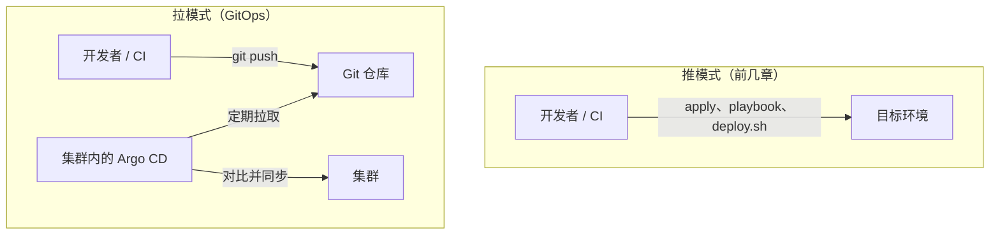
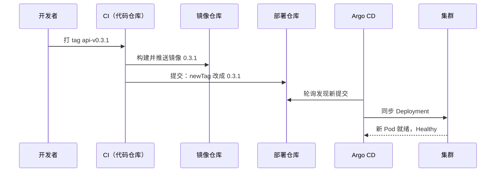

# GitOps 与 Argo CD

前几章处理的是机器：开出来、配好、放上密钥。应用版本则一直交给 `deploy.sh`，由人在机器上敲一条命令。这一章是一条支线：如果将来 hatch-counter 跑到 Kubernetes 上（比如用 k3s 搭的单机集群），应用交付这一层可以换成 **GitOps**：Git 仓库里写着每个应用应该是哪个版本、什么配置，集群里的 Argo CD 持续地把现实拉向 Git。这一章讲 GitOps 的原则、Argo CD 的用法、密钥怎么处理，也讨论不上 K8s 时能借鉴什么。

## GitOps 是什么

GitOps 这个词被用得很宽泛。OpenGitOps 项目（CNCF 下的一个工作组）给了一个比较公认的定义，四条原则：

| 原则 | 含义 | 对应前几章的什么 |
|---|---|---|
| 声明式 | 系统的期望状态用声明式的方式描述 | OpenTofu 的 HCL、K8s 的 YAML |
| 版本化且不可变 | 期望状态存在一个保留完整历史、不可篡改的地方 | Git |
| 自动拉取 | 软件代理自动从那个地方拉取期望状态 | 前几章没有：都是人在本机推 |
| 持续调和 | 代理持续观察实际状态，并让它向期望状态靠拢 | 前几章没有：只在运行命令时对齐一次 |

前两条，OpenTofu 和 Ansible 都满足。区别在后两条：`tofu apply` 和 `ansible-playbook` 都是**人在本机触发、推向目标**的；GitOps 则是**目标环境里的代理主动拉取、并且一直在运行**。



拉模式带来三个实际的好处：

1. **集群的凭证不出集群**：CI 不需要持有生产环境的 kubeconfig，它只需要能往 Git 推提交。攻破 CI 拿不到直接操作生产的权限
2. **漂移会被自动纠正**：有人用 `kubectl edit` 临时改了副本数，Argo CD 会发现并改回去（如果开了自愈）
3. **Git 历史就是部署历史**：回滚等于 `git revert`，「生产上现在是什么」等于「那个分支上现在是什么」

[《部署与 CI/CD》](../deploy-release/)里提到过，hatch-counter 的上线代理 `agent.sh` 定期读下载桶里的指针、变了就切换静态站的版本，这已经是拉模式的思路了，只是期望状态存在对象存储的指针文件里，而不是 Git。

## Argo CD 的模型

Argo CD 运行在集群里，核心概念只有一个：**Application**。它是一个 K8s 自定义资源，回答三个问题：

- **从哪拉**（source）：哪个 Git 仓库、哪个分支、哪个目录
- **部署到哪**（destination）：哪个集群、哪个命名空间
- **怎么同步**（syncPolicy）：自动还是手动、要不要删多余的资源、要不要自愈

Argo CD 对每个 Application 持续计算两个状态：

| 状态 | 取值 | 含义 |
|---|---|---|
| 同步状态 | Synced / OutOfSync | 集群里的资源和 Git 里渲染出来的是否一致 |
| 健康状态 | Healthy / Progressing / Degraded / Missing | 资源本身是否正常工作（Deployment 的 Pod 都就绪了吗） |

两者是独立的：一个 Synced 但 Degraded 的应用，说明 Git 里的配置已经全部生效了，只是这份配置本身有问题（比如镜像起不来）。

## 安装

前提是有一个能用的集群。k3s 的安装、kubectl 的配置见[《Kubernetes 入门到实战》](../kubernetes/)，这里假设 `kubectl get nodes` 已经能看到节点。

```bash
kubectl create namespace argocd
# install.yaml 取 Argo CD 官方仓库 stable 分支下 manifests/install.yaml，
# 生产环境建议钉一个具体的版本标签，而不是跟着 stable 走
kubectl apply -n argocd -f install.yaml

kubectl -n argocd get pods   # 等全部 Running

# 初始 admin 密码
argocd admin initial-password -n argocd

# 不对公网暴露管理界面，用端口转发访问
kubectl port-forward svc/argocd-server -n argocd 8080:443
```

`argocd` 是 Argo CD 的命令行工具，单独安装（`brew install argocd`）。管理界面不要通过 Ingress 挂到公网上：它能改动集群里的一切，对一个人来说端口转发或者走 VPN 足够了。

安装 Argo CD 这件事本身可以交给第 3 章的 Ansible：一个 `k3s` role 装集群，一个 `argocd` role 应用 install.yaml 并创建根 Application。之后的一切都由 Argo CD 从 Git 管理。这是机器层和应用层的交接点。

## 部署仓库的结构

GitOps 需要一个存放 K8s 清单的仓库。常见的选择是**应用代码一个仓库、部署配置一个仓库**：

- CI 在代码仓库里构建镜像，然后往部署仓库提交「把镜像 tag 改成新版本」
- Argo CD 只盯着部署仓库

分开的理由是：部署仓库的每一次提交都对应一次部署，混在代码仓库里，改个 README 也会触发 Argo CD 的同步检查，历史也会被大量和部署无关的提交淹没。一个人用，放在同一个仓库的独立目录里也可以，但要注意 Argo CD 只看指定的路径。

用 Kustomize 组织清单，base 放通用的定义，overlay 放各环境的差异：

```text
counter-deploy/
  apps/
    counter-api/
      base/
        deployment.yaml
        service.yaml
        kustomization.yaml
      overlays/
        prod/
          kustomization.yaml
          sealed-secret.yaml
  argocd/
    root.yaml           # 根 Application：管理下面这些
    counter-api.yaml
```

```yaml
# apps/counter-api/base/deployment.yaml
apiVersion: apps/v1
kind: Deployment
metadata:
  name: counter-api
spec:
  replicas: 1
  selector:
    matchLabels:
      app: counter-api
  template:
    metadata:
      labels:
        app: counter-api
    spec:
      containers:
        - name: api
          image: registry.example.com/counter/api
          ports:
            - containerPort: 3000
          envFrom:
            - secretRef:
                name: counter-api-env
          readinessProbe:
            httpGet:
              path: /v1/health
              port: 3000
```

```yaml
# apps/counter-api/overlays/prod/kustomization.yaml
apiVersion: kustomize.config.k8s.io/v1beta1
kind: Kustomization
namespace: counter
resources:
  - ../../base
  - sealed-secret.yaml
images:
  - name: registry.example.com/counter/api
    newTag: "0.3.0"
```

**镜像 tag 只出现在 overlay 的 `images` 里一处**。发版就是改这一行。

## Application 清单

```yaml
# argocd/counter-api.yaml
apiVersion: argoproj.io/v1alpha1
kind: Application
metadata:
  name: counter-api
  namespace: argocd
  finalizers:
    - resources-finalizer.argocd.argoproj.io
spec:
  project: default
  source:
    repoURL: https://github.com/<you>/counter-deploy.git
    targetRevision: main
    path: apps/counter-api/overlays/prod
  destination:
    server: https://kubernetes.default.svc
    namespace: counter
  syncPolicy:
    automated:
      prune: true
      selfHeal: true
    syncOptions:
      - CreateNamespace=true
```

逐项解释 `syncPolicy`：

- **`automated`**：Git 有新提交就自动同步；不写则只标记 OutOfSync，等人点同步
- **`prune: true`**：Git 里删掉的资源，集群里也删掉。不开的话，删掉的清单会在集群里留成孤儿
- **`selfHeal: true`**：集群里的资源被手工改了，自动改回 Git 的样子。这是「持续调和」的真正体现
- **`finalizers`**：删除这个 Application 时，连带删除它管理的资源；不写则只删 Application 本身，资源留下

Argo CD 默认大约每三分钟轮询一次 Git，也可以在 Git 托管平台上配 webhook 让它立即感知。

### App of Apps

应用多了之后，每个 Application 清单本身也要管理。做法是建一个**根 Application**，它指向 `argocd/` 目录，而这个目录里放的是其他 Application 的清单：

```yaml
# argocd/root.yaml，这是唯一一个需要手工 kubectl apply 的清单
apiVersion: argoproj.io/v1alpha1
kind: Application
metadata:
  name: root
  namespace: argocd
spec:
  project: default
  source:
    repoURL: https://github.com/<you>/counter-deploy.git
    targetRevision: main
    path: argocd
    directory:
      exclude: root.yaml
  destination:
    server: https://kubernetes.default.svc
    namespace: argocd
  syncPolicy:
    automated:
      prune: true
      selfHeal: true
```

从此新增一个应用，就是往 `argocd/` 目录提交一个 Application 清单。整个集群上跑什么，全部可以从部署仓库推导出来。重建集群时，装好 Argo CD、apply 这一个根清单，其余的会自己长回来。

### 私有仓库

部署仓库通常是私有的。给 Argo CD 一个只读的凭证，用带特定标签的 Secret 声明：

```yaml
apiVersion: v1
kind: Secret
metadata:
  name: counter-deploy-repo
  namespace: argocd
  labels:
    argocd.argoproj.io/secret-type: repository
stringData:
  type: git
  url: https://github.com/<you>/counter-deploy.git
  username: git
  password: <只读的访问令牌>
```

这个 Secret 本身也是密钥，不能明文进 Git，见下文。

## 发版流程



CI 修改部署仓库那一步，用 Kustomize 自带的命令即可：

```bash
cd counter-deploy/apps/counter-api/overlays/prod
kustomize edit set image registry.example.com/counter/api:0.3.1
git commit -am "deploy: counter-api 0.3.1"
git push
```

回滚就是把这个提交 revert 掉。Argo CD 也有自己的回滚按钮，但开了自动同步时它会被下一次同步覆盖，**以 Git 为准**是 GitOps 唯一的规矩。

另一个选择是 Argo CD Image Updater：它监视镜像仓库，发现新 tag 就自动改部署仓库。省掉了 CI 那一步，但让「什么时候上线」变得不那么显式，一个人用，CI 显式提交更容易理解和排查。

### 迁移怎么办

hatch-counter 的 `deploy.sh` 有一条铁律：先跑数据库迁移，跑完才起新容器。在 Argo CD 里，这个顺序用 **sync hook** 表达：

```yaml
# apps/counter-api/base/migrate-job.yaml
apiVersion: batch/v1
kind: Job
metadata:
  # 固定名字配合 BeforeHookCreation：每次同步前先删掉上一次的 Job 再建新的。
  # 不用 generateName，Kustomize 处理不了没有固定名字的资源
  name: counter-migrate
  annotations:
    argocd.argoproj.io/hook: PreSync
    argocd.argoproj.io/hook-delete-policy: BeforeHookCreation
spec:
  backoffLimit: 0
  template:
    spec:
      restartPolicy: Never
      containers:
        - name: migrate
          image: registry.example.com/counter/api
          command: ["./node_modules/.bin/tsx", "src/db/migrate-cli.ts"]
          envFrom:
            - secretRef:
                name: counter-api-env
```

`PreSync` 的 Job 在同步其他资源之前运行，失败则整次同步中止，新版本的 Deployment 不会被应用。这和 `deploy.sh` 的顺序语义一致。把这个 Job 也列进 base 的 `kustomization.yaml`，并且同样放进 overlay 的 `images` 替换范围，保证迁移用的镜像和应用是同一个版本。「迁移只能往前、每个迁移都要兼容上一版代码」这条纪律不会因为换了工具而消失。

## GitOps 里的密钥

GitOps 要求一切都在 Git 里，而 K8s 的 Secret 只是 base64 编码，等于明文。三种常见的解法：

| 方案 | 原理 | 一个人用的评价 |
|---|---|---|
| Sealed Secrets | 集群里的控制器持有私钥；你用它的公钥把 Secret 加密成 SealedSecret 提交，控制器在集群里解密 | 简单，不依赖外部服务；私钥在集群里，重建集群要备份它 |
| SOPS + KSOPS / helm-secrets | 沿用第 4 章的 SOPS 文件，给 Argo CD 的 repo-server 装插件来解密 | 和前几章统一用一套钥匙，但要定制 Argo CD 的部署 |
| External Secrets Operator | 集群从外部密钥服务（云 Secrets Manager、Vault）同步 | 需要一个外部密钥服务，一个人通常没有 |

Sealed Secrets 的用法：

```bash
# 在本机生成普通 Secret 的 YAML（不落盘），交给 kubeseal 加密
kubectl create secret generic counter-api-env \
  --namespace counter \
  --from-env-file=<(sops decrypt api.env) \
  --dry-run=client -o yaml \
  | kubeseal --format yaml > apps/counter-api/overlays/prod/sealed-secret.yaml
```

这里把第 4 章的 SOPS 文件作为源头，用 `sops decrypt` 解密后直接管道给 `kubeseal`。SOPS 仍然是密钥的唯一真相，SealedSecret 只是它在集群里的一个投影。用 Sealed Secrets 时务必备份控制器的私钥（它本身是集群里的一个 Secret），否则重建集群后所有 SealedSecret 都解不开。

## 不上 K8s 能借鉴什么

Argo CD 只能管 K8s。hatch-counter 现在的形态是一台机器上的 docker compose，硬上 K8s 换 GitOps 不划算（《Kubernetes 入门到实战》的最后一章专门讨论这个问题）。但 GitOps 的几条思想可以用更轻的方式落地：

- **期望版本写在 Git 里**：把「生产上应该是哪个版本」写成仓库里的一个文件（比如 `infra/versions.yml`），`deploy.sh` 读它而不是读命令行参数。部署历史就是这个文件的 Git 历史
- **拉而不是推**：hatch-counter 的 `agent.sh` 已经是拉模式。同样的方式可以用于服务端：机器上的代理定期检查期望版本，变了就执行 `deploy.sh`
- **`ansible-pull`**：Ansible 自带的拉模式，机器定时从 Git 拉取 playbook 并在本机执行，配合 systemd timer 就是一个简易的持续调和
- **漂移检测**：即使不自动纠正，定期跑 `tofu plan` 和 `ansible-playbook --check`，有差异就告警，也实现了「持续观察」的一半（第 6 章）

要不要做到自动纠正，取决于你多信任自动化。对一个人来说，**自动发现、人工纠正**往往是更稳的平衡点：机器半夜自己改回去的东西，可能正是你白天为了排障临时改的。

## 本章要点

- GitOps 的四条原则：声明式、版本化且不可变、**自动拉取**、**持续调和**；后两条是它和前几章推模式的区别
- 拉模式让集群凭证不出集群、漂移被自动纠正、Git 历史就是部署历史
- Argo CD 的核心是 **Application**：从哪拉、部署到哪、怎么同步；同步状态和健康状态相互独立
- `automated` + `prune` + `selfHeal` 才是完整的持续调和；App of Apps 让整个集群可从一个根清单长出来
- 发版是 CI 往部署仓库提交新 tag；回滚是 `git revert`；迁移用 `PreSync` hook 保证先于新版本
- 密钥用 Sealed Secrets 或 SOPS 插件，SOPS 文件仍是唯一真相
- 不上 K8s 也能借鉴：期望版本进 Git、拉模式代理、`ansible-pull`、定期漂移检测
