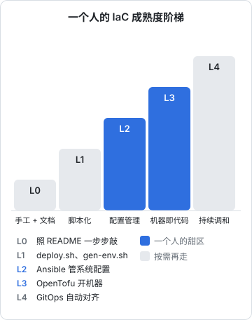
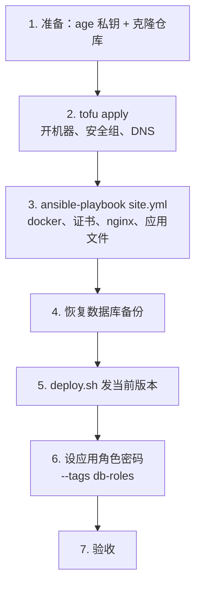

# 一个人的 IaC 落地

前五章把工具一样样摆了出来。最后一章回答一个更实际的问题：一个人、一两台机器、没有专职运维，IaC 该做到什么程度，怎么开始，怎么让它不腐烂。然后把前几章的零件串成一份完整的重建手册，并把它变成一次每年都要做的演练。

## 做到哪一步



| 级别 | 做到了什么 | 能回答的问题 | 维护代价 |
|---|---|---|---|
| L0 手工 + 文档 | 一份照着敲的 README | 「大概怎么搭的」 | 文档会过期 |
| L1 脚本化 | 部署、生成配置有脚本 | 「怎么发版」 | 低 |
| L2 配置管理 | Ansible 描述机器内部，SOPS 管密钥 | 「机器里应该有什么」 | 中：每改一处配置都要回写代码 |
| L3 机器即代码 | OpenTofu 描述云资源 | 「云上应该有什么」 | 中：provider 升级、状态文件维护 |
| L4 持续调和 | GitOps 代理自动对齐 | 「现在和期望一致吗」并自动纠正 | 高：要有 K8s 或自建代理 |

hatch-counter 现在在 L1，而且是做得很好的 L1。本书的建议是走到 **L2，再视情况走到 L3**：

- **L2 收益最大**：机器内部的配置（nginx、systemd、compose 文件、证书续期钩子）是改得最频繁、最容易漂移、重建时最费时间的部分。部署文档的 19 步里，大部分落在这一层
- **L3 看机器数量和换机频率**：只有一台机器、几年才换一次，OpenTofu 带来的主要是安全组和 DNS 的可审计性，以及换云时的便利。机器多于一台、或者经常起测试环境，L3 的价值就明显了
- **L4 只在上了 K8s 时考虑**：为了 GitOps 去上 K8s 是本末倒置

### 从哪开始

对一台已经在跑的机器，顺序很重要：

1. **先 SOPS**：把散落在机器上、密码管理器里、记忆里的密钥收拢成一个加密文件。这一步本身就有价值，哪怕之后什么都不做
2. **再 Ansible，从最常改的 role 开始**：先写 nginx 和 counter_app，在现有机器上跑到 `changed=0`，证明代码和现实一致；base 和 docker 这些「装好就不动」的放后面
3. **最后 OpenTofu，用 `import` 收编**：先收编安全组和 DNS（最常被临时改动、最需要审计的），机器本身最后收编

每一步都要在**现有机器上跑出零差异**之后再往下走。代码和现实不一致时，IaC 不仅没用，还会在你下次运行时把现实改成错的。

## 规矩：不再登上去手改

有了代码之后最大的风险是**双轨**：一部分改动走代码，一部分改动登上机器直接改。后者会制造出比没有 IaC 时更隐蔽的漂移，因为你以为代码是真相。

一个人很难完全杜绝手改，排障时登上去临时调一下参数是常事。可执行的规矩是：

- 排障可以手改，但**事后要么回写进代码，要么跑一次 playbook 把它改回去**
- 手改时在机器上留个记号，比如在改过的文件顶部加一行注释写明日期和原因，下次跑 `--check` 时看到 diff 能想起来
- 每周的漂移检测（下文）兜底

## 漂移检测

每周一次，让机器自己检查代码和现实是否一致：

```bash
#!/usr/bin/env bash
# infra/scripts/drift.sh：每周跑一次，有差异才通知
set -uo pipefail
cd "$(dirname "$0")/.."
report=""

# OpenTofu：-detailed-exitcode 让退出码区分「无变化」和「有变化」
# 0 = 无变化，1 = 出错，2 = 有变化
# 退出码在 exec-env 的子 shell 里直接写进文件，不依赖 sops 是否原样传回
(cd tofu/envs/prod && sops exec-env cloud.env \
  'tofu plan -detailed-exitcode -lock=false -no-color > /tmp/tofu-drift.txt 2>&1; echo $? > /tmp/tofu-drift.rc')
case "$(cat /tmp/tofu-drift.rc 2>/dev/null)" in
  0) ;;
  2) report+="云资源有漂移，见 tofu plan 输出\n" ;;
  *) report+="tofu plan 执行失败\n" ;;
esac

# Ansible：演习模式，统计 changed 的数量
(cd ansible && ansible-playbook site.yml --check > /tmp/ansible-drift.txt 2>&1)
changed=$(grep -oE 'changed=[0-9]+' /tmp/ansible-drift.txt | head -1 | cut -d= -f2)
if [ "${changed:-x}" != "0" ]; then
  report+="系统配置有漂移：changed=${changed:-未知}\n"
fi

if [ -n "$report" ]; then
  printf "%b" "$report"
  exit 1
fi
echo "无漂移"
```

`-lock=false` 让只读的检查不去抢状态锁，避免和你正在进行的 `apply` 冲突。通知怎么发（推送到手机、发邮件），沿用《一人运维手册》里每日检查脚本的通道即可。

这个脚本需要 age 私钥和云凭证才能运行，所以它应该跑在你自己的电脑上（比如用 launchd 或日历提醒每周触发），而不是放到某台服务器上：把能解开所有密钥的私钥放到一台常驻的机器上，等于给整套体系加了一个新的、更脆弱的信任根。

## infra 的 CI

`infra/` 目录的代码同样需要早期反馈。一个人用，CI 只做**不需要任何凭证**的检查：

```yaml
# .github/workflows/infra.yml
name: infra
on:
  pull_request:
    paths: ["infra/**"]
  push:
    branches: [main]
    paths: ["infra/**"]

jobs:
  check:
    runs-on: ubuntu-latest
    steps:
      - uses: actions/checkout@v4

      - uses: opentofu/setup-opentofu@v1

      - name: tofu fmt
        run: tofu fmt -check -recursive infra/tofu

      - name: tofu validate
        working-directory: infra/tofu/envs/prod
        run: |
          tofu init -backend=false
          tofu validate

      - name: ansible-lint
        run: |
          pipx install ansible-lint
          cd infra/ansible
          ansible-galaxy collection install -r requirements.yml
          ansible-lint site.yml

      - name: 密钥文件都已加密
        run: bash infra/scripts/check-encrypted.sh
```

`tofu init -backend=false` 跳过后端连接，`validate` 只检查语法和类型，都不需要云凭证。`plan` 和 `apply` 留在本机执行：要在 CI 里跑 `plan`，就得把云凭证和 age 私钥交给 CI 平台，对一个人来说，这份风险换来的便利不值得。

action 的版本号以各自仓库的最新发布为准。

## 和编码 agent 协作

IaC 代码是 Claude Code 这类编码 agent 很擅长写的东西：HCL 和 Ansible 的写法高度模式化，provider 文档又长又碎，让 agent 去查参数、写初稿，效率很高。但 IaC 也是 agent 最容易造成不可逆后果的地方。几条边界：

| 交给 agent | 留给自己 |
|---|---|
| 写 HCL、role、模板的初稿 | 读 `plan` 输出，决定是否 `apply` |
| 把部署文档的步骤翻译成任务 | 在生产上执行 `apply` 和 playbook |
| 跑 `fmt`、`validate`、`ansible-lint` 并修复 | 持有 age 私钥和云凭证 |
| 在测试环境里跑 `--check` | 删除任何资源 |
| 解释一段 `plan` 输出里每个变更的原因 | 轮换密钥 |

具体做法：

- **agent 的会话里不注入云凭证**：不在它运行的 shell 里 `export` 云厂商的 key，不让它能执行 `sops exec-env`。它能做的最多到 `validate` 和 `ansible-lint`
- **让 agent 产出计划文件，人来执行**：agent 可以说明要跑哪条 `tofu plan` 命令，人在自己的终端里跑、看、决定
- **在项目的 `CLAUDE.md` 里写明**：`infra/` 下禁止执行 `tofu apply`、`tofu destroy`、`sops decrypt`，以及对生产 inventory 的 `ansible-playbook`（不带 `--check` 的）
- **把 `lifecycle { prevent_destroy = true }` 当作最后一道闸**：即使人和 agent 都看漏了，带数据的资源也删不掉

agent 写出的 IaC 代码最常见的问题是**参数过时**：它记得的是某个旧版本 provider 的写法（比如 Cloudflare 4.x 的 `cloudflare_record`）。让它先查当前 provider 版本的文档再写，`validate` 会抓出大部分这类错误。

## 重建手册

把前几章串起来，hatch-counter 的完整重建是这样一份清单。它取代了原来部署文档的第 1–14 步，剩下的（静态站上线、验收）沿用原文档。



```bash
# 1. 准备（本机）
git clone <hatch-counter 仓库> && cd hatch-counter/infra
export SOPS_AGE_KEY_FILE=~/.config/sops/age/keys.txt
sops decrypt ansible/group_vars/counter/secrets.sops.yaml > /dev/null && echo "私钥可用"

# 2. 开机器（本机）
cd tofu/envs/prod
sops exec-env cloud.env 'tofu init'
sops exec-env cloud.env 'tofu plan -out=tfplan'   # 读一遍：应该只有 + 号
sops exec-env cloud.env 'tofu apply tfplan'
cd ../../..

# 3. 配机器（本机）。DNS 生效后证书才能签下来，先确认解析
dig +short api.example.com
cd ansible
ansible-galaxy collection install -r requirements.yml
ansible-playbook site.yml
ansible-playbook site.yml   # 第二遍：应该 changed=0
cd ..

# 4. 恢复数据库（机器上）：按《一人运维手册》备份章节的恢复流程，
#    把最近一次备份恢复进 compose 的 postgres 容器

# 5. 发当前版本（机器上）
ssh counter-prod 'cd /srv/counter && ./deploy.sh <线上当前版本>'

# 6. 应用角色密码（本机）。从备份恢复时角色和密码已随数据回来，
#    这一步主要用于全新的空库
ansible-playbook site.yml --tags db-roles

# 7. 验收：沿用部署文档的验收步骤
```

几个容易被忽略的点：

- **第 2 步之后 DNS 需要时间生效**，第 3 步的证书申请依赖它。旧机器还在时，可以先用 `/etc/hosts` 或者一个临时子域名验证新机器，确认无误再切 DNS
- **第 4 步决定了 RPO**：重建能恢复到什么时间点，取决于最近一次备份。IaC 能重建机器，重建不了数据，备份仍然是《一人运维手册》和《PostgreSQL 运维》的事
- **对象存储桶和镜像仓库不在重建范围内**：它们独立于机器存在，机器没了它们还在。如果它们也用 OpenTofu 管理，要放在一个单独的状态里（比如 `envs/shared/`），并且加 `prevent_destroy`，避免重建机器时连带删掉

## 重建演练

一份没有演练过的重建手册，和第 1 章批评的那份文档没有本质区别：你不知道它现在还能不能用。

每年至少一次，用一个**临时的测试环境**完整走一遍：

1. 复制一份 `envs/prod` 为 `envs/drill`，改名字和子域名（比如 `drill-api.example.com`），`acme_staging: true`
2. 在一台**干净的电脑**或新建的用户账号上，只用备份钥匙和 Git 仓库，执行完整的重建手册
3. 记下每一步的实际耗时和遇到的问题
4. 验收通过后 `tofu destroy` 掉整个测试环境（drill 环境不加 `prevent_destroy`）
5. 把问题修进代码和手册

第一次演练几乎一定会失败，失败的地方就是这份 IaC 里隐藏的手工步骤：某个只在老机器上存在的目录、某个 role 之间没写明的顺序依赖、某个 provider 升级后改了名的参数。这些恰恰是真出事时会卡住你的地方，在平静的日子里发现它们，是演练的全部意义。

演练结果和《一人运维手册》的恢复演练一样，记一份日志：

```text
2026-11 重建演练
- 总耗时：____（目标：____）
- 第 3 步失败：certbot 在 nginx role 之后，新机器上 nginx -t 报证书不存在 → 已调整 site.yml 顺序
- 第 4 步：备份恢复耗时 ____
- 待办：drill 环境的 DNS 记录忘了删，已加进 destroy 前的检查
```

## 让它不腐烂

IaC 代码放着不动也会坏：provider 发布新版本、废弃参数，Ubuntu 换了 LTS，Ansible 的 collection 改了模块名。几条维护习惯：

- **版本都钉住**：`.terraform.lock.hcl` 进 Git，`requirements.yml` 写版本下限，Ubuntu 镜像在 `ignore_changes` 里
- **升级是有意识的动作**：每季度一次，`tofu init -upgrade`、更新 collection，跑一遍 `plan` 和 `--check`，确认零差异再提交
- **跟着演练升级**：大版本升级（provider 的 major、Ubuntu 的 LTS）放在演练环境里先走一遍
- **代码量保持小**：一个人的 IaC 不需要支持多环境、多区域、多租户的抽象。只为一个实际存在的需求写代码，`modules/` 目录里只放真的被复用的东西

## 本章要点

- 一个人的甜区是 **L2 配置管理 + SOPS**，机器多或换得勤再上 **L3 OpenTofu**，L4 只在上了 K8s 时考虑
- 对已有机器按 **SOPS → Ansible → OpenTofu import** 的顺序落地，每一步先在现有机器上跑出零差异
- 最大的风险是双轨；手改之后要回写代码或改回去，每周的**漂移检测**兜底
- infra 的 CI 只做不需要凭证的检查；`plan` / `apply` 留在本机
- 编码 agent 写初稿、跑检查，人读 `plan`、持有密钥、执行生产变更
- 重建手册：私钥 → `tofu apply` → `ansible-playbook` → 恢复备份 → `deploy.sh` → 验收；IaC 重建机器，**数据靠备份**
- 每年在临时环境里完整**演练一次**，失败的地方就是隐藏的手工步骤
- 版本钉住、每季度有意识地升级、代码量保持小

## 接下来读什么

这本书一直在说「不绑死云厂商」，但真正选哪家、怎么选，没有展开。按书架导读的运维路线，接下来建议读《云与边缘》：VPS、Serverless、托管服务怎么取舍，国内云和海外云各自的约束，以及 Cloudflare Workers、R2 这类边缘平台。你会发现其中不少资源（对象存储桶、DNS、Worker 的路由）同样可以用本书的 OpenTofu 来管理。

如果打算把服务搬上 Kubernetes，第 5 章的 Argo CD 部分可以配合《Kubernetes 入门到实战》一起读；如果还没读过《可观测性与性能》，它能补上本书漂移检测之外的另一半：机器配置正确之后，服务本身是否健康。
