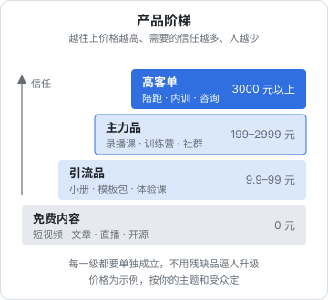
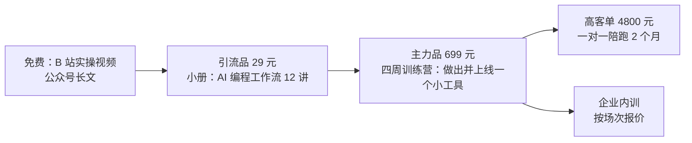

# 知识产品的形态与产品阶梯

「知识付费」这个词把很多完全不同的东西装在了一起：一份 9.9 元的小册、一个 399 元的录播课、一个 1999 元的四周训练营、一年 365 元的付费社群、一小时 800 元的咨询。它们的生产成本、交付压力、能收的价格、适合的人，都不一样。很多人第一次做知识产品失败，不是内容不行，而是**选错了形态**：一个下班只有两小时的人去做需要每天盯群的训练营，或者一个还没有任何粉丝的人去打磨三个月的大课。

这一章先把常见形态拆开，讲每种的价格带、交付成本和适合的人；然后讲怎么把几种形态串成一条**产品阶梯**；最后给一张产品设计画布，开工前填完它。

本书的读者是在职开发者，内容可能是编程、AI 工具、职业发展这类主题。书中的例子都按这个背景来写，价格和数字是示例，不是行情数据。

## 七种常见形态

### 一张总表

| 形态 | 常见价格带（示例） | 生产成本 | 交付成本 | 收入方式 | 最适合的阶段 |
|---|---|---|---|---|---|
| 付费专栏 / 小册 | 9.9–199 元 | 中，持续写 | 低 | 一次性或订阅 | 起步，验证选题 |
| 电子书 / 文档包 | 19–99 元 | 中，一次写完 | 极低 | 一次性 | 有体系化积累时 |
| 模板 / 工具包 | 29–299 元 | 低到中 | 极低 | 一次性 | 有现成的好用资产时 |
| 录播课 | 99–999 元 | 高，一次投入 | 低（答疑除外） | 一次性 | 主题已被验证过 |
| 训练营 | 399–2999 元 | 中 | 高，按期投入 | 按期收费 | 需要带人做出结果的主题 |
| 付费社群 | 99–999 元 / 年 | 低 | 中，持续投入 | 年费 | 有稳定内容输出能力时 |
| 咨询 / 陪跑 | 300–3000 元 / 小时，或按项目 | 低 | 高，卖时间 | 按次或按月 | 有真实专长，愿意卖时间 |

价格带只是让你有个量级概念：同一个主题，个人博主和机构讲师的定价能差好几倍。真正决定价格的是第 7 章讲的「对谁、解决什么问题、拿到什么结果」。定价心理和三档定价的基本方法见[《定价与商业模式》第 3 章](../pricing-monetization/03-pricing-psychology.md)。

### 付费专栏和小册：最轻的起步

专栏是**持续更新**的付费文章合集，读者买的是「接下来一段时间你会持续给我有价值的东西」；小册是**一次写完**的主题合集，读者买的是一个完整话题。

- 好处：不用录视频、不用剪辑，一个人下班写得动；平台（如小报童，见第 6 章）自带支付、阅读和分销，几乎零启动成本
- 难处：文字的单价天花板低；专栏要求持续更新，断更会引来退款和差评
- 适合：**验证选题**。一个主题能不能卖，先写成 9.9–49 元的小册试一试，比直接录课便宜得多

### 电子书、文档包、模板与工具包

这一类是「**一次做完、反复卖**」的数字资产：一份《AI 编程提示词手册》、一套 Notion 项目管理模板、一组 Cursor / Claude Code 的规则文件、一个简历模板包。

- 好处：交付成本几乎为零，没有「什么时候更新」的压力；对技术人来说，做模板和工具包往往比写长文更顺手
- 难处：容易被复制和二次传播；单价低，要么靠量，要么作为引流品或课程赠品
- 关键：**卖的是「省时间」，不是「信息」**。一份提示词清单网上到处都有，但「我实际在用、按场景分好类、每条带使用说明和效果截图」的版本才值钱

### 录播课

一次录完，长期售卖。读者买的是**一个被组织好的学习路径**。

- 好处：边际成本低，一次制作可以卖很久；适合在平台上架、做分销
- 难处：制作成本高（一门 10 小时的课，备课、录制、剪辑往往要上百小时）；**完课率普遍很低**，大部分买家不会看完；没有督促和反馈，学员很难真的学会
- 适合：主题已经通过小册或直播验证过，你已经知道学员卡在哪里

### 训练营

有开营和结营时间，固定节奏推进，有作业、点评、答疑，通常有助教。读者买的是**在一段时间内被带着做出一个结果**。

- 好处：单价高，结果可见，口碑和案例产出快；学员之间互相推动，完课率远高于录播课
- 难处：交付是按期的体力活，开一期就要投入几周；规模受限于你和助教能点评多少作业
- 适合：「学了也不会做」类型的主题，例如「四周用 AI 编程做出并上线一个小工具」

训练营的运营方法是第 4 章的内容。

### 付费社群

一年收一次费，在社群里持续提供内容、答疑和连接。读者买的是**持续的信息、问答和圈子**。

- 好处：年费模式带来可预期的现金流；内容可以碎片化，不需要体系
- 难处：要持续输出，否则续费率会很差；社群规模越大，维护越费劲
- 适合：你本来就在持续学习和输出某个领域（比如每天都在试新的 AI 工具），把这件事收费化

社群日常运营的通用方法见[《国内私域与内容平台》第 7 章](../private-domain-cn/07-community-ops.md)，付费社群特有的部分在第 4 章。

### 咨询和陪跑

一对一，按时间或按项目收费。读者买的是**针对他自己情况的判断**。

- 好处：单价最高、启动最快，不需要任何内容资产；做咨询的过程本身就是最好的需求调研
- 难处：卖的是你的时间，天花板就是你的可用小时数；在职期间时间很碎
- 适合：有明确专长、有人来问；也适合作为高客单产品放在阶梯顶端

咨询的具体做法是第 5 章的内容。按小时、诊断项目、按月顾问的通用定价方式见[《过渡期收入与个人保障》第 3 章](../opc-transition/03-consulting-training.md)。

## 选形态的四个问题

不要从「我想做什么形态」出发，而是从下面四个问题倒推。

**1. 读者要的是信息、路径，还是结果？**

- 要信息（「最近有哪些好用的 AI 编程工具」）→ 专栏、社群
- 要路径（「Python 数据分析从零到能干活该学什么」）→ 录播课、电子书
- 要结果（「我要在一个月内做出一个能上线的小程序」）→ 训练营、陪跑

**2. 你每周能稳定拿出多少时间？**

| 每周可投入 | 可以承担的形态 |
|---|---|
| 3 小时以内 | 小册、模板包、电子书 |
| 3–8 小时 | 加上专栏或小规模付费社群 |
| 8–15 小时 | 加上录播课制作，或每月几次咨询 |
| 15 小时以上，且有连续几周的整块时间 | 训练营 |

在职开发者最常见的错误是**低估训练营的时间投入**：一期 30 人、四周的训练营，每周批改作业、两次直播、群内答疑，十几个小时打不住，赶上项目上线就会交付失控。

**3. 你有没有现成资产？**

已经写过一系列技术文章？整理成小册或电子书。工作中沉淀了好用的脚手架和规则文件？做成工具包。有人经常来请教你同一类问题？那就是咨询或训练营的选题。**从已有资产开始，第一款产品的成本最低。**

**4. 你能接受多大的交付压力？**

录播课卖出去之后基本不用管；训练营卖出去就是一份承诺，开营那几周无论工作多忙都要兑现。副业阶段，**优先选择交付时间可以自己安排的形态**。

## 产品阶梯

单一产品很难撑起一门生意：只卖 9.9 元的小册，要卖几千份才有像样的收入；只卖 3000 元的陪跑，又很难让陌生人第一次就掏这么多钱。产品阶梯就是把不同价位的产品排成一条路，让读者**先用很低的代价体验你，再一步步买更深的服务**。



### 四级

| 层级 | 作用 | 典型形态 | 价格（示例） |
|---|---|---|---|
| 免费内容 | 让人知道你、判断你是否靠谱 | 短视频、公众号文章、直播、开源项目 | 0 |
| 引流品 | 让人第一次付钱，完成从「看客」到「客户」的转变 | 小册、模板包、低价体验课、直播课 | 9.9–99 元 |
| 主力品 | 主要收入来源，解决一个完整问题 | 录播课、训练营、年度社群 | 199–2999 元 |
| 高客单 | 少数人需要的深度服务 | 一对一陪跑、企业内训、项目咨询 | 3000 元以上 |

几个要点：

- **引流品的目的不是赚钱，是筛人和建立信任**。它要让人花很少的钱就拿到一个实实在在的小结果，觉得「这个人的东西靠谱」。引流品做得敷衍，会把阶梯从最下面打断
- **主力品是你认真打磨的东西**，大部分精力放在这里
- **高客单不需要一开始就有**。它往往是主力品的学员主动来问「能不能单独带我」时自然长出来的
- 每一级都要能**单独成立**，不能是「不买下一级就没用」的残缺品。用残缺的低价品逼人升级，是知识付费口碑差的主要原因之一

### 一个例子

一位在职后端开发，在公众号和 B 站分享「用 AI 编程工具提效」的经验，积累了几千个关注。他的阶梯可以这样设计：



- 小册讲方法，读完能把自己的开发流程改一遍
- 训练营带着做，结营时每人有一个上线的作品
- 陪跑给想把作品做成产品、做出收入的少数人
- 企业内训是训练营内容的「团队版」，由学员所在公司来找

### 阶梯怎么连起来

阶梯不会自己连起来，每一级都要有**明确的下一步**：

| 从 | 到 | 怎么连 |
|---|---|---|
| 免费内容 | 引流品 | 内容结尾自然提一句；主页和置顶放入口；不要每条都硬广 |
| 引流品 | 私域 | 小册里留「加入读者群领取配套资料」的入口（导流规则见[《国内私域与内容平台》第 9 章](../private-domain-cn/09-rules-and-bans.md)） |
| 引流品 | 主力品 | 小册最后一讲讲清楚「自己做会卡在哪里」，介绍训练营；给小册读者一个限时的抵扣 |
| 主力品 | 高客单 | 训练营结营时做一次一对一复盘，由此发现需要深度服务的人 |

转化率通常是一级比一级低。具体能到多少，取决于你的内容、受众和价格，**以自己的数据为准**，不要相信「引流品转化 30%」这种没有出处的数字。

## 产品设计画布

开工之前，把下面这张画布填完。填不出来的格子，就是你还没想清楚的地方。

```markdown
## 知识产品设计画布

### 1. 给谁
- 具体是谁：（职业、年限、处境。例：工作 3–8 年的后端开发，想用 AI 提效但只会在网页里聊天）
- 他现在的状态：
- 他想到达的状态：
- 他为什么自己做不到：（缺信息？缺路径？缺督促？缺反馈？）

### 2. 解决什么
- 一句话承诺：（例：四周内，用 AI 编程工具独立做出并上线一个小工具）
- 可检验的结果：（结束时学员手里有什么？能用什么证明？）
- 不解决什么：（明确写出来，避免预期错位）

### 3. 怎么交付
- 形态：（小册 / 录播课 / 训练营 / 社群 / 咨询 / 组合）
- 时长与节奏：
- 包含的服务：（直播几次、作业几次、点评方式、答疑时效、有效期）
- 我每周要投入的时间：

### 4. 卖多少
- 价格：
- 参照物：（读者会拿它和什么比？同类课程、自学的时间成本、请人的费用）
- 这个价格下要卖多少份才值得做：

### 5. 凭什么是我
- 我做过什么相关的事：（真实可验证的经历、作品、数据）
- 已有的信任基础：（粉丝数、内容数、读者反馈）

### 6. 风险
- 如果卖不动，最小的损失是什么：
- 如果卖得太好，我交付得了吗：
- 会不会触碰监管红线：（承诺收入？承诺就业？涉及资质领域？）

### 7. 在阶梯里的位置
- 上一级是什么：
- 下一级是什么：
```

两个最容易出问题的格子：

- **「可检验的结果」**：写成「掌握 AI 编程」是不可检验的，写成「结营时有一个上线可访问的作品，附代码仓库」是可检验的。结果写不清，后面的课程设计、销售页、退款规则全都会含糊
- **「凭什么是我」**：只能写真实的东西。没有大厂背景就不要暗示有，没有学员成果就不要编。第一期的学员成果，就是你下一期的「凭什么是我」

## 监管边界：先知道哪些不能碰

> [!WARNING]
> 本节按截至 2026-11 的《广告法》和 2025-03 前后的平台类目规则（行业媒体转述）整理，可能已调整，以市场监管总局的规定原文和微信小店、抖音等平台规则中心的最新类目规则为准。

做知识产品之前，先知道几条红线。细节和条文见[《自媒体与短剧合规财税》](../media-compliance/)，这里只列出会直接影响产品设计的几条：

- **不能对培训效果做保证性承诺**。《广告法》对教育、培训广告有专门规定，不得对升学、通过考试、获得学历证书或培训效果作出明示或暗示的保证性承诺。「包会」「包就业」「学完月入过万」都在此列
- **学科类校外培训**（面向中小学生的语数外等）受严格限制，不要碰
- **教收入、教变现**的课程风险高，平台审核也在收紧。比如据行业媒体整理，微信小店 2025 年 3 月施行的教育培训类目规则禁止售卖「教授 AI 商业变现」的课程（来源：课堂界转载科汛文章，2025-03-24）。如果你的主题和赚钱相关，把重心放在**技能本身**，而不是收入承诺
- 涉及**医疗、心理、法律、金融投资**等需要资质的领域，没有资质不要做，或只讲通识、不做个案建议

把这些写进画布的「风险」一栏，产品设计阶段就避开，比写完销售页再改便宜得多。

## 本章要点

- 知识产品七种常见形态：专栏小册、电子书、模板工具包、录播课、训练营、付费社群、咨询陪跑，交付成本和价格带差别很大
- 选形态从四个问题倒推：读者要信息、路径还是结果；你每周有多少时间；有什么现成资产；能承受多大交付压力
- 在职阶段优先选交付时间可以自己安排的形态，不要低估训练营的投入
- 产品阶梯：免费内容 → 引流品 → 主力品 → 高客单；引流品的任务是建立信任，每一级都要单独成立
- 开工前填完产品设计画布，「可检验的结果」和「凭什么是我」两格必须写实
- 不承诺效果、不碰学科类培训、谨慎做「教赚钱」的主题、资质领域不越界
