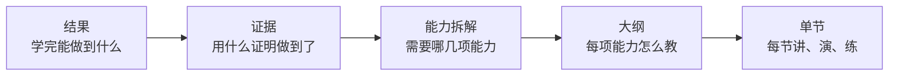

# 课程设计：学习目标、大纲与单节结构

验证过需求之后，才轮到设计课程。很多技术人做课的方式是「把我会的东西按顺序讲一遍」，结果往往是内容很扎实、学员学不会。原因是**讲清楚和学得会是两件事**：前者以内容为中心，后者以学员为中心。

这一章讲一套从结果倒推的课程设计方法：先写学习目标，再拆大纲，然后设计每一节的结构，最后设计作业和反馈。它适用于录播课、训练营和小册，差别只在交付方式。

## 从结果倒推

课程设计的顺序是倒着来的：



先确定终点和验收方式，再决定讲什么。这样做的好处是：**每一节都能回答「这节为什么存在」**。回答不了的内容，哪怕你觉得很重要，也应该删掉或放进附录。

## 写学习目标

### 好的学习目标长什么样

学习目标要用**可观察的动作**来写，而不是「理解」「掌握」「了解」这类看不见的词：

| 不好 | 好 |
|---|---|
| 理解 AI 编程的原理 | 能用一段说明文件让 AI 工具按项目规范生成代码 |
| 掌握 Docker | 能为一个 Node 服务写出 Dockerfile 并在云服务器上跑起来 |
| 了解提示词技巧 | 能把一个模糊需求改写成 AI 能一次做对的任务描述 |
| 学会部署 | 能把小工具部署到一个公网可访问的地址，并配好 HTTPS |

一个检验方法：**目标写完后，问自己「我怎么知道学员做到了」**。答得出来，就是好目标。

### 课程目标和单节目标

- **课程目标** 1–3 条，对应产品设计画布里的「可检验的结果」
- **单节目标** 每节 1–2 条，所有单节目标加起来，要能支撑课程目标

```markdown
## 课程目标
学完这门课，你能：
1. 用 AI 编程工具，从需求描述开始，独立做出一个可用的 Web 小工具
2. 把它部署到公网，有一个能分享给别人的地址
3. 遇到 AI 生成的代码报错时，有一套固定的排查步骤

## 验收方式
提交一个可访问的地址 + 代码仓库 + 一页说明（做了什么、AI 帮了哪些、自己改了哪些）
```

## 拆大纲

### 拆能力，不是拆知识点

把课程目标拆成完成它所需要的几项能力，每项能力对应一个模块。以上面的课程为例：

| 目标 | 需要的能力 | 模块 |
|---|---|---|
| 做出小工具 | 把需求写清楚；让 AI 按规范生成；读懂并修改生成的代码 | 需求与任务描述、AI 协作工作流、代码阅读与修改 |
| 部署上线 | 选平台；配置环境变量和域名 | 部署 |
| 会排错 | 读报错；最小复现；让 AI 帮忙定位 | 排错 |

然后把模块排成学习顺序。原则是：**尽早让学员做出一个能跑的东西**。第一周就跑通一个最简单的版本，后面再逐步加功能、加部署、加排错。这和开发里「先跑通主流程」是同一个道理。

### 大纲模板

```markdown
# 课程名：____

## 基本信息
- 目标学员：
- 入学门槛：（需要会什么、需要准备什么环境）
- 课程目标：（1–3 条，可检验）
- 验收方式：
- 形式与时长：（录播 X 讲 / 训练营 X 周，每周 X 小时）

## 课前准备（第 0 讲）
- 环境清单：
- 自测题：（3–5 题，做不出来的建议先补什么）

## 模块 1：____（对应目标 1）
| 讲 | 单节目标 | 主要内容 | 练习 / 作业 | 时长 |
|---|---|---|---|---|
| 1.1 | | | | |
| 1.2 | | | | |

## 模块 2：____
...

## 结课项目
- 要求：
- 评分标准：
- 提交方式与截止时间：

## 不包含的内容
- （明确列出，避免预期错位）
```

两个容易忽略的部分：

- **第 0 讲（课前准备）**：把试讲中发现的环境问题全部前置。附上每一步的截图和常见报错的处理方法。这一讲做得好，开课第一周的答疑量能少一大半
- **「不包含的内容」**：比如「本课不讲前端框架原理」「不提供一对一远程调试」。写进大纲，后面写进销售页，能减少大量「我以为会讲 X」的退款

### 控制分量

技术人做课最普遍的问题是**内容太多**。一个判断：

- 录播课单讲 10–20 分钟比较合适，超过 30 分钟的拆开
- 训练营每周学员投入 3–5 小时（含作业）是在职人群能坚持的上限，超过这个数，完课率会明显下降
- 写完大纲后，把每讲的预计学习时间加起来，和你承诺的时长对比。超了就砍，砍掉的放进「延伸阅读」

## 单节结构

### 讲、演、练、查

每一节都用同一个结构，学员会很快习惯节奏：

| 环节 | 作用 | 占比参考 |
|---|---|---|
| 开场 | 本节要做成什么，为什么要学这个 | 5% |
| 讲 | 必要的概念，只讲做这件事需要的部分 | 20–30% |
| 演 | 你完整做一遍，包括犯错和修正 | 30–40% |
| 练 | 学员自己做一个类似但不同的任务 | 作业 |
| 查 | 对照清单自查，或提交作业 | 5–10% |

**「演」要包括犯错**。技术课最有价值的部分往往不是顺利的演示，而是「AI 生成的代码跑不起来，我是怎么排查的」。提前彩排到完美无瑕的演示，学员自己做的时候一出错就慌。

### 单节脚本模板

```markdown
## 第 X 讲：____

### 本节目标
- 学完你能：

### 开场（1 分钟）
- 上一讲我们做到了：
- 这一讲做完，你的项目会多出：（展示最终效果）

### 讲（3–5 分钟）
- 概念 1：一句话解释 + 一个类比
- 概念 2：
- 只讲到这里，其他的放在文末延伸阅读

### 演（5–10 分钟）
- 步骤 1：
- 步骤 2：
- 故意保留的一个错误：（错误现象、排查过程、修复方法）

### 练
- 任务：（和演示类似但不同）
- 提示：（卡住时看）
- 参考答案：（放在下一讲或单独文件）

### 查
- 自查清单：
  - [ ] 
  - [ ] 
- 常见问题：
```

### 录播课的制作要点

- **先写稿，再录**。逐字稿太僵硬的话，至少写到每一步要说的要点和要操作的步骤
- 录屏时调大字号、关掉通知、清理桌面；代码编辑器字号建议调到在手机上也能看清
- 每讲开头 30 秒内展示本讲最终效果
- 版本问题：在课程开头写明录制时使用的工具版本，**工具更新导致界面变化时，及时补录或补充说明**。AI 编程工具几个月就会大改一次界面，这是技术课的特有维护成本，在定价和有效期上要考虑进去
- 剪辑、字幕、设备等制作细节见[《拍摄与剪辑实务》](../shooting-editing/)

## 作业与反馈

作业和反馈是学员「学会」的关键，也是你和免费内容拉开差距的地方。免费教程到处都有，**有人看你的作业并告诉你哪里不对**才是付费的理由。

### 作业设计原则

- **每份作业对应一个单节目标**，完成作业就是达成目标的证据
- **有明确的提交物**：一个链接、一张截图、一段代码，而不是「练习一下」
- **难度递进**：前两份作业要让几乎所有人都能完成，建立信心；最后的结课项目才是真正的挑战
- **作业之间有延续**：最好每份作业都是在同一个项目上加东西，结营时自然得到一个完整作品
- **允许选择题目**：给两三个可选的项目方向，学员做和自己相关的东西更有动力

### 作业说明模板

```markdown
## 作业 X：____

**目标**：完成后你的项目将能 ____
**提交物**：
- [ ] 可访问的链接或截图
- [ ] 一段说明：遇到了什么问题，怎么解决的
**截止时间**：周 X 晚上 22:00
**预计用时**：1–2 小时
**合格标准**：
- [ ] ____
- [ ] ____
**加分项（可选）**：
- ____
**卡住了怎么办**：先看本讲「常见问题」，再在群里按模板提问
```

### 点评怎么写

点评要具体、可执行，而且要能在合理时间内写完。一个三段式模板：

```text
【做得好的】
部署成功了，并且你自己加了一个加载状态，这一点很多人没想到。

【需要改的】
API Key 写在了前端代码里，打开浏览器开发者工具就能看到。
改法：移到服务端，通过环境变量读取，参考第 3.2 讲的演示。

【下一步】
改好之后，试试给接口加一个简单的频率限制，下一讲会用到。
```

点评的工作量是训练营规模的天花板。粗算一下：每份作业点评 10 分钟，30 人一期、每周一份作业，每周就是 5 小时。所以：

- 提前写好**常见问题的点评片段**，相同问题直接复用并补充针对性的一两句
- 用**合格标准清单**快速判断，合格的简短点评，不合格的详细点评
- 规模扩大后引入助教，见第 4 章
- 可以用 AI 辅助生成点评初稿，但**你必须亲自看过并修改**。学员付钱买的是你的判断，把 AI 生成的点评原样发出去，一旦被发现会严重伤害信任

## 课程设计检查清单

开课（或上架）之前，过一遍：

```markdown
## 课程设计检查

### 目标
- [ ] 课程目标 1–3 条，用可观察的动作描述
- [ ] 有明确的验收方式
- [ ] 每一讲都能说出它支撑哪条目标

### 大纲
- [ ] 第 0 讲覆盖了试讲中发现的所有环境问题
- [ ] 第一周就能做出一个能跑的东西
- [ ] 每周学员投入不超过承诺的时长
- [ ] 写明了「不包含的内容」
- [ ] 写明了录制时的工具版本

### 单节
- [ ] 每讲都有本节目标、演示、练习和自查清单
- [ ] 演示中包含至少一次犯错和排查

### 作业
- [ ] 每份作业有明确的提交物和合格标准
- [ ] 前两份作业几乎人人能完成
- [ ] 作业之间有延续，结营能得到完整作品
- [ ] 算过点评工作量，在我能承受的范围内

### 合规
- [ ] 课程目标和宣传里没有保证效果、保证收入、保证就业的表述
- [ ] 使用的素材、代码、图片有授权或是自己做的
```

素材、字体、音乐的版权问题见[《自媒体与短剧合规财税》](../media-compliance/)。

## 本章要点

- 课程设计从结果倒推：结果 → 证据 → 能力拆解 → 大纲 → 单节
- 学习目标用可观察的动作写，检验方法是「我怎么知道学员做到了」
- 按能力拆模块，尽早让学员做出能跑的东西；第 0 讲把环境问题前置，大纲写明不包含的内容
- 控制分量：在职学员每周投入 3–5 小时是上限，超了就砍
- 每节用「讲、演、练、查」的结构，演示里保留犯错和排查
- 作业有明确提交物和合格标准，前易后难，彼此延续；点评用三段式，算清工作量，AI 辅助的点评必须亲自改过
