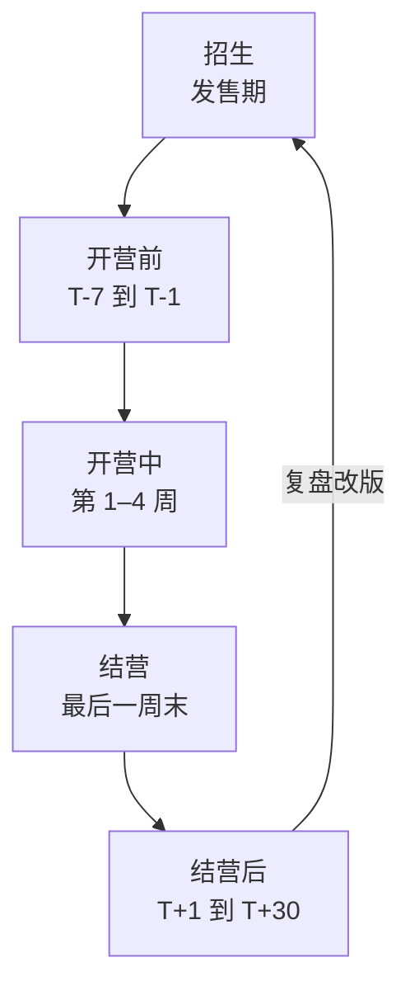

# 训练营与付费社群运营

训练营和付费社群都是「持续交付」的产品：卖出去只是开始，真正的工作在后面几周甚至一整年。它们的口碑几乎完全取决于运营，而不是内容本身。同样一份课件，一个有节奏、有反馈、有人催的训练营，完课率可以比放进网盘自学高得多。

这一章讲训练营的完整 SOP（开营前、开营中、结营后）、四周运营日历、助教的分工和管理、完课率怎么提，以及付费社群和普通社群不一样的地方。群规、新人进群、冷场处理这些通用社群方法见[《国内私域与内容平台》第 7 章](../private-domain-cn/07-community-ops.md)，这里不重复。

## 训练营的全周期



每一期都按同一套 SOP 走，第二期开始就会轻松很多。

## 开营前 SOP

开营前一周是最容易被忽略、又最影响体验的阶段。学员付完钱后的这几天，如果没人理，焦虑和后悔会开始累积。

| 时间 | 动作 | 说明 |
|---|---|---|
| 付款后 24 小时内 | 发欢迎消息，拉进学员群（或告知开营时间再拉） | 告诉他接下来会发生什么 |
| T-7 | 发课前准备清单（第 0 讲） | 环境配置、账号注册、自测题 |
| T-5 | 收集学员信息问卷 | 背景、目标、每周可投入时间、想做的项目方向 |
| T-3 | 根据问卷分组，安排助教 | 按项目方向或基础分组 |
| T-2 | 检查谁还没完成环境配置，单独提醒 | 环境问题必须在开营前解决 |
| T-1 | 发开营通知：时间、链接、要准备什么 | 提前 1 天和开营前 1 小时各提醒一次 |

### 欢迎消息模板

```text
你好，欢迎加入「AI 编程四周实战营」第 3 期！

接下来的安排：
- 12 月 1 日（周一）晚 8 点开营直播，链接会提前一天发
- 开营前请完成课前准备（链接），大约需要 1 小时
- 11 月 28 日前请填一下这份问卷（链接），我会根据你的情况分组

有任何问题直接回复我。开营前的环境问题，越早提越好解决。
```

### 学员信息问卷

```markdown
1. 你现在的工作是？（开发 / 产品 / 设计 / 学生 / 其他）
2. 编程经验：（没有 / 一年以内 / 1–3 年 / 3 年以上）
3. 用过哪些 AI 编程工具？
4. 这四周你每周大概能投入多少小时？
5. 你想做一个什么样的小工具？（可以先不确定）
6. 结营时你希望自己做到什么？
7. 有什么担心的地方？
```

第 4 题和第 7 题最重要：时间很少的人，提前告诉他哪些是必做、哪些可以跳过；担心「基础太差」的人，安排基础相近的同组。

## 开营中 SOP

### 每周的固定节奏

| 日 | 动作 | 负责 |
|---|---|---|
| 周一 | 发本周学习内容和作业；晚上直播讲解（可回放） | 主讲 |
| 周二 | 群内答疑；发一条「本周常见问题」 | 助教 |
| 周三 | 提醒作业进度；私聊未开始的学员 | 助教 |
| 周四 | 晚上答疑直播或小组讨论（可选） | 主讲 / 助教 |
| 周五 | 作业截止前提醒 | 助教 |
| 周六 | 作业截止（如晚 10 点） | — |
| 周日 | 点评作业；发本周优秀作业展示；统计完成情况 | 主讲 + 助教 |

节奏的关键是**固定**。学员知道每周一有新内容、周六交作业、周日有点评，形成习惯后，执行率会明显提高。在职学员周末时间多，作业截止放在周六晚或周日晚比较合适。

### 群内答疑规则

训练营群和普通社群最大的区别，是**问题量集中、时效要求高**。几条规则：

- **提问模板**：要求按模板提问，能省掉一半来回

```text
【我在做】第 2 周作业，部署到云平台
【我做了什么】按 2.3 讲的步骤，配置了环境变量，执行了部署命令
【出现了什么】页面打开显示 500 错误（附截图 / 日志）
【我试过】检查了环境变量名，和教程一致
```

- **答疑时效**：写明响应时间，比如「工作日晚 8–10 点、周末白天集中回复，其他时间看到会回」。不承诺做不到的「秒回」
- **相同问题汇总**：每天把重复的问题整理成一条「常见问题」，置顶或发到文档里
- **鼓励学员互答**：先回答的学员公开感谢。学员之间互相帮助，是训练营最好的状态

### 每周数据表

每周日统计一次，用一张表就够。下面是其中五列：

| 学员 | 分组 | 直播出席 | 最近一次发言 | 状态 |
|---|---|---|---|---|
| A | 1 组 | 2/2 | 周日 | 正常 |
| B | 1 组 | 1/2 | 上周三 | 需跟进 |
| C | 2 组 | 0/2 | 未发言 | 重点跟进 |

完整的九列模板（含第 1–3 周作业和第 4 周项目），复制到表格软件里用：

```csv
学员,分组,第 1 周作业,第 2 周作业,第 3 周作业,第 4 周项目,直播出席,最近一次发言,状态
A,1 组,合格,合格,,,2/2,周日,正常
B,1 组,合格,未交,,,1/2,上周三,需跟进
C,2 组,未交,未交,,,0/2,未发言,重点跟进
```

「状态」一栏决定下周助教要私聊谁。

## 四周运营日历

下面是一个四周训练营的完整日历，可以直接改成你的：

| 周 | 主题 | 内容和作业 | 运营重点 |
|---|---|---|---|
| 第 0 周 | 课前准备 | 环境配置、自测题、信息问卷 | 确保每个人环境跑通；分组 |
| 第 1 周 | 跑通最小版本 | 需求描述、AI 协作工作流；作业：做出一个本地能跑的最简版本 | **建立信心**：第一份作业要让 90% 的人完成；展示所有人的第一个作品 |
| 第 2 周 | 加功能 | 读懂和修改生成的代码；作业：加两个功能 | 第一个流失高峰，重点跟进未交作业的人 |
| 第 3 周 | 部署上线 | 部署、域名、环境变量；作业：上线一个可访问的地址 | 难度最高的一周，加一次答疑直播 |
| 第 4 周 | 打磨和展示 | 排错、优化；结课项目 | 结营展示会；收集反馈和案例授权 |
| 结营后 | 复盘 | — | 一对一复盘、问卷、转化下一步 |

几个时间点要特别注意：

- **第 2 周中**：新鲜感消退，第一个流失高峰。主动私聊作业没交的人，问「卡在哪里」，而不是「怎么还没交」
- **第 3 周**：最难的一周。提前在第 2 周末预告「下周是最难的一周，大家可能会卡，这是正常的」，降低挫败感
- **结营前三天**：提醒结课项目，展示已提交的作品，让还没做的人看到「别人都做出来了」

## 助教

### 什么时候需要助教

一个人能带多少学员，取决于每周你能花多少时间在答疑和点评上。粗算：

> 每周所需小时 = 学员数 ×（每份作业点评分钟 + 每人每周答疑分钟）÷ 60

比如 30 人、每份作业点评 10 分钟、每人每周平均答疑 10 分钟，就是每周 10 小时，再加上两次直播的准备和讲解，在职状态下很难长期撑住。**超过 20–30 人，或者算出来超过你可用时间的一半，就该考虑助教**。

### 助教从哪里来

最好的助教来源是**上一期的优秀学员**：

- 他们走过一遍完整流程，知道学员会卡在哪
- 他们认可这门课，沟通成本低
- 对他们自己来说，当助教是巩固和展示能力的机会

报酬方式可以是固定费用、按学员人数提成，或者免费参加下一期进阶课程。**无论哪种，事先写清楚、按约支付**。长期合作的话，签一份简单的协议，写明职责、报酬、保密和学员信息的使用边界。

### 助教的职责边界

| 助教做 | 助教不做 |
|---|---|
| 群内日常答疑（按常见问题库） | 承诺退款、改价、延期等需要主讲决定的事 |
| 作业初审：合格 / 不合格 + 常见问题点评 | 结课项目的最终评定 |
| 跟进未交作业的学员 | 私下向学员推销其他产品 |
| 整理每周常见问题和数据表 | 把学员信息带出训练营 |
| 发提醒和通知 | 处理投诉（转给主讲） |

### 助教手册

给助教一份手册，至少包括：每周节奏表、常见问题和标准回答、点评模板和合格标准、什么情况必须转给你、学员信息保护要求。手册在每期结束后根据实际情况更新。

## 完课率

### 怎么定义

先定义清楚再去提高：

- **到课率**：参加直播或看完当周内容的比例
- **作业完成率**：按时提交合格作业的比例
- **完课率**：完成结课项目（或全部必做作业）的比例

对训练营来说，最有意义的是**完课率**，因为它直接对应「拿到结果」。每期都记录这三个数，看趋势比看单个数字更有用。

### 提高完课率的做法

完课率低的原因通常是三个：**太难、太多、没人管**。对应的做法：

| 原因 | 做法 |
|---|---|
| 太难 | 第 0 讲解决环境问题；第一份作业保证人人能完成；分级作业（必做 + 选做） |
| 太多 | 每周投入控制在 3–5 小时；明确标出可以跳过的内容 |
| 没人管 | 固定节奏；小组制（5–8 人一组，组内互相提醒）；每周私聊落后学员 |
| 没有反馈 | 每份作业都有点评；每周展示优秀作业 |
| 看不到进展 | 作业彼此延续，学员能看到自己的项目一周比一周完整 |

不建议用「押金返还」「完课退费」这类机制：它们的合规和财务处理都比较复杂，也容易引发纠纷。用设计和运营来提高完课率，比用金钱激励更可持续。

### 落后学员的私聊

```text
你好，看到这周的作业还没提交，想问问是遇到什么问题了吗？
如果是卡在某一步，把截图发我，我帮你看看。
如果是这周工作太忙，也完全没关系，下周的作业是在这周基础上做的，
我可以告诉你哪几步是必须的、哪些可以先跳过。
```

语气是关心，不是催。很多人不交作业是因为卡住了又不好意思问。

## 付费社群

付费社群（例如知识星球上的付费星球，平台对比见第 6 章）和训练营不同：它没有明确的终点，学员买的是一年的持续价值。它的核心指标是**续费率**。

### 付费社群和免费群的区别

| 方面 | 免费群 | 付费社群 |
|---|---|---|
| 成员预期 | 有就看，没有也无所谓 | 我付了钱，要看到持续的价值 |
| 内容 | 随意 | 需要稳定的更新节奏和质量 |
| 答疑 | 尽力而为 | 有明确的承诺（如「提问 48 小时内回复」） |
| 退出 | 随时退群 | 涉及退款规则 |
| 关键指标 | 活跃度 | 续费率 |

### 付费社群的内容日历

用一个固定的周节奏，保证每周都有「值回票价」的东西：

| 时间 | 内容 | 示例 |
|---|---|---|
| 每周一 | 本周动态 | 本周 AI 编程工具的重要更新，附上我自己的试用结论 |
| 每周三 | 一篇实操 | 一个完整的实践记录：用什么工具做了什么，踩了什么坑 |
| 每周五 | 问答汇总 | 本周成员提问的精选回答 |
| 每月一次 | 直播或专题 | 一个主题的深度分享，或成员作品点评 |
| 每季度一次 | 精华整理 | 把这一季度的内容整理成一份目录或小册 |

**内容日历要可持续**。宁可每周两次稳定更新，也不要第一个月每天更新、第三个月断更。断更是付费社群差评和续费率低的头号原因。

### 提问的承诺

付费社群里，成员的提问是否被认真回答，直接决定他觉得值不值。写明规则：

- 回复时效（如 48 小时内）
- 回答的范围（「本星球主题相关的问题」，避免变成免费的私人技术支持）
- 什么情况不回答（与主题无关、需要大量时间的个案调试，可以建议走咨询）

### 续费

- **到期前一个月**开始提醒，附上这一年的内容回顾：发了多少篇内容、回答了多少问题、举办了几次直播。让成员看到自己得到了什么
- 给老成员续费优惠，是对忠诚的回报，也符合公平感（见[《定价与商业模式》第 3 章](../pricing-monetization/03-pricing-psychology.md)）
- 看**谁没续费**并问原因，和第 2 章访谈未下单的人是同一个方法

## 学员信息的保护

训练营和社群会收集学员的姓名、联系方式、工作、作品等信息。基本要求：

- 只收集运营必需的信息，问卷里说明用途
- 不在群内公开学员的个人信息；展示作业时征得同意，必要时隐去姓名
- 助教只在训练营期间使用学员信息，结束后不保留、不带走
- 案例和截图用于宣传，必须事先征得本人同意

个人信息保护的法律要求见[《国内私域与内容平台》第 9 章](../private-domain-cn/09-rules-and-bans.md)和[《自媒体与短剧合规财税》](../media-compliance/)。

## 本章要点

- 训练营按「开营前、开营中、结营、结营后」的 SOP 走，每期复用、每期迭代
- 开营前一周决定第一印象：24 小时内欢迎、课前准备、信息问卷、分组、环境检查
- 开营中用固定的周节奏；按模板提问；每周一张数据表决定跟进谁
- 第 2 周是流失高峰、第 3 周最难，提前预告并加强跟进
- 用公式估算每周工作量，超出可用时间一半就引入助教；优秀学员是最好的助教来源，职责边界写进手册
- 完课率低的原因是太难、太多、没人管；用设计和运营解决，不用押金返还
- 付费社群看续费率：稳定可持续的内容日历、明确的提问承诺、到期前回顾一年的价值
