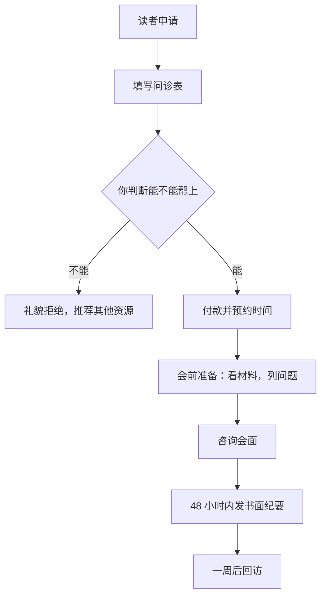

# 1 对 1 咨询与陪跑

一对一是知识产品里启动最快、单价最高的形态：不需要录课，不需要粉丝基础很大，有人愿意为你的判断付钱就能开始。它也是最好的需求调研：每一次咨询，你都能听到一个真实的人遇到的真实问题，这些问题会变成你下一门课的大纲。

但一对一卖的是你的时间，做不好会变成「免费技术支持」或者「无限期保姆」。这一章讲两种一对一产品：**单次咨询**和**陪跑**，各自的流程、模板和边界。按小时定价、诊断项目、按月顾问这几种通用的咨询定价方式，《过渡期收入与个人保障》第 3 章已经讲过，这里只讲知识博主场景下怎么做。

## 两种产品的区别

| 方面 | 单次咨询 | 陪跑 |
|---|---|---|
| 解决什么 | 一个具体问题的判断 | 一段时间内带着做出一个结果 |
| 时长 | 一次 60–90 分钟 | 4–12 周，多次会面 + 日常沟通 |
| 读者买的是 | 你的经验和判断 | 你的判断 + 督促 + 及时反馈 |
| 价格（示例） | 几百到几千元一次 | 几千到几万元一期 |
| 你的投入 | 可预测 | 不容易预测，需要边界 |
| 适合放在阶梯的 | 引流品或主力品旁边 | 高客单 |

在职阶段，**单次咨询更容易管理**；陪跑要先想清楚每周能拿出多少时间，同时最多带几个人。

## 单次咨询

### 卖什么：把咨询变成「产品」

「有问题都可以来问我」不是一个好产品，读者不知道该问什么，也不知道值不值。把咨询包装成**有明确范围的几个选项**：

| 咨询项目 | 适合谁 | 你给出什么 | 时长 |
|---|---|---|---|
| AI 编程工作流诊断 | 想用 AI 提效但用得不顺的开发者 | 看他的项目和用法，给出改进清单 | 60 分钟 + 书面纪要 |
| 副业项目评估 | 想做个小产品但不确定方向的人 | 对 1–2 个想法的可行性判断和下一步建议 | 60 分钟 + 书面纪要 |
| 技术路线咨询 | 小团队的技术负责人 | 技术选型建议和风险提示 | 90 分钟 + 书面纪要 |

每个项目写清楚：适合谁、不适合谁、会得到什么、需要提前准备什么。

### 咨询流程



**「先问诊再收款」是最重要的一步**。它筛掉了你帮不上的人，也让付款的人对结果有合理预期。

### 问诊表

```markdown
## 咨询申请表

1. 你想咨询的项目：（从上面的列表中选）
2. 你现在的情况：（工作、背景、相关经验，3–5 句话）
3. 你遇到的具体问题是什么？（越具体越好）
4. 你已经尝试过什么？结果如何？
5. 这次咨询之后，你希望得到什么？（一个判断？一份清单？一个方案？）
6. 有没有相关材料可以提前给我看？（代码仓库、产品链接、文档）
7. 方便的时间段：

提交后我会在 2 个工作日内回复。如果判断我帮不上，会直接告诉你并尽量推荐更合适的资源，不收任何费用。
```

### 会面结构

一次 60 分钟的咨询：

| 时间 | 环节 | 要点 |
|---|---|---|
| 0–5 分钟 | 确认目标 | 「今天结束时，你希望带走什么？」把答案写下来 |
| 5–20 分钟 | 澄清情况 | 你问，他答。重点问问诊表里没说清的地方 |
| 20–45 分钟 | 分析和建议 | 你的判断、理由、可选方案和各自的代价 |
| 45–55 分钟 | 下一步 | 一起定出 3 件最重要的下一步，按优先级排 |
| 55–60 分钟 | 收尾 | 确认目标是否达成；说明纪要什么时候发 |

几个原则：

- **说判断，也说理由**。读者付钱买的是判断，但只有判断没有理由，他下次遇到类似问题还是不会
- **说清楚你不确定的地方**。「这一点我没有一手经验，我的推测是……建议你再找做过的人确认」比装作什么都懂更有价值
- **不当场写代码、不远程调试**。咨询是给判断，不是代做。代做是另一种服务，另外报价

### 书面纪要模板

纪要是咨询的「交付物」，让读者觉得这次咨询有实物留存，也方便他之后回顾。

```markdown
## 咨询纪要：____（日期）

### 你的问题
（用一两句话复述）

### 我的判断
1. ____
   - 理由：
2. ____
   - 理由：

### 可选方案
| 方案 | 好处 | 代价 | 适合的情况 |
|---|---|---|---|
| A | | | |
| B | | | |

### 建议的下一步（按优先级）
1. ____（本周内）
2. ____（两周内）
3. ____（一个月内）

### 推荐资源
- ____

### 我不确定的地方
- ____

一周后我会发消息问问进展。有简短的跟进问题可以直接发我，一周内免费回复。
```

最后一句是一个小承诺：**一周内的跟进问题免费回复**。它大大提高了满意度，代价通常很小。但要写明「简短的跟进问题」，避免变成第二次免费咨询。

### 一周后回访

```text
你好，上周咨询之后，第一步「____」进展怎么样？
有遇到什么新问题吗？
```

回访的价值不只是服务：**它能告诉你你的建议到底有没有用**。把回访结果记下来，积累几十次之后，你就知道哪些建议是真正有效的，这些会变成你的课程内容。

## 陪跑

陪跑是在一段时间内，持续带着一个人（或一个小团队）做出一个结果。它是产品阶梯顶端的高客单产品，适合训练营里想走得更远的学员。

### 设计陪跑产品

陪跑最大的风险是**范围无限扩大**：从「带你做出一个小工具」变成「帮你解决一切问题」。设计时用里程碑把范围钉死：

```markdown
## 陪跑方案：____

### 目标
8 周内，把你的小工具从原型做成一个有付费用户的产品

### 里程碑
| 周 | 里程碑 | 验收标准 |
|---|---|---|
| 1–2 | 明确用户和核心功能 | 写出一页产品说明；访谈 5 位潜在用户 |
| 3–4 | 做出可用的 MVP | 核心功能可用，部署上线 |
| 5–6 | 接入支付，找到首批用户 | 支付流程跑通；10 位试用用户 |
| 7–8 | 第一笔收入和复盘 | 至少 1 位付费用户；写出下一阶段计划 |

### 包含
- 每周一次 45 分钟视频会议（共 8 次）
- 工作日文字答疑，24 小时内回复
- 每个里程碑的书面反馈

### 不包含
- 代写代码、远程操作你的电脑
- 里程碑以外的新项目
- 保证收入或用户数（结果取决于你的执行和市场）

### 价格和付款
- ____ 元，分两次付：开始前付 50%，第 4 周结束付 50%
- 退款：第 1 次会议后不满意可全额退；之后按未进行的会议次数比例退
```

两个要点：

- **「不包含」里写「不保证结果」**。陪跑的结果取决于学员自己的执行和市场，承诺收入或用户数既做不到，也越过了广告和宣传的红线
- **分阶段付款**降低双方的风险，学员更容易下决心，你也不会因为一次性收了全款而感到被绑架

### 陪跑的节奏

| 环节 | 频率 | 内容 |
|---|---|---|
| 周会 | 每周一次 | 回顾上周、解决卡点、定下周任务 |
| 周报 | 每周会前 | 学员提交：本周做了什么、遇到什么问题、下周计划 |
| 日常答疑 | 工作日 | 文字为主，你集中时间回复 |
| 里程碑评审 | 每两周 | 对照验收标准，书面反馈 |

**要求学员会前提交周报**。这能让周会直接进入正题，也能看出学员的投入程度。连续两周没有周报，就要坦诚聊一次：是时间不够还是目标需要调整。

### 学员不推进怎么办

陪跑最难受的情况是学员自己不动。几个处理方式：

- 每周会议结束时，让学员**自己说出**下周要做的三件事，并写进纪要
- 连续两周任务没完成，问清原因：是任务太大、时间不够，还是失去了兴趣
- 合同里写明：因学员原因错过的会议**不顺延**（或最多顺延一次），避免陪跑无限期拖下去
- 如果确实无法继续，按规则退还未进行部分的费用，好聚好散

## 时间管理和边界

一对一产品最容易侵蚀你的时间。在职状态下尤其要守住边界：

| 边界 | 做法 |
|---|---|
| 预约时间 | 只开放固定的时间段（如每周二、四晚上），用预约工具或日历链接让对方选 |
| 回复时间 | 写明「工作日晚上集中回复」，不在上班时间回复 |
| 同时进行的陪跑数 | 设一个上限，比如同时最多 2 位 |
| 免费咨询 | 公开内容里的提问可以简短回答；需要看材料、个案分析的，引导到付费咨询 |
| 越界请求 | 「这超出了我们约定的范围，如果需要，我们可以另外约一次 / 另外报价」 |

**和本职工作的冲突**要特别注意：如果你的咨询主题和雇主的业务有关，或者咨询对象是雇主的客户、竞争对手，可能涉及竞业和保密义务。开始之前查一下劳动合同和公司制度，拿不准的问清楚。

## 拒绝的话术

不是每个来咨询的人你都应该接。以下几种情况，建议拒绝：

- 你没有相关经验，硬接只会让对方失望
- 对方要的是代做而不是咨询
- 对方的目标明显不现实，或者希望你保证某个结果
- 涉及你没有资质的领域（法律、财税、医疗、投资建议）

```text
谢谢你的信任。看了你的情况，我觉得这次我可能帮不上太多：
你的问题主要在 ____，这不是我擅长的方向。
建议你可以找 ____ 方向的朋友聊聊，或者看看 ____。
如果之后有 ____ 方面的问题，欢迎再来找我。
```

拒绝得体，对方往往会记得你，甚至会把更合适的人推荐给你。

## 从咨询中沉淀产品

每一次咨询结束后，花 5 分钟在一个固定的文档里记一笔：

```markdown
| 日期 | 咨询者背景 | 问题 | 我的核心建议 | 回访结果 | 可以变成什么内容 |
|---|---|---|---|---|---|
| 11-05 | 3 年后端 | AI 生成的代码质量不稳定 | 先写项目规范文件再让 AI 写 | 一周后反馈明显改善 | 一篇文章 / 课程中的一讲 |
```

积累二三十条后，你会看到同一类问题反复出现。反复出现的问题，就是一门课程或一个训练营的选题（回到第 2 章去验证它）。这也是一对一放在产品阶梯里最大的价值：**它让你始终贴着真实的需求**。

## 本章要点

- 单次咨询卖判断，陪跑卖判断 + 督促 + 反馈；在职阶段单次咨询更好管理
- 把咨询包装成有明确范围的几个项目，先问诊再收款，帮不上就直说并不收费
- 会面按「确认目标、澄清情况、分析建议、下一步」推进；不当场写代码、不远程调试
- 每次咨询都发书面纪要，一周后回访，回访结果是检验建议质量的数据
- 陪跑用里程碑和验收标准钉住范围，写明不包含什么、不保证结果，分阶段付款
- 守住时间边界：固定预约时段、集中回复、限制同时陪跑的人数，注意和本职工作的竞业保密冲突
- 记录每次咨询的问题，反复出现的就是下一门课的选题
