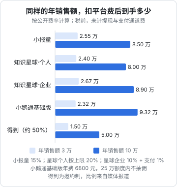
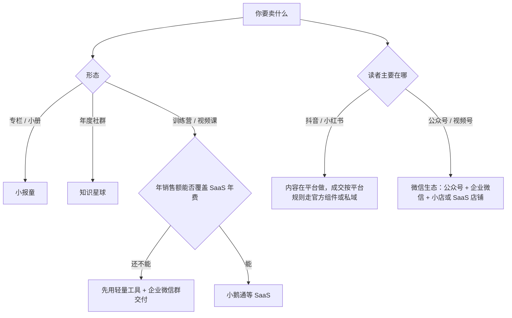

# 平台选择

产品设计好了，要找一个地方收钱和交付。国内做知识付费的平台大致分三类：**轻量的内容付费工具**（小报童、知识星球）、**自建店铺的 SaaS**（小鹅通等）、**内容平台自带的课程交易**（抖音、视频号 / 微信小店、小红书、B 站）。另外还有得到、网易云课堂这类**课程平台**，以平台招募或邀约为主。

这一章先讲选平台的几个维度，然后逐个讲主要平台的费率、规则和适合什么，最后给一张对比表和选择路径。

> [!WARNING]
> 平台费率和规则变化很快。本章的数字都标了出处和查询时间（2026 年 11 月），其中一部分来自第三方整理而不是官方原文，已在文中注明。**上架前以各平台后台和官方帮助中心的最新规则为准**，不要直接用书里的数字做财务预算。

## 选平台看什么

| 维度 | 要问的问题 |
|---|---|
| 费率 | 平台抽多少？有没有年费？提现有没有额外费用和税费代扣？ |
| 主体要求 | 个人能不能开？需不需要营业执照、个体户、企业、ICP 备案？ |
| 流量 | 平台本身会不会给你带来买家，还是全靠你自己带人来？ |
| 交付形态 | 支持图文、音频、视频、直播、社群、作业中的哪些？ |
| 用户归属 | 你能不能拿到买家的联系方式？能不能把他们沉淀到自己的私域？ |
| 退款规则 | 平台有没有强制的退款期？退款由谁处理？ |
| 迁移成本 | 以后想换平台，内容和用户能不能带走？ |
| 内容审核 | 你的主题在这个平台能不能卖？有没有类目限制？ |

对在职起步的开发者，最重要的通常是前三个：**个人主体能不能开、启动成本多高、你的读者在不在那里**。

## 轻量内容付费工具

### 小报童

> [!WARNING]
> 本节费率来自 2025-12 至 2026-02 的第三方整理，未核对官方原文，开通前以小报童后台显示的费率和规则为准。

小报童是一个专注付费专栏的工具，支持订阅制专栏和买断制小册，阅读以图文为主。

| 项目 | 内容 | 出处 |
|---|---|---|
| 平台服务费 | 创作者收入的 15% | 第三方整理（CreatorCut，标注来源为小报童帮助，数据 2025-12；ai-bot.cn 介绍页同为 15%） |
| 分销 | 作者可开启「合伙人」分销，自行设定佣金比例 | 同上；佣金上限两处说法不一致，以后台为准 |
| 提现 | 第三方整理称提现时另有结算服务商的服务费和个税代扣，非平台收取 | CreatorCut，2026-02 更新 |
| 退款 | 第三方介绍页称提供 24 小时内无理由退款 | ai-bot.cn，未标日期 |
| 主体 | 个人可开 | — |

我没有找到小报童官网公开的费率页面，上表数字都来自第三方整理。

适合：**起步验证、写专栏和小册的人**。启动几乎零成本，自带分销功能，适合让读者帮你传播。缺点是交付形态单一，不适合做视频课和训练营；流量基本要靠你自己带。

### 知识星球

> [!WARNING]
> 本节按知识星球官方帮助中心 2026-11-03 的说明整理，费率和退款规则可能调整，以帮助中心和你后台显示的为准。

知识星球是付费社群工具，以「星球」为单位，成员按年付费加入，支持主题帖、问答、文件、专栏等。

以下来自知识星球官方帮助中心（doc.zsxq.com，2026-11-03 查询）：

| 项目 | 内容 |
|---|---|
| 个人星球服务费 | 手续费 10%～20%，不含应缴纳的相关税费 |
| 企业星球服务费 | 自然年收入 10 万元以内按 10%，超出部分按 5%，另加微信支付 1%；税务自理 |
| 个人星球结算 | 结算期 72 小时后可在 App 提现 |
| 企业星球结算 | T+7 天后自动结算到对公账户 |
| 星球币（iOS）订单 | 财务结算周期 90 天 |
| 成员退款 | 付款后 72 小时内可在 App 内自助申请退款，原路返回；超过 72 小时自助入口关闭，可与星主协商，此时交易手续费和分享奖励一般不退 |

个人星球的具体费率在 10%～20% 之间，帮助中心没有写明按什么规则落在哪个点上。

72 小时自助退款对星主的意义是：**成员加入后的头三天体验非常关键**。新成员进来看到的是一个长期没更新、没人回复的星球，就会直接退款。

适合：**付费社群、年度会员**。成员管理、内容沉淀、问答都做得比较成熟，在技术、投资、职场类读者中认知度高。缺点是不适合做结构化的视频课程和训练营的作业流程。

## 自建店铺的 SaaS：小鹅通

> [!WARNING]
> 本节年费、免收额度和服务费按 2026 年 11 月查看的小鹅通官网定价页（xiaoe-tech.com/server_price）整理；额度比 2025 年第三方整理的数字减半，说明收费方式调整过，以定价页和销售给出的合同为准。

小鹅通是知识付费 SaaS，给你一个自己的「店铺」（可以接入公众号、小程序、视频号等），支持图文、音视频课程、直播、训练营、社群、会员等几乎所有形态。

| 项目 | 内容 | 出处 |
|---|---|---|
| 收费模式 | 年费 + 超额度按交易收服务费 | 官网定价页，2026-11 查看 |
| 年费 | AI 基础版 6800 元 / 年，AI 专业版 12800 元 / 年，AI 旗舰版 25800 元 / 年 | 同上 |
| 私域免收额度 | 知识店铺内的虚拟商品订单，交易额在基础版 12.5 万、专业版 25 万、旗舰版 62.5 万以内免收；超出部分收交易额 2% 的服务费（实物商品、有价优惠券除外） | 同上 |
| 公域渠道 | 通过小鹅通方案从公域引流的订单按交易额 2% 收技术服务费；视频号、快手另按类目收平台自己的技术服务费（页面写视频号 1%–5%、快手 2%–5%） | 同上 |
| 主体 | 第三方文章称完成个人或企业身份认证即可上传课程 | 小鹅通合作方文章，2024-03 |

2025 年的第三方整理（CreatorCut，数据 2025-01）写的免抽佣额度是 25 万 / 50 万 / 125 万，现在官网是它的一半。按交易收费的部分在变大，签约前对着当时的定价页再算一遍。

适合：**主力品已经验证、年销售额能覆盖年费、需要训练营和多形态交付的人**。好处是功能全、用户数据在你手里、可以接入微信生态的各个入口。缺点是有固定年费门槛，年销售额太小时不划算（见下图）；店铺本身没有流量。

## 内容平台的课程交易

> [!WARNING]
> 本节的平台规则按 2023–2025 年的平台公告和行业媒体转述整理，部分未能核对官方原文；上架前以抖店、微信小店、小红书的商家后台类目费率表和规则中心的最新规则为准。

在抖音、视频号、小红书这类内容平台上，可以把课程直接挂在视频、直播间或主页上卖。好处是**内容和交易在同一个地方**，转化路径最短；代价是**规则最严、变化最快**。

### 抖音

抖音卖课主要有几条路径：通过抖店上架课程商品、通过抖音的课程平台（学浪 / 抖音课堂）、通过第三方服务商的小程序挂载。这几条路的资质要求和规则在 2024–2025 年间多次调整：

- **宣传规范**：抖音《「教育培训类商品」宣传规范》2025 年 2 月 15 日施行，不得对升学、考试通过、证书取得或培训效果作保证性表述（如「包学包会」「包过」），不得以「终身」「永久」作为卖点，课时、答疑、服务周期等信息要和详情页一致（来源：课堂界转载的行业文章，2025-03-24）
- **资质**：第三方指南称学浪入驻通常需要主体资质、教师资质和 ICP 备案（知乎专栏，2025 年版，未能核对官方原文）
- **小程序挂载**：据行业报道，2024 年 7 月前后抖音收紧了教育类小程序的规则，加强课程内容和资质审核，部分类目（如家庭教育、互联网产品与运营）被关闭（CSDN 等转载的报道，未能核对官方公告）

我没有查到抖音课程类商品当前的技术服务费率的官方公开原文，**以抖店后台的类目费率表为准**。

对个人开发者的含义：**没有营业执照的个人，在抖音直接卖课的门槛很高**。网上流传的「共享资质」「无资质挂课」多为服务商营销，风险很大，不建议使用。更现实的路径是在抖音做内容和直播，把有兴趣的人引到你的私域或其他平台成交（导流规则见[《国内私域与内容平台》第 9 章](../private-domain-cn/09-rules-and-bans.md)和[《抖音与快手》](../douyin-kuaishou/)）。

### 视频号 / 微信小店

视频号的课程交易走微信小店（原视频号小店），也可以通过小鹅通等服务商的店铺挂载。

- **技术服务费**：视频号自 2023 年 1 月 1 日起向商家收取技术服务费，按订单所属类目的费率计算（来源：多篇行业文章，引用视频号官方公告）。教育培训类目的具体费率，第三方文章有不同说法，**以微信小店后台为准**
- **类目规则**：《微信小店「一级类目 - 教育培训」类目管理规则》2025 年 3 月 23 日起生效。据行业媒体整理，规则禁止以教学课程包装、实际与教培无关的商品；**禁止销售教授 AI 商业变现的课程**，以及 AI 换脸等虚假形象模仿类课程；线下交付类培训不得在该类目下售卖（来源：课堂界转载的科汛文章，2025-03-24；AIbase 同期报道内容一致，举例 AI 创业、获客、变现类课程。2026 年 11 月仍未在公开渠道找到规则原文，以微信小店后台的类目说明为准）
- **主体**：第三方文章称微信小店需要企业或个体工商户资质，并需缴纳类目保证金（未能核对官方原文）

「禁止教授 AI 商业变现」这一条对本书读者影响很大：**如果你的课程是关于 AI 的，主题要放在技能和效率上**，比如「用 AI 编程工具做出小工具」，而不是「用 AI 月入过万」。这既是平台规则，也是《广告法》的要求。

适合：已经在视频号和公众号有读者积累的人。微信生态内，从视频号到公众号到企业微信到成交的路径很顺，详见[《国内私域与内容平台》](../private-domain-cn/)第 4、6 章。

### 小红书

小红书允许通过商城、直播间购物车等官方方式交易。《交易导流违规管理细则》2025 年 3 月 12 日起实施，**不得通过官方组件之外的方式引导站外交易**，违规可能面临警告、限制直播甚至封号（来源：课堂界，2025-03-24）。在小红书卖课，要么用官方的交易组件，要么只做内容、不在站内导流到站外成交。

### B 站

B 站有自己的课程（课堂）体系，适合中长视频课程，技术类内容在 B 站有比较好的受众基础。我没有查到当前公开的课程入驻和分成规则，**入驻前以 B 站官方说明为准**。创作者视角的 B 站规则见[《小红书、视频号与 B 站》](../xhs-channels-bilibili/)。

## 课程平台：得到、网易云课堂

- **得到**：以平台邀约为主，不是自助上架。据媒体报道（CreatorCut 整理，引用界面新闻，2025-12），课程分成大约是平台和作者各一半，电子书分成比例不同。个人开发者一般很难直接进入
- **网易云课堂**：有讲师入驻通道，但我没有查到当前公开的入驻条件和分成比例，**入驻前以平台说明为准**

这类平台的价值主要是**平台自带的流量和背书**，适合已经有一定知名度、被平台邀约的人。起步阶段不必把它们作为首选。

## 对比总表

| 平台 | 典型形态 | 费用（出处见上文） | 个人能否开 |
|---|---|---|---|
| 小报童 | 专栏、小册 | 约 15% + 提现相关费用 | 能 |
| 知识星球 | 付费社群 | 个人 10%～20%；企业 10% / 5% + 1% | 能 |
| 小鹅通 | 全形态 | 年费 + 超额度 2%（基础版 12.5 万以内免收） | 能（需认证） |
| 抖音 | 课程商品、直播 | 按类目，以后台为准 | 门槛高 |
| 微信小店 | 课程商品、直播 | 按类目，以后台为准 | 需个体户或企业 |
| 小红书 | 商品、直播 | 以后台为准 | 以平台为准 |
| 得到等课程平台 | 课程 | 媒体报道约 50% | 邀约 |

| 平台 | 自带流量 | 用户归属 | 适合阶段 |
|---|---|---|---|
| 小报童 | 很少 | 有限 | 起步验证 |
| 知识星球 | 很少 | 有限 | 社群、年度会员 |
| 小鹅通 | 无 | 在你手里 | 主力品放量 |
| 抖音 | 多 | 平台内 | 有资质、有内容基础 |
| 微信小店 | 中 | 微信生态内 | 有公众号 / 视频号积累 |
| 小红书 | 多 | 平台内 | 内容型博主 |
| 得到等课程平台 | 多 | 平台 | 有知名度之后 |

## 费率对到手收入的影响

同样卖出一年的课程，扣掉平台费之后到手多少，差别不小。下图按上文的公开费率，算了年销售额 3 万和 10 万两种情况：

两个结论：

- **年费制在销售额小时不划算**：年销售额 3 万时，小鹅通基础版扣掉 6800 元年费，到手比抽成制平台还少；销售额到 10 万，年费摊薄后反而最划算。所以起步阶段用抽成制工具，主力品跑通后再考虑 SaaS
- **平台费不是唯一成本**：图里没算提现费用、支付通道费、个税、你自己的时间，也没算平台带来的流量价值。得到抽得多，但如果它能带来你自己带不来的买家，可能仍然值得

## 选择路径

几个实用建议：

- **一开始只用一个平台**。多个平台同时开，规则、退款、客服都要分别处理，在职状态下顾不过来
- **把用户沉淀到自己能触达的地方**。无论在哪个平台成交，都要合规地让买家加入你的企业微信或社群（交付需要，也是复购的基础）。企业微信的用法见[《国内私域与内容平台》第 6 章](../private-domain-cn/06-wecom-customer-groups.md)
- **iOS 上的虚拟商品购买**：在 iOS App 内购买虚拟内容通常需要走苹果内购，平台会相应处理价格或结算周期（如知识星球的星球币订单结算期 90 天）。苹果内购的机制见[《定价与商业模式》第 6 章](../pricing-monetization/06-app-store-iap.md)
- **收款主体和税**：用个人身份在平台收款，平台通常会代扣个税；收入规模上来之后要考虑是否注册个体户或公司，见[《自媒体与短剧合规财税》](../media-compliance/)

## 本章要点

- 选平台看费率、主体要求、流量、交付形态、用户归属、退款规则、迁移成本和内容审核
- 小报童适合专栏和小册起步；知识星球适合付费社群，官方规则是个人星球 10%～20%、成员 72 小时内可自助退款
- 小鹅通是年费制 SaaS，功能全、数据在自己手里，年销售额小时年费不划算
- 抖音、微信小店卖课门槛和规则变化最快：不承诺效果、不以「终身」为卖点；微信小店教培类目禁止教 AI 商业变现的课程
- 得到等课程平台以邀约为主，起步阶段不必作为首选
- 一开始只用一个平台，把买家合规地沉淀到自己的私域；所有费率上架前以后台为准
