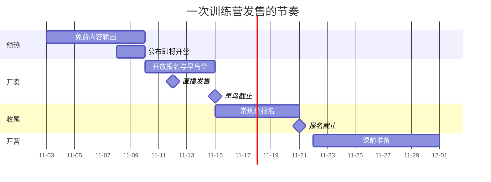

# 销售页与发售

产品做好了，要让对的人知道、理解并决定购买。这一章讲两件事：**销售页**（读者做决定时看的那一页）和**发售**（在一段集中的时间里，把产品介绍给你的读者）。

知识产品的销售有一个特点：读者买之前**无法试用**，只能靠你的描述来判断。所以销售页的核心任务不是「说服」，而是**让读者准确地判断这个产品适不适合自己**。适合的人买了，不适合的人不买，这样后面的交付、口碑和退款都会顺利得多。

## 销售页结构

### 十个模块

一个完整的销售页按下面的顺序组织。录播课、训练营、社群都适用，按形态增减。

| 序 | 模块 | 回答读者的什么问题 |
|---|---|---|
| 1 | 标题和一句话承诺 | 这是什么？能给我什么结果？ |
| 2 | 适合谁 / 不适合谁 | 这是给我的吗？ |
| 3 | 问题和现状 | 你懂我现在的处境吗？ |
| 4 | 学完你能做到 | 具体能得到什么？ |
| 5 | 大纲 | 具体学什么、怎么学？ |
| 6 | 交付方式 | 怎么上课、多久、有什么服务？ |
| 7 | 主讲人 | 凭什么是你？ |
| 8 | 学员反馈和作品 | 别人学了怎么样？ |
| 9 | 价格和购买 | 多少钱、怎么买、有什么优惠？ |
| 10 | 常见问题和退款 | 我还有什么顾虑？不满意怎么办？ |

### 逐个模块的写法

**1. 标题和一句话承诺**

一句话说清「谁 + 多长时间 + 做到什么」：

- 好：「四周，用 AI 编程工具做出并上线你的第一个小工具」
- 不好：「AI 编程从入门到精通」（模糊，且「精通」是夸大）
- 不能写：「零基础学 AI，三个月月入过万」（承诺收入，违反广告法和平台规则）

**2. 适合谁 / 不适合谁**

这一块最能体现诚意，也最能减少退款：

```markdown
### 适合你，如果：
- 你会一点编程，能看懂基本的代码
- 你用过 AI 聊天工具，但还没用它做出过一个完整的东西
- 未来四周，你每周能拿出 4–5 小时

### 不适合你，如果：
- 你完全没有接触过编程（建议先学一门入门课）
- 你已经能熟练用 AI 工具独立开发和部署项目
- 你想学的是 AI 模型原理（本课只讲工具的使用）
```

**3. 问题和现状**

描述目标读者现在遇到的问题，用他自己会说的话。这些话最好来自第 2 章的调研和访谈：

```markdown
你可能遇到过这些情况：
- 让 AI 写代码，一开始很顺，项目一大就开始乱改、越改越错
- 本地能跑，一部署就报错，不知道从哪里查
- 看了很多教程，但没有一个是从头到尾做完的
```

**4. 学完你能做到**

用第 3 章的课程目标，列 3–5 条，每条都可检验。附上一个往期学员的作品截图（经过本人同意）比任何形容词都有说服力。

**5. 大纲**

按周或按模块列出，每一讲一行。不需要放全部细节，但要让读者能判断「这些是我需要的」。

**6. 交付方式**

把服务写成清单，**每一项都要是你确定能做到的**：

```markdown
- 形式：每周一次直播（周一晚 8 点，约 90 分钟，有回放）
- 作业：每周一份，主讲或助教逐份点评，周日前返回
- 答疑：学员群内答疑，工作日晚上集中回复
- 有效期：直播回放和课件，结营后可继续观看 12 个月
- 开营时间：12 月 1 日；报名截止：11 月 28 日
```

注意有效期：抖音的宣传规范明确不能以「终身」「永久」作为卖点（见第 6 章），即使在其他平台，**也不建议承诺「永久」**。你没办法保证自己或平台永远运营，写一个明确的期限更诚实。

**7. 主讲人**

只写和这门课相关的、真实的经历。可以写：

- 你做过的相关项目（附链接）
- 你在这个主题上的公开内容（文章数、视频数、开源项目）
- 你为什么做这门课

不要写：没有的头衔、模糊的「某大厂」暗示、无法验证的成就。《广告法》对教育培训广告还有一条：**不得利用专业人士、受益者的名义或者形象作推荐、证明**。请人站台、用学员名义背书要特别谨慎，具体边界见[《自媒体与短剧合规财税》](../media-compliance/)。

**8. 学员反馈和作品**

- 用**真实的、经本人同意的**反馈和作品
- 好评和中性的评价都可以放，只放五星好评反而不可信
- 第一期没有学员反馈，就放试讲学员的反馈（第 2 章），或者干脆不放，用详细的大纲和你的作品来代替
- **不能编造**，不能用「某某学员月入三万」这类收入案例

**9. 价格和购买**

- 明码标价，写清楚包含什么
- 有优惠就写清楚优惠的条件和截止时间，**截止时间必须真实执行**
- 划线价必须是真实销售过的价格
- 三档定价、锚定这些方法见[《定价与商业模式》第 3 章](../pricing-monetization/03-pricing-psychology.md)

**10. 常见问题和退款**

把咨询中被问得最多的问题放在这里，至少包括：基础不够怎么办、时间不够怎么办、能不能开发票、退款规则。**退款规则必须在付款前就能看到**（退款设计见第 9 章）。

### 销售页模板

```markdown
# 四周，用 AI 编程工具做出并上线你的第一个小工具

第 3 期 · 12 月 1 日开营 · 限 30 人（每份作业都要点评，人数有上限）

## 适合你，如果
- ...
## 不适合你，如果
- ...

## 你可能遇到过
- ...

## 学完你能做到
1. ...
2. ...
3. ...
（往期学员作品截图，已获本人同意）

## 四周安排
| 周 | 主题 | 作业 |
|---|---|---|
| 0 | 课前准备 | 环境配置 |
| 1 | ... | ... |

## 怎么上课
- ...

## 主讲人
（真实经历，附作品链接）

## 往期学员怎么说
（真实反馈，已获同意）

## 价格
699 元（11 月 20 日前报名 599 元）
包含：四周直播及回放、4 次作业点评、学员群答疑、课件 12 个月有效

## 常见问题
**我的基础够吗？** 做一下这 3 道自测题（链接）……
**工作忙跟不上怎么办？** ……
**能开发票吗？** ……

## 退款说明
开营后第一周结束前，不满意全额退款，不问原因。之后……（完整规则）

[ 报名 ]
```

## 发售

发售是把产品在一段集中的时间里介绍给你的读者。和「上架后放着慢慢卖」相比，集中发售能制造讨论、聚集注意力，而且有明确的开营时间，交付也更好安排。

### 发售节奏

一个典型的发售周期大约两到三周：



| 阶段 | 时间 | 做什么 |
|---|---|---|
| 预热 | 开卖前 1 周 | 连续发几条和课程主题相关的高质量免费内容，让读者重新想起你在这个领域的专业；在私域里预告「下周开放报名」 |
| 开卖 | 3–5 天 | 发布销售页；直播发售；私域里分批通知 |
| 早鸟截止 | 开卖后 3–5 天 | 按时截止，不延期 |
| 收尾 | 截止前几天 | 回答常见问题；分享已报名人数（真实数字）；截止前 24 小时最后提醒 |
| 截止 | 按时 | 关闭报名，进入开营前 SOP（第 4 章） |

### 预热内容

预热不是发广告，是**发能单独成立的好内容**，让读者在看内容的过程中意识到自己需要更系统的学习。比如：

- 一篇「我用 AI 编程工具做小工具的完整流程」长文
- 一个「从需求到上线」的录屏视频
- 一次免费直播：现场做一个小工具

每条内容的结尾可以提一句「下周会开放训练营报名，想了解的可以加我」，但内容本身要有完整的价值。选题和结构的方法见[《选题与爆款结构》](../topic-and-hooks/)。

### 私域里的发售通知

在企业微信和社群里分几次通知，每次的内容不同：

| 时间 | 内容 |
|---|---|
| 预热期 | 「下周会开一期训练营，这次主要讲……想优先了解的回复 1」 |
| 开卖当天 | 销售页链接 + 早鸟价说明 + 直播预约 |
| 直播当天 | 直播提醒 |
| 早鸟截止前 24 小时 | 提醒截止时间；附上一两个常见问题的回答 |
| 报名截止前 24 小时 | 最后提醒 |

几个原则：

- **对回复过「1」的人单独发**，对没有表达兴趣的人群发次数要少
- 群发频率注意企业微信的上限（见[《国内私域与内容平台》第 6 章](../private-domain-cn/06-wecom-customer-groups.md)），也要注意不要打扰到对这个主题不感兴趣的人
- **一次发售最多群发三到四次**，超过这个数，被删好友和退群的人会明显增多

### 直播发售

直播是知识产品发售最有效的方式之一：读者能看到你本人、听你讲、实时提问，信任建立得比看销售页快得多。

一场 90 分钟的发售直播的结构：

| 时间 | 环节 | 内容 |
|---|---|---|
| 0–10 分钟 | 开场 | 介绍今天讲什么，等人进来；预告最后会介绍训练营 |
| 10–50 分钟 | 干货 | 真正有价值的内容，比如现场演示一个完整流程 |
| 50–65 分钟 | 问答 | 回答和主题相关的问题 |
| 65–80 分钟 | 介绍产品 | 为什么做这个训练营、适合谁不适合谁、学什么、怎么学、多少钱 |
| 80–90 分钟 | 问答和收尾 | 回答报名相关问题；告知报名方式和截止时间 |

要点：

- **前 50 分钟的内容必须本身有价值**。不买课的人看完也要有收获，这是对读者时间的尊重，也是长期口碑的来源
- 介绍产品时，**主动说「不适合谁」**，比只讲好处更能建立信任
- 不用「倒计时 3、2、1 上链接」「最后 10 个名额」这类制造焦虑的话术，除非名额和时间是真实的
- 直播的技术搭建、话术脚本、复盘方法见[《直播实战》](../live-streaming/)

### 发售复盘

发售结束后马上复盘，用一张表：

```markdown
## 发售复盘：第 X 期

### 数据
| 指标 | 数值 |
|---|---|
| 销售页访问人数 | |
| 直播观看人数 / 峰值 | |
| 咨询人数 | |
| 报名人数 | |
| 退款人数（截至开营） | |
| 各渠道报名占比 | 私域 __% / 直播 __% / 公域内容 __% |

### 转化
- 访问 → 报名：
- 咨询 → 报名：

### 有效的
- 

### 无效的
- 

### 咨询中出现最多的问题（补进下一期的常见问题）
- 

### 下一期要改的三件事
1. 
2. 
3. 
```

渠道数据需要提前准备：不同渠道用不同的链接或渠道码（企业微信渠道活码见《国内私域与内容平台》第 6 章），否则发售结束后你不知道人是从哪里来的。

## 常青销售

不是所有产品都适合集中发售。录播课、小册、模板包这类不需要按期交付的产品，可以**常青销售**：一直挂着，靠持续的内容带来购买。

| 方面 | 集中发售 | 常青销售 |
|---|---|---|
| 适合 | 训练营、需要按期交付的产品 | 录播课、小册、模板、社群 |
| 节奏 | 一年几次，每次集中两三周 | 持续 |
| 优点 | 注意力集中，有明确的开始时间 | 不需要专门的发售精力，收入更平稳 |
| 缺点 | 发售期很累；两次发售之间收入少 | 缺少紧迫感，转化率通常较低 |

常青产品可以在每个季度做一次小型的促销（真实的限时优惠），或者在你发了相关内容之后在结尾提一句。

## 宣传用语自查

销售页和发售文案发布前，逐条检查：

```markdown
- [ ] 没有承诺效果：「包会」「包过」「保证学会」「100% 掌握」
- [ ] 没有承诺收入或就业：「月入过万」「学完接单赚回学费」「包就业」「内推大厂」
- [ ] 没有「终身」「永久」作为卖点
- [ ] 没有「最」「第一」「唯一」「顶级」等绝对化用语
- [ ] 划线原价是真实销售过的价格
- [ ] 「限时」「限量」是真实的，并且会按时执行
- [ ] 学员反馈和作品都是真实的，并且征得了本人同意
- [ ] 主讲人介绍里的经历都可以验证
- [ ] 退款规则在付款前可见
- [ ] 课时、答疑、有效期等服务内容和实际交付一致
```

这些要求的法律依据和具体边界见《自媒体与短剧合规财税》。通用的文案写作方法见[《文案与内容》](../copywriting-content/)。

## 本章要点

- 销售页的任务是帮读者准确判断适不适合，而不是不择手段地说服
- 十个模块：承诺、适合 / 不适合、问题、结果、大纲、交付、主讲人、反馈、价格、常见问题与退款
- 「不适合谁」和「不包含什么」写得越清楚，退款越少
- 服务内容只写确定做得到的；不承诺「终身」，写明确的有效期
- 发售两到三周：预热发真正的好内容，开卖用直播和私域分批通知，按时截止，最多群发三四次
- 直播发售前半程必须本身有价值，介绍产品时主动讲不适合谁
- 发售后立刻复盘；提前用渠道码区分来源
- 发布前用宣传用语自查清单过一遍
