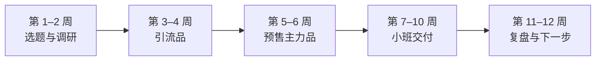

# 技术人做知识产品：优势、坑与第一个 90 天

前面九章讲的方法对任何人都适用。最后一章回到本书的读者：**下班做副业的在职开发者**。技术人做知识产品有一些别人没有的优势，也有一些特别容易踩的坑。这一章把它们讲清楚，最后给一个从零到第一款产品的 90 天计划。

## 技术人的优势

### 1. 内容本身就有需求，而且更新快

编程和 AI 工具是少数「每几个月就要重新学一遍」的领域。新工具出来、旧工具大改版，总有一批人需要有人带着重新上手。这意味着：

- 需求持续存在，不容易做完一波就枯竭
- 你在工作中自然地接触新工具，**学习本身就是内容生产**
- 「我在真实项目中用过」本身就是稀缺的，网上大量教程只停留在玩具示例

### 2. 能做出可检验的结果

技术类课程的结果天然是可检验的：一个能访问的网址、一个能跑的仓库、一个通过的测试。第 3 章说「学习目标要可观察」，对技术人来说几乎是默认的。这让你的销售页、作业和案例都更具体、更有说服力。

### 3. 能自己做工具

别人要花钱买或者找人做的东西，你可以自己写：

| 需要 | 技术人可以自己做 |
|---|---|
| 作业自动检查 | 写脚本或用 CI 检查学员仓库能否构建、测试是否通过，先过自动检查再人工点评 |
| 学员数据表 | 从平台导出数据，用脚本生成每周的作业完成情况（第 4 章的数据表） |
| 课前环境检测 | 写一个一键检测脚本，学员运行后告诉他哪一步没装好 |
| 交互式练习 | 在线代码练习、可运行的示例仓库 |
| 课程站点 | 用静态站点生成器做课程文档，比平台自带的图文排版更适合放代码 |

一个课前环境检测脚本的例子，能显著减少开营第一周的答疑量：

```bash
#!/usr/bin/env bash
# 课前环境检测：逐项检查，最后汇总哪些没通过
fail=0
check() {
  if command -v "$1" >/dev/null 2>&1; then
    echo "✅ $1 已安装：$($1 --version 2>&1 | head -n 1)"
  else
    echo "❌ 没有找到 $1，请按课前准备第 $2 步安装"
    fail=$((fail + 1))
  fi
}
check node 2
check git 3
check pnpm 4
if [ -z "${OPENAI_API_KEY:-}${ANTHROPIC_API_KEY:-}" ]; then
  echo "❌ 没有检测到 API Key 环境变量，请按课前准备第 5 步配置"
  fail=$((fail + 1))
fi
if [ "$fail" -eq 0 ]; then
  echo "全部通过，开营见！"
else
  echo "有 $fail 项未通过，把以上输出截图发到学员群"
fi
```

注意：脚本只检查环境变量**是否存在**，不读取、不打印 Key 的值，也不上传任何东西。让学员运行你写的脚本，就要对脚本的安全负责。

### 4. 习惯迭代

开发者熟悉「先做最小版本、上线、看数据、迭代」。这正是知识产品应该的做法：先预售验证（第 2 章），第一期小规模，每期复盘改进。很多非技术背景的人第一次做课会追求「一次做到完美」，反而迟迟上不了线。

## 技术人常见的坑

### 坑 1：内容过多、过深

技术人最常见的问题是**想把会的都讲了**。一门「AI 编程入门」课，讲着讲着就去讲 Transformer 原理、讲 token 计费、讲各家模型的架构差异。这些都有价值，但对「做出一个小工具」这个目标没有帮助。

**对策**：每一讲都回答「这一讲支撑哪条课程目标」（第 3 章），答不出来的删掉或放进延伸阅读。

### 坑 2：低估「不会」的程度

你觉得理所当然的东西（命令行、环境变量、Git、读报错），对很多学员来说都是障碍。这就是所谓的「知识的诅咒」：你已经忘了自己不会时是什么样子。

**对策**：试讲（第 2 章），并且认真看学员卡在哪里；第 0 讲把环境问题前置；演示里保留犯错和排查。

### 坑 3：重工具、轻运营

技术人喜欢做系统：先花一个月搭课程网站、写自动化脚本、做数据看板，然后发现没人报名。工具是在**已经有学员、手工做不过来的时候**才值得做的。

**对策**：第一期一切手工：用现成的平台收款，用企业微信群交付，用表格记录作业。第二期把最痛的一个环节自动化。

### 坑 4：不愿意「卖」

很多技术人觉得推销自己的课程很尴尬，于是销售页写得很含糊，发售时也不好意思提。结果是真正需要的人不知道有这个产品。

**对策**：把「卖」理解为「帮对的人做判断」（第 7 章）。写清楚适合谁、不适合谁、能得到什么，然后告诉你的读者。这不是推销，是信息传递。不需要夸大，也不需要制造焦虑。

### 坑 5：低估时间投入

在职状态下，一期训练营意味着连续几周每周十几个小时。赶上公司项目上线、加班，交付质量就会断崖式下滑，然后是退款和差评。

**对策**：

- 选择交付时间可以自己安排的形态起步（第 1 章）
- 训练营避开你已知的工作高峰期（季度末、大版本上线）
- 第一期规模小一点（10–20 人），算好工作量（第 4 章的公式）
- 提前准备好所有课件，开营期间只做点评和答疑

### 坑 6：教「用 AI 赚钱」

AI 是当下最热的主题，也是最容易踩线的主题。「用 AI 月入过万」「AI 副业躺赚」这类选题看起来最好卖，但：

- 违反《广告法》关于教育培训不得保证效果的规定
- 微信小店等平台明确禁止「教授 AI 商业变现」的课程（第 6 章）
- 这类产品的口碑通常很差，会毁掉你作为技术人最值钱的信誉

**对策**：讲技能和效率，不讲收入。「用 AI 编程工具把开发效率提上来」「用 AI 做出一个小工具」是技能；「用 AI 赚钱」是承诺。

### 坑 7：忽视雇主相关的风险

在职做副业，有几件事要提前确认：

| 风险 | 要确认的 |
|---|---|
| 劳动合同和公司制度 | 有没有关于兼职、副业、对外授课的限制 |
| 竞业 | 课程主题和公司业务是否重叠；咨询对象是不是公司的客户或竞争对手 |
| 知识产权 | 课程里用的代码、文档、案例，是不是在工作中产生的。**不要把公司的代码、内部文档、未公开的数据拿来做课** |
| 保密 | 举例时不要透露公司的项目细节、技术架构、业务数据 |
| 时间和设备 | 不在工作时间做副业，不用公司电脑和账号 |

拿不准的，查劳动合同、问 HR 或法务，或者咨询律师。在职期间的副业收入怎么报税，见《过渡期收入与个人保障》第 8 章和《自媒体与短剧合规财税》。

### 坑 8：只在一个平台、不建自己的私域

所有读者都在某个平台上，一旦账号被限流或规则变化，就断了和读者的联系。

**对策**：从第一个产品开始，就合规地把买家沉淀到企业微信或社群（《国内私域与内容平台》第 6 章）。私域里的读者是你每一次发售的基础盘。

## 第一个 90 天

下面是一个在职开发者从零到第一款知识产品的计划。假设你每周能稳定拿出 6–8 小时，已经在某个平台上有一些内容和读者（几百到几千人）。如果还没有，先读《账号定位与对标拆解》和《自媒体与短剧行动手册》，从内容开始。



### 第 1–2 周：选题与调研

- 翻一遍自己的内容数据和私信，列出 3 个候选选题
- 每个选题做桌面调研（第 2 章），写一页需求笔记
- 填产品设计画布（第 1 章），选出一个
- **产出**：一页需求笔记 + 一张产品设计画布

### 第 3–4 周：做一个引流品

- 把选题中最基础、最常被问的部分做成一个低价小册或模板包（9.9–49 元），在小报童等轻量平台上架（第 6 章）
- 在小册结尾留「加入读者群领取配套资料」的入口
- 发两三条相关的免费内容，引导到小册
- **产出**：一个上架的引流品；一个读者群
- **判断**：如果两周内一份都卖不出去，回到选题；卖出几十份，说明方向成立

### 第 5–6 周：预售主力品

- 写训练营大纲（第 3 章）和简版销售页（第 7 章）
- 在读者群和私域发预售，写明开营条件和退款规则（第 2 章）
- 同时做一次免费直播试讲
- **产出**：预售结果
- **判断**：按第 2 章事先写下的标准决定开营、缩小规模还是退款

### 第 7–10 周：小班交付

- 开营前 SOP、四周运营日历、数据表（第 4 章）
- 第一期规模控制在 10–20 人，一切手工
- 交付检查清单每周逐项打勾（第 8 章）
- **产出**：一期完整交付；学员作品

### 第 11–12 周：复盘与下一步

- 发反馈问卷，征询案例授权（第 8 章）
- 复盘发售和交付数据：完课率、退款率、推荐意愿
- 决定下一步：第二期扩大规模？改成录播课？加付费社群？
- 把第一期最痛的一个环节自动化
- **产出**：复盘文档；第二期的计划

### 90 天之后

| 结果 | 下一步 |
|---|---|
| 第一期完课率高、反馈好、有人问下一期 | 第二期适当扩大规模，引入助教；考虑小鹅通等 SaaS（看年费是否划算） |
| 交付顺利但招生困难 | 重点放在内容和私域积累上，引流品继续卖 |
| 交付吃力，工作受影响 | 改成录播课 + 答疑社群的组合，降低按期交付的压力 |
| 反馈一般 | 认真读问卷，改课程设计，下一期小规模再试 |
| 整个过程都很痛苦 | 也是有价值的结论：知识产品可能不适合你现在的状态，回到内容本身或其他变现方式（见《自媒体与短剧一人公司全景》） |

## 每周时间预算

在职状态下，时间是最稀缺的资源。一个每周 8 小时的分配参考：

| 阶段 | 内容 | 产品制作 | 交付 / 运营 | 私域 |
|---|---|---|---|---|
| 准备期（第 1–6 周） | 3 小时 | 4 小时 | 0 | 1 小时 |
| 交付期（第 7–10 周） | 1 小时 | 0 | 6 小时 | 1 小时 |
| 复盘期（第 11–12 周） | 3 小时 | 2 小时 | 1 小时 | 2 小时 |

交付期内容更新会明显变少，提前准备几条存稿。如果交付期实际投入远超 8 小时，说明规模或作业设计超出了你的能力，下一期要调整。

## 最后：长期主义

知识付费做得好的人，几乎都有一个共同点：**长期在一个领域里真实地做事，并持续地、诚实地分享**。产品、发售、运营这些方法能让你少走弯路，但不能替代你在这个领域的真实积累。

对技术人来说，最好的知识产品往往来自你正在做的事：你在工作中解决的问题、你在业余做的项目、你在学习新工具时踩的坑。把这些真实的经验整理好、讲清楚、带着别人做出来，这就是一门好的知识产品。不需要夸大，不需要制造焦虑，也不需要承诺任何人发财。

## 本章要点

- 技术人的优势：内容需求持续更新、结果天然可检验、能自己做工具、习惯迭代
- 八个常见坑：内容过多过深、低估学员「不会」的程度、重工具轻运营、不愿意卖、低估时间投入、教「用 AI 赚钱」、忽视雇主相关风险、不建私域
- 第一期一切手工，第二期再自动化最痛的环节；环境检测脚本不读取、不上传敏感信息
- 在职做副业先确认劳动合同、竞业、知识产权和保密，不用公司的代码和数据做课
- 90 天计划：选题调研 → 引流品 → 预售 → 小班交付 → 复盘，每个阶段有产出和判断标准
- 最好的知识产品来自你正在做的真实工作，长期、诚实地分享
