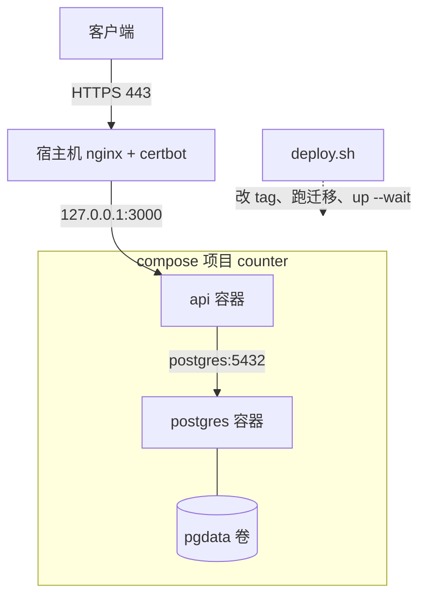
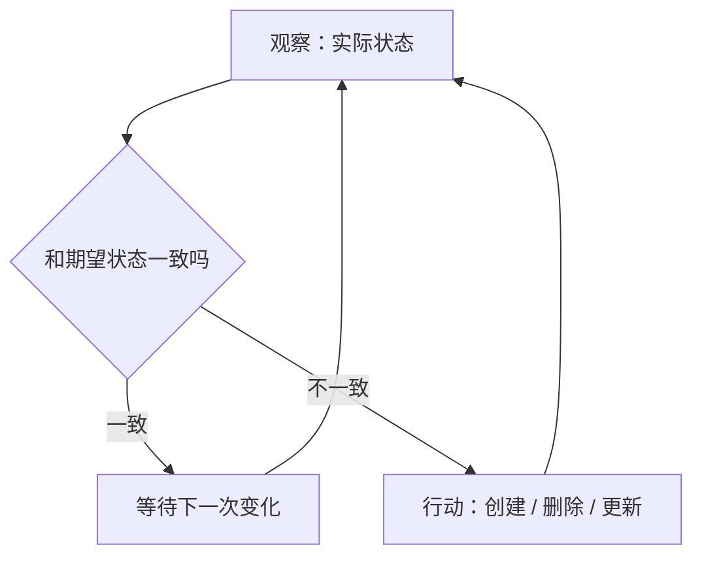
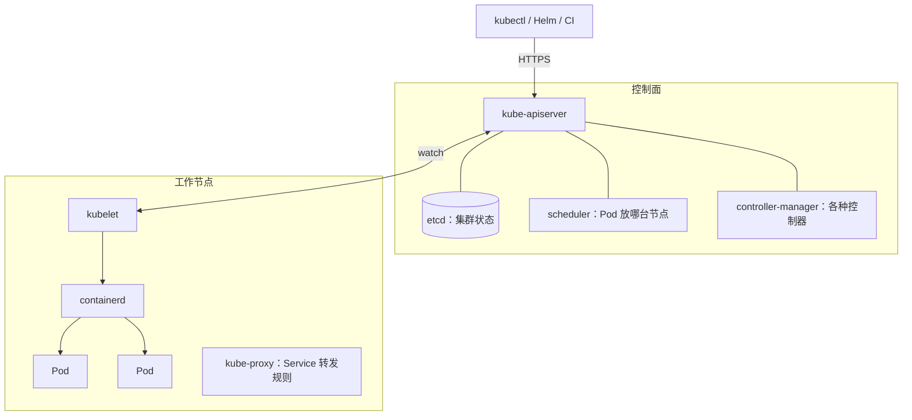

# K8s 解决什么问题

## 这本书讲什么

Kubernetes（常写作 K8s，K 和 s 之间有 8 个字母）是目前事实上的容器编排标准。招聘要求里有它，云厂商都卖它，开源项目的安装文档里第一种方式常常就是 Helm chart。它也是出了名的复杂：概念多、YAML 多、出问题时要查的层次多。

这本书只做一件事：**把一套已经在跑的 Docker Compose 部署，迁到一台机器上的 k3s 集群里**，一路把 Kubernetes 的核心概念讲清楚。迁移对象是 hatch-counter（掌柜眼）的生产部署：一个 NestJS 服务端加一个 Postgres，前面一层宿主机 nginx，用 `deploy.sh` 发版。[《容器技术》](../docker-containers/)一书里已经把它装进了容器、用 Compose 跑起来，本书从那里接着走。

全书 9 章：

| 章 | 内容 | 贯穿练习的进度 |
|---|---|---|
| 1 | K8s 解决什么问题（本章） | 看清 Compose 版缺了什么 |
| 2 | 核心对象：Pod / Deployment / Service | 服务端跑成 Deployment |
| 3 | 配置与密钥 | `api.env` 变成 ConfigMap + Secret，迁移变成 Job |
| 4 | 网络与 Ingress | nginx 反代变成 Ingress，证书自动续 |
| 5 | 存储 | Postgres 跑成 StatefulSet，加备份 CronJob |
| 6 | Helm | 一堆 YAML 打包成一个 chart |
| 7 | 用 k3s 搭单机小集群 | 在 VPS 上装 k3s，切流量，留退路 |
| 8 | 排障 | Pending、CrashLoopBackOff、Service 不通怎么查 |
| 9 | 什么时候不该上 K8s | 回头算账：这次迁移值不值 |

**适合谁**：已经会写 Dockerfile 和 compose 文件、在一台 VPS 上用 Compose 跑过服务的人。容器本身的原理（namespace、cgroup、镜像分层、多阶段构建、镜像仓库）不再重复，需要时回头翻《容器技术》。

**怎么读**：第 2–6 章每章都会产出一组可以 `kubectl apply` 的 YAML，建议在本机起一个练习集群跟着敲（第 2 章开头讲怎么起）。第 7 章才在服务器上搭正式集群。如果你只想知道「我该不该上 K8s」，可以先读本章和第 9 章；线上出了问题，直接翻第 8 章的排障顺序。

**版本**：本书的清单按 Kubernetes 1.3x 写，只用已经 GA（正式稳定）的 API 版本，比如 `apps/v1`、`batch/v1`、`networking.k8s.io/v1`。这些版本多年没有变过，短期内也不会变。具体到 k3s、Helm、cert-manager 这些工具的安装命令和默认组件，会随版本调整，动手前以各自官方文档为准。

## 先看看 Compose 版缺了什么

回顾一下 hatch-counter 现在的生产部署（项目名和仓库地址已替换）：



这套东西其实很好用，而且已经做对了很多事：镜像只从自己的仓库拉、密码放在独立的 env 文件、数据库不开端口、服务端只绑 127.0.0.1、`--wait` 等的是真正查一次库的健康检查、发版失败自动退回上一个 tag。

但把它放在显微镜下，能看到几处「靠人和脚本兜着」的地方：

| 场景 | Compose 版现在怎么办 | 隐患 |
|---|---|---|
| api 进程卡死但没退出 | `restart: unless-stopped` 只管进程退出 | 健康检查失败只会把容器标成 unhealthy，没人去重启它 |
| 发版 | `deploy.sh` 停旧起新 | 替换容器那几秒端口是空的，请求会失败 |
| 想跑两个 api 实例 | 改端口、改 nginx upstream、改脚本 | 每多一个实例，脚本复杂一圈 |
| 机器重启 | Docker 开机自启，容器按 restart 策略起来 | 起来的顺序和就绪判断靠 compose 的 depends_on，只在 `up` 时生效 |
| 证书续期 | certbot 定时任务 + reload 钩子 | 一套独立机制，挂了要另外发现 |
| 配置漂移 | 服务器上的 `.env`、nginx 配置手工维护 | 机器上的真实状态和仓库里的不一致，没人知道 |

注意第一行：很多人以为 Compose 的 healthcheck 失败会自动重启容器，**并不会**。Docker 只更新健康状态，重启只看进程退出码。要「不健康就重启」，得自己加 autoheal 之类的小工具。

这些问题单独看都能用脚本补上。Kubernetes 的价值在于：它把这些补丁背后的共同模式抽象成了一个统一的机制。

## 核心思想：声明式 + 控制循环

### 命令式和声明式

`deploy.sh` 是**命令式**的：先拉镜像，再起库，再跑迁移，再起服务。每一步都是一个动作，脚本作者负责想清楚顺序和失败处理。

Kubernetes 是**声明式**的：你提交一份「我想要的状态」，比如「counter-api 要有 2 个副本，用 1.4.0 的镜像，每个最多 512Mi 内存」，然后由系统负责让现实变成这样，并且**一直保持**这样。

```yaml
# 一份期望状态的片段（第 2 章会完整讲）
apiVersion: apps/v1
kind: Deployment
metadata:
  name: counter-api
spec:
  replicas: 2
  selector:
    matchLabels:
      app: counter-api
  template:
    metadata:
      labels:
        app: counter-api
    spec:
      containers:
        - name: api
          image: registry.example.com/counter/api:1.4.0
```

「一直保持」是关键。一个 Pod 被 OOM 杀掉，系统发现实际副本数是 1、期望是 2，就补一个；你把镜像 tag 改成 1.5.0，系统发现实际和期望不一致，就开始滚动替换。

### 控制循环

实现这件事的叫**控制器**（controller），每个控制器都在跑同一个循环：



Deployment 控制器盯着副本数和模板，Node 控制器盯着节点是否失联，Job 控制器盯着任务是否完成……每个控制器只管自己那一块，合起来就是一个能自我修复的系统。这种模式叫 **reconcile**（调和）。

理解了这一点，K8s 里很多「奇怪」的行为都说得通了：

- 你手动 `kubectl delete pod` 一个 Deployment 管的 Pod，它马上又出来一个，因为控制器只认期望状态
- 改了配置不一定立刻生效，因为要等控制器下一轮观察到变化
- 出问题时第一件事是看「期望」和「实际」差在哪：`kubectl describe` 底部的 Events 就是控制器的行动日志

## 集群长什么样

一个 Kubernetes 集群分成**控制面**和**工作节点**两部分：



| 组件 | 职责 |
|---|---|
| kube-apiserver | 唯一入口。所有读写都经过它，做认证、鉴权、校验，然后存进 etcd |
| etcd | 分布式键值库，存整个集群的状态。它丢了，集群就失忆了 |
| scheduler | 给新建的 Pod 挑一个节点，考虑资源余量、亲和性等约束 |
| controller-manager | 运行内置的各种控制器 |
| kubelet | 每个节点上的代理，按 apiserver 分配给本节点的 Pod 去调用容器运行时 |
| containerd | 容器运行时，真正拉镜像、起容器。K8s 早已不直接调用 Docker |
| kube-proxy | 把 Service 翻译成节点上的 iptables / nftables / IPVS 规则 |

所有组件之间不直接互相调用，而是都通过 apiserver **watch** 自己关心的对象。scheduler 看到一个没分配节点的 Pod，就写一个节点名回去；kubelet 看到一个分配给自己的 Pod，就去起容器。这种松耦合让每个组件都可以单独重启、单独替换。

### 单机集群也是这个结构

本书最终要搭的 k3s 单机集群，是把上面所有角色压进一台机器、一个进程：k3s 把 apiserver、scheduler、controller-manager、kubelet 打包成一个二进制，默认用 SQLite 代替 etcd，自带 containerd、CoreDNS、Traefik（Ingress）和本地存储供给器。概念完全一样，只是部署形态变轻了。第 7 章会细讲。

## 一切皆对象，一切皆 API

在 K8s 里，你操作的每样东西都是一个 API 对象，结构高度统一：

```yaml
apiVersion: v1        # 这个对象属于哪个 API 组的哪个版本
kind: ConfigMap       # 对象类型
metadata:             # 名字、命名空间、标签、注解
  name: counter-config
  namespace: counter
  labels:
    app.kubernetes.io/part-of: counter
data:                 # 不同 kind 这里不同：多数是 spec，ConfigMap 是 data
  NODE_ENV: production
```

- **apiVersion**：核心对象（Pod、Service、ConfigMap）是 `v1`；其他按组划分，如 `apps/v1`（Deployment、StatefulSet）、`batch/v1`（Job、CronJob）、`networking.k8s.io/v1`（Ingress、NetworkPolicy）。带 `alpha`、`beta` 的版本可能被移除，生产清单尽量只用 GA 版本
- **spec 和 status**：你写 spec（期望），系统写 status（实际）。`kubectl get -o yaml` 能看到两者
- **labels**：键值对标签，是 K8s 里对象之间「找到彼此」的主要方式（Service 靠 label 找 Pod，Deployment 靠 label 管 Pod）
- **annotations**：也是键值对，但不用于选择，用来给工具留信息（比如 Ingress 控制器的配置项）

因为一切都是 API 对象，所以 `kubectl`、Helm、Argo CD、CI 脚本做的事本质相同：读写 apiserver 里的对象。这也是 K8s 生态能长得这么大的原因：任何人都可以定义新的对象类型（CRD）并写控制器去调和它，比如 cert-manager 定义了 `Certificate`，你声明「我要一张某域名的证书」，它的控制器负责去申请和续期。

## K8s 不解决什么

在开始之前先把期望摆正。Kubernetes **不会**：

- 让你的应用自动变得可横向扩展。服务端如果把会话存在内存里、把上传文件写在本地磁盘，开两个副本就会出错
- 让数据库变得高可用。在 K8s 里跑 Postgres 和在 Compose 里跑，数据安全性的本质问题一样：备份、恢复演练、磁盘
- 省钱。控制面本身要吃资源，学习和排障要吃时间
- 替你做监控告警。它提供探针和事件，但「半夜谁被叫醒」仍然要你自己搭（见[《可观测性与性能》](../observability-performance/)）

它真正提供的是：**一套统一的、声明式的、可自我修复的运行时，以及围绕它的庞大生态**。对一个人来说，这到底值不值，第 9 章会认真算。

## 本章要点

- 本书以把 hatch-counter 的 Compose 部署迁到 k3s 单机集群为贯穿练习，容器基础见《容器技术》
- Compose 版的隐患集中在：不健康不重启、发版有空窗、多实例要改脚本、证书和配置靠人维护
- Kubernetes 的核心是**声明式期望状态 + 控制循环持续调和**，看懂这一点就看懂了它的大部分行为
- 集群 = 控制面（apiserver、etcd、scheduler、controller-manager）+ 节点（kubelet、容器运行时、kube-proxy），组件都通过 apiserver watch 协作
- 一切都是带 `apiVersion` / `kind` / `metadata` / `spec` 的 API 对象，生产清单只用 GA 版本
- K8s 不会自动让应用可扩展、让数据库高可用，也不省钱

## 动手练习

本章没有要敲的清单。第 1 题先在纸上预测，等[第 2 章起好练习集群](02-core-objects.md#先起一个练习集群)后再回来验证；所有练习只在本机的 k3d / kind 集群里做，动手前先用 `kubectl config current-context` 确认连的不是生产集群。

1. **预测控制循环**：一个 `replicas: 2` 的 Deployment 正常运行。依次发生：(a) 你 `kubectl delete pod` 删掉其中一个 Pod；(b) 你执行 `kubectl scale deployment <名字> --replicas=3`；(c) 你直接改 Pod 的标签，让它不再匹配 Deployment 的 selector。每一步之后，集群里会有几个带原标签的 Pod？

   验证：在练习集群里 `kubectl create deployment demo --image=nginx:alpine --replicas=2`，按顺序操作，每步后用 `kubectl get pods -l app=demo` 和 `kubectl get pods --show-labels` 观察。第 (c) 步可以用 `kubectl label pod <某个 Pod> app=orphan --overwrite`。

   参考答案：(a) 后很快又回到 2 个；(b) 后是 3 个；(c) 后带 `app=demo` 的 Pod 仍是 3 个，因为控制器发现少了一个就补一个，被改标签的那个变成「孤儿」继续运行，要手动删除。控制器只认「符合 selector 的实际数量」和期望数量的差。

2. **判断能不能开两个副本**：某个 NestJS 服务把登录会话存在进程内存的 Map 里，用户上传的图片写到容器内的 `/app/uploads`，每天凌晨的对账任务用 `setInterval` 在服务里触发。把 `replicas` 从 1 改成 2，会出现哪些问题？各怎么改？

   验证：能指出三个问题，并各给出一种改法。

   参考答案：会话只在某个副本里，请求落到另一个副本就「掉登录」，改成 Redis 或 JWT；上传文件只存在某个副本的容器里，另一个副本读不到，而且容器重建就丢，改成对象存储或共享卷；对账任务在两个副本里各跑一次，改成独立的 CronJob（第 5 章）或加分布式锁。这些都是 K8s 不会替你解决的。

3. **API 对象按组划分**：起好练习集群后执行 `kubectl api-resources | grep -E '^(pods|deployments|cronjobs|ingresses|configmaps) '`，再执行 `kubectl explain deployment.spec.replicas`。

   验证：每一行的 APIVERSION 列分别是 `v1`、`apps/v1`、`batch/v1`、`networking.k8s.io/v1`；`explain` 打印出这个字段的类型和说明。

   参考答案：核心对象在 `v1`，其余按 API 组划分。写清单时拿不准字段，用 `kubectl explain` 查当前集群版本的权威定义，比凭记忆或搜索可靠。
