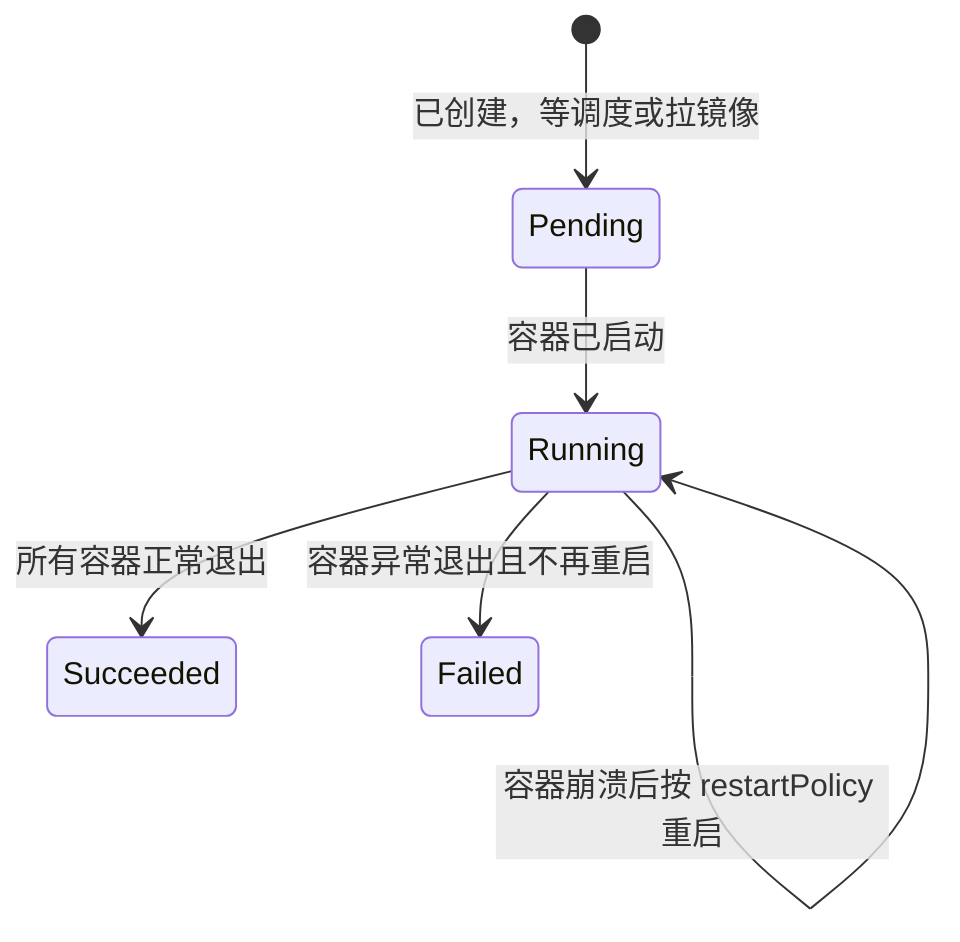
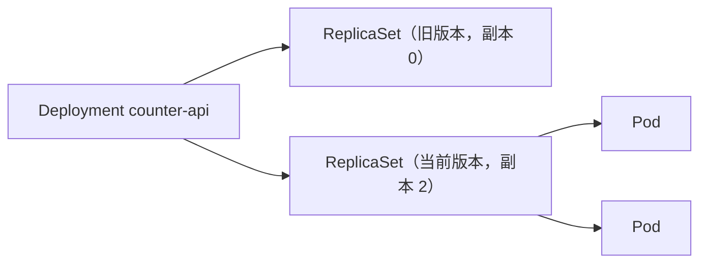
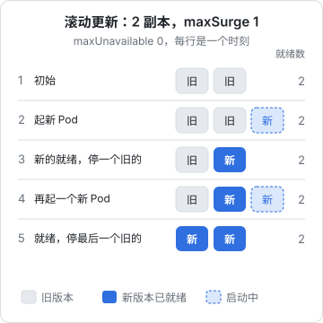
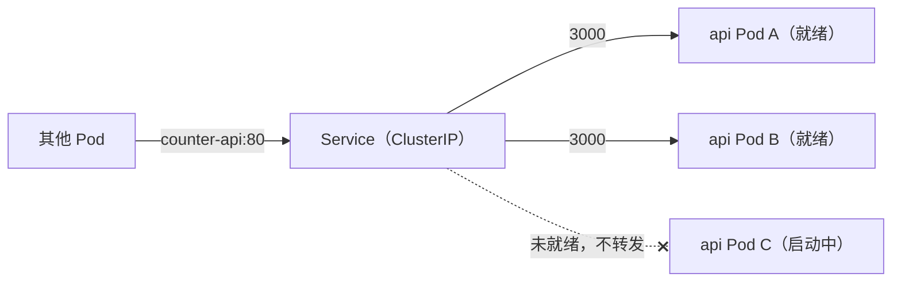

# 核心对象：Pod、Deployment、Service

上一章讲了 K8s 的思想：提交期望状态，控制器负责调和。这一章落到具体对象上。把 hatch-counter 的服务端跑进集群，最少需要三样东西：**Pod**（容器真正跑的地方）、**Deployment**（管 Pod 的副本数和版本）、**Service**（给一组 Pod 一个稳定的访问地址）。写完这一章，你会有一份能滚动发布、能自我修复的服务端清单。

## 先起一个练习集群

第 7 章才在服务器上搭正式集群。练习阶段在本机起一个就够了，几种常见选择：

| 方式 | 说明 |
|---|---|
| k3d | 把 k3s 跑在 Docker 容器里，和第 7 章的生产环境同源，推荐 |
| Docker Desktop / OrbStack 自带的 Kubernetes | 设置里勾一下就有，省事 |
| kind | 社区常用于 CI 测试的「Docker 里的 K8s」 |
| minikube | 老牌方案，支持多种驱动 |

以 k3d 为例（macOS 用 Homebrew 安装）：

```bash
brew install k3d kubectl

# 起一个单节点集群，把集群的 80/443 映射到本机 8080/8443，后面练 Ingress 要用
k3d cluster create counter-lab -p "8080:80@loadbalancer" -p "8443:443@loadbalancer"

kubectl get nodes
```

```text
NAME                       STATUS   ROLES           AGE   VERSION
k3d-counter-lab-server-0   Ready    control-plane   20s   v1.3x.x+k3s1
```

`kubectl` 通过 `~/.kube/config` 知道连哪个集群。k3d 创建集群时会自动写入并切换上下文，`kubectl config get-contexts` 可以看当前连的是哪个。**养成看上下文的习惯**：以后本机同时有练习集群和生产集群，敲错上下文的后果你不会想体验。

## Pod：最小调度单位

Pod 是 K8s 里能被调度的最小单位。它是**一个或多个容器的组合**，这些容器：

- 共享同一个网络命名空间：同一个 IP，互相用 `localhost` 访问
- 可以共享卷
- 总是被调度到同一个节点，同生共死

为什么不直接调度容器？因为有些进程天然要紧挨着跑，比如应用容器加一个日志收集 sidecar。Pod 给了它们一个共同的「小主机」。不过大多数情况下一个 Pod 就一个容器，hatch-counter 的服务端也是如此。

一个最简单的 Pod：

```yaml
apiVersion: v1
kind: Pod
metadata:
  name: hello
  labels:
    app: hello
spec:
  containers:
    - name: web
      image: nginx:1.27-alpine
      ports:
        - containerPort: 80
```

```bash
kubectl apply -f pod.yaml
kubectl get pods -o wide        # 看状态、IP、在哪个节点
kubectl logs hello              # 看日志
kubectl exec -it hello -- sh    # 进容器
kubectl delete pod hello
```

**生产中几乎从不直接创建 Pod。** 裸 Pod 被删了、节点挂了，就没了，没有任何东西会把它补回来。Pod 应该由上层控制器（Deployment、StatefulSet、Job）创建和管理。可以把 Pod 理解成「一次运行」，而不是「一个服务」：它的 IP 每次重建都会变，名字带随机后缀，随时可能被替换。

### Pod 的生命周期



排障时常见的几个状态：

| 你看到的 | 含义 | 先查什么 |
|---|---|---|
| `Pending` | 没节点能放下，或者 PVC 没绑上 | `kubectl describe pod` 的 Events |
| `ImagePullBackOff` | 拉不到镜像 | 镜像名、tag、仓库凭证（第 3 章） |
| `CrashLoopBackOff` | 容器起来就退出，K8s 在指数退避重试 | `kubectl logs --previous` 看上一次的日志 |
| `Running` 但 `READY 0/1` | 进程在，就绪探针没过 | 探针配置、应用日志 |
| `OOMKilled` | 超了内存 limit 被杀 | 调整 limits 或排查内存泄漏 |

## Deployment：管副本和版本

Deployment 是跑无状态服务的标准方式。它的结构是三层：



- **ReplicaSet** 保证「某个 Pod 模板」有 N 个副本
- **Deployment** 管理多个 ReplicaSet：每次改 Pod 模板（换镜像、改环境变量），就新建一个 ReplicaSet，然后逐步把旧的缩到 0、新的扩到 N。旧的 ReplicaSet 保留着，回滚时直接扩回来

下面是 hatch-counter 服务端的 Deployment。环境变量和密钥留到第 3 章接上，这里先关注结构、探针和资源：

```yaml
apiVersion: apps/v1
kind: Deployment
metadata:
  name: counter-api
  namespace: counter
  labels:
    app.kubernetes.io/name: counter-api
    app.kubernetes.io/part-of: counter
spec:
  replicas: 2
  revisionHistoryLimit: 5
  selector:
    matchLabels:
      app.kubernetes.io/name: counter-api
  strategy:
    type: RollingUpdate
    rollingUpdate:
      maxSurge: 1
      maxUnavailable: 0
  template:
    metadata:
      labels:
        app.kubernetes.io/name: counter-api
        app.kubernetes.io/part-of: counter
    spec:
      terminationGracePeriodSeconds: 30
      containers:
        - name: api
          image: registry.example.com/counter/api:1.4.0
          ports:
            - name: http
              containerPort: 3000
          resources:
            requests:
              cpu: 100m
              memory: 256Mi
            limits:
              memory: 512Mi
          startupProbe:
            httpGet:
              path: /v1/health
              port: http
            periodSeconds: 2
            failureThreshold: 30
          readinessProbe:
            httpGet:
              path: /v1/health
              port: http
            periodSeconds: 5
            failureThreshold: 2
          livenessProbe:
            tcpSocket:
              port: http
            periodSeconds: 10
            failureThreshold: 3
          lifecycle:
            preStop:
              sleep:
                seconds: 5
```

逐块讲。

### selector 和 labels

`spec.selector.matchLabels` 决定这个 Deployment 管哪些 Pod，必须和 `template.metadata.labels` 匹配。**selector 创建后不可修改**，想改只能删了重建。所以一开始就用稳定的标签，`app.kubernetes.io/name` 这一组是官方推荐的标签约定，工具链都认。

### 三种探针：别把它们混用

这是从 Compose 迁过来最容易出错的地方。Compose 只有一个 healthcheck，K8s 有三个，各管一件事：

| 探针 | 失败的后果 | 用来回答 |
|---|---|---|
| startupProbe | 启动期间失败到上限就杀掉重启；成功前不跑另外两个 | 「启动完了吗」 |
| readinessProbe | 从 Service 的转发列表里摘掉，**不重启** | 「现在能接流量吗」 |
| livenessProbe | **杀掉容器重启** | 「进程是不是卡死了」 |

hatch-counter 的 `/v1/health` 会真去数据库 `select` 一下。这对**就绪**判断是对的：连不上库的实例接了流量也只能报错，不如先摘掉。

但它**不能用来做存活探针**。设想 Postgres 重启了 30 秒：如果 liveness 也打 `/v1/health`，所有 api 副本会一起被判死、一起重启，库回来时它们还在冷启动，一次数据库抖动被放大成一次全站重启。存活探针只应该检查「这个进程本身」是否还活着，所以这里用 `tcpSocket`：端口还能连上，就说明事件循环没彻底卡死。更严谨的做法是在应用里加一个不碰任何依赖的 `/livez` 接口。

startupProbe 给了最长 60 秒（2 秒 × 30 次）的启动时间，对应原 Dockerfile 里 `start-period=20s` 的意图，又留了余量。有了它，liveness 就不用为了照顾慢启动而把阈值放得很宽。

### resources：requests 和 limits

| 字段 | 作用 |
|---|---|
| `requests` | 调度依据：scheduler 只把 Pod 放到「剩余可分配资源 ≥ requests」的节点上；也决定资源紧张时的分配比例 |
| `limits.memory` | 硬上限，超了被 OOMKill |
| `limits.cpu` | 硬上限，超了被限流（throttle），进程变慢但不会被杀 |

这里故意**没写 CPU limit**。CPU 是可压缩资源，一个服务在突发时多用点 CPU 没有坏处，设了 limit 反而可能在流量尖峰时被节流、延迟飙升。内存是不可压缩资源，必须设 limit，否则一个内存泄漏会拖垮整台机器上的所有 Pod。

单机集群上 requests 尤其重要：它是你给每个组件做的「内存预算」。第 7 章会把整台机器的预算摊开来算。

Node.js 还有一个细节：V8 堆上限和容器内存 limit 要协调。较新的 Node 版本会参考 cgroup 的内存限制来定默认堆大小，但具体策略随版本变化。稳妥起见，可以用 `NODE_OPTIONS=--max-old-space-size=384` 这样显式把堆上限设在 limit 以下，给堆外内存（Buffer、原生模块）留出空间。

### 滚动更新：maxSurge 和 maxUnavailable

`maxSurge: 1, maxUnavailable: 0` 的意思是：更新过程中最多比期望多 1 个 Pod，任何时刻可用的 Pod 都不少于期望值。对 2 副本来说过程是这样的：



新 Pod 必须**通过 readinessProbe** 才算可用，才会继续停下一个旧的。如果新版本启动就报错，它永远不会就绪，更新就卡在第一步，旧的 2 个副本照常服务。这比 `deploy.sh` 的「失败后退回上一个 tag」更进一步：坏版本根本接不到流量。

### 优雅停机：preStop 为什么要睡 5 秒

Pod 被删除时，有两件事**同时**发生：

1. kubelet 给容器发 SIGTERM（先执行 preStop）
2. 控制面把这个 Pod 从 Service 的转发列表（EndpointSlice）里删掉，各节点的 kube-proxy 和 Ingress 控制器再去更新自己的规则

第 2 步需要传播时间。如果容器收到 SIGTERM 立刻关闭监听，传播完成前到达的请求就会失败。`preStop` 里 sleep 几秒，等转发规则更新完再开始关停，是消除滚动发布中零星 502 的标准做法。`lifecycle.preStop.sleep` 是较新的 K8s 版本提供的原生写法；老版本集群上用 `exec: { command: ["sleep", "5"] }`，前提是镜像里有 `sleep`（alpine 有）。

之后 NestJS 收到 SIGTERM，因为 hatch-counter 在 `main.ts` 里调了 `app.enableShutdownHooks()`，它会停止接新连接、跑完 `onModuleDestroy` 等钩子。整个过程要在 `terminationGracePeriodSeconds`（默认 30 秒）内结束，超时会被 SIGKILL。

还有一点：`CMD ["node", "dist/main.js"]` 让 node 直接作为 PID 1 收信号。如果镜像用 `npm start` 或 shell 包一层启动，SIGTERM 可能传不到 node 进程，优雅停机就形同虚设。这一点[《容器技术》](../docker-containers/)讲 Dockerfile 时提过，在 K8s 里它的影响会在每一次滚动发布中体现出来。

### 发布、观察、回滚

```bash
# 换镜像（生产中更常见的是改 YAML 再 apply，或者第 6 章的 helm upgrade）
kubectl -n counter set image deployment/counter-api api=registry.example.com/counter/api:1.5.0

# 盯着滚动过程，失败或超时会返回非 0，适合放进脚本
kubectl -n counter rollout status deployment/counter-api --timeout=180s

# 历史版本，以及退回上一版
kubectl -n counter rollout history deployment/counter-api
kubectl -n counter rollout undo deployment/counter-api
```

和 `deploy.sh` 一样，**回滚只退镜像，退不了数据库迁移**。迁移仍然必须向前兼容上一版代码（先加列不删列），这条纪律迁到 K8s 后一点没变。迁移本身怎么跑，第 3 章讲。

## Service：给一组 Pod 一个稳定地址

Pod 的 IP 随时在变，2 个副本还有 2 个 IP。Service 给它们一个**稳定的虚拟 IP 和 DNS 名字**，并在背后做负载均衡：

```yaml
apiVersion: v1
kind: Service
metadata:
  name: counter-api
  namespace: counter
  labels:
    app.kubernetes.io/name: counter-api
spec:
  selector:
    app.kubernetes.io/name: counter-api
  ports:
    - name: http
      port: 80
      targetPort: http
```

- `selector` 按标签挑 Pod，只有**就绪**的 Pod 会出现在转发列表里
- `port` 是 Service 自己的端口，`targetPort` 是 Pod 上的端口，这里引用了容器端口的名字 `http`，以后容器端口改了不用改 Service
- 集群内任何 Pod 都可以用 `http://counter-api.counter.svc.cluster.local` 访问它，同一命名空间里直接写 `http://counter-api`



这就是 Compose 里 `postgres:5432` 那种服务名解析的 K8s 版本，只是多了健康感知的负载均衡。Service 的类型（ClusterIP / NodePort / LoadBalancer）和集群 DNS 的细节放到第 4 章。

本地调试时，不用暴露任何东西就能访问：

```bash
kubectl -n counter port-forward svc/counter-api 3000:80
curl http://127.0.0.1:3000/v1/health
```

## Namespace：把一个项目圈起来

上面的对象都写了 `namespace: counter`。命名空间是对象名字的作用域，也是权限、资源配额、网络策略的边界。单机集群上它的主要价值是**整理**：一个项目一个命名空间，`kubectl -n counter get all` 一眼看完，不想要了 `kubectl delete namespace counter` 一次删干净。

```yaml
apiVersion: v1
kind: Namespace
metadata:
  name: counter
  labels:
    app.kubernetes.io/part-of: counter
```

嫌每次敲 `-n counter` 麻烦，可以设置当前上下文的默认命名空间：

```bash
kubectl config set-context --current --namespace=counter
```

## 常用 kubectl 速查

| 想做什么 | 命令 |
|---|---|
| 应用一个目录下所有清单 | `kubectl apply -f k8s/` |
| 先看会改什么 | `kubectl diff -f k8s/` |
| 只在服务端校验、不落盘 | `kubectl apply -f k8s/ --dry-run=server` |
| 列出资源 | `kubectl get deploy,svc,pods -o wide` |
| 看对象详情和事件 | `kubectl describe pod <名字>` |
| 看最近事件 | `kubectl get events --sort-by=.lastTimestamp` |
| 看日志（含上一次崩溃） | `kubectl logs deploy/counter-api --previous` |
| 跟随多个 Pod 的日志 | `kubectl logs -l app.kubernetes.io/name=counter-api -f` |
| 资源占用（k3s 自带 metrics-server） | `kubectl top pods` |
| 查字段含义 | `kubectl explain deployment.spec.strategy` |

`kubectl explain` 值得单独提一句：它直接从集群的 API 定义里读字段说明，永远和你的集群版本一致，比凭记忆写 YAML 或者让 AI 生成后不核对可靠得多。

## 本章要点

- 练习用 k3d 在本机起 k3s，和生产环境同源；操作前先确认 kubectl 的当前上下文
- **Pod** 是最小调度单位、是「一次运行」，生产中不直接创建，由控制器管理
- **Deployment** 通过 ReplicaSet 管副本和版本，`maxSurge: 1, maxUnavailable: 0` 实现新版本就绪后才下线旧版本
- 三种探针各司其职：readiness 可以查依赖，**liveness 绝不能查数据库**，startup 照顾慢启动
- 内存必须设 limit；CPU 设 requests 不设 limit 是常见的稳妥做法
- preStop 短暂 sleep + 应用处理 SIGTERM，才能消除滚动发布的零星失败
- **Service** 用标签选择就绪的 Pod，提供稳定的 DNS 名和负载均衡
- 回滚只退镜像，迁移仍然要向前兼容
