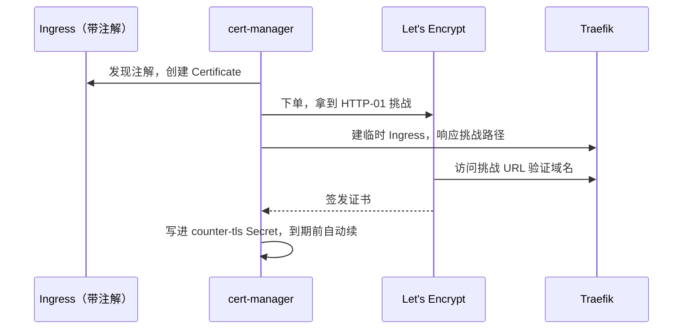

# 网络与 Ingress

Compose 版的流量入口是宿主机上的 nginx：按域名分流、终结 TLS、把 `/v1/` 反代到 `127.0.0.1:3000`，证书靠 certbot 定时续期。这一章把这一层搬进集群：先理解 K8s 的网络模型和 Service 的几种类型，再用 **Ingress** 替代 nginx 的反代配置，用 **cert-manager** 替代 certbot，最后用 **NetworkPolicy** 把数据库圈起来。

## K8s 的网络模型

K8s 对网络只提了几条要求，具体实现交给 CNI 插件：

- 每个 Pod 有自己独立的 IP
- 所有 Pod 之间不经 NAT 就能直接互通，无论在不在同一个节点
- 节点上的进程能访问本节点所有 Pod

这和 Docker 默认的 bridge 网络很不一样：Docker 里每个 compose 项目一张网，容器间隔离靠网络边界；K8s 是**一张扁平的大网**，默认人人互通，隔离要靠 NetworkPolicy 额外声明。k3s 默认的 CNI 是 Flannel，单机集群上你基本感觉不到它的存在。

在这张网上，有三层地址：

| 地址 | 稳定吗 | 谁用 |
|---|---|---|
| Pod IP | 不稳定，Pod 重建就变 | 几乎不直接用 |
| Service ClusterIP + DNS 名 | 稳定 | 集群内部服务互相访问 |
| Ingress / LoadBalancer 对外地址 | 稳定 | 集群外的客户端 |

## Service 的类型

第 2 章写的 Service 没指定 `type`，默认是 ClusterIP。完整的选择是：

| 类型 | 能从哪访问 | 典型用途 |
|---|---|---|
| ClusterIP | 只在集群内 | 绝大多数内部服务：api、postgres |
| NodePort | 每个节点 IP 的某个高位端口（默认 30000–32767） | 调试，或者前面还有一层外部负载均衡 |
| LoadBalancer | 云厂商分配的外部 IP | 云上托管集群对外暴露入口 |
| ClusterIP: None（headless） | 没有虚拟 IP，DNS 直接返回各 Pod IP | StatefulSet，第 5 章用到 |

在自建的单机 k3s 上，没有云厂商来分配 LoadBalancer IP。k3s 自带一个叫 **ServiceLB** 的简易实现：给每个 LoadBalancer 类型的 Service 在节点上起一个小代理，直接占用节点的对应端口。k3s 自带的 Traefik 就是用这种方式占住了节点的 80 和 443。

一个推论：**k3s 装好后，节点的 80/443 已经被 Traefik 占了**，宿主机 nginx 和它不能同时监听这两个端口。第 7 章会讨论两种迁移路线：让 Traefik 接管入口，或者暂时关掉 Traefik、让 nginx 继续站在前面。

### 集群 DNS

CoreDNS 给每个 Service 一个 DNS 名：

```text
<service>.<namespace>.svc.cluster.local
```

同一命名空间内只写 `<service>` 就行，跨命名空间写 `<service>.<namespace>`。所以 hatch-counter 的连接串里写 `postgres:5432`，前提是 Postgres 的 Service 叫 `postgres` 并且和 api 在同一个命名空间。

排查 DNS 问题时，起一个临时 Pod 进去查：

```bash
kubectl -n counter run dns-test --rm -it --image=busybox:1.36 --restart=Never -- nslookup postgres
```

## Ingress：集群的 HTTP 入口

Service 工作在 TCP/UDP 层，不懂域名和路径。按域名、按路径分流、终结 TLS 这些 HTTP 层的事，交给 **Ingress**。

Ingress 分两部分，这一点要先搞清楚：

- **Ingress 对象**：你写的路由规则，「某个域名的某个路径转给某个 Service」
- **Ingress 控制器**：真正干活的反向代理，它 watch 所有 Ingress 对象，把规则翻译成自己的配置

只写 Ingress 对象而集群里没有控制器，什么都不会发生。常见的控制器：

| 控制器 | 说明 |
|---|---|
| Traefik | k3s 默认自带，配置通过 Ingress 注解和它自己的 CRD（Middleware 等） |
| ingress-nginx | 社区维护多年的 nginx 实现。Kubernetes 社区已宣布该项目退役、停止后续维护，新集群不建议再选它，具体时间以官方公告为准 |
| 各云厂商的控制器 | 把 Ingress 翻译成云上的负载均衡器 |

另外要知道 **Gateway API**：它是 Ingress 的继任者，用 `Gateway`、`HTTPRoute` 等对象把「基础设施管理员」和「应用开发者」的职责拆开，表达能力也更强（流量切分、请求头匹配等）。Ingress API 本身已冻结、不再加新功能，但仍是稳定 GA 的 API，不会被移除。对单人单机的场景，Ingress 足够简单，本书用它；Traefik 也支持 Gateway API，以后想迁不难。

### hatch-counter 的入口规则

Compose 版的 nginx 按域名分了好几个站。迁移时先处理两个和服务端有关的：

- `api.example.com`：整站转给服务端（移动端用）
- `app.example.com`：网页端静态文件，`/v1/` 转给服务端

网页端的静态文件原本由宿主机 nginx 直接从磁盘上读。迁进集群的一个简单做法是：CI 构建网页端时，把产物打进一个 nginx 镜像，在集群里跑成一个小 Deployment（`counter-web`），配一个同名 Service。这样网页端的发布也变成了「换镜像 tag」，和服务端一个模式。

```yaml
apiVersion: networking.k8s.io/v1
kind: Ingress
metadata:
  name: counter
  namespace: counter
  annotations:
    cert-manager.io/cluster-issuer: letsencrypt
    traefik.ingress.kubernetes.io/router.middlewares: counter-redirect-https@kubernetescrd
spec:
  ingressClassName: traefik
  tls:
    - hosts:
        - api.example.com
        - app.example.com
      secretName: counter-tls
  rules:
    - host: api.example.com
      http:
        paths:
          - path: /
            pathType: Prefix
            backend:
              service:
                name: counter-api
                port:
                  name: http
    - host: app.example.com
      http:
        paths:
          - path: /v1
            pathType: Prefix
            backend:
              service:
                name: counter-api
                port:
                  name: http
          - path: /
            pathType: Prefix
            backend:
              service:
                name: counter-web
                port:
                  name: http
```

几个要点：

- **`ingressClassName`** 指定由哪个控制器处理。集群里只有一个控制器时也建议写上，免得以后多装一个时规则被抢
- **`pathType: Prefix`** 按路径段匹配：`/v1` 匹配 `/v1` 和 `/v1/stores`，但不匹配 `/v1abc`。同一个 host 下更长的路径优先，所以 `/v1` 会先于 `/` 生效
- **路径不改写**：请求 `/v1/stores` 到达服务端时还是 `/v1/stores`。这和原 nginx 配置 `proxy_pass` 不带路径的写法效果一致，服务端的路由本来就带 `/v1` 前缀
- **`tls`** 声明这两个域名用 `counter-tls` 这个 Secret 里的证书。这个 Secret 不用手动建，下面的 cert-manager 会根据注解自动申请并写入

### HTTP 跳转 HTTPS：Traefik Middleware

注解里引用的 `counter-redirect-https@kubernetescrd` 是 Traefik 的一个 Middleware 对象，格式是「命名空间-名字@来源」：

```yaml
apiVersion: traefik.io/v1alpha1
kind: Middleware
metadata:
  name: redirect-https
  namespace: counter
spec:
  redirectScheme:
    scheme: https
    permanent: true
```

已经是 HTTPS 的请求不会被重定向，所以同一个 Ingress 同时服务 80 和 443 不会循环跳转。Middleware 还能做限流（`rateLimit`）、Basic Auth、加响应头等，相当于把 nginx 配置里那些 `location` 块里的指令拆成了可复用的对象。

`traefik.io/v1alpha1` 是 Traefik 自己的 CRD 版本号，名字里虽然带 alpha，却是 Traefik 2.10 之后和 3.x 的正式写法；更早的版本用的是 `traefik.containo.us/v1alpha1`。CRD 的版本跟着控制器走，升级 k3s 时要留意它附带的 Traefik 大版本变化。

### 搬过来时别忘了的几处细节

原 nginx 配置里有几处「不配会出事」的设置，换成 Traefik 要逐一对上：

| nginx 里的设置 | 原因 | 在 Traefik 里 |
|---|---|---|
| `client_max_body_size` 调大 | 服务端请求体上限 12MB（拍照的进货单、整月的收银报表），nginx 默认 1MB | Traefik 默认不限制请求体大小；如果你加了 Buffering 中间件，要把它的上限设到 12MB 以上 |
| SSE 长连接不缓冲、超时放宽 | 网页端有一条推送长连接 | Traefik 默认流式转发响应；入口的超时配置以所用版本的文档为准，上线后实测一条连接能挂多久 |
| `X-Forwarded-For` / `X-Forwarded-Proto` | 服务端要知道真实客户端 IP 和协议 | Traefik 默认会设置这两个头 |

最后一行牵出 `TRUST_PROXY` 该填几的问题。请求路径是：客户端 → Traefik → api Pod。对服务端来说直接连它的是 Traefik，只隔一层，所以 Express 的 `trust proxy` 填 `1`。但这里有个坑：k3s 的 ServiceLB 默认会对进来的连接做 SNAT，Traefik 看到的源地址是节点内部地址而不是真实客户端，它写进 `X-Forwarded-For` 的自然也是错的。解决办法是把 Traefik 的 Service 改成 `externalTrafficPolicy: Local`，保留源 IP。k3s 用一个 `HelmChartConfig` 对象覆盖内置 Traefik 的配置：

```yaml
apiVersion: helm.cattle.io/v1
kind: HelmChartConfig
metadata:
  name: traefik
  namespace: kube-system
spec:
  valuesContent: |-
    service:
      spec:
        externalTrafficPolicy: Local
```

把它放进 `/var/lib/rancher/k3s/server/manifests/traefik-config.yaml`，k3s 会自动应用并重新部署 Traefik。改完以后用一个会打印客户端 IP 的接口实测，确认看到的是你自己的公网 IP。限流、登录风控都依赖这个值，错了的后果是「所有人共享一个限流额度」。

## cert-manager：证书自动续期

cert-manager 是一个控制器，它定义了 `Certificate`、`Issuer` 等 CRD，负责向 Let's Encrypt 这类 CA 申请证书、写进 Secret、到期前自动续期。安装通常用它官方的 Helm chart 或发布页上的清单（以官方文档为准），装好后在 `cert-manager` 命名空间里会有三个 Deployment。

然后建一个集群级的签发者：

```yaml
apiVersion: cert-manager.io/v1
kind: ClusterIssuer
metadata:
  name: letsencrypt
spec:
  acme:
    server: https://acme-v02.api.letsencrypt.org/directory
    email: ops@example.com
    privateKeySecretRef:
      name: letsencrypt-account-key
    solvers:
      - http01:
          ingress:
            ingressClassName: traefik
```

流程是这样的：



几个实践建议：

- 先用 Let's Encrypt 的 **staging** 地址（`acme-staging-v02`）调通再切正式地址，正式环境有频率限制，调试时反复失败可能被临时封
- HTTP-01 要求 80 端口能从公网访问到 Traefik。如果服务器在境内且域名未备案，80/443 可能根本不通，这是合规问题而不是技术问题
- 进度看 `kubectl -n counter get certificate,certificaterequest,order,challenge`，卡住时 `describe` 那个 challenge 一般能看到原因

和 certbot 的区别是：证书变成了集群里的一个声明式对象，续期由控制器持续调和，失败会在对象状态和事件里留下记录。但**过期告警仍然要自己做**，证书过期等于所有客户端同时连不上，最好在外部可用性监控里加一条证书剩余天数的检查。

## NetworkPolicy：把数据库圈起来

前面说过，K8s 默认 Pod 之间全通。Compose 版的 Postgres 不开端口、只在 compose 网络里可见；在 K8s 里，同集群任何 Pod 都能连 `postgres.counter:5432`。单人集群里「任何 Pod」看起来就是自己的那几个，但只要以后装了任何第三方 chart，它们就和你的数据库在同一张网上。

k3s 内置了 NetworkPolicy 的实现，可以直接用：

```yaml
apiVersion: networking.k8s.io/v1
kind: NetworkPolicy
metadata:
  name: postgres-ingress
  namespace: counter
spec:
  podSelector:
    matchLabels:
      app.kubernetes.io/name: postgres
  policyTypes:
    - Ingress
  ingress:
    - from:
        - podSelector:
            matchExpressions:
              - key: app.kubernetes.io/name
                operator: In
                values:
                  - counter-api
                  - counter-migrate
                  - postgres-backup
      ports:
        - protocol: TCP
          port: 5432
```

语义是：**选中了 postgres 的 Pod 之后，只放行列出的来源**，其余的入站连接一律拒绝。`from` 里只写 `podSelector` 时只匹配同一命名空间的 Pod。`postgres-backup` 是第 5 章的备份任务，要提前放进白名单，否则备份会静悄悄地连不上。

写完一定要验证「该通的通、不该通的不通」：

```bash
# 应该超时：一个不在白名单里的临时 Pod
kubectl -n counter run nettest --rm -it --image=busybox:1.36 --restart=Never -- \
  nc -zv -w 3 postgres 5432
```

## 本章要点

- K8s 是一张扁平网络，Pod 默认互通，隔离要靠 NetworkPolicy 声明
- Service 有 ClusterIP、NodePort、LoadBalancer、headless 四种用法；k3s 的 ServiceLB 让 Traefik 直接占用节点的 80/443
- 集群内用 `<service>` 或 `<service>.<namespace>` 访问服务，Service 叫 `postgres` 就能沿用原连接串
- Ingress 对象是规则，控制器才是干活的代理；k3s 默认 Traefik，ingress-nginx 已宣布退役，Gateway API 是继任者
- 迁移 nginx 时逐项对上请求体上限、长连接、转发头；`externalTrafficPolicy: Local` 才能拿到真实客户端 IP
- cert-manager 让证书成为声明式对象并自动续期，但过期告警仍需外部监控
- 用 NetworkPolicy 只放行 api、迁移、备份三类 Pod 访问 Postgres，并实际验证
