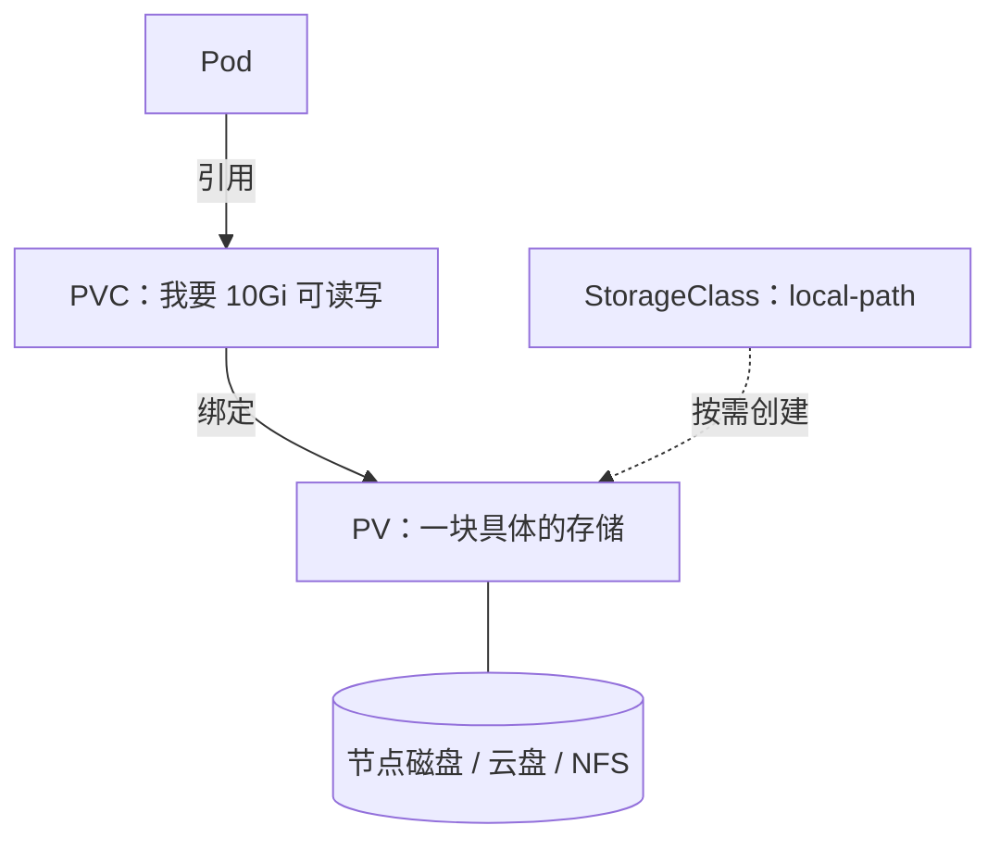

# 存储

前几章的服务端是无状态的：Pod 随便删、随便重建，没有任何损失。Postgres 不一样，它的数据目录就是 hatch-counter 所有门店的账本。Compose 版用一个命名卷 `pgdata` 保存它，注释里写着「放容器可写层的话，`docker rm` 一下整本账就没了」。这一章讲 K8s 里对应的机制：**PersistentVolume / PersistentVolumeClaim / StorageClass** 三件套，用 **StatefulSet** 跑 Postgres，再用 **CronJob** 做定时备份。最后讨论一个更根本的问题：数据库到底该不该放进集群。

## 三件套：PV、PVC、StorageClass

K8s 把「存储从哪来」和「谁要用存储」拆成了两边：



| 对象 | 是什么 | 谁写 |
|---|---|---|
| PersistentVolume（PV） | 一块具体的存储，有容量、访问模式、回收策略 | 管理员手写，或由供给器自动创建 |
| PersistentVolumeClaim（PVC） | 一份「存储申请」：要多大、什么访问模式、哪个 StorageClass | 应用这一侧 |
| StorageClass | 一类存储的模板和供给器（provisioner） | 管理员，或集群自带 |

应用只写 PVC，不关心底下是本地磁盘还是云盘。PVC 提交后，StorageClass 的供给器按需创建 PV 并绑定。这叫**动态供给**。

### 访问模式和回收策略

| 访问模式 | 含义 |
|---|---|
| ReadWriteOnce（RWO） | 只能被一个节点以读写方式挂载，数据库用这个 |
| ReadWriteOncePod | 只能被一个 Pod 挂载，比 RWO 更严格 |
| ReadOnlyMany / ReadWriteMany | 多节点共享，需要 NFS 一类网络存储支持 |

| 回收策略 | PVC 被删除后 |
|---|---|
| Delete | PV 和底层数据**一起删除** |
| Retain | PV 保留，数据还在，需要人工处理 |

**动态供给的 StorageClass 默认回收策略通常是 Delete。** 这意味着一次手滑的 `kubectl delete pvc`，或者删掉整个命名空间，数据就真没了。这比 Compose 危险：`docker compose down` 默认不删命名卷，要加 `-v` 才删。

### k3s 的 local-path

k3s 自带 local-path-provisioner，StorageClass 名叫 `local-path`，并设为默认。它的做法很朴素：每个 PVC 在节点上建一个目录（默认在 `/var/lib/rancher/k3s/storage/` 下），用 hostPath 的方式挂进 Pod。

| 特点 | 影响 |
|---|---|
| 数据就在本机磁盘上 | 性能和直接用磁盘一样，单机集群的首选 |
| PV 绑定在创建它的节点上 | 多节点时 Pod 不能漂移到别的节点，单机无所谓 |
| 不强制容量限制 | PVC 写 10Gi 只是声明，实际能写满整块盘 |
| 不支持快照、扩容 | 备份要自己做 |
| 默认回收策略 Delete | 见上，要处理 |

针对最后一条，给数据库单独建一个回收策略为 Retain 的 StorageClass：

```yaml
apiVersion: storage.k8s.io/v1
kind: StorageClass
metadata:
  name: local-path-retain
provisioner: rancher.io/local-path
reclaimPolicy: Retain
volumeBindingMode: WaitForFirstConsumer
```

`volumeBindingMode: WaitForFirstConsumer` 表示等使用它的 Pod 被调度后再创建 PV，这样 PV 会建在 Pod 所在的节点上，local-path 必须这样配。已经存在的 PV 也可以随时改成 Retain：

```bash
kubectl patch pv <pv 名字> -p '{"spec":{"persistentVolumeReclaimPolicy":"Retain"}}'
```

## StatefulSet：给有状态服务的控制器

Deployment 的 Pod 是可互换的：名字随机、谁先谁后无所谓、共享同一个 PVC 会出问题。数据库需要的恰恰相反：

| 需求 | StatefulSet 怎么满足 |
|---|---|
| 稳定的身份 | Pod 名字固定为 `<名字>-0`、`<名字>-1`…… |
| 每个实例有自己的存储 | `volumeClaimTemplates` 为每个 Pod 生成独立的 PVC，Pod 重建后重新挂上同一个 |
| 有序启停 | 按序号顺序创建、逆序删除 |
| 稳定的网络名 | 配合 headless Service，每个 Pod 有 `<pod>.<service>` 的 DNS 名 |

单副本的 Postgres 用 StatefulSet 主要图的是第二条：PVC 和 Pod 的绑定关系由控制器维护，Pod 删了重建，还是挂原来那块数据。另一个不那么显眼的好处是：StatefulSet 在更新时会先停掉旧 Pod 再起新 Pod，不会出现两个 Postgres 进程同时打开同一个数据目录的情况。如果你用 Deployment 跑数据库，默认的滚动更新会先起新 Pod，两个实例争抢同一个目录，后果很难预料。

### hatch-counter 的 Postgres

先是密钥，对应原来的 `postgres.env`：

```yaml
apiVersion: v1
kind: Secret
metadata:
  name: postgres-secret
  namespace: counter
type: Opaque
stringData:
  POSTGRES_USER: counter
  POSTGRES_PASSWORD: CHANGE_ME
  POSTGRES_DB: counter
```

然后是 headless Service 和 StatefulSet：

```yaml
apiVersion: v1
kind: Service
metadata:
  name: postgres
  namespace: counter
  labels:
    app.kubernetes.io/name: postgres
spec:
  clusterIP: None
  selector:
    app.kubernetes.io/name: postgres
  ports:
    - name: postgres
      port: 5432
      targetPort: postgres
---
apiVersion: apps/v1
kind: StatefulSet
metadata:
  name: postgres
  namespace: counter
  labels:
    app.kubernetes.io/name: postgres
    app.kubernetes.io/part-of: counter
spec:
  serviceName: postgres
  replicas: 1
  selector:
    matchLabels:
      app.kubernetes.io/name: postgres
  template:
    metadata:
      labels:
        app.kubernetes.io/name: postgres
        app.kubernetes.io/part-of: counter
    spec:
      terminationGracePeriodSeconds: 60
      imagePullSecrets:
        - name: registry-cred
      containers:
        - name: postgres
          image: registry.example.com/counter/postgres:16-alpine
          envFrom:
            - secretRef:
                name: postgres-secret
          env:
            - name: PGDATA
              value: /var/lib/postgresql/data/pgdata
          ports:
            - name: postgres
              containerPort: 5432
          resources:
            requests:
              cpu: 250m
              memory: 512Mi
            limits:
              memory: 1Gi
          readinessProbe:
            exec:
              command: ["pg_isready", "-U", "counter", "-d", "counter"]
            periodSeconds: 10
            timeoutSeconds: 3
          volumeMounts:
            - name: data
              mountPath: /var/lib/postgresql/data
            - name: shm
              mountPath: /dev/shm
      volumes:
        - name: shm
          emptyDir:
            medium: Memory
            sizeLimit: 256Mi
  volumeClaimTemplates:
    - metadata:
        name: data
      spec:
        accessModes:
          - ReadWriteOnce
        storageClassName: local-path-retain
        resources:
          requests:
            storage: 20Gi
```

逐项说明：

- **Service 名叫 `postgres`、`clusterIP: None`**：headless Service 同时满足 StatefulSet 对 `serviceName` 的要求，也让 `postgres` 这个名字直接解析到 Pod IP。单副本的情况下，第 3 章连接串里的 `postgres:5432` 原样可用
- **`PGDATA` 指向子目录**：有些存储挂进来的根目录里带 `lost+found` 之类的东西，Postgres 的 initdb 要求数据目录为空，放在子目录里可以避开。local-path 不会有这个问题，但这样写换存储时不用再改。注意官方 Postgres 镜像从 18 开始调整了默认数据目录的布局，升级大版本时要按镜像说明重新核对挂载路径
- **`/dev/shm` 挂内存卷**：容器默认的共享内存只有 64MB，Postgres 的并行查询会用到共享内存，不够时报 `could not resize shared memory segment`。Compose 里用 `shm_size` 解决，K8s 里用 `medium: Memory` 的 emptyDir
- **只有 readinessProbe，没有 livenessProbe**：数据库在做长时间恢复或检查点时可能暂时无响应，被存活探针误杀重启只会更糟。原 compose 也只有一个 `pg_isready` 健康检查，用途是「什么时候能连」，对应的正是就绪探针
- **`terminationGracePeriodSeconds: 60`**：给 Postgres 足够的时间做干净的关闭（写检查点）。被 SIGKILL 的 Postgres 下次启动要做崩溃恢复
- **requests 和 limits**：这里的数值是一台 4GB 机器上的示例预算，要和 Postgres 自身的 `shared_buffers` 等参数一起调，参数怎么定见[《PostgreSQL 运维》](../database-ops/)

### 数据库用的角色从哪来

hatch-counter 有三个数据库角色，原先是在库初始化后用 SQL 建的。Postgres 镜像会执行 `/docker-entrypoint-initdb.d/` 下的脚本，但**只在数据目录为空、第一次初始化时执行**。迁移场景下数据来自旧库的导出，角色也会随导出一起过来（用 `pg_dumpall --roles-only` 导出角色），不需要依赖初始化脚本。具体导入步骤放在第 7 章切换流量时讲。

## 用 CronJob 做定时备份

**PVC 不是备份。** local-path 的数据就在本机磁盘上，磁盘坏了、机器被误删、误执行了一条 `DROP TABLE`，PVC 都救不了你。备份的完整方法论（逻辑备份、WAL 归档、时间点恢复、恢复演练）在《PostgreSQL 运维》里，这里只演示 K8s 怎么定时跑一个 `pg_dump`：

```yaml
apiVersion: v1
kind: PersistentVolumeClaim
metadata:
  name: postgres-backups
  namespace: counter
spec:
  accessModes:
    - ReadWriteOnce
  storageClassName: local-path-retain
  resources:
    requests:
      storage: 20Gi
---
apiVersion: batch/v1
kind: CronJob
metadata:
  name: postgres-backup
  namespace: counter
spec:
  schedule: "30 3 * * *"
  timeZone: Asia/Shanghai
  concurrencyPolicy: Forbid
  successfulJobsHistoryLimit: 3
  failedJobsHistoryLimit: 3
  jobTemplate:
    spec:
      backoffLimit: 1
      activeDeadlineSeconds: 3600
      template:
        metadata:
          labels:
            app.kubernetes.io/name: postgres-backup
        spec:
          restartPolicy: Never
          imagePullSecrets:
            - name: registry-cred
          containers:
            - name: backup
              image: registry.example.com/counter/postgres:16-alpine
              command:
                - sh
                - -c
                - |
                  set -eu
                  f="/backups/counter-$(date +%Y%m%d-%H%M%S).dump"
                  pg_dump -h postgres -U "$POSTGRES_USER" -d "$POSTGRES_DB" -Fc -f "$f.tmp"
                  mv "$f.tmp" "$f"
                  find /backups -name 'counter-*.dump' -mtime +14 -delete
                  ls -lh /backups
              env:
                - name: POSTGRES_USER
                  valueFrom:
                    secretKeyRef:
                      name: postgres-secret
                      key: POSTGRES_USER
                - name: POSTGRES_DB
                  valueFrom:
                    secretKeyRef:
                      name: postgres-secret
                      key: POSTGRES_DB
                - name: PGPASSWORD
                  valueFrom:
                    secretKeyRef:
                      name: postgres-secret
                      key: POSTGRES_PASSWORD
              volumeMounts:
                - name: backups
                  mountPath: /backups
          volumes:
            - name: backups
              persistentVolumeClaim:
                claimName: postgres-backups
```

要点：

- **`timeZone`**：CronJob 默认按控制器所在时区（通常是 UTC）解释 schedule。显式写时区，凌晨 3:30 就是北京时间凌晨 3:30，避开门店营业时间
- **`concurrencyPolicy: Forbid`**：上一次还没跑完就跳过这一次，避免两个备份同时压数据库
- **用同一个 Postgres 镜像**：`pg_dump` 的版本要不低于服务器版本，复用同一个镜像最省心
- **先写 `.tmp` 再改名**：中途失败不会留下一个看起来完整的残缺文件
- **标签 `postgres-backup`**：和第 4 章 NetworkPolicy 的白名单对上，否则连不上库

这份备份仍然在同一块盘上，只防误操作，不防磁盘损坏和机器丢失。异地加密、防删和恢复演练的通用做法见[《一人运维手册》3-2-1 原则](../production-ops/02-backup-dr.md#3-2-1-原则)；放到集群里，就是在同一个 Job 里再加一个容器负责上传，凭证放 Secret。

手动触发一次来验证：

```bash
kubectl -n counter create job --from=cronjob/postgres-backup backup-manual-1
kubectl -n counter logs -f job/backup-manual-1
```

## 数据库该不该放进集群

迁移到这里，值得停下来问一句。把 Postgres 放进 K8s 有三种选择：

| 方案 | 优点 | 代价 |
|---|---|---|
| 原生 StatefulSet（本章） | 简单透明，一切都在一套清单里 | 备份、升级、故障切换全靠自己 |
| Operator（如 CloudNativePG） | 声明式的备份、WAL 归档、主从、大版本升级 | 又一个要理解和升级的控制器；出问题时多一层抽象 |
| 放在集群外 | 数据库的运维方式完全不变 | 集群和数据库是两套管理方式 |

对单机单副本的场景，StatefulSet 跑 Postgres 的数据安全性和 Compose 跑在本质上一样：都是一个进程、一块本地盘、一份你自己负责的备份。K8s 没有让它变得更安全，只是换了一种管理方式。

如果选择把数据库留在集群外（比如继续用 compose 跑，或者直接装在宿主机上，或者用云数据库），集群里的应用照样可以用 `postgres` 这个名字访问它：建一个**不带 selector 的 Service**，再手写一个 EndpointSlice 指向外部地址；如果外部数据库有域名，用 `type: ExternalName` 的 Service 更简单。应用的连接串一个字都不用改。

《PostgreSQL 运维》最后一章「容器里跑数据库的取舍」讨论得更细。本书的贯穿练习选择放进集群，是为了把 StatefulSet、PVC、CronJob 这些概念走一遍；第 9 章会回头评估这个选择。

## 本章要点

- 应用写 **PVC** 申请存储，**StorageClass** 的供给器动态创建 **PV**
- 动态供给默认回收策略多为 **Delete**，删 PVC 就删数据；数据库用 Retain 的 StorageClass
- k3s 的 **local-path** 把数据放在本机目录，性能好，但不限容量、不支持快照，PV 绑死节点
- **StatefulSet** 提供稳定身份、每实例独立 PVC、先停后起的更新，适合跑数据库
- Postgres 清单要注意：`PGDATA` 子目录、`/dev/shm` 内存卷、只用就绪探针、足够的优雅停机时间
- **PVC 不是备份**：CronJob 定时 `pg_dump`，再传到异地，并定期恢复演练
- 单机场景下，K8s 里的 Postgres 不比 Compose 里的更安全，只是换了管理方式

## 动手练习

只在本机练习集群里做，先确认 `kubectl config current-context`，沿用 `lab` 命名空间。这里删的都是练习数据。

1. **Delete 和 Retain**：建一个 PVC `scratch`（`storageClassName: local-path`，1Gi，RWO）和一个挂载它、执行 `sh -c 'echo hello > /data/f && sleep 3600'` 的 busybox Pod。Pod 跑起来后执行 `kubectl get pv` 记下 PV 名，然后删掉 Pod 和 PVC，再 `kubectl get pv`。换成正文里的 `local-path-retain` StorageClass 重做一遍。

   验证：用 `local-path` 时删掉 PVC 后那个 PV 消失；用 `local-path-retain` 时 PV 还在，STATUS 是 `Released`。做完手动 `kubectl delete pv <名字>` 清理。

   参考答案：动态供给的 PV 继承 StorageClass 的回收策略，默认 Delete 会连数据一起删。数据库的 PVC 用 Retain，手滑删了 PVC 至少数据还在。

2. **StatefulSet 的固定身份**：apply 一个 2 副本的 StatefulSet `idt`（配一个同名的 headless Service），容器 `busybox:1.36`，命令 `["sh", "-c", "[ -f /data/id ] || hostname > /data/id; sleep 3600"]`，用 `volumeClaimTemplates` 给每个 Pod 一个 `/data`。等两个 Pod 起来后执行 `kubectl delete pod idt-0`，等它重建，再 `kubectl exec idt-0 -- cat /data/id` 和 `kubectl get pvc`。

   验证：重建后的 Pod 名还是 `idt-0`，文件里是 `idt-0`；PVC 列表里是 `data-idt-0` 和 `data-idt-1` 两个，删 Pod 前后没有变化。

   参考答案：StatefulSet 按序号给 Pod 固定名字，并让同一个序号永远挂回自己那块 PVC。Deployment 做不到这一点，所以数据库用 StatefulSet。

3. **concurrencyPolicy 的效果**：建一个每分钟触发一次、每次 `sleep 90` 的 CronJob（`schedule: "*/1 * * * *"`，容器 `busybox:1.36`，`restartPolicy: Never`），先设 `concurrencyPolicy: Forbid`，观察三四分钟 `kubectl get cronjob` 的 ACTIVE 列和 `kubectl get jobs`；再改成 `Allow` 观察同样长的时间。

   验证：`Forbid` 时 ACTIVE 最多是 `1`，有些分钟没有新 Job；`Allow` 时会出现 ACTIVE 为 `2` 的时刻。做完删除这个 CronJob。

   参考答案：上一次没跑完时，`Forbid` 直接跳过这一次，`Allow` 会并行起一个新的。备份这种会压数据库的任务用 `Forbid`。
