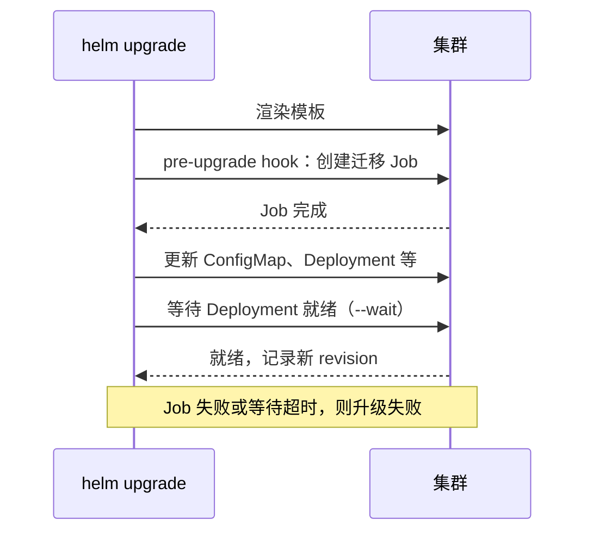

# Helm

到上一章为止，hatch-counter 在集群里已经有十几个对象：Namespace、ConfigMap、两个 Secret、两个 Deployment、三个 Service、StatefulSet、StorageClass、Ingress、Middleware、NetworkPolicy、CronJob，外加每次发版的迁移 Job。每次发版要改好几处镜像 tag，迁移 Job 的名字要手动换，改了 ConfigMap 还要记得 `rollout restart`。这一章用 **Helm** 把与发版相关的部分打包成一个 chart：一条 `helm upgrade` 完成「迁移 → 发布 → 等待就绪 → 失败回滚」。顺带介绍 kubectl 内置的另一条路 Kustomize，以及怎么用 Helm 安装别人写好的软件。

## Helm 解决什么问题

Helm 自称是 K8s 的包管理器，它做三件事：

| 能力 | 解决的问题 |
|---|---|
| 模板 | 同一份清单，用不同的值（镜像 tag、副本数、域名）渲染出不同环境的 YAML |
| Release 管理 | 把一次安装当成一个整体：记录每次升级的版本历史，能整体回滚、整体卸载 |
| 分发 | chart 可以打包上传到仓库，别人一条命令安装。cert-manager、监控栈这些都这样发布 |

第三点是 Helm 在生态里的地位所在：绝大多数开源软件都提供 Helm chart，即使你自己的应用不用 Helm，安装第三方组件时也很难绕开它。

本章的命令按 Helm 4 写，在 Helm 3 上基本通用。Helm 4 调整了部分参数名，比如把 `--atomic` 改名为 `--rollback-on-failure`，旧名暂时还能用但会提示已弃用；遇到参数报错时以 `helm <子命令> --help` 的输出为准。

## 一个 chart 的结构

```text
counter/
  Chart.yaml            # chart 的元信息
  values.yaml           # 默认值
  values-prod.yaml      # 生产环境覆盖的值（可选，名字随意）
  templates/
    _helpers.tpl        # 可复用的模板片段
    api-configmap.yaml
    api-deployment.yaml
    api-service.yaml
    migrate-job.yaml
    web.yaml
    ingress.yaml
    middleware.yaml
```

先决定**什么进 chart、什么不进**。原则是：跟着应用版本一起变的进 chart，生命周期更长的留在外面。

| 进 chart | 不进 chart，单独管理 |
|---|---|
| api / web 的 Deployment、Service | Namespace |
| ConfigMap | Secret 的真实值 |
| 迁移 Job | Postgres 的 StatefulSet、PVC、备份 CronJob |
| Ingress、Middleware | StorageClass、NetworkPolicy |

把数据库放在 chart 外面是故意的。`helm uninstall` 会删掉 release 里的所有对象，Postgres 跟着应用的 chart 走，就意味着一次误操作的卸载会带走数据库（PVC 由 volumeClaimTemplates 创建，默认不随 StatefulSet 删除，但你不会想去验证这一点）。数据库的变更频率也远低于应用，没必要每次发版都让 Helm 碰它。

### Chart.yaml

```yaml
apiVersion: v2
name: counter
description: 掌柜眼服务端和网页端
type: application
version: 0.1.0
appVersion: "1.4.0"
```

- `apiVersion: v2` 是 Helm 3 以来的 chart 格式
- `version` 是 **chart 本身**的版本，模板结构变了才改
- `appVersion` 是应用的版本，仅作展示。镜像 tag 用 values 控制，不和它绑定

### values.yaml

```yaml
image:
  registry: registry.example.com/counter
  pullSecret: registry-cred

api:
  tag: "1.4.0"
  replicas: 2
  resources:
    requests:
      cpu: 100m
      memory: 256Mi
    limits:
      memory: 512Mi
  # 不敏感的配置，渲染进 ConfigMap
  config:
    NODE_ENV: production
    PORT: "3000"
    TRUST_PROXY: "1"
    ACCESS_TOKEN_TTL: 15m
    REFRESH_TOKEN_TTL_DAYS: "30"
  # 敏感配置不进 chart，引用一个事先建好的 Secret
  existingSecret: counter-api-secret

web:
  tag: "1.4.0"
  replicas: 1

ingress:
  className: traefik
  clusterIssuer: letsencrypt
  apiHost: api.example.com
  appHost: app.example.com
  tlsSecret: counter-tls
```

tag 写成带引号的字符串。`1.10` 这样的版本号如果不加引号，YAML 会把它解析成浮点数 1.1，渲染出一个不存在的镜像 tag。

`existingSecret` 是社区 chart 的常见约定：chart 不创建 Secret，只引用一个名字。真实值按第 3 章的办法灌进集群，永远不经过 values 文件，也就不会出现在 Helm 的 release 历史里（Helm 会把每次渲染的完整清单存在集群中的 Secret 里，values 里的明文密码会一直留在那里）。

## 模板

Helm 模板是 Go 的 `text/template` 加上一套叫 Sprig 的函数库。`{{ }}` 里是表达式，`.Values` 是合并后的值，`.Release`、`.Chart` 是内置对象。

### _helpers.tpl：公共片段

```yaml
{{- define "counter.labels" -}}
app.kubernetes.io/part-of: counter
app.kubernetes.io/managed-by: {{ .Release.Service }}
helm.sh/chart: {{ .Chart.Name }}-{{ .Chart.Version }}
{{- end -}}

{{- define "counter.apiImage" -}}
{{ .Values.image.registry }}/api:{{ .Values.api.tag }}
{{- end -}}
```

以下划线开头的文件不会被当成清单渲染，专门放 `define`。`{{-` 和 `-}}` 会吃掉相邻的空白和换行，模板里控制缩进主要靠它们和 `nindent`。

### ConfigMap：从 values 生成

```yaml
apiVersion: v1
kind: ConfigMap
metadata:
  name: counter-api-config
  labels:
    {{- include "counter.labels" . | nindent 4 }}
data:
  {{- range $k, $v := .Values.api.config }}
  {{ $k }}: {{ $v | quote }}
  {{- end }}
```

`quote` 给每个值加引号，彻底避免第 3 章说的「数字和布尔值」问题。`include ... | nindent 4` 把片段插进来并整体缩进 4 格。

### Deployment：配置变了自动重启

```yaml
apiVersion: apps/v1
kind: Deployment
metadata:
  name: counter-api
  labels:
    app.kubernetes.io/name: counter-api
    {{- include "counter.labels" . | nindent 4 }}
spec:
  replicas: {{ .Values.api.replicas }}
  revisionHistoryLimit: 5
  selector:
    matchLabels:
      app.kubernetes.io/name: counter-api
  strategy:
    type: RollingUpdate
    rollingUpdate:
      maxSurge: 1
      maxUnavailable: 0
  template:
    metadata:
      labels:
        app.kubernetes.io/name: counter-api
        {{- include "counter.labels" . | nindent 8 }}
      annotations:
        checksum/config: {{ include (print $.Template.BasePath "/api-configmap.yaml") . | sha256sum }}
    spec:
      terminationGracePeriodSeconds: 30
      imagePullSecrets:
        - name: {{ .Values.image.pullSecret }}
      containers:
        - name: api
          image: {{ include "counter.apiImage" . }}
          envFrom:
            - configMapRef:
                name: counter-api-config
            - secretRef:
                name: {{ .Values.api.existingSecret }}
          ports:
            - name: http
              containerPort: 3000
          resources:
            {{- toYaml .Values.api.resources | nindent 12 }}
          # startupProbe / readinessProbe / livenessProbe / preStop 与第 2 章相同
```

关键是 `checksum/config` 这个注解：把渲染后的 ConfigMap 内容算一个 SHA-256 写进 Pod 模板。ConfigMap 一变，哈希就变，Pod 模板就变，Deployment 自然触发滚动更新。第 3 章「改了配置要记得 rollout restart」的问题由此自动解决。

Secret 不在 chart 里，它变了不会触发重启，改完 Secret 仍要手动 `kubectl rollout restart`。这是 `existingSecret` 模式的代价，换来的是密码不进 Helm 历史。

### 迁移 Job：用 hook 控制顺序

```yaml
apiVersion: batch/v1
kind: Job
metadata:
  name: counter-migrate-{{ .Values.api.tag | replace "." "-" }}
  labels:
    app.kubernetes.io/name: counter-migrate
    {{- include "counter.labels" . | nindent 4 }}
  annotations:
    "helm.sh/hook": post-install,pre-upgrade
    "helm.sh/hook-weight": "0"
    "helm.sh/hook-delete-policy": before-hook-creation
spec:
  backoffLimit: 0
  activeDeadlineSeconds: 600
  template:
    metadata:
      labels:
        app.kubernetes.io/name: counter-migrate
    spec:
      restartPolicy: Never
      imagePullSecrets:
        - name: {{ .Values.image.pullSecret }}
      containers:
        - name: migrate
          image: {{ include "counter.apiImage" . }}
          command: ["./node_modules/.bin/tsx", "src/db/migrate-cli.ts"]
          envFrom:
            - configMapRef:
                name: counter-api-config
            - secretRef:
                name: {{ .Values.api.existingSecret }}
```

带 `helm.sh/hook` 注解的资源不属于普通清单，Helm 会在特定时刻单独创建它，**并等它完成**才继续：



为什么是 `post-install,pre-upgrade` 而不是 `pre-install,pre-upgrade`？因为**第一次安装时**，ConfigMap 还不存在，pre-install 阶段的迁移 Job 会因为引用不到配置而起不来。首次安装时让迁移在其他资源创建之后跑，代价是服务端会比表结构先起来几十秒，在一次性的首装场景里可以接受（迁移场景下表结构其实来自旧库的导入，见第 7 章）。

pre-upgrade 也有一个容易忽略的细节：hook 跑的时候 ConfigMap **还是旧的**。如果某个版本新增了一个必填配置项，迁移 Job 会因为缺配置而失败。遇到这种版本，要么先单独更新 ConfigMap，要么让迁移脚本只校验它自己需要的配置。

`before-hook-creation` 表示下次创建同名 hook 前先删掉旧的。Job 名字带版本号，正常情况下不会重名；同一个版本重试发布时，它负责清理上次失败留下的 Job。没有选 `hook-succeeded`（成功就删），是为了留着迁移日志备查，旧 Job 由下次发布清理。

其余模板（Service、web、Ingress、Middleware）就是把前几章的清单里会变的部分换成 `{{ .Values.xxx }}`，命名空间不写在模板里，由 `helm -n` 决定，Middleware 的引用写成 `{{ .Release.Namespace }}-redirect-https@kubernetescrd`。

## 渲染、检查、发布

### 先看渲染结果

```bash
helm lint ./counter
helm template counter ./counter -n counter -f counter/values-prod.yaml > /tmp/rendered.yaml
```

`helm template` 在本地渲染，不连集群。把渲染结果交给 kubeconform 这类工具校验，能在 CI 里提前发现字段拼错、API 版本写错的问题：

```bash
helm template counter ./counter -n counter | kubeconform -strict -summary \
  -schema-location default \
  -schema-location 'https://raw.githubusercontent.com/datreeio/CRDs-catalog/main/{{.Group}}/{{.ResourceKind}}_{{.ResourceAPIVersion}}.json'
```

第二个 `-schema-location` 是社区维护的 CRD schema 目录，用来校验 Traefik 的 Middleware 这类自定义资源。本书所有清单都用这种方式校验过。

### 安装和升级

```bash
# 首次安装和以后的升级用同一条命令
helm upgrade --install counter ./counter \
  -n counter \
  -f counter/values-prod.yaml \
  --set api.tag=1.5.0 --set web.tag=1.5.0 \
  --wait --timeout 5m \
  --rollback-on-failure     # Helm 3 中叫 --atomic
```

| 参数 | 作用 |
|---|---|
| `upgrade --install` | release 不存在就安装，存在就升级，脚本里只写这一条 |
| `-f` / `--set` | 覆盖默认值，后出现的优先。版本号这种每次都变的用 `--set`，其余放文件 |
| `--wait` | 等所有资源就绪才算成功，否则 helm 一提交就返回 |
| `--rollback-on-failure` | 失败时自动回滚到上一个 revision（Helm 3 的 `--atomic`，Helm 4 里旧名仍能用但已弃用） |

整条命令的效果就是第 3 章那个脚本的全部内容，外加失败自动回滚、配置变更自动重启。

### 查看和回滚

```bash
helm -n counter list
helm -n counter history counter
helm -n counter get values counter        # 这个 revision 用了哪些值
helm -n counter get manifest counter      # 这个 revision 实际提交了什么
helm -n counter rollback counter 7        # 回到第 7 个 revision
```

`helm rollback` 退的是 chart 里的所有对象（镜像 tag、ConfigMap、Ingress），比 `kubectl rollout undo` 只退一个 Deployment 更完整。但迁移 hook 在回滚时**不会反向执行**，数据库结构依旧停在新版本。「迁移只能往前、每个迁移都兼容上一版代码」的纪律，从 `deploy.sh` 到 Helm 一路都没变过。

想在升级前看到具体会改什么，可以装社区的 helm-diff 插件，`helm diff upgrade` 会以 diff 的形式列出变化，相当于 Helm 版的 `kubectl diff`。

## 用 Helm 装第三方软件

这是 Helm 最常见的用法。以 cert-manager 为例，流程一般是：

```bash
helm repo add <仓库名> <仓库地址>          # 地址见软件官方文档
helm repo update
helm show values <仓库名>/cert-manager > cm-values.yaml   # 先看有哪些可配项
helm upgrade --install cert-manager <仓库名>/cert-manager \
  -n cert-manager --create-namespace \
  --version <固定版本> -f cm-values.yaml
```

两条纪律：

- **固定 `--version`**。不写版本就是装最新版，今天和下个月重装可能是两个大版本
- **把 values 文件存进 Git**。三个月后你不会记得当初改过哪些默认值

k3s 还提供了另一种方式：它有一个内置的 Helm 控制器，把 `HelmChart` 对象（`helm.cattle.io/v1`）放进 `/var/lib/rancher/k3s/server/manifests/` 目录，k3s 会自动安装这个 chart。Traefik 就是这样装上的，第 4 章用 `HelmChartConfig` 覆盖它的配置也是这个机制。

## 另一条路：Kustomize

Helm 不是唯一的选择。kubectl 内置了 **Kustomize**，思路完全不同：不用模板，而是在一份普通 YAML 的基础上叠加补丁。

```yaml
# overlays/prod/kustomization.yaml
apiVersion: kustomize.config.k8s.io/v1beta1
kind: Kustomization
namespace: counter
resources:
  - ../../base
images:
  - name: registry.example.com/counter/api
    newTag: "1.5.0"
replicas:
  - name: counter-api
    count: 2
configMapGenerator:
  - name: counter-api-config
    envs:
      - config.env
```

```bash
kubectl apply -k overlays/prod
```

`configMapGenerator` 会在 ConfigMap 名字后面加上内容哈希并自动改写引用，和 Helm 的 checksum 注解是同一个目的。

| | Helm | Kustomize |
|---|---|---|
| 方式 | 模板 + 值 | 原始 YAML + 补丁 |
| 学习成本 | 要学模板语法，缩进容易出错 | 低，base 就是能直接 apply 的 YAML |
| 发布管理 | 有 release、历史、回滚、hook | 没有，就是 apply |
| 迁移顺序 | hook 原生支持 | 要靠外部脚本 |
| 第三方软件 | 生态主流 | 少 |

对 hatch-counter 来说，「先迁移再发布」和「失败自动回滚」是刚需，Helm 的 hook 和失败自动回滚正好对上，所以选 Helm。如果你的应用没有迁移这类顺序要求，Kustomize 更简单。两者也可以混用：Argo CD 这类 GitOps 工具同时支持它们，《基础设施即代码》会讲。

## 本章要点

- Helm 提供模板、release 管理和分发；安装第三方软件几乎绕不开它
- chart 只放跟应用版本一起变的东西；**数据库、Namespace、Secret 真实值放在 chart 外**
- 用 `existingSecret` 引用外部 Secret，密码不进 values，也不进 Helm 的 release 历史
- `checksum/config` 注解让 ConfigMap 变更自动触发滚动更新
- 迁移 Job 用 `post-install,pre-upgrade` hook：首装时配置还不存在，升级时 hook 看到的是旧配置
- `helm upgrade --install --wait --rollback-on-failure` 一条命令完成迁移、发布、等待、失败回滚；回滚不会撤销迁移
- 渲染结果交给 kubeconform 校验；第三方 chart 固定版本、values 进 Git
- 没有顺序要求时，kubectl 内置的 Kustomize 是更轻的选择
