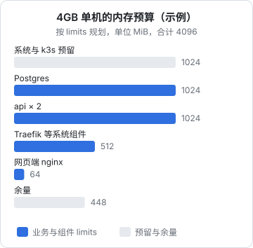
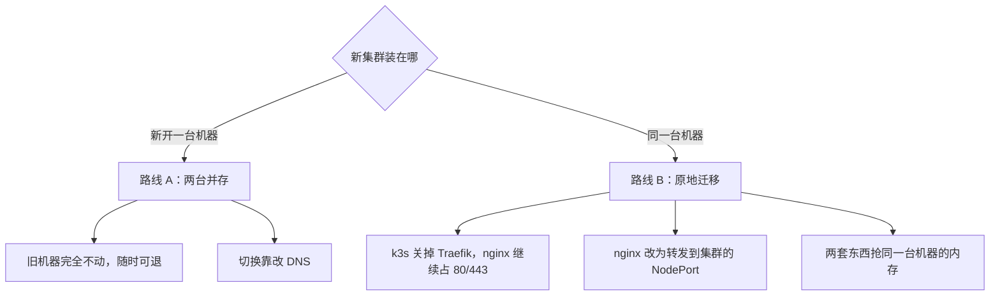
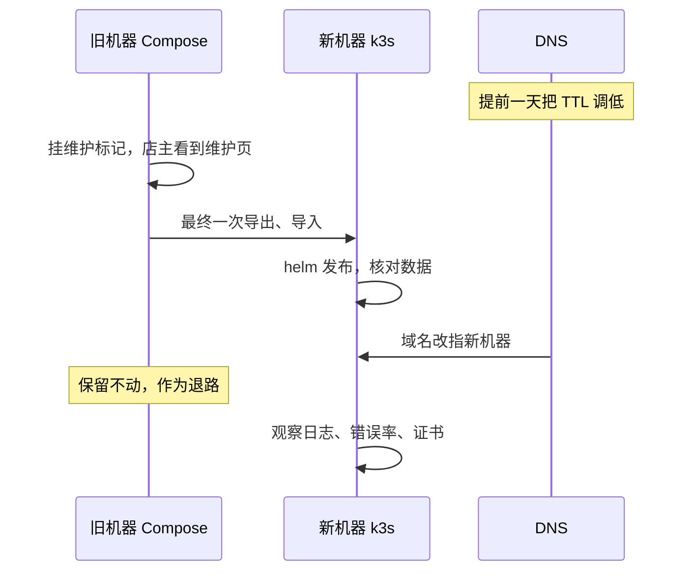

# 用 k3s 搭单机小集群

前面六章在本机的练习集群里把 hatch-counter 的清单和 chart 都写好了。这一章去真实的服务器上：装 k3s、做安全加固、解决境内服务器拉镜像的问题、把所有对象部署上去，然后是整个迁移里风险最高的一步：**把线上数据和流量从 Compose 切到集群，并且随时能退回去**。最后讲集群上线之后的日常维护。

## 为什么是 k3s

| 方案 | 适合 |
|---|---|
| kubeadm 原生集群 | 想完整理解每个组件；多节点、长期维护的团队 |
| 云厂商托管 K8s | 有预算，控制面交给云厂商；通常控制面另外收费或需要多台节点 |
| k3s | 单机或边缘设备，一个二进制装完，资源占用小 |
| MicroK8s、k0s 等 | 同类的轻量发行版，取舍相近 |

k3s 是通过 CNCF 认证的 Kubernetes 发行版，API 和标准 K8s 一致，前几章的清单不用改。它「轻」在打包方式：控制面组件合并成一个进程，默认用 SQLite 代替 etcd，并且自带了单机用得上的全套组件：

| 自带组件 | 作用 | 本书在哪一章用到 |
|---|---|---|
| containerd | 容器运行时 | 全书 |
| Flannel | CNI 网络 | 第 4 章 |
| CoreDNS | 集群 DNS | 第 4 章 |
| Traefik | Ingress 控制器 | 第 4 章 |
| ServiceLB | 简易 LoadBalancer | 第 4 章 |
| local-path-provisioner | 本地存储动态供给 | 第 5 章 |
| metrics-server | `kubectl top` 的数据来源 | 第 2 章 |
| NetworkPolicy 控制器 | 让 NetworkPolicy 生效 | 第 4 章 |
| Helm 控制器 | 自动安装 manifests 目录里的 HelmChart | 第 6 章 |

## 机器和内存预算

k3s 官方文档给出了最低硬件要求，但「能装上」和「能放心跑生产」差得很远。拿第 2、5 章写过的 limits 算一笔账：



这张图是规划，不是测量值。实际要在机器跑起来后用 `kubectl top nodes`、`kubectl top pods` 和 `free -m` 核对。几个结论：

- **4GB 是这套组合比较舒服的起点**。2GB 的机器也能装上 k3s，但扣掉控制面后留给业务的很紧，Postgres 的 `shared_buffers` 只能设得很小
- 原来 Compose 版跑同样的业务，省下的正是「k3s 预留」和「系统组件」这两块。这是上 K8s 的第一笔固定成本
- requests 总和不能超过节点的可分配内存，否则新 Pod 会 Pending；limits 总和可以超（叫超售），但超得越多，内存紧张时被 OOMKill 的风险越大

磁盘也要算：镜像会在 containerd 里越积越多，kubelet 在磁盘使用率超过阈值时会自动清理不用的镜像，再高就会开始驱逐 Pod。数据盘留足余量，并且对磁盘使用率加告警。

## 安装

### 先写配置文件

k3s 的启动参数可以写在 `/etc/rancher/k3s/config.yaml` 里，安装脚本和后续重启都会读它。**在安装之前**写好：

```yaml
# /etc/rancher/k3s/config.yaml
write-kubeconfig-mode: "0600"
secrets-encryption: true
tls-san:
  - k8s.example.com
node-name: counter-1
```

| 配置 | 为什么 |
|---|---|
| `write-kubeconfig-mode: "0600"` | `/etc/rancher/k3s/k3s.yaml` 是集群的管理员凭证，只允许 root 读 |
| `secrets-encryption: true` | Secret 加密后再写进数据库，对应第 3 章 |
| `tls-san` | apiserver 证书里加上这个名字，以后通过它访问 apiserver 不会报证书错误 |
| `node-name` | 固定节点名，不随主机名变化 |

secrets-encryption 最好在第一次启动时就打开，事后开启需要额外的操作把已有 Secret 重新加密。

### 运行安装脚本

```bash
curl -sfL https://get.k3s.io | INSTALL_K3S_VERSION="<固定的版本号>" sh -
```

- **固定版本号**。不写就装当前 stable 通道的最新版，以后在新机器上重装时版本对不上。版本号在 k3s 的发布页查，格式类似 `v1.3x.y+k3s1`
- 境内服务器访问上面的脚本地址和 GitHub 发布页可能很慢或不通，k3s 官方文档里有面向中国用户的说明，提供国内镜像的安装方式；另一种办法是离线安装（air-gap）：在能联网的地方下载二进制和系统镜像包，传到服务器上安装
- 安装脚本会注册一个 `k3s` 的 systemd 服务，开机自启

装完检查：

```bash
sudo systemctl status k3s
sudo k3s kubectl get nodes
sudo k3s kubectl get pods -A
```

`kube-system` 命名空间里应该能看到 coredns、traefik、local-path-provisioner、metrics-server 这几个 Pod 陆续进入 Running。如果卡在 `ImagePullBackOff`，多半就是下一节的问题。

### 境内服务器的镜像问题

《容器技术》里 hatch-counter 的 compose 有一条铁律：编排里一个 Docker Hub 的镜像都不留，因为境内机器访问 Docker Hub 会超时。迁到 k3s 后有一个新的坑：**k3s 自己的系统组件镜像默认也从 Docker Hub 拉**（`rancher/mirrored-...` 这类名字）。

解决办法是 `/etc/rancher/k3s/registries.yaml`，它配置节点上 containerd 的镜像源和仓库凭证：

```yaml
# /etc/rancher/k3s/registries.yaml
mirrors:
  docker.io:
    endpoint:
      - "https://mirror.example.com"
configs:
  "registry.example.com":
    auth:
      username: counter-pull
      password: CHANGE_ME
```

- `mirrors`：拉 `docker.io` 的镜像时改去指定的加速地址。可以填你自己在国内云镜像仓库里转存的地址，或者可靠的加速服务
- `configs`：私有仓库的凭证。在这里配置之后，所有命名空间拉这个仓库都不需要再写 `imagePullSecrets`。第 3 章的 Secret 方式和这里任选其一，单机集群上这种更省事
- 改完要 `sudo systemctl restart k3s` 才生效。这个文件含密码，权限设成 600

另一种更彻底的办法是在 `config.yaml` 里设置 `system-default-registry`，让所有系统镜像都从你自己的仓库拉，前提是事先把这些镜像转存过去。哪种方式适合你，以 k3s 文档中「私有仓库」和「离线安装」两节为准。

## 安全加固

装完的 k3s 默认在 6443 端口监听 apiserver。**不要把 6443 暴露到公网**：apiserver 是整个集群的控制入口，拿到它的凭证就拿到了一切。

| 项 | 做法 |
|---|---|
| 云安全组 | 只放行 22（最好限制来源 IP）、80、443 |
| 主机防火墙 | k3s 官方建议关闭 ufw 或 firewalld，或者放行 Pod 网段（默认 10.42.0.0/16）和 Service 网段（默认 10.43.0.0/16），否则集群内部通信会被拦 |
| 远程管理 | 从本机通过 SSH 隧道访问 apiserver |
| kubeconfig | 拷到本机后妥善保管，它等同于 root 密码 |

SSH 隧道的用法：

```bash
# 本机：把服务器上的 6443 转发到本机 6443
ssh -N -L 6443:127.0.0.1:6443 deploy@<服务器>

# 另开一个终端，拷 kubeconfig 到本机（之后编辑它，把 server 改成 https://127.0.0.1:6443，上下文名改成 counter-prod）
scp deploy@<服务器>:/etc/rancher/k3s/k3s.yaml ~/.kube/counter-prod.yaml
```

服务器上的 `k3s.yaml` 是 root 才能读的，拷之前要临时 `sudo cp` 一份到 deploy 用户能读的地方，拷完删掉。默认的 server 地址就是 `https://127.0.0.1:6443`，配合 SSH 隧道正好不用改，只需要把集群名和上下文名从 `default` 改成能一眼认出来的名字，并用 `KUBECONFIG` 环境变量或 `kubectl --context` 明确指定。第 2 章说过：本机同时有练习集群和生产集群时，敲错上下文是真实的风险。

主机层面的加固（SSH 只用密钥、fail2ban、自动安全更新）和以前一样，见《一人运维手册》。

## 部署全部对象

把前几章的清单整理成一个仓库目录，按依赖顺序部署：

```text
deploy-k8s/
  00-namespace.yaml
  10-storageclass.yaml
  20-postgres.yaml          # Secret 之外的 Service + StatefulSet
  21-postgres-backup.yaml   # PVC + CronJob
  30-networkpolicy.yaml
  40-clusterissuer.yaml
  secrets/                  # 不进 Git
    api.secret.env
    postgres.secret.env
  counter/                  # 第 6 章的 Helm chart
  bootstrap.sh
```

```bash
#!/usr/bin/env bash
# bootstrap.sh：在一个空集群上把所有东西搭起来。可以重复执行
set -euo pipefail
export KUBECONFIG="${KUBECONFIG:-$HOME/.kube/counter-prod.yaml}"
NS=counter

kubectl apply -f 00-namespace.yaml -f 10-storageclass.yaml

kubectl -n "$NS" create secret generic postgres-secret \
  --from-env-file=secrets/postgres.secret.env --dry-run=client -o yaml | kubectl apply -f -
kubectl -n "$NS" create secret generic counter-api-secret \
  --from-env-file=secrets/api.secret.env --dry-run=client -o yaml | kubectl apply -f -

kubectl apply -f 20-postgres.yaml -f 21-postgres-backup.yaml -f 30-networkpolicy.yaml
kubectl -n "$NS" rollout status statefulset/postgres --timeout=180s

# cert-manager 用 Helm 安装（固定版本，见第 6 章），装好后才能建 ClusterIssuer
kubectl apply -f 40-clusterissuer.yaml

echo "基础设施就绪。导入数据后再执行 helm upgrade --install 发布应用。"
```

应用本身的发布留到数据导入之后，原因见下一节。

## 切换：从 Compose 到集群

### 两条路线



**推荐路线 A**：多租一台机器一两周的费用，换来的是旧环境原封不动，任何时候出问题都能退回去。路线 B 省钱，但 k3s 和原来的 Docker、nginx、Postgres 挤在同一台机器上，内存紧张，排障时两套东西互相干扰；如果非要走路线 B，就在 `config.yaml` 里加上 `disable: [traefik]`，让宿主机 nginx 继续做入口，把 `proxy_pass` 指到集群里 counter-api 的 NodePort 上，等稳定后再决定要不要把入口也交给集群。

下面按路线 A 讲。

### 演练：先完整走一遍

正式切换前，至少完整演练一次。演练时旧环境照常服务，新集群导入的是一份当时的数据快照：

```bash
# 旧机器：导出角色和数据
cd /srv/counter
docker compose exec -T postgres pg_dumpall -U counter --roles-only > roles.sql
docker compose exec -T postgres pg_dump -U counter -d counter -Fc > counter.dump

# 本机：拿到这两个文件后导入新集群
kubectl -n counter exec -i postgres-0 -- psql -U counter -d postgres < roles.sql
kubectl -n counter exec -i postgres-0 -- pg_restore -U counter -d counter < counter.dump
```

`roles.sql` 里会有一句创建 `counter` 角色的语句报「已存在」，因为 Postgres 镜像初始化时已经按 `POSTGRES_USER` 建过它，可以忽略。其余几个角色（应用角色、后台角色）和它们的密码会原样建出来，行级安全依赖的所有权关系在 `pg_restore` 时保留。导入完核对几张关键表的行数和旧库一致。

然后发布应用：

```bash
helm upgrade --install counter ./counter -n counter \
  -f counter/values-prod.yaml --set api.tag=<当前线上版本> --set web.tag=<当前线上版本> \
  --wait --timeout 5m --rollback-on-failure
```

迁移 hook 会跑一次，因为表结构已经是最新的，它应该什么都不做就成功退出。这本身就是一项检查。

**怎么在不改 DNS 的情况下测试新集群？** 在本机的 hosts 文件里把两个域名临时指向新机器的 IP，用浏览器和真机实际走一遍登录、导入报表、拍进货单、看推送这些主流程。证书在这一步还没有（HTTP-01 验证要求 DNS 已经指向新机器），可以先把旧机器上 certbot 的现有证书导入成 Secret：

```bash
kubectl -n counter create secret tls counter-tls \
  --cert=fullchain.pem --key=privkey.pem
```

Ingress 用的正是这个 Secret 名，证书立即生效。DNS 切过来之后，cert-manager 到了续期时间会自动接管，用新签发的证书覆盖它。

### 正式切换



具体步骤：

1. **提前一天**把相关域名的 DNS TTL 调低（比如几分钟），让切换和回退都能快速生效
2. 挑凌晨这类没有门店营业的时间。原 `deploy.sh` 的注释里写过：收银台白天被打断，正是这个产品一直在躲的事
3. 旧机器挂上维护标记，确认写入已经停止
4. 最终导出、导入、核对行数（同演练）
5. `helm upgrade --install` 发布，确认 Pod 就绪
6. 改 DNS 指向新机器，从外部网络验证主流程
7. 观察至少一个营业日：错误日志、响应时间、证书状态、CronJob 备份是否按时生成

移动端打包时写死了 API 域名，这在切换时反而是好事：域名不变，只改解析，手机端什么都不用做。

### 退路

整个过程中旧机器上的数据和服务都没有动过，回退就是两步：DNS 改回旧机器，摘掉旧机器的维护标记。

唯一要想清楚的是：**切换之后写进新集群的数据，退回时怎么办**。切换后越久，这个问题越大。所以要事先约定一个观察窗口（比如 24 小时）：窗口内出问题，就把新库的增量导回旧库再回退，或者接受丢失窗口内数据的代价；窗口过后确认稳定，就不再考虑退回旧机器，回滚只在集群内部用 Helm 做。旧机器在窗口结束后再保留一周，做最后一次冷备份后释放。

## 上线之后的日常

### 升级 k3s

K8s 每年发布若干个小版本，每个版本的社区维护期有限，长期不升级就会落到不再有安全修复的版本上。k3s 的升级规则：

- **一次只升一个小版本**（比如 1.33 → 1.34），不要跨版本跳
- 升级前读 k3s 和对应 K8s 版本的发布说明，重点看被移除的 API 和自带组件（尤其是 Traefik）的大版本变化
- 单机的升级方式最简单：用新的 `INSTALL_K3S_VERSION` 重新执行安装脚本，它会替换二进制并重启服务；也可以装 k3s 的 system-upgrade-controller 让升级声明式进行
- 单节点升级时 k3s 进程会重启，已在运行的容器一般不受影响，但控制面会有短暂不可用，选低峰期

### 要备份什么

| 内容 | 位置 | 怎么备份 |
|---|---|---|
| 业务数据 | Postgres | 第 5 章的 CronJob + 异地 + 恢复演练，**最重要** |
| 集群状态 | `/var/lib/rancher/k3s/server/db/`（默认 SQLite） | 停服务后拷贝，或依赖下一行重建 |
| 集群令牌 | `/var/lib/rancher/k3s/server/token` | 和集群状态一起保存，开了 secrets-encryption 时恢复需要它 |
| 清单、chart、values | Git 仓库 | 已经在 Git 里 |
| Secret 真实值 | 本机加密存储 | 和 env 文件一样管理 |

对单机集群来说，最实用的恢复策略往往不是还原集群状态，而是：**新装一台 k3s → 跑 bootstrap.sh → 导入最近的数据库备份 → helm 发布**。把这条路径演练一次并记下耗时，就知道机器整个丢了要多久才能恢复。

### 观察集群

```bash
kubectl top nodes
kubectl top pods -A --sort-by=memory
kubectl get events -A --field-selector type=Warning --sort-by=.lastTimestamp
```

这些是排障时手动看的。持续的指标、日志、告警（Prometheus、Grafana、Loki 等）可以用 Helm 装进集群，但要注意它们本身吃的内存可能比 hatch-counter 还多。单机上更实际的做法是：外部可用性监控 + 证书到期检查 + 磁盘和内存告警，细节见《可观测性与性能》。

## 本章要点

- k3s 是认证过的 K8s 发行版，一个二进制装完，自带网络、DNS、Ingress、本地存储等单机所需组件
- 先按 limits 做内存预算：4GB 是这套组合比较舒服的起点，k3s 和系统组件是上 K8s 的固定开销
- 安装前写好 `config.yaml`：kubeconfig 权限、Secret 加密、固定节点名；安装时固定版本号
- 境内服务器要用 `registries.yaml` 解决系统组件和业务镜像的拉取，凭证也可以配在这里
- **6443 不暴露公网**，用 SSH 隧道访问；kubeconfig 等同 root 密码
- 推荐新开机器迁移：演练一遍，凌晨切换，导入旧证书过渡，改 DNS，旧机器保留作退路
- 日常：逐个小版本升级 k3s，备份重点永远是数据库，演练「从零重建」的完整路径
