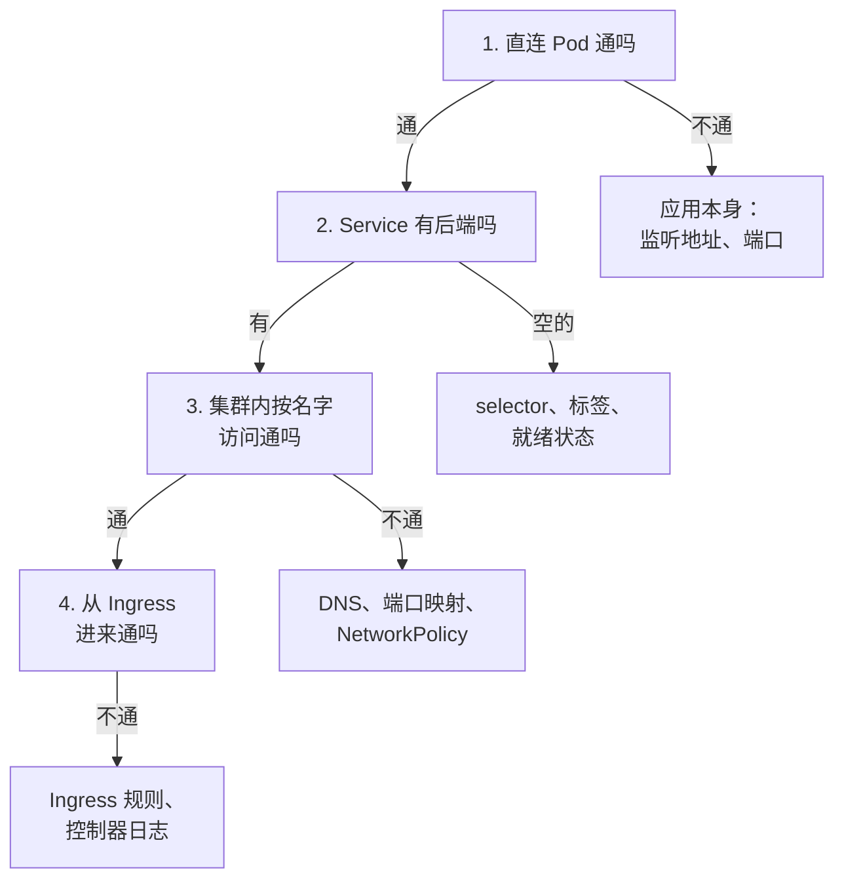

# 排障：Pod 为什么不正常

前面几章在讲「怎么写对」，这一章讲「写错了、或者运行中坏了，怎么找出来」。Compose 时代出了问题，`docker compose ps` 加 `logs` 基本能定位；到了 K8s，同一个问题可能藏在 Pod、Deployment、Service、Ingress、节点任何一层，状态名字也变成了 `CrashLoopBackOff`、`ImagePullBackOff` 这样的术语。好在排查的顺序是固定的，常见的状态也就那么几种。这一章先给出通用的排查顺序，再逐个讲最常见的几种异常，最后是「Service 不通」这个最容易绕晕的问题。

> [!NOTE]
> 本章的命令按 Kubernetes 1.3x 和 k3s 写。状态名、事件文案在不同版本间偶有调整，以 `kubectl explain` 和你所用版本的官方文档为准。单机 Docker / Compose 下的同类问题见[《容器技术》容器起不来：排查清单](../docker-containers/06-compose.md#容器起不来排查清单)。

## 通用顺序：get → describe → logs → 进去看

不管看到什么异常，先走这四步：

```bash
# 1. 看状态：STATUS、READY、RESTARTS 三列
kubectl -n counter get pods -o wide

# 2. 看详情和事件：问题的原因多半写在最后的 Events 里
kubectl -n counter describe pod <pod>

# 3. 看日志：当前这次，以及上一次崩溃前的
kubectl -n counter logs <pod>
kubectl -n counter logs <pod> --previous

# 4. 还看不出来，就进去看
kubectl -n counter exec -it <pod> -- sh
```

第 2 步最重要，也最容易跳过。`describe` 末尾的 **Events** 是调度器、kubelet、控制器留下的记录：调度失败的原因、拉镜像的报错、探针失败的响应码、被杀掉的理由都在这里。事件默认只保留一小时左右，时间久了要去看日志。

也可以按命名空间看最近的事件，适合「不知道是哪个对象出了问题」的时候：

```bash
kubectl -n counter get events --sort-by=.lastTimestamp
kubectl get events -A --field-selector type=Warning
```

第 4 步的 `exec` 有个前提：镜像里得有 shell。distroless 这类精简镜像什么工具都没有，这时用 `kubectl debug` 往 Pod 里临时塞一个带工具的容器，和目标容器共享进程空间：

```bash
kubectl -n counter debug -it <pod> --image=busybox:1.36 --target=api
```

`--target` 写目标容器的名字，进去后 `ps` 能看到对方的进程，`wget` 能访问对方监听的端口。容器反复崩溃、`exec` 进不去时，可以用 `kubectl debug -it <pod> --copy-to=<新名字> --container=api -- sh` 复制一个 Pod、把启动命令换成 shell，在副本里手动启动看报错。

## 先看 STATUS 列

Pod 的 STATUS 列把问题大致分了类，每一类查的方向不同：

| STATUS | 意味着 | 先查 |
|---|---|---|
| `Pending` | 还没调度到节点，或卷没就绪 | Events 里的 `FailedScheduling` |
| `ErrImagePull` / `ImagePullBackOff` | 镜像拉不下来 | 镜像名、凭证、网络 |
| `CrashLoopBackOff` | 进程启动后反复退出 | Last State 的退出码，`logs --previous` |
| `Running`，READY `0/1` | 进程在跑但就绪探针不过 | Events 里的 `Readiness probe failed` |

另外两个常见的：`CreateContainerConfigError` 通常是引用的 ConfigMap 或 Secret 不存在、或者里面没有指定的 key；`Evicted` 是节点资源（内存、磁盘）紧张时 kubelet 主动驱逐，单机集群上看到它，说明整台机器快撑不住了，第 7 章的内存预算该重算了。

## Pending：调度不上

Pod 停在 `Pending`，说明调度器还没给它找到节点，或者找到了节点但卷还没就绪。`describe` 的 Events 里会有一条 `FailedScheduling`，原因写在后面：

| Events 里的原因 | 意思 | 处理 |
|---|---|---|
| `Insufficient memory` / `Insufficient cpu` | 所有节点剩余的可分配资源都小于这个 Pod 的 requests | 调小 requests，或者先删掉别的东西腾地方；`kubectl describe node` 的 Allocated resources 看已分配了多少 |
| `pod has unbound immediate PersistentVolumeClaims` | 要用的 PVC 还没绑定到 PV | 看 PVC 的 `describe`：StorageClass 名字写错、没有默认 StorageClass |
| `node(s) had untolerated taint` | 节点被打了污点，比如 `disk-pressure` | `kubectl describe node` 看 Taints；磁盘满了先清磁盘 |
| `node(s) didn't match Pod's node affinity/selector` | `nodeSelector` 写的标签没有节点满足 | 核对节点标签 `kubectl get nodes --show-labels` |

单机集群上最常见的是第一种。**调度看的是 requests 加总，不是实际用量**：机器上明明还有 2GB 空闲内存，但已分配的 requests 已经到顶，新 Pod 照样进不来。第 7 章动手练习里试过一次。

k3s 的 local-path 有个容易误判的地方：它的 StorageClass 是「等第一个使用者再绑定」，PVC 在没有 Pod 用它之前一直显示 `Pending`，这是正常的。要看的是 Pod 被调度之后 PVC 有没有变成 `Bound`。

## ImagePullBackOff：拉不到镜像

`ErrImagePull` 是拉取失败，失败几次之后变成 `ImagePullBackOff`，表示 kubelet 在等一段时间再试。`describe` 里会有完整的报错，按关键字对号入座：

| 报错关键字 | 原因 |
|---|---|
| `not found` / `manifest unknown` | tag 写错，或者这个 tag 还没推上去（CI 推镜像失败了而你没发现） |
| `unauthorized` / `authentication required` | 私有仓库没有凭证：Pod 或 ServiceAccount 上没挂 `imagePullSecrets`，或者 Secret 在别的命名空间，见[第 3 章](03-config-secrets.md#私有镜像仓库的凭证) |
| `i/o timeout` / `context deadline exceeded` | 网络拉不动，境内服务器拉海外仓库最常见，见[第 7 章](07-k3s-cluster.md#境内服务器的镜像问题) |
| `no match for platform in manifest` | 镜像没有这个节点架构的版本 |

最后一条有个变种更隐蔽：镜像只有 arm64 版本却**拉下来了**（单架构镜像不带平台信息时 kubelet 不会拦），容器一启动就报 `exec format error`，表现为下面的 CrashLoopBackOff。Mac 上本地构建、直接推到仓库给 amd64 服务器用，就会遇到这个问题。

想确认是不是节点拉不动，可以在节点上直接用 k3s 自带的 `crictl` 拉一次，报错会更直接：

```bash
sudo k3s crictl pull registry.example.com/counter/api:1.5.0
```

## CrashLoopBackOff：启动就退出

`CrashLoopBackOff` 不是一种错误，而是一种**状态**：容器启动后退出了，kubelet 按重启策略拉起来，又退出，于是拉起的间隔越来越长（从 10 秒开始翻倍，最长 5 分钟），这段等待期就显示为 CrashLoopBackOff。RESTARTS 列会一直涨。

真正的原因在两处：**上一次退出时的状态**和**上一次的日志**。

```bash
kubectl -n counter describe pod <pod>        # 看 Last State 一段
kubectl -n counter logs <pod> --previous     # 上一次运行的日志
```

`describe` 里的 Last State 长这样：

```text
    Last State:     Terminated
      Reason:       Error
      Exit Code:    1
      Started:      Tue, 04 Nov 2026 10:21:07 +0800
      Finished:     Tue, 04 Nov 2026 10:21:09 +0800
```

`Reason` 和 `Exit Code` 合起来看：

| Reason / Exit Code | 含义 | 常见原因 |
|---|---|---|
| `Error` / 1 | 应用自己报错退出 | 环境变量缺失、连不上数据库、配置写错，看 `--previous` 的日志 |
| `Completed` / 0 | 进程正常结束了 | 命令本来就是一次性的（应该用 Job），或者启动脚本没把主进程留在前台 |
| `OOMKilled` / 137 | 超过内存 limit 被内核杀掉 | 见下一节 |
| `Error` / 137 | 被 SIGKILL，但不是 OOM | 收到 SIGTERM 后没在宽限期内退出被强杀，探针失败触发的重启也会走到这一步 |
| `StartError` / 128 | 容器进程没能启动 | `command` 写错、镜像里没有这个程序，Message 里会写 `executable file not found` |

`Started` 和 `Finished` 之间的间隔也是线索：只活了两秒，问题在启动阶段；活了几分钟才退出，更可能是运行中的内存或探针问题。

几个 K8s 特有的启动失败原因，Compose 里不会遇到：

- **配置变了形**：Secret 的值多了一个换行（用 `echo` 而不是 `echo -n` 生成 base64 时最常见），或者环境变量名和应用读的不一致，应用读到的值和你以为的不一样。`kubectl exec <pod> -- env | sort` 直接看容器拿到了什么
- **迁移 Job 没跑完**：服务端在启动时检查表结构，迁移还没执行完就起来了，`kubectl -n counter get jobs` 看迁移 Job 的状态（第 3 章、第 6 章的 hook）
- **启动太慢被启动探针杀掉**：`startupProbe` 给的时间不够，进程还在初始化就被判失败重启，日志里看不到任何错误，只是每次都在同一个时间点被打断

## OOMKilled：内存超限

容器用的内存超过 `limits.memory`，内核的 OOM killer 直接用 SIGKILL 杀掉它，应用没有机会打日志。所以 OOMKilled 的特征是：**`logs --previous` 里什么异常都没有，日志在某个普通的请求处戛然而止**，只有 `describe` 里的 `Reason: OOMKilled` 说出真相。[第 2 章的练习](02-core-objects.md#动手练习)里制造过一次。

处理顺序：

1. **先看实际用量**：`kubectl top pod -n counter` 看平时占多少。如果平时就贴着 limit，是 limit 定小了
2. **再看是不是在涨**：平时只占一半，跑一段时间才被杀，多半是内存泄漏，调大 limit 只是推迟被杀的时间
3. **Node 服务对一下堆上限**：V8 的堆上限要比容器 limit 小，给堆外内存留出空间，第 2 章说过 `--max-old-space-size` 的设法。堆上限比 limit 还大时，进程会在 V8 自己报 heap out of memory 之前就被内核杀掉，日志里连那句报错都没有

要和 `Evicted` 分开：OOMKilled 是**单个容器**超了自己的 limit；Evicted 是**整个节点**内存不够，kubelet 按优先级挑 Pod 赶走。前者改 limit 或修泄漏，后者要重算整台机器的预算。

## 探针失败：Running 但不就绪，或者反复重启

探针配错的症状分两种，对应第 2 章那张三种探针的表：

| 症状 | 哪个探针 | Events 里的样子 |
|---|---|---|
| STATUS 是 `Running`，READY 是 `0/1`，RESTARTS 不涨 | readinessProbe 失败 | `Readiness probe failed: HTTP probe failed with statuscode: 503` |
| RESTARTS 一直涨，日志里没有错误 | livenessProbe 或 startupProbe 失败 | `Liveness probe failed: ...`，紧接着 `Container api failed liveness probe, will be restarted` |

探针失败时，先**用和探针完全相同的方式自己请求一次**，看到底返回了什么：

```bash
# 在 Pod 里请求探针的路径（镜像里没有 wget 时用 node -e 发请求）
kubectl -n counter exec <pod> -- wget -qO- -T 2 http://127.0.0.1:3000/v1/health
```

常见原因：

- **路径或端口写错**：探针打的是 `/health`，应用只有 `/v1/health`；端口写成了 Service 的 80 而不是容器的 3000
- **应用只监听了 `127.0.0.1`**：kubelet 从 Pod 外面（节点上）访问 Pod IP，应用只听回环地址时探针连不上，而你 `exec` 进去请求 `127.0.0.1` 却是通的。Node 服务 `listen(3000, '127.0.0.1')` 改成不写主机或写 `0.0.0.0`
- **依赖抖动连带重启**：存活探针查了数据库，数据库一重启，所有副本一起被杀，这正是第 2 章强调「liveness 绝不能查数据库」的原因
- **超时太短**：`timeoutSeconds` 默认 1 秒，接口偶尔慢一点就判失败。就绪探针可以放宽到 2–3 秒

readiness 失败的 Pod 不会被重启，但也不会出现在 Service 的转发列表里。如果**所有**副本都不就绪，Service 就没有任何后端，外部看到的是 Ingress 返回 503，这就引出了下一节。

## Service 不通：从里往外查

「Pod 都 Running，但请求就是到不了」是最容易绕晕的问题，因为路径上的环节最多：Ingress → Service → EndpointSlice → Pod。按**从里往外**的顺序，每一步排除一层：



**第 1 步，绕过 Service 直连 Pod**：

```bash
kubectl -n counter port-forward pod/<pod> 3000:3000
curl -s http://127.0.0.1:3000/v1/health
```

这里不通，问题在应用本身，和网络无关。

**第 2 步，看 Service 背后有没有 Pod**：

```bash
kubectl -n counter get endpointslices -l kubernetes.io/service-name=counter-api
```

ENDPOINTS 列为空，Service 就没有可转发的地方。原因只有两类：Service 的 `selector` 和 Pod 的标签对不上（拼错一个字母、版本升级时改了标签），或者 Pod 都没就绪。用 Service 的 selector 反查一次 Pod：

```bash
kubectl -n counter get svc counter-api -o jsonpath='{.spec.selector}'
kubectl -n counter get pods -l app.kubernetes.io/name=counter-api
```

第二条命令什么都没列出来，就是标签对不上。

**第 3 步，在集群内按名字访问**：起一个临时 Pod，模拟另一个服务的视角：

```bash
kubectl -n counter run curl-test --rm -it --image=busybox:1.36 --restart=Never -- \
  wget -qO- -T 3 http://counter-api/v1/health
```

这一步不通而第 1、2 步都通，查三处：DNS（`nslookup counter-api`，跨命名空间要写 `counter-api.counter`）；Service 的 `targetPort` 是否指向容器真正监听的端口；有没有 NetworkPolicy 挡住了这个来源（第 4 章说过，选中了目标 Pod 的策略只放行列出的来源，临时 Pod 不在白名单里也会被挡）。

**第 4 步，从 Ingress 进来**：集群内能通、外面不通，问题在入口这一层：

```bash
kubectl -n counter describe ingress counter              # 规则和后端是否解析成功
kubectl -n kube-system logs deploy/traefik --tail=50     # Traefik 的报错
curl -sv --resolve app.example.com:443:<节点 IP> https://app.example.com/v1/health
```

常见原因是 `ingressClassName` 写错导致没有控制器认领、`host` 和请求的域名不一致、路径的 `pathType` 写成了 `Exact`。再往外就是节点的安全组、防火墙和 DNS，回到[《计算机网络》](../networking/)的排查方法。

## 节点本身的问题

上面都是 Pod 层面的问题。如果 `kubectl` 本身就连不上，或者所有 Pod 一起出问题，看节点和 k3s 本身：

```bash
kubectl get nodes                       # STATUS 不是 Ready 就是节点出了问题
kubectl describe node <节点名>           # Conditions 里看 MemoryPressure、DiskPressure
sudo journalctl -u k3s --since "30 min ago"   # k3s 自己的日志
df -h /var/lib/rancher                  # 镜像和本地卷都在这里，满了会触发驱逐
```

单机集群上节点出问题最常见的原因是**磁盘满了**：旧镜像越积越多，日志没有轮转，`DiskPressure` 一出现，kubelet 就开始驱逐 Pod、拒绝调度新 Pod。k3s 会按阈值自动清理不用的镜像，但它清不了你的备份文件和日志，磁盘告警（第 7 章「观察集群」）要先加上。

## 本章要点

- 通用顺序：`get` 看状态 → `describe` 看 Events → `logs --previous` 看上次崩溃 → `exec` 或 `kubectl debug` 进去看
- **Pending** 是调度不上，看 `FailedScheduling` 的原因；调度按 requests 加总，不按实际用量
- **ImagePullBackOff** 看报错关键字：tag、凭证、网络、架构；架构不对也可能表现为 `exec format error` 的崩溃
- **CrashLoopBackOff** 是状态不是原因，看 Last State 的 Reason、Exit Code 和 `--previous` 日志
- **OOMKilled** 时日志里什么都没有，只有 `describe` 说得出真相；和节点级的 Evicted 区分开
- 探针失败先用同样的方式自己请求一次；应用只听 `127.0.0.1` 时探针和 Service 都连不上
- Service 不通从里往外查：直连 Pod → EndpointSlice 有没有后端 → 集群内按名字访问 → 从 Ingress 进来
- 单机集群的节点问题首先查磁盘

## 动手练习

在本机的 k3d 练习集群里做（[第 2 章](02-core-objects.md#先起一个练习集群)创建的那个）：先 `kubectl config current-context` 确认是 `k3d-counter-lab`，再 `kubectl create namespace lab && kubectl config set-context --current --namespace=lab`，做完 `kubectl delete namespace lab`。第 2 章的练习已经制造过 ImagePullBackOff 和 OOMKilled，这里练另外三种。

1. **CreateContainerConfigError**：执行 `kubectl create deployment cfg --image=busybox:1.36 -- sh -c 'echo $GREETING; sleep 3600'`，再让它引用一个还不存在的 ConfigMap：`kubectl patch deployment cfg --type=json -p '[{"op":"add","path":"/spec/template/spec/containers/0/envFrom","value":[{"configMapRef":{"name":"app-config"}}]}]'`。等几秒后看 `kubectl get pods` 和新 Pod 的 `describe`。然后 `kubectl create configmap app-config --from-literal=GREETING=hi`，再观察。

   验证：先出现 `CreateContainerConfigError`，Events 里写着 `configmap "app-config" not found`；建好 ConfigMap 后，Pod 不需要你做任何事就变成 `Running`，`kubectl logs deploy/cfg` 输出 `hi`。

   参考答案：引用的配置不存在时容器根本不会创建，kubelet 会一直重试。这和 CrashLoopBackOff 不同：进程一次都没运行过，所以 `logs` 什么都没有，原因只在 Events 里。

2. **CrashLoopBackOff 和 --previous**：执行 `kubectl run crash --image=busybox:1.36 -- sh -c 'echo "connecting to db..."; sleep 2; echo "ECONNREFUSED" >&2; exit 1'`，隔半分钟执行几次 `kubectl get pod crash`；然后分别执行 `kubectl logs crash`、`kubectl logs crash --previous` 和 `kubectl describe pod crash | grep -A5 'Last State'`。

   验证：RESTARTS 逐渐增加，STATUS 在 `Error` 和 `CrashLoopBackOff` 之间切换；`Last State` 里是 `Reason: Error`、`Exit Code: 1`；`--previous` 能看到完整的两行输出。

   参考答案：CrashLoopBackOff 只说明「反复退出」，原因要看上一次的退出码和日志。当前这次如果还在等待重启，`logs` 可能拿不到内容，`--previous` 才稳定。

3. **Service 背后没有 Pod**：执行 `kubectl create deployment web --image=nginx:1.27-alpine`，再 apply 一个 selector 故意写错的 Service：`kubectl create service clusterip web --tcp=80:80`，然后 `kubectl patch svc web -p '{"spec":{"selector":{"app":"wbe"}}}'`。按本章第 2、3 步检查：`kubectl get endpointslices -l kubernetes.io/service-name=web`，以及 `kubectl run t --rm -it --image=busybox:1.36 --restart=Never -- wget -qO- -T 3 http://web`。最后把 selector 改回 `app: web` 再试一次。

   验证：selector 写错时 EndpointSlice 的 ENDPOINTS 为空，`wget` 超时或被拒；改对之后 ENDPOINTS 出现 Pod IP，`wget` 返回 nginx 的欢迎页。

   参考答案：DNS 能解析出 Service 的 ClusterIP，所以「名字解析得到但连不上」是 Service 没有后端的典型表现。先看 EndpointSlice，再用 selector 反查 Pod，比怀疑网络快得多。
