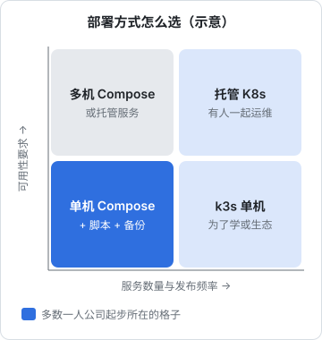

# 什么时候不该上 K8s

前七章把 hatch-counter 从 Compose 完整迁到了 k3s。这一章要回头问一个前面一直刻意回避的问题：**这次迁移值不值？** 结论可能会让你意外：对现在的 hatch-counter，以及对大多数处在起步阶段的一人公司来说，答案是「不值，至少现在不值」。但这不代表前七章白学了。这一章把账算清楚，给出判断信号，介绍介于 Compose 和 K8s 之间的选择，最后说说一个人学 K8s 真正的收获在哪。

## 算一笔账

### 得到了什么

| 能力 | Compose 版 | k3s 版 | 对 hatch-counter 的实际价值 |
|---|---|---|---|
| 不健康自动重启 | 没有（只看进程退出） | liveness 探针 | 有用，但 Compose 加一个 autoheal 小工具也能做到 |
| 发版无空窗 | 有几秒空窗 | 滚动更新，新的就绪才替换 | 有用；凌晨发版时这几秒几乎没人感知 |
| 迁移与发布的顺序 | `deploy.sh` 保证 | Helm hook 保证 | 两边都做到了 |
| 失败回滚 | trap 自动退 tag | `--rollback-on-failure` | 两边都做到了 |
| 证书续期 | certbot + reload | cert-manager | 差不多，都需要外部过期告警 |
| 多副本 | 要改脚本和 nginx | 改一个数字 | 单机上多副本只防进程崩溃，不防机器故障 |
| 数据库安全 | 命名卷 + 备份 | PVC + 备份 | **完全一样**，单机单副本 |
| 机器挂了 | 服务中断 | 服务中断 | **完全一样**，单节点集群没有高可用 |

最后两行最关键。单机集群在「机器级故障」面前和单机 Compose 没有任何区别。K8s 自愈能力的大头（节点挂了把 Pod 调度到别的节点、存储跟着漂移）在单节点上根本用不上。

### 付出了什么

**资源**。按第 7 章的示例预算，k3s 预留和系统组件合计约 1.5GB（这是规划值，实际以 `kubectl top` 和 `free -m` 为准），原来这些内存大部分属于业务。在 4GB 的机器上，这是三分之一以上。

**配置量**。数一数两边实际需要维护的配置（去掉注释和空行）：

| | Compose 版 | k3s 版 |
|---|---|---|
| 编排 | compose 文件约 30 行 | Helm chart 渲染后约 250 行，chart 外的清单约 220 行 |
| 发版逻辑 | `deploy.sh` 约 65 行 | Helm hook + 一条命令 |
| 额外组件 | certbot | cert-manager、Traefik 配置、registries.yaml |

YAML 行数本身不代表难度，但每一行都是一个以后可能要理解、调试、升级的点。

**概念**。为了看懂自己的部署，需要掌握的概念从「容器、卷、网络、compose」扩展到：Pod、ReplicaSet、Deployment、StatefulSet、Job、CronJob、Service（四种）、EndpointSlice、Ingress、IngressClass、Middleware、ConfigMap、Secret、PV、PVC、StorageClass、NetworkPolicy、三种探针、requests 和 limits、Helm 的 release 与 hook、cert-manager 的五种 CRD……

**排障路径**。Compose 版出了问题，排查路径是「nginx → 容器 → 应用」。k3s 版是「DNS → ServiceLB → Traefik → Ingress 规则 → Service → EndpointSlice → Pod 就绪状态 → 容器 → 应用」，中间还可能夹着 NetworkPolicy 和 CoreDNS。凌晨两点一个人对着报警时，这条路径的长度就是恢复时间的长度。

**持续维护**。K8s 的小版本有维护期限，k3s、Traefik、cert-manager、Helm chart 各有自己的升级节奏和破坏性变更。Compose 版的组件（Docker、nginx、certbot）也要升级，但它们的接口多年稳定。

### 结论

把两边放在一起：k3s 版得到的增量是「不健康自动重启」「发版无空窗」「多副本更容易」，付出的是三分之一的内存、数倍的配置、长得多的排障路径和持续的升级负担。**对一个单机、两个服务、每周发一两次版的产品，这笔账不划算。**

## 不该上 K8s 的信号

符合下面任意几条，就先别上：

- **只有一台机器**，也没有计划很快扩到多台
- **服务数量个位数**，而且它们的部署方式差不多
- **发版频率不高**，现有脚本没有成为瓶颈
- **没有人和你一起值班**。K8s 出问题时需要有人懂它，而这个人只有你
- **产品还在找方向**。这时候所有时间都应该花在用户和功能上，基础设施够用就好
- **你想用它解决的其实是别的问题**：应用不能横向扩展、数据库没有备份、没有监控，这些 K8s 都不会替你解决
- **机器内存在 2GB 左右**，k3s 的固定开销会直接挤压业务

## 该考虑 K8s 的信号

反过来，下面这些情况出现得越多，K8s 的价值越明显：

- **需要多台机器**，并且希望一台挂了服务自动转移，而不是靠人手动恢复
- **服务数量多到 Compose 文件和部署脚本开始失控**，每个服务都有自己的一套发布方式
- **有团队**，需要统一的部署规范、权限隔离、自助发布
- **要用的东西在 K8s 生态里有现成方案**：比如要跑 GPU 推理服务、要用某个只提供 Helm chart 的开源系统
- **客户要求**：企业客户要求私有化部署到他们的 K8s 集群里，你就必须交付 Helm chart。这对做 B2B 的一人公司是个很现实的理由
- **你选择托管 K8s**，控制面由云厂商负责，你只管工作负载，运维负担会小很多（但账单会大一些）

## 中间地带：比 Compose 多一点，比 K8s 少很多

在「单机 Compose」和「Kubernetes」之间有很大一片空间，很多时候正确答案在这里：



| 方案 | 适合 | 说明 |
|---|---|---|
| 改进现有 Compose | 单机，想补上 K8s 的几个好处 | 加 autoheal 实现不健康重启；用 nginx upstream 切换做蓝绿发布消除空窗。一两天的工作量 |
| Kamal 这类部署工具 | 一到几台机器，想要零停机发布 | 用 SSH + Docker 在多台机器上做滚动发布，不引入集群 |
| Docker Swarm | 几台机器，想保留 compose 文件格式 | compose 文件加少量字段就能多机部署，社区热度远不如 K8s，长期前景要自己评估 |
| Nomad | 多机，想要比 K8s 简单的调度器 | 概念少、单二进制，但生态小得多 |
| PaaS（各类托管平台） | 不想管机器 | 推代码或镜像即部署，按量付费；数据库常配托管服务 |
| Serverless / 边缘平台 | 无状态 API、静态站 | 比如 Cloudflare Workers，hatch-recordwall 就是这么部署的，见[《云与边缘》](../cloud-and-edge/) |
| 托管数据库 | 任何阶段 | 把最难运维的那一块交出去，往往比上 K8s 更能降低风险 |

最后一行值得多说一句。一人公司最大的运维风险通常不是「发版有几秒空窗」，而是「数据库备份从来没恢复过」和「机器挂了不知道要多久才能恢复」。把有限的精力花在**备份恢复演练、监控告警、从零重建的手册**上，回报远高于引入编排系统。这些在[《一人运维手册》](../production-ops/)和[《PostgreSQL 运维》](../database-ops/)里有完整的方法。

### 把 K8s 的好想法带回 Compose

前七章学到的很多东西不依赖 K8s，可以直接用在 Compose 部署上：

| K8s 里学到的 | 在 Compose 里怎么用 |
|---|---|
| 存活和就绪分开，存活不查依赖 | 健康检查只用于判断就绪；需要重启时用单独的、不碰数据库的检查 |
| preStop 等待 + 处理 SIGTERM | 发版时先把实例从 nginx upstream 摘掉，等几秒再停；`stop_grace_period` 留足时间 |
| 内存必须有上限 | compose 里给每个服务设内存限制，避免一个泄漏拖垮整机 |
| 迁移作为独立的一次性任务 | `deploy.sh` 已经是这么做的 |
| 声明式、配置进 Git | 服务器上的 nginx 配置、env 模板都进仓库，用脚本同步，消除漂移 |
| 备份是 CronJob，要有监控 | systemd timer 跑备份，失败要能通知到你 |

做完这些，Compose 版和 k3s 版的差距会缩小到「多副本」和「生态」两项，而这两项正是单机场景用不上的。

## 用编码 Agent 写 K8s 配置的提醒

用 Claude Code 这类编码 agent 写 YAML 非常快，一个完整的 Helm chart 几分钟就能生成。这会制造一种错觉：K8s 的复杂度被 AI 吸收掉了。

并没有。生成配置只是成本里最小的一块，**理解、排障、升级**仍然落在你身上。agent 生成的清单常见的问题，恰好都是本书花篇幅讲过的：存活探针去查数据库、缺 preStop、ConfigMap 里的数字没加引号、StorageClass 的回收策略是 Delete、用了已经弃用的 API 版本。如果你看不出这些问题，生成得再快也只是更快地埋雷。

另外，**不要把生产集群的 kubeconfig 交给 agent 直接操作**。第 7 章说过，kubeconfig 等同于 root 密码；agent 一条误判的 `kubectl delete` 或 `helm uninstall`，影响的是整个线上环境。比较稳妥的分工是：agent 写清单和 chart，用 `helm template` 加 kubeconform 在本地验证，由你审阅后再发布。agent 的权限边界怎么划，[《Agent 安全》](../agent-safety/)一书有系统的讨论。

## 那前七章学了干什么

既然结论是「现在不上」，为什么还要花一本书学它？

- **读懂别人的部署**。几乎所有开源软件都提供 Helm chart，云厂商的服务都在用 K8s 的词汇。看懂 Deployment、Service、Ingress，你就能读懂大量文档和故障报告
- **为增长留一条清楚的路**。等到真的需要多台机器、需要团队协作时，你知道要迁什么、怎么迁、坑在哪，而不是在压力最大的时候从零学起
- **交付能力**。B2B 客户要求私有化部署时，能交付一个靠谱的 Helm chart 是实打实的竞争力
- **反过来改进现有部署**。上一节那张表就是证据：声明式、控制循环、探针分工、优雅停机，这些思想让你的 Compose 部署也变得更好
- **练习集群随时可用**。k3d 在本机就能起一个集群，想试什么都可以，不必押上生产环境

一个具体的建议：生产环境保持 Compose，把本书的清单和 chart 留在仓库的一个目录里，每隔几个月在练习集群上跑一遍，保证它能用。真的需要迁移的那一天，第 7 章的切换流程就是现成的手册。

## 本章要点

- 单节点集群在机器故障面前和单机 Compose 一样，K8s 自愈能力的大头用不上
- 迁移的代价：按示例预算约三分之一的内存、数倍的配置、更长的排障路径、持续的升级负担
- **不该上**：单机、服务少、发版不频繁、一个人值班、产品还在找方向
- **该考虑**：多机高可用、服务多到失控、有团队、生态依赖、客户要求私有化部署
- 中间地带很宽：改进 Compose、Kamal、PaaS、Serverless、托管数据库；备份恢复和监控的回报往往更高
- 存活与就绪分离、优雅停机、内存上限、配置进 Git，这些 K8s 的好想法可以直接带回 Compose
- 编码 agent 能快速生成 YAML，但理解和排障仍然靠你；不要把生产 kubeconfig 交给 agent
- 学 K8s 的价值在于读懂生态、为增长留路、具备交付能力，而不一定是现在就用它

## 动手练习

1. **三个场景，该不该上**：A 是一个人做的 SaaS，一台 4GB 云服务器，API 加 Postgres，每周发版两次；B 是三个人的团队，十几个服务分在四台机器上，各有各的部署脚本，上个月一台机器宕机后手动恢复花了半天；C 是一人公司做 B2B，最大的客户要求把产品私有化部署到他们自己的 K8s 集群。分别给出建议。

   验证：每个场景给出结论，并引用本章至少一条「该」或「不该」的信号。

   参考答案：A 不上，单机、服务少、一个人值班，精力花在备份恢复演练和监控上；B 可以考虑，多机、服务多到失控、有团队，托管 K8s 能减轻控制面负担；C 不一定要自己跑 K8s，但必须能交付一个靠谱的 Helm chart，并在练习集群里持续验证。

2. **审一份 agent 生成的清单**：下面是某个 agent 生成的片段，找出至少四处问题，然后把它（补全成能 apply 的样子）在本机练习集群里用 `kubectl apply --dry-run=server -f` 验证其中能被 API 发现的那几处。

   ```yaml
   apiVersion: v1
   kind: ConfigMap
   metadata: { name: api-config }
   data: { PORT: 3000, DEBUG: false }
   ---
   apiVersion: extensions/v1beta1
   kind: Ingress
   metadata: { name: api }
   # Deployment 里：livenessProbe 打 /v1/health（会查数据库），没有 preStop
   # Postgres 的 PVC：storageClassName: local-path
   ```

   验证：`dry-run` 对 ConfigMap 报值类型不对，对 Ingress 报这个 API 版本不存在；另外两处 API 不会报错，要靠人看出来。

   参考答案：ConfigMap 的值要加引号；Ingress 要用 `networking.k8s.io/v1`；liveness 不能查依赖，否则数据库一抖全部重启；缺 preStop 会在滚动发布时有零星失败；数据库 PVC 用默认 Delete 回收策略，删 PVC 即删数据。最后两类恰恰是最需要人审的。

3. **把 K8s 的好想法带回 Compose**：给一个 compose 服务加上内存上限和停机宽限期：

   ```yaml
   name: backport
   services:
     api:
       image: nginx:1.27-alpine
       stop_grace_period: 30s
       deploy: { resources: { limits: { memory: 512M } } }
   ```

   执行 `docker compose up -d`，然后 `docker inspect -f '{{.HostConfig.Memory}} {{.Config.StopTimeout}}' backport-api-1`。

   验证：输出 `536870912 30`。做完 `docker compose down`。

   参考答案：内存上限对应 K8s 的 `limits.memory`，`stop_grace_period` 对应 `terminationGracePeriodSeconds`。不上 K8s，这些保护照样能有。

## 接下来读什么

这本书把一套单机 Compose 部署迁进了 K8s，又认真讨论了什么时候不该这么做。按导读的顺序，接下来可以读：

- [《基础设施即代码》](../iac-gitops/)：本书里手动执行的 `bootstrap.sh`、手工管理的 Secret，用 Terraform、Ansible、GitOps 和 SOPS 做成可重复、可审计的流程
- 《云与边缘》：VPS、Serverless、托管服务怎么选，以及 Cloudflare Workers 这类不需要管机器的运行模型
- 《一人运维手册》：无论用 Compose 还是 K8s，备份演练、事故响应、值班制度才是一个人运维的根基
