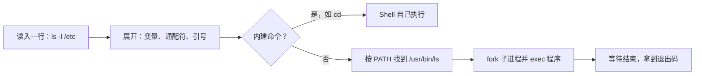

# Shell 与常用命令

你每天都在 macOS 的终端里敲 `pnpm`、`git`、`ssh`，但一登上那台 Ubuntu 服务器，很多人会突然心虚：这台机器上跑着什么？日志在哪？磁盘还剩多少？服务挂了怎么拉起来？这一章先把「Shell 到底是什么」和一套最常用的命令讲清楚，后面所有章节都在这个基础上展开。

## 关于这本书

### 讲什么

这本书讲一台 Linux 服务器上你迟早要碰到的东西：Shell 与命令、文件和权限、进程和信号、systemd 管服务、journald 看日志、apt 装软件、磁盘与挂载、写 Shell 脚本，最后是一套排障工具箱。

以 **Ubuntu / Debian 服务器**为主，示例按 Ubuntu 24.04 LTS 和 Debian 12 写，更新的版本命令基本一致。CentOS / Rocky 这类 RHEL 系发行版只在差别大的地方提一句（主要是包管理）。

### 适合谁

适合已经会写代码、但对 Linux 运维只有零散经验的开发者：会 `ssh` 上去、会 `docker compose up`，但遇到「服务起不来」「磁盘满了」「进程卡死」就只能靠搜索。不需要你懂内核。

全书会反复用到一个真实案例：hatch-counter（门店管理系统）线上那台机器。它的 `deploy/` 目录里有 docker-compose、nginx 配置、一个 systemd 服务和几份部署脚本，是一个很典型的「一人公司单机部署」形态。书里引用时做了简化，路径统一写成 `/srv/counter`。

### 怎么读

- 前三章是地基，建议按顺序读：命令、文件权限、进程
- 第 4、5 章（systemd、journald）是服务器运维的核心，务必读
- 第 6、7 章（包管理、磁盘）可以遇到问题再查
- 第 8 章讲脚本，第 9 章把前面的工具串成排障流程，适合出事时翻

最好手边开一台测试机或本地虚拟机，边读边敲。macOS 上可以用 OrbStack、UTM 或 Multipass 起一台 Ubuntu。

## Shell 是什么

**Shell 是一个读命令、执行命令的程序**。你在终端里看到的提示符 `$`，背后就是一个 Shell 进程在等你输入。

几个容易混淆的概念：

| 名词 | 是什么 | 例子 |
|---|---|---|
| 终端（terminal） | 显示字符、接收键盘输入的窗口 | iTerm2、Ghostty、macOS 终端 |
| Shell | 解释命令的程序，跑在终端里 | bash、zsh、dash |
| 命令 | Shell 去执行的东西 | 内建命令 `cd`，外部程序 `/usr/bin/ls` |

macOS 默认 Shell 是 zsh，**Ubuntu / Debian 上交互登录默认是 bash**，而 `/bin/sh` 指向的是更精简的 dash。这一点在第 8 章写脚本时很重要：脚本开头写 `#!/bin/sh` 就不能用 bash 的扩展语法。

```bash
echo $SHELL          # 当前用户的登录 Shell
readlink -f /bin/sh  # Debian / Ubuntu 上输出 /usr/bin/dash
```

### 一条命令是怎么执行的

你敲下 `ls -l /etc` 回车，Shell 做了这几件事：



两个关键点：

- **展开在执行之前**：`rm *.log` 里的 `*.log` 是 Shell 展开成文件列表再交给 `rm` 的，`rm` 自己根本不认识 `*`
- **外部命令靠 PATH 查找**：`echo $PATH` 看搜索路径，`type ls` 或 `command -v node` 看命令到底是哪个

`cd` 必须是内建命令：如果它是子进程，改的就是子进程自己的目录，退出后父 Shell 毫无变化。

## 每天都要用的命令

### 在目录里移动

```bash
pwd                 # 当前在哪
cd /srv/counter     # 绝对路径
cd ..               # 上一级
cd -                # 回到上一次所在的目录
cd                  # 回家目录，等于 cd ~
ls -lah             # 详细列表，含隐藏文件，大小用人类可读单位
```

`ls -l` 的输出第一列是权限，第三、四列是属主和属组，第 2 章细讲。

### 看文件内容

| 命令 | 用途 |
|---|---|
| `cat file` | 整个打印出来，适合短文件 |
| `less file` | 分页看长文件，`/` 搜索，`q` 退出，`G` 跳到末尾 |
| `head -n 20 file` | 看前 20 行 |
| `tail -n 50 file` | 看末尾 50 行 |
| `tail -f file` | 持续跟踪新增内容，看日志最常用 |
| `wc -l file` | 数行数 |

### 创建、复制、移动、删除

```bash
mkdir -p /srv/counter/sites/web   # -p：中间目录不存在就一起建，已存在不报错
cp -a src/ dst/                   # -a：递归并保留权限、时间、软链
mv old.conf new.conf              # 移动或改名
rm file                           # 删除文件
rm -r dir/                        # 递归删除目录
```

**Linux 没有回收站**。`rm -rf` 删掉就没了，尤其注意两种翻车：

- 变量为空：`rm -rf "$DIR/"` 在 `DIR` 为空时变成 `rm -rf /`。脚本里要写成 `rm -rf "${DIR:?}/"`，变量为空时直接报错退出（hatch-counter 的 `agent.sh` 就是这么写的）
- 多打一个空格：`rm -rf / tmp/x` 和 `rm -rf /tmp/x` 只差一个空格

### 找文件、找内容

```bash
find /var/log -name '*.log' -mtime -1     # 一天内改过的 .log
find /srv -type f -size +100M             # 大于 100M 的文件
grep -rn 'listen' /etc/nginx/             # 递归搜内容并显示行号
grep -v '^#' nginx.conf | grep -v '^$'    # 去掉注释行和空行
```

本地开发你可能更习惯 `rg`（ripgrep），服务器上不一定装了，`grep` 永远在。

## 管道与重定向

Linux 命令的设计哲学是：**每个程序只做一件事，通过文本流组合起来**。组合靠两样东西：管道和重定向。

### 三个标准流

每个进程启动时都有三个打开的「文件」：

| 编号 | 名字 | 默认指向 |
|---|---|---|
| 0 | 标准输入 stdin | 键盘 |
| 1 | 标准输出 stdout | 终端 |
| 2 | 标准错误 stderr | 终端 |

```bash
cmd > out.txt         # stdout 写入文件（覆盖）
cmd >> out.txt        # stdout 追加
cmd 2> err.txt        # stderr 写入文件
cmd > all.txt 2>&1    # stdout 和 stderr 都进文件（顺序不能反）
cmd > /dev/null 2>&1  # 全部丢掉
cmd < input.txt       # 从文件读 stdin
```

`2>&1` 的意思是「让 2 号指向 1 号现在指向的地方」，所以必须先 `> all.txt` 再 `2>&1`。

### 管道

`|` 把前一个命令的 stdout 接到后一个命令的 stdin：

```bash
# 统计 nginx 访问日志里访问最多的 10 个 IP
awk '{print $1}' /var/log/nginx/access.log | sort | uniq -c | sort -rn | head -10

# 找出占内存最多的 5 个进程
ps aux --sort=-%mem | head -6
```

这条 `sort | uniq -c | sort -rn | head` 是文本统计的万能组合，值得背下来。

### tee：既看又存

```bash
./deploy.sh 0.3.0 2>&1 | tee deploy-$(date +%F).log
```

`tee` 把输入同时写到屏幕和文件，跑部署脚本时很好用。

## 引号与变量

```bash
name=counter          # 等号两边不能有空格
echo "$name"          # 双引号：变量会展开
echo '$name'          # 单引号：原样输出 $name
echo "今天是 $(date +%F)"   # $( ) 是命令替换
```

**变量引用一律加双引号**。文件名里有空格时，不加引号的 `$file` 会被拆成两个参数，这是 Shell 脚本最常见的 bug。第 8 章还会讲。

## 让命令行更高效

### 快捷键

| 按键 | 作用 |
|---|---|
| `Tab` | 补全命令和路径，按两下列出候选 |
| `Ctrl+R` | 反向搜索历史命令，最省时间的一个 |
| `Ctrl+C` | 中断当前命令（发 SIGINT，第 3 章讲） |
| `Ctrl+D` | 输入结束；在空提示符下等于退出 |
| `Ctrl+A` / `Ctrl+E` | 跳到行首 / 行尾 |
| `Ctrl+W` | 删掉前一个词 |
| `Ctrl+L` | 清屏 |

### 历史与别名

```bash
history | grep docker   # 翻历史
!!                      # 上一条命令，常见用法：sudo !!
alias ll='ls -lah'      # 别名，写进 ~/.bashrc 永久生效
```

### 查帮助

```bash
man systemctl       # 完整手册，/ 搜索，q 退出
ls --help           # 大多数 GNU 命令都支持
tldr tar            # 需另装，给常用例子，比 man 好读
```

`man` 是离线的、和你机器上版本完全对应的文档，比搜索引擎更可靠。搜到的博客可能写的是十年前的版本。

## sudo 与 root

服务器上有一个超级用户 root，它能做任何事。日常应该用普通用户登录，需要特权时加 `sudo`：

```bash
sudo apt update
sudo -i                 # 切到 root 的交互 Shell，用完 exit
sudo -u postgres psql   # 以另一个用户身份执行
```

有了 `sudo`，每次提权都有日志可查，误操作的范围也小。很多云厂商的镜像默认直接给 root 登录，第 2 章讲用户与权限时会说怎么改。

## 远程连接：ssh

```bash
ssh user@host
ssh -p 2222 user@host                 # 非默认端口
ssh user@host 'df -h'                 # 只执行一条命令就回来
scp ./file user@host:/srv/counter/    # 传文件
rsync -avz ./dist/ user@host:/srv/x/  # 增量同步，大量文件时优于 scp
```

在本机的 `~/.ssh/config` 里给服务器起个短名，以后 `ssh counter` 就行，`scp`、`rsync` 也认这个名字：

```text
Host counter
    HostName <服务器公网 IP>
    User deploy
    IdentityFile ~/.ssh/id_ed25519
```

另一个常用技巧是**端口转发**：服务只监听服务器的 `127.0.0.1:3000`，本地想调试它，可以：

```bash
ssh -N -L 3000:127.0.0.1:3000 counter
```

之后在本机访问 `localhost:3000` 就等于访问服务器上的 3000 端口，不用把端口暴露到公网。

### 断线不怕：tmux

长时间任务（迁移数据、跑大脚本）直接在 ssh 里跑，网络一断进程就被杀。用 tmux 开一个会话，断了再连回来：

```bash
tmux new -s work      # 新建会话
# Ctrl+B 然后按 D：脱离会话，进程继续跑
tmux attach -t work   # 重新连回
```

## 本章要点

- 终端是窗口，Shell 是解释命令的程序；Ubuntu / Debian 交互默认 bash，`/bin/sh` 是 dash
- Shell 先**展开**（变量、通配符、引号）再执行；外部命令按 `PATH` 查找，`cd` 这类必须是内建命令
- 三个标准流 stdin / stdout / stderr，`>`、`2>&1`、`|` 把小命令组合成大工具
- 变量引用加双引号，`rm -rf` 配合 `${VAR:?}` 防止变量为空
- `Ctrl+R`、`Tab`、`man` 是效率三件套；ssh 配 `~/.ssh/config`、端口转发和 tmux
