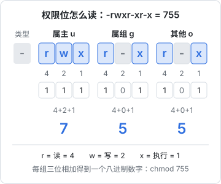
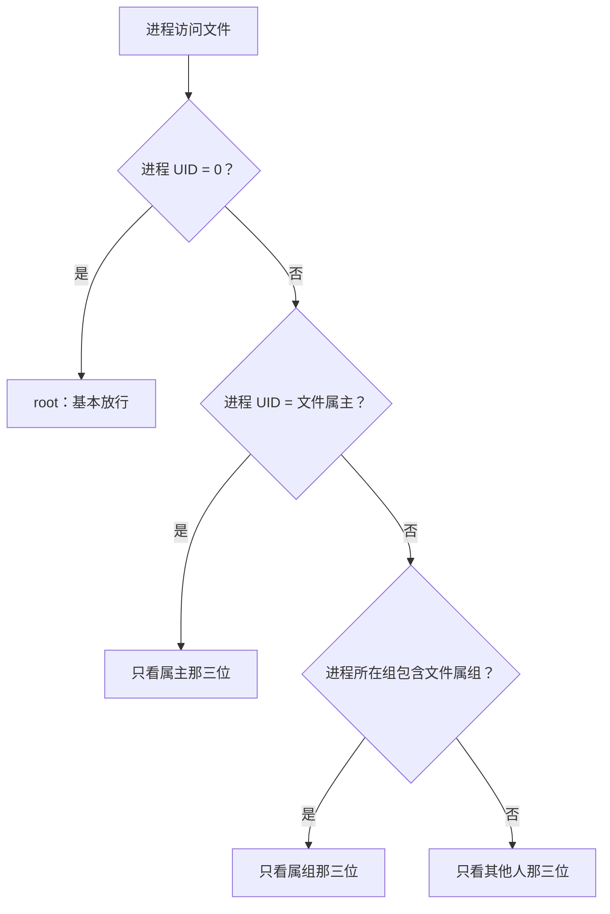

# 文件系统与权限

「Permission denied」大概是 Linux 新手见得最多的报错。要真正看懂它，得先知道两件事：Linux 的目录是怎么组织的，以及内核凭什么决定「这个进程能不能动这个文件」。这一章讲目录布局、一切皆文件、inode 与链接，然后把用户、组和权限位彻底讲清楚，最后给一台新服务器的用户初始化步骤。

## 目录树：一切从 / 开始

Linux 没有 C 盘 D 盘，所有东西都挂在一棵以 `/` 为根的树上，其他硬盘、U 盘也是「挂」到某个目录下（第 7 章讲挂载）。各目录的用途由 FHS（文件系统层次标准）约定，服务器上常打交道的是这些：

| 目录 | 放什么 | 你什么时候会去 |
|---|---|---|
| `/etc` | 系统和软件的配置文件 | 改 nginx、ssh、systemd 配置 |
| `/var` | 运行中会变化的数据 | `/var/log` 日志，`/var/lib` 数据库和 Docker 的数据 |
| `/usr` | 系统安装的程序和库 | `/usr/bin` 命令，`/usr/lib/systemd/system` 软件自带的 unit |
| `/home` | 普通用户的家目录 | 你自己的 `~` |
| `/root` | root 的家目录 | |
| `/srv` | 本机对外提供服务的数据 | 放自己的部署目录，如 `/srv/counter` |
| `/opt` | 第三方的独立软件包 | 不走 apt 装的大型软件 |
| `/tmp` | 临时文件，重启可能清空 | |
| `/proc`、`/sys` | 内核暴露的虚拟文件 | 查进程、硬件信息 |
| `/dev` | 设备文件 | 磁盘 `/dev/sda`、`/dev/null` |

把自己的应用放在 `/srv/<项目>` 是个好习惯：一眼看出哪些是你部署的、哪些是系统的，备份和迁移时也只用管这一个目录。hatch-counter 就把 compose 文件、部署脚本、各个静态站都收在 `/srv/counter` 下面。

现代 Ubuntu / Debian 做了「usr 合并」：`/bin`、`/sbin`、`/lib` 都是指向 `/usr` 下对应目录的软链，所以 `/bin/bash` 和 `/usr/bin/bash` 是同一个文件。

## 一切皆文件

Linux 的一个核心设计是：**能用文件接口表达的东西，都做成文件**。普通文件、目录、设备、管道、套接字，甚至进程信息，都能用 `open`、`read`、`write` 来操作。

```bash
cat /proc/cpuinfo | grep 'model name' | head -1   # CPU 型号
cat /proc/meminfo | head -3                       # 内存
cat /proc/loadavg                                 # 负载
ls -l /proc/self/fd                               # 当前进程打开的文件
echo hello > /dev/null                            # 写进黑洞
```

`ls -l` 第一列的第一个字符就是文件类型：

| 字符 | 类型 |
|---|---|
| `-` | 普通文件 |
| `d` | 目录 |
| `l` | 符号链接（软链） |
| `c` / `b` | 字符设备 / 块设备 |
| `s` | 套接字，如 `/run/docker.sock` |
| `p` | 命名管道 |

这个设计的好处是工具可以通用：`grep`、`cat`、`tail` 能处理一切，不需要每种资源一套专用工具。

## inode、硬链接与软链接

### 文件名不是文件本身

在 ext4 这类文件系统里，一个文件由两部分组成：

- **inode**：存元数据（大小、属主、权限、时间戳、数据块位置），每个 inode 有一个编号
- **目录项**：目录本质是一张「文件名 → inode 编号」的表

```bash
ls -i /etc/hostname        # 看 inode 编号
stat /etc/hostname         # 看完整元数据
```

这解释了几个现象：

- `mv` 同一文件系统内移动文件是瞬间完成的，只改了目录项，数据没动
- 文件名不在 inode 里，所以一个 inode 可以有多个名字
- 文件系统的 inode 数量是有限的，小文件太多会出现「磁盘有空间却写不进去」（第 7 章讲 `df -i`）

### 两种链接

```bash
ln target hardlink         # 硬链接：多一个名字指向同一个 inode
ln -s target symlink       # 软链接：一个独立的小文件，内容是目标路径
```

| | 硬链接 | 软链接 |
|---|---|---|
| 本质 | 同一个 inode 的另一个名字 | 存着路径的特殊文件 |
| 删除原文件后 | 照样能用 | 断链 |
| 能否跨文件系统 | 不能 | 能 |
| 能否指向目录 | 不能 | 能 |

日常用得最多的是软链。一个典型用法是**用软链做版本切换**。hatch-counter 每个静态站的目录长这样：

```text
/srv/counter/sites/web/
  1.1.0/
  1.2.0/
  current -> 1.2.0
```

nginx 的 `root` 指向 `current`，发新版就是把新包解压到 `1.3.0/`，再把 `current` 改指过去；回滚就是指回旧版本。切换只改一个软链，瞬间完成。

但 `ln -sfn` 其实是「先删再建」两步，中间有一瞬间 `current` 不存在。要做到原子切换，可以先建一个临时软链再用 `rename` 盖过去：

```bash
ln -sfn 1.3.0 /srv/counter/sites/web/.current.next
mv -Tf /srv/counter/sites/web/.current.next /srv/counter/sites/web/current
```

`mv` 在同一文件系统内调用的是 `rename(2)`，内核保证它是原子的，任何时刻读到的 `current` 都是一个完整的链接。`-T` 让 `mv` 把目标当成普通文件处理，而不是「移动到 current 这个目录里面」。这个 `-T` 是 GNU coreutils 的选项，macOS 的 `mv` 没有。

## 用户与组

内核不认识用户名，只认数字：**UID**（用户 ID）和 **GID**（组 ID）。用户名和数字的对应关系写在两个文本文件里：

```bash
grep deploy /etc/passwd
# deploy:x:1000:1000:,,,:/home/deploy:/bin/bash
#  用户名  UID  GID       家目录       登录 Shell

grep docker /etc/group
# docker:x:988:deploy
#  组名     GID 成员
```

密码哈希不在 `/etc/passwd` 里，在只有 root 能读的 `/etc/shadow`。

几类用户：

- **root**：UID 为 0，内核对它基本不做权限检查
- **系统用户**：UID 通常小于 1000，给服务用的，比如 `www-data`（nginx）、`postgres`，一般没有登录 Shell
- **普通用户**：UID 从 1000 开始，给人用

```bash
id                       # 我是谁，在哪些组
whoami
sudo useradd -r -s /usr/sbin/nologin myapp   # 建系统用户
sudo usermod -aG docker deploy               # 把 deploy 加进 docker 组
```

`usermod -aG` 里的 `-a` 很重要，漏掉它就变成「只属于 docker 组」，原来的组全没了。加组之后要**重新登录**才生效，因为组身份是登录时确定、由进程继承的。

## 权限位

### rwx 三组九位

`ls -l` 的第一列除了类型字符，后面九个字符是权限，分成三组：属主（user）、属组（group）、其他人（other）。每组三位：读 r、写 w、执行 x。



每组三位刚好是一个八进制数字：r=4、w=2、x=1，加起来就是这一组的值。所以 `rwxr-xr-x` 就是 `755`，`rw-r--r--` 就是 `644`。

### 对文件和目录含义不同

| 位 | 对文件 | 对目录 |
|---|---|---|
| r | 读内容 | 列出目录里的文件名（`ls`） |
| w | 改内容 | 在目录里新建、删除、改名文件 |
| x | 作为程序执行 | 进入目录（`cd`），访问里面的文件 |

两个反直觉的结论：

- **删除文件看的是目录的 w，不是文件本身的权限**。一个只读文件，只要你对它所在目录有写权限，照样能删
- **访问 `/a/b/c.txt` 要求路径上每一级目录都有 x**。nginx 报 403、但文件权限明明是 644 时，往往是某一级父目录（比如家目录 `750`）不让 `www-data` 进

### 内核怎么判断

当一个进程访问文件时，内核按顺序检查，**只用第一个匹配上的那一组**：



注意「只看」：如果你是属主，但属主位是 `---`、其他人位是 `rwx`，你照样无权访问，内核不会再去看其他人那组。

### 常用命令

```bash
chmod 644 file              # 八进制：属主读写，其他只读
chmod 755 script.sh         # 可执行脚本、目录的常见权限
chmod 600 ~/.ssh/id_ed25519 # 私钥：只有自己能读写
chmod u+x deploy.sh         # 符号形式：给属主加执行位
chmod -R a+rX dist/         # 所有人可读；大写 X 只给目录和本来就可执行的文件加 x
chown deploy:deploy file    # 改属主和属组（需要 sudo）
chown -R www-data: /srv/x   # 冒号后留空表示用该用户的默认组
```

常见权限组合：

| 权限 | 用途 |
|---|---|
| `600` | 私钥、`.env` 这类含密码的文件 |
| `644` | 普通配置、网页静态文件 |
| `700` | 私有目录，如 `~/.ssh` |
| `755` | 目录、可执行程序 |

ssh 对权限很挑剔：`~/.ssh` 不是 700、私钥不是 600，它会直接拒绝使用，报 `UNPROTECTED PRIVATE KEY FILE`。

### umask：新文件的默认权限

新建的文件为什么默认是 644？因为进程有一个 **umask**，表示「要去掉哪些位」。默认 umask 通常是 `022`：文件基准 666 去掉 022 得到 644，目录基准 777 去掉 022 得到 755。

```bash
umask          # 查看，通常 0022
umask 077      # 本 Shell 之后新建的文件只有自己能访问
```

生成密钥、写 `.env` 的脚本里先 `umask 077`，就不会有「文件刚创建、还没来得及 chmod 就被别人读到」的窗口。

## 特殊权限位

除了九位基本权限，还有三个特殊位，知道它们的存在即可：

| 位 | 显示 | 作用 | 例子 |
|---|---|---|---|
| setuid | 属主的 x 位变成 `s` | 执行时以文件属主身份运行 | `/usr/bin/passwd` 要改 `/etc/shadow` |
| setgid | 属组的 x 位变成 `s` | 对目录：里面新建的文件继承目录的组 | 多人共享的项目目录 |
| sticky | 其他人的 x 位变成 `t` | 目录里的文件只有属主能删 | `/tmp`（权限 `1777`） |

setuid 程序是攻击者最爱找的提权入口，自己不要随便给文件加 `s` 位。

## 一个真实的坑：解压时的属主

hatch-counter 的上线代理以 root 身份解压 CI 打的前端包。tar 有个默认行为：**root 解包时会照搬包里记录的 UID**。CI 机器上打包用户的 UID 是 1001，解出来的文件属主就是 1001。服务器上暂时没有这个 UID 的用户，看起来没事；但哪天新建一个普通用户，很可能正好分到 1001，它就成了线上网页文件的主人，能随意改。

所以脚本里解包要加 `--no-same-owner`，让解出来的文件一律归当前用户：

```bash
tar -xzf web-1.3.0.tar.gz -C /tmp/x --no-same-owner
chmod -R a+rX /tmp/x
```

教训是：**内核只认数字**。文件跨机器传输时，UID 的含义不会跟着走。

## 新服务器的用户初始化

云服务器开出来通常只有 root。建部署用户、放公钥、关密码登录的完整步骤见[《部署与 CI/CD》拿到机器之后的头半小时](../deploy-release/01-vps-setup.md#拿到机器之后的头半小时)，更进一步的收紧见[《一人运维手册》SSH：从「能用」到「收紧」](../production-ops/01-hardening.md#ssh从能用到收紧)。这里只看其中和本章有关的两点。

一是权限：复制到新用户家目录的 `.ssh` 要 `chown -R deploy:deploy`，目录 700、`authorized_keys` 600。属主不对，或者目录、文件对别人可写，sshd 会拒绝这把公钥，表现就是「公钥明明放进去了还要密码」。

二是配置文件的位置。关密码登录不要直接改 `/etc/ssh/sshd_config`，而是在 `/etc/ssh/sshd_config.d/` 下新建一个文件，比如 `10-hardening.conf`。文件名以 `10-` 开头是有讲究的：sshd 对同一个选项**取第一次出现的值**，`sshd_config.d/` 里的文件按文件名排序读入。有些云镜像会放一个 `50-cloud-init.conf` 打开密码登录，你的文件排在它前面才能生效。改完可以用 `sudo sshd -T | grep -i passwordauth` 看最终生效的值。

`sshd -t` 先检查配置语法，有错就不 reload。改 ssh 配置时**保留一个已登录的会话别关**，万一改错了还能救回来。

## 本章要点

- 所有东西挂在 `/` 下：配置在 `/etc`，变化的数据在 `/var`，自己的服务放 `/srv/<项目>`
- 一切皆文件：设备、进程信息都能用读写文件的方式操作
- 文件名只是目录项，真正的文件是 inode；软链适合做版本切换，`rename` 保证切换原子
- 内核只认 UID / GID，按「属主 → 属组 → 其他人」只取第一个匹配组的权限
- 目录的 x 控制能否进入，w 控制能否增删文件；路径上每一级都要有 x
- 密钥 600、目录 755、静态文件 644；新服务器先建普通用户，再关掉 root 和密码登录

## 动手练习

root 会跳过大部分权限检查，下面的题要用普通用户做。在一次性容器里准备环境：`docker run --rm -it ubuntu:24.04 bash`，然后 `useradd -m alice`，需要以 alice 身份执行时用 `su alice -c '命令'`。

1. **删除看目录**：以 alice 身份在 `/home/alice` 下执行 `mkdir d && touch d/f && chmod 444 d/f && chmod 555 d && rm -f d/f`；再 `chmod 755 d` 后重复 `rm -f d/f`。

   验证：第一次报 `Permission denied`，第二次成功，`ls d` 为空。

   参考答案：删除是修改目录项，只看目录的 w；文件本身是 444 并不妨碍删除。

2. **路径上每一级都要 x**：以 root 执行 `mkdir -p /srv/a/b && echo hi > /srv/a/b/c.txt && chmod 644 /srv/a/b/c.txt && chmod 700 /srv/a`，然后 `su alice -c 'cat /srv/a/b/c.txt'`；再 `chmod 711 /srv/a`，重试。

   验证：第一次 `Permission denied`；改成 711 后打印 `hi`，但 `su alice -c 'ls /srv/a'` 仍然被拒绝。

   参考答案：进入目录只要 x，列目录才要 r。这正是 nginx「文件 644 却 403」的常见原因：某一级父目录没给其他人 x。

3. **只看第一个匹配的组**：以 alice 身份执行 `echo secret > f && chmod 007 f && cat f`。

   验证：报 `Permission denied`，尽管 `ls -l f` 显示其他人有 `rwx`。

   参考答案：alice 是属主，内核只看属主那三位（`---`），不会再退到其他人那组。`chmod 600 f` 后就能读。
